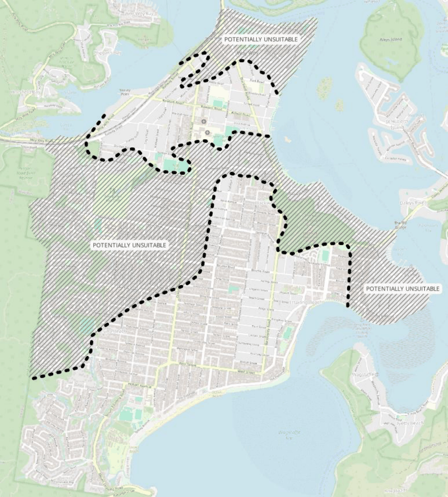

### 16.5 Compliance

#### 16.5.1 Compliance Inspections and Documentation

Compliance with this section of the Specification will be confirmed upon site observation by Council’s Representative.

All traffic signs, pavement markings, permanent traffic control devices and safety barriers installed and/or removed as part of the works shall be shown on the work-as-executed drawings.

Safety barrier installations shall be confirmed in writing by the installation contractor, certifying that their installation conforms to the approved drawings and manufacturer’s specifications and requirements.

#### 16.5.2 Non-complying Work

Where traffic signs, pavement markings, permanent traffic control devices and safety barriers are observed by Council’s Representative to not comply with this or any section of this Specification, the Service Provider shall be instructed verbally or in writing of the non-compliance. The non-complying item(s) shall be required to be rectified prior to the final inspection.

Appendix A -  Work-as-Executed Data and Drawings and

### Compliance Documentation Requirements

Work-as-executed (WAE) data, drawings and related compliance documentation shall be provided to Council’s Representative for approval prior to handover of works.

For development-related works, Compliance Certificate(s) and Subdivision Certificate(s) for any works shall not be issued without Council’s review and acceptance of the WAE drawings and related compliance documentation, showing all information as required by this Specification and the applicable Development Consent.

#### A.1 Information Required on Work-as-Executed Drawings

Work-as-executed (WAE) data and drawings shall demonstrate that works have been constructed as shown on the approved drawings and in accordance with this Specification, to the approved line, level and specification tolerances.

WAE drawings shall be prepared and certified by a Registered Land Surveyor in the State of New South Wales or a suitably qualified Engineer.

WAE drawings shall have the following notation on each drawing set in red and is to be signed by the certifying Surveyor and/or Engineer:

I certify that:

1\. This work-as-executed drawing, outlines in red what has been constructed in the field and includes all variations from the original design drawings.

2\. All public drainage works constructed within private property, are located centrally within existing or new easements to drain water.

3\. All construction of public assets within private land has appropriate easements, right-of-way, or like restriction over the whole of the structure. Date: Printed Name: Signature:

WAE drawings shall be prepared using the approved Design and Construction Drawings as a base to identify compliance with the approved drawings and to highlight approved changes that may have been required during construction.

All WAE information shall be provided in red and shall consist of either:

• A red tick on approved drawings next to level, note or label where the WAE information is the same as that on the approved drawing.

• New levels, notes or label information in red where WAE information is different from the approved drawings and the original approved information struck through in red.

• New plan and section detail lines and symbols shown in red and original approved plan and section detail lines and symbols crossed out with a series of small crosses in the case of lines or a single cross in the case of a symbol.

• All assets that have been removed, or made redundant, must be labelled accordingly with a red note.

Additional details required to be shown on all WAE drawings include:

• Design drawing title block updated to reflect status as work-as-executed drawings.

• All levels shall be in metres AHD.

• All co-ordinates shall be referenced to MGA.

• Finished levels and horizontal alignment of concrete kerb and gutter, vehicle access crossings and other concrete works.

• All traffic signs, pavement markings, permanent traffic control devices and safety barriers installed or removed as part of the works.

WAE drawings shall be submitted in an electronic and hard copy format to Council’s Representative for approval. The electronic file format shall be high resolution Portable Document Format (.pdf) or other Council-approved format, such as AutoCAD (.dwg), with all pages of the drawings contained in a single file.

WAE Quality and Compliance documentation shall also be provided in conjunction with the WAE drawings.

#### A.2 Roadworks and Pavement As-Constructed Compliance Details

#### A.2.1 Work-as-Executed Drawings

For development-related works, the Service Provider in collaboration with the Consulting Geotechnical Engineer shall prepare work-as-executed (WAE) documentation, including as-constructed Pavement Testing Report, incorporating the approved Construction Drawings showing (but not limited to) the following:

• Extent of as-constructed pavement.

• Average pavement layer thickness (i.e. as averaged from surveyed conformance levels during construction - refer below).

• Location and test identification number of test results from all relative compaction testing carried out for the works (i.e. as separated by each pavement layer tested during construction).

Finished surface levels of road pavements and elsewhere in the road reserve or proposed road reserve:

• Surveyed as-constructed pavement layer levels shall be presented in tabular format, which references the chainage and provides enough levels to define the surface of each layer. The table shall also provide the average pavement layer thickness for each road based on the difference between each adjoining pavement

layer’s conformance levels. The as-constructed levels referred in the table shall be taken at the top of the following pavement layers: o Subgrade layer. o Subgrade replacement layer. o Select material layer. o Sub-base layer. o Base course layer. o Asphalt wearing course layer.

A plan view from the approved drawings shall be used to mark the final pavement layer thickness, as averaged from the surveyed pavement layers conformance levels (i.e. summarising each road’s final averaged pavement layer thicknesses), including the following:

• Subgrade replacement layer.

• Select material layer.

• Sub-base layer.

• Base course layer.

• Asphalt wearing course layer.

• Any other pavement layer that may have been incorporated into the works.

#### A.3 Stormwater Drainage Details

#### A.3.1 Work-as-Executed Drawings

Work-as-executed (WAE) data and drawings, in addition to those listed in A.1 above, shall include (but is not limited to) the following:

• Finished surface, grate or lid levels to AHD at all pits and other structures.

• Finished surface levels between pits and other structures.

• Location of finished surface levels taken labelled (e.g. top of kerb, centre of headwall, centre of grate, centre of concrete lid).

• Finished invert levels for pits, other structures, pipes, channels and box culverts.

• Changes to the horizontal position of any pits, other structures, pipes, channels and box culverts.

• Confirmation of the installed pipe diameter.

• Pipe material and class of pipe.

• Confirmation of the dimensions of installed box culverts.

• Pipe or box culvert grades.

• Locations of subsurface drainage cleanouts and outlets.

• Details of overland flow path including horizontal alignment and levels to AHD.

• Finished invert levels, top of bank levels, base width, top width, base/wall material for open channels.

• Manufacturer/model number of any proprietary drainage structure.

• Dimensions, structural components and certification for stormwater drainage basin(s), wetland(s), bio-retention/detention, rainwater tank(s) and sediment basin(s). Minimum volume requirements are compliant with the approved plans and/or Water Cycle Management Report(s).

The Service Provider shall submit details regarding ongoing maintenance requirements such as operations and maintenance manual(s) for gross pollutant traps (GPTs) and/or water quality basin structures.

Stormwater pipeline trench backfill compaction compliance documentation and CCTV pipe inspection video file(s) and report(s) shall be submitted in accordance with the requirements under Section 6.8 Trench Backfilling Compliance Testing Specification and Section 6.6.5 Compliance Inspections and Documentation of this Specification, respectively.

#### A.3.2 Asset Attribute Spreadsheet

Council’s Drainage Assets Team will provide the Asset Attribute Spreadsheet Template which is to be populated by the Service Provider with the relevant asset attribute data. The requirements for each drainage asset category are listed below, and this information is required on each individual drainage asset constructed or modified. The data shall include (but is not limited to) the following:

#### Pits

| Pit asset ID number | Grate/Lid RL (m AHD) |
|---|---|
| X co-ordinate (Easting) | Pit depth (m) |
| Y co-ordinate (Northing) | Pit width (m) |
| Installation date | Lintel length (m) |
| Pit type | Pit inflow type |
| Pit material |  |
| Lid width (mm) |  |
| Lid length (mm) |  |

#### Pipes

| Asset ID number | Length (m) |
|---|---|
| From (upstream) pit number | Diameter (m) |
| To (downstream) pit number | Grade (%) |
| Upstream invert level (m AHD) | Class |
| Downstream invert level (m AHD) | Construction type |
| Installation date | Joint type |
| Type |  |
| Material |  |

#### Headwalls

| Asset ID number | Installation date |
|---|---|
| Type | Connected conduit size |

| Material | Number of connected conduits |
|---|---|
| Width (m) | Apron (Y/N) |
| Depth (m) | Energy dissipator (Y/N) |
| X co-ordinate (Easting) |  |
| Y co-ordinate (Northing) |  |

#### Box Culverts

| Asset ID number | Width (mm) |
|---|---|
| From (upstream) pit number | Length (m) |
| To (downstream) pit number | Material |
| Upstream invert level | Grade |
| Downstream invert level | Type |
| Installation date |  |
| Height (mm) |  |

#### Stormwater Quality Improvement Devices (SQUIDs)

| Asset ID number | Capacity (m3) |
|---|---|
| X co-ordinate (Easting) | Lid RL (m AHD) |
| Y co-ordinate (Northing) | Depth (m) |
| Installation date | Width (m) |
| Type |  |
| Model number |  |
| Manufacturer |  |

The Asset Attribute Spreadsheet Template is also available for downloading from Council’s website.

#### A.4 Earth-Retaining Structures and Embankments

Work-as-executed (WAE) drawings shall include as-constructed locations and details of all earth-retaining structures and embankments where shown on the approved drawings. WAE drawings shall confirm details as shown on the approved drawings, including (but not limited to) the following:

• Component type.

• Component size.

• Buried components (backfill material extent and type, foundation including piers of piles, etc).

• Location of subsurface drainage lines, flushing points and the connection of subsurface pipes to the drainage system.

• MGA co-ordinates at each end of each structure.

• Plan showing: o Horizontal alignment at toe of structure(s). o Horizontal alignment at top of structure(s). o Horizontal alignment and extent of buried components; rock bolts, tie backs, soil reinforcement, etc.

• Longitudinal section(s) of the top and base levels of earth-retaining structures.

• Typical cross section showing: o Footings size/extent. o Chainages at each end of each site. o Zone of influence for loading at back of retaining structure. o Zone of influence for excavation at toe of structure. o Zone of influence clearance to any nearby underground services.

An as-constructed Certification by a suitably qualified Structural or Civil Engineer and Geotechnical Engineer shall be provided and include (but not limited to) the following:

• Photo mosaics and/or all site photos taken during site inspections of all structural elements, including drainage components associated with the earth-retaining structures and embankments.

• List of dates of all site inspections where carried out by the certifying Structural or Civil Engineer and Geotechnical Engineer.

• List of all referenced Australian Standards, National Codes of Practice, guidelines and specifications, the as-constructed structural elements are certified to, following the elements’ construction.

• Full details of the certifying professional(s), including the following: o Printed full name and signature. o Contact details. o National Engineering Register accreditation/registration number. o Building Professionals Board Category of accreditation and registration number.

• Copy of the certifying Structural or Civil Engineer and Geotechnical Engineers’ professional indemnity insurance and certificate of currency.

• Photo mosaic(s) are required when stabilisation works involve multiple types of work, including rock removal, geotechnical and structural specifications.

• Engineering report on any stabilisation works during construction, including rock removal, temporary support or any additional geotechnical and/or structural specifications applied during the structure’s construction.

• Engineering report on any Quality Assurance documentation requested by the approved drawings, such as, Geotechnical and/or Structural aspects confirming that the specifications or an acceptable equivalent have been met.

Any retaining structure with covered, buried or otherwise hidden components shall require a photo mosaic(s) of components before covering, e.g. rock bolts and reinforcing mesh pre-shotcrete, in addition to the above requirements, as part of the WAE documentation.

#### A.5 Water Supply Infrastructure

• Reticulation mains - all installation details as shown on the Design Drawings.

• Trunk mains - all installation details as shown on the Design Drawings.

#### A.6 Sewerage Infrastructure

• Gravity sewer - all installation details as shown on the detailed Design Drawings.

• Sewer rising mains - all installation details as shown on the detailed Design Drawings.

• Pump stations - all installation details as shown on the detailed Design Drawings.

### Appendix B -  CCTV Survey Inspections Technical Specification - Drainage Assets

#### B.1 General Requirements

This part of the Construction Specification defines how Closed-Circuit Television (CCTV) survey inspections of Central Coast Council’s drainage assets are to be carried out. CCTV inspections are used to assess current performance and condition of the asset (including any damage that may have occurred during development construction), and to assess the workmanship of any new drainage infrastructure that has been constructed to be handed over to Council’s care and control.

The CCTV data is to include the recorded video footage, condition and defect information and the associated pdf report.

#### B.1.1 Working hours

All services shall be carried out in daylight hours between 7.00am and 5.00pm Monday to Friday. No works are to occur outside of these hours unless prior approval is obtained in writing from Council.

#### B.1.2 Insurance

The contractor shall provide copies proving the currency of Public Liability Insurance for $20 million and full Workers Compensation insurance prior to commencement of any services. Insurances must be kept current for the duration of the service.

#### B.1.3 Work Health and Safety (WHS)

All activities carried out are to comply with Council’s WHS policies and procedures. The contractor is to provide all necessary WHS documentation including SWMS to Council for review and approval prior to undertaking any activity.

The contractor must be inducted to site by a Council Representative prior to the commencement of works and shall provide a copy of all completed safety documentation including pre-start checks and site-specific risk assessments to Council.

#### B.2 CCTV Inspection

#### B.2.1 Personnel

The Contractor shall ensure that all personnel responsible for operating CCTV cameras, identifying and recording defects and preparing CCTV survey reports are trained and accredited in defect identification including picture interpretation, defect coding and classification as outlined in Part 2 of WSA Code 05 – Conduit Inspection Reporting, or similar certified training.

Personnel should also hold a current White Card – Construction induction certification.

Confined space entry should be avoided wherever practical. If there is no feasible way to complete a survey without entering a confined space, Council’s Representative must be notified and provided with all relevant documentation for review in accordance with Section 4.3 of the NSW Work Health and Safety Regulation 2025. Confined space entry works shall not proceed until Council’s representative has granted permission in writing.

Any personnel undertaking confined space entry works must hold full confined space entry certification in accordance with Section 4.3 of the NSW Work Health and Safety Regulation 2025. Any personnel implementing Traffic Guidance Schemes must be accredited with the Implement Traffic Guidance Scheme certification. Any personnel who have prepared or will modify any Traffic Guidance Scheme must be accredited with the Prepare Work Zone Traffic Management Plans certification.

Personnel must be competent in the use of service locating equipment associated with the CCTV camera including sonde use.

A minimum of two personnel is required for all CCTV inspections.

#### B.2.2 Planning the Inspection and Council’s Assistance

Council will provide the CCTV operator with the following information where available:

• Plans/maps containing the asset location, asset type, asset id numbers and street names. Aerial photography can also be included. This information will be provided through the OneDrive portal.

• An Asset Attribute Data spreadsheet for recording pit, headwall, pipe and culvert condition data.

The contractor is to make all reasonable attempts with two personnel to lift access pits safely to carry out the survey. If there are lids that require mechanical assistance to open; Council staff are to be notified to discuss these requirements. Options may include the utilisation of Council’s maintenance staff and plant or external contractor assistance.

#### B.2.3 CCTV Inspection Equipment

The Contractor's CCTV equipment shall include (but is not limited to) the following:

• Appropriate closed-circuit camera(s) that are tractor mounted with varying sizes of tractors to cater for a large range of conduit sizes.

• Service locating functionality that can be attached to the camera/tractor and associated sonde to allow locating of buried pits, junctions and changes of direction.

• Sufficient traffic control equipment to fully implement any required Traffic Guidance Schemes.

• The CCTV camera shall include pan and tilt capabilities to allow right angle and 360-degree rotational inspections, as well as zoom functionality.

• The camera and illumination system shall provide a clear, accurate and in focus record of the internal condition of the conduit in colour.

• The camera/cable shall provide an accurate running chainage relative to the entry pit/manhole. The camera cable shall be retracted to remove slack and to ensure an accurate chainage reading.

• All equipment must be fully charged and in good working order.

#### B.2.4 Camera Operation

Direction of CCTV inspection - CCTV surveys shall be completed from maintenance pit to maintenance pit (or headwall) preferably following a downstream direction, however when not feasible, upstream direction shall be acceptable.

A new survey is required for each pipe or culvert reach (from pit to pit).

Prior to commencing the formal survey, a dummy run should first be conducted to confirm network layout and identify any changes such as bends or previously unidentified buried pits.

The CCTV inspection is to commence with a recorded inspection of the entry pit walls and floor, so this information can be utilised to determine a condition rating for the pit. Pit condition and defect information is to be recorded in the Asset Attribute Data spreadsheet (to be provided by Council).

A running chainage is to be embedded in the footage and is to commence from the pipe or culvert connection to the pit and is to be continuously updated and displayed throughout the CCTV inspection.

Pipe defects are to be recorded as outlined in the following section Observation of Pipe Defects (Structural).

Camera position - the camera is to be located centrally within the pipe or culvert wherever possible to prevent the risk of image distortion and lack of illumination.

Camera speed - the camera shall progress through the pipe/culvert at a speed that will allow the viewer to clearly inspect defects, features and general condition.

Data to be displayed on the CCTV footage at the commencement of each pipe/culvert reach survey should be as follows:

• Name of operator.

• Name of company.

• Town or suburb.

• Location/street.

• Pipe or culvert ID number.

• Upstream pit or headwall ID number.

• Downstream pit or headwall ID number.

• Pipe diameter/culvert width and height.

• Material.

• Direction of camera.

During the CCTV inspection, the footage shall always include the following information:

• Street location.

• Start pit/MH ID number and end pit/MH ID number.

• Pipe or culvert ID number.

• Conduit size.

• Direction of inspection.

• Running chainage.

• Date of inspection.

• Longitudinal grade.

#### B.2.5 Encoding of Observations

Each observation of a feature within a conduit shall be described by one or more main observation codes, accompanied, as appropriate by several data fields of supporting information. The scores for all defects shall be allocated to the service and structural defects and will be applied to the pipe or culvert reach.

The WinCan database file is to include:

• All the location details.

• Characteristics of the reportable features.

• All defects identified during the inspection.

• References to all digital video recordings, photographs and reports.

The contractor shall produce a condition assessment report generated in WinCan based on the information collated in the inspection survey. The grading of structural condition and service shall be based on WSAA’s WSA code 05 - Conduit Inspection Reporting.

Operators must assign an overall condition score (1 to 5) for each asset in accordance with IPWEA Practice Note 5, which is to be recorded in the Asset Attribute Data spreadsheet.

#### B.2.6 Observation of Pipe Defects (Structural)

Pipe/culvert joints: 360-degree panning is required at every pipe or culvert joint. Panning must be conducted at a speed that allows the viewer to adequately assess the joint for defects.

Lifting holes: inspection is required at all lifting holes.

Intruding connections: identifying all connections and coding their structural status is mandatory. The CCTV survey is to give a clear view of each internal junction by looking along the axis of the lateral connection.

All structural defects are to be recorded and coded in accordance with WSAA’s WSA Code 05 - Conduit Inspection Reporting.

All utility service intrusions and buried pits are to be recorded, coded and the locations marked on the ground surface by spray paint. Locations of these issues are to be clearly marked up on the plans or maps provided.

The Contractor is to notify Council’s Representative immediately if any defective pipes or culverts are identified that score a condition or service rating of 5 and are in danger of imminent collapse or require urgent attention.

#### B.2.7 Observation of Pipe Blockages (Serviceability)

Intruding connections: identifying all connections and coding the serviceability status is mandatory. The CCTV survey is to give a clear view of each internal junction by looking along the axis of the lateral axis.

Debris or foreign material and tree root intrusion is to be identified and coded in the reports.

The contractor shall notify Council’s Representative immediately if there are any significant/critical blockages identified, such as, blockage > 60%.

Where surveys cannot be completed due to blockages, displacements or drop pits, Council’s Representative shall be notified and the issues recorded in the footage and on the report.

#### B.2.8 Deliverables B.2.8.1 CCTV Inspection Survey Video Footage

The Contractor shall provide:

• A separate mpeg or MP4 file for each pipe or culvert reach.

• The electronic file name for the video file must use the following naming convention: “Conduit ID number”_”From node ID number”_”To node ID number”_”Date (DDMMYYYY)”. Example: a survey of Pipe “DPI-12345” from Pit “DPIT-23456” to Headwall “DHW- 34567” on “9 February 2026” would be labelled as follows: DPI-12345_DPIT-23456_DHW-34567_09022026.mpeg

#### B.2.8.2 Inspection Reports

Inspection reports shall be provided in electronic pdf format. The inspection reports shall include:

• The location details, characteristics of the reportable features and defects identified during the inspection. The inspection reports shall include all mandatory detail and specifications included in the above sections.

• The electronic file name for the PDF report file must use the following naming convention: “Conduit ID number”_”Street Name”_”Date (DDMMYYYY)”.pdf Example: a survey of Culvert “DCUL-12345” at “King Street” on “7 July 2026” would be labelled as follows: DCUL-12345_King Street_07072026

• Condition assessment gradings based on the information provided in the inspection report. The grading of structural and service internal condition shall be based on WSAA’s WSA Code 05 - Conduit Inspection Reporting.

• A minimum of two photographs shall be taken to illustrate each reportable feature/defect during conduit inspections in accordance with WSAA’s WSA Code 05 - Conduit Inspection Reporting. One photograph with a perspective view and one with a close-up view as a minimum, and one photograph when inspection survey is abandoned. In particular: o Digital images shall provide a clear and concise picture quality of the reportable features and defects, using adequate lighting, iris and focus to capture images. o Images should be adequately referenced to each section report and linked to the WinCan VX version database.

#### B.2.8.3 Asset Attribute Data

Council will provide an Asset Attribute Data spreadsheet that is to be used to populate asset and condition data. This data is to be entered into the spreadsheet for each asset surveyed. Pit and headwall condition ratings are also to be included when observed at the start and completion of each surveyed pipe or culvert reach. These condition ratings must be assigned in accordance with the IPWEA Practice Note 5 rating scale.

#### B.2.8.4 Asset Updates from CCTV Surveys - Marked Up Plans

• Drainage maps provided to the contractor will include the relevant asset ID numbers. Where new assets are found during a survey, Council shall provide a list of new asset ID numbers that can be assigned - please contact the Drainage Assets team via ask@centralcoast.nsw.gov.au.

• Work-as-Executed CCTV maps must include annotations for: o Endpoint of an abandoned survey. o Blockages > 60%. o Locations with observed subsidence on the ground surface. o Unknown utility penetrations. o Buried pits.

o Significant defects which would be considered a high risk.

• Any discrepancies in relation to Council’s current asset records, including assets not recorded, are to be marked up on the maps provided with the appropriate level of information to support updating of the asset register.

#### B.2.8.5 Site Photographs and Surface Marking

All major defects and buried pits must be located on the surface using a sonde, marked with spray paint and photographed. Items to be located, marked and photographed include:

• Endpoint of an abandoned survey.

• Blockages > 60%.

• Locations with observed subsidence on the ground surface.

• Unknown utility penetrations.

• Buried pits.

• Significant defects which would be considered a high risk.

Photographs should be taken from at least 3 angles, with sufficient detail to allow the location to be identified - features such as nearby buildings, fences, or road markings assist in finding the location again at a later date.

Photographs must also be named with a descriptive title, using Asset ID numbers where relevant.

#### B.2.8.6 Data Transfer Management

All data including maps, video files, PDF reports, the Asset Attribute Data spreadsheet and site photos are to be transferred/shared through OneDrive. OneDrive can be accessed using any smart phone, tablet or computer. Council will provide a link to several shared folders as follows:

• CCTV Maps: this is where Council will upload the relevant maps which outline the assets to be surveyed with the relevant asset IDs shown.

• CCTV Maps - WAE marked up: this is where the contractor is to save all marked up maps indicating any significant issues, discrepancies or new assets.

• CCTV Video Files: all CCTV video files are to be saved into this folder with the appropriate file names and file type as outlined above.

• CCTV Reports and Asset Condition Template: all CCTV reports are to be saved into this folder with the appropriate file name. The Asset Attribute Data spreadsheet is to be updated as outlined above.

• CCTV Site Photos: all site photographs, including surface markups, are to be saved into this folder.

All CCTV surveyed data is to be uploaded into OneDrive on the day of the survey.

Appendix C -  Structural Lining of Stormwater Pipelines, End Sealing and Sealing of Junctions Technical Specification

#### C.1 General Requirements

This Specification has been compiled to outline Council's requirements for structural lining of stormwater pipelines (non-pressure), end sealing and sealing of junctions within the Central Coast Local Government Area.

The inclusion of specifications, standard details, or construction methodologies within this Structural Lining of Stormwater Pipelines, End Sealing and Sealing of Junctions Technical Specification does not constitute approval by Council for the application of those works to defective or existing drainage assets.

Any proposed treatment, rehabilitation, or renewal works intended to address defective drainage assets must be subject to explicit assessment and written approval by Council prior to construction, where the asset is to be handed over to, or accepted into, Council’s care and control.

The selection of an appropriate treatment must be based on site-specific conditions, asset condition, hydraulic performance, structural requirements, service life objectives, and whole-of-life considerations.

The presence of a relining specification within this document shall not be interpreted as permission to reline by default, nor as Council endorsement of relining as a universally acceptable solution.

This Specification is applicable to all structural lining systems, including cured-in-place-pipelines (CIPP), spiral-wound and fold-in-form liners. This Specification is not applicable to linings which act solely as a protective coating, or which are installed using spray techniques.

Structural lining is widely accepted as a practical alternative to replacement of pipelines ranging in diameter from 100mm to 1600mm and may be considered where there are concerns over integrity, leaking, root invasion and/or where site conditions would make full replacement difficult, disruptive and expensive.

An initial investigation should be undertaken to determine the suitability of structural lining for specific assets.

Project specific requirements shall be provided by Council’s Representative where applicable. Where specifications that are contrary to all or part of this Specification are contained in a Tender/Contract document then those specifications shall be applied.

If this Specification does not cover a requirement for an activity, then the provisions of the current AS/NZS 2566.1 - Buried flexible pipelines, Part 1: Structural design shall apply unless otherwise instructed by Council’s Representative.

When a specification for an item is not defined by this Specification or applicable Standards then Council’s Representative shall determine the appropriate specification to be applied.

This Specification is not for the purposes of providing an interpretation of what the Service Provider is required to comply with regarding various Acts and Regulations. It is expected that the Service Provider is familiar with their obligations to comply with various Acts and Regulations.

#### C.2 Investigation and Design

#### C.2.1 Initial Investigation

A thorough investigation of the site should be undertaken including (but not limited to) the following:

• Desktop study and site inspection to determine pipe size, age, material, inlet and outlet locations, asset conditions, site constraints and access points.

• Asset cleaning and CCTV inspection to determine defect types and chainages, overall condition, buried pits, junctions and changes in vertical or horizontal alignment.

Once investigation is complete, the optimal intervention treatment can be determined which may include the selection of an appropriate structural liner.

#### C.2.2 Selection of Structural Lining Product

The recommendation of a particular structural liner is to be supported by documentation outlining the assessment of remediation options and justification as to why the particular liner was preferred. Council’s Drainage Assets Section will need to support the proposed treatment. The product must be proven and comply with applicable Australian/New Zealand Standards. The manufacturer of the product should have in place a quality system that conforms to or is equivalent to AS/NZS ISO 9001 - Quality management systems - Requirements, for certification covering design, manufacturing, installation and service.

The Structural Liner shall be constructed of materials which will not be subject to excessive shrinkage, thermal contraction, recovery or reversion affecting the shape or dimensions of the liner following installation. It shall be sufficiently robust not to be damaged by common cleaning equipment. The minimum expected service life is 50 years. For Cured in Place Liners, the minimum thickness shall be 5mm.

Independent test results should be made available which confirm long-term material properties (particularly modulus of elasticity). Long-term material property tests shall be taken from a minimum 2 years post-installation.

#### C.2.2.1 Products for Stormwater Rehabilitation

Council reserves the right to accept or reject proposed products. Council is open to existing proven products on the market and innovative new products providing they meet the requirements of this Specification and comply with applicable Australian/New Zealand standards.

#### C.2.2.2 Chemical Resistance

The product is to be such that all materials used are to be chemically resistant to withstand exposure to chemicals typically found in stormwater pipes, external exposure to soil bacteria and any chemical attack which may be due to residues remaining on the conduit wall or materials in the surrounding ground.

Test results should be made available which confirm long-term chemical resistance properties in accordance with Australian/New Zealand Standard Test Methods.

#### Table B.2.1 Minimum Chemical Resistance Requirements for Structural Liners

| Chemical Solution | Concentration % |
|---|---|
| Tap water (pH 6-9) | 100 |
| Nitric acid | 5 |
| Phosphoric acid | 10 |
| Sulfuric acid | 10 |
| Gasoline | 100 |
| Vegetable oil | 100 |
| Detergent | 0.1 |
| Soap | 0.1 |

#### C.2.2.3 Abrasion Resistance

The product is to have abrasion resistance to the migration of silt, sand and debris along the pipe. It is to be sufficiently robust not to be damaged by common cleaning equipment. Test results should be made available which confirm long-term abrasion resistance properties.

#### C.2.3 Responsibilities and Accreditations

The design and installation of the Structural Liner, End Sealing and Sealing of Junctions generally include the following responsibilities.

#### C.2.3.1 Works Generally Undertaken by Council

• Initial investigation.

• Survey (if required).

• Hydrological study - in cases where it is suspected that the existing pipe may be under capacity (allow for thickness of liner).

• Civil/Structural design of the following (if required but also may be delivered by the Service Provider): o New inlet pits and outlets structures.

o Construction and maintenance access. o Culvert extensions including connection details.

Council may specifically request all or part of the above works be undertaken by the Service Provider in addition to the below requirements.

#### C.2.3.2 Works Generally Undertaken by the Service Provider

The Service Provider shall supply full details of design calculations with the tender including (but not limited to) the following:

• Design of the structural liner and liner thickness.

• Third-party verification of the civil/structural design in terms of access etc. for installation of structural liner.

• Selection of the lining method (to be supported by Council).

• Planning of bypass/flow management.

• Dewatering.

• Planning of traffic control.

• Cleaning and preparation including pipe intrusion grinding, patching and sealing.

• Installation and curing of the liner including end sealing, recommissioning of private connections and sealing of junctions.

• Trimming and testing of the liner.

#### C.2.3.3 Service Provider Accreditation

The Service Provider shall be accredited by the product manufacturer to install the product and have the capability to design the liner and liner thickness using the manufacturer’s published lining product properties specific to the works under contract.

#### C.2.4 Design of the Structural Liner

The structural liner is to have a minimum serviceable life of at least 50 years in accordance with AS/NZS 2566.1. The Service Provider must submit evidence of product testing to demonstrate this requirement.

The lining system shall not reduce the internal diameter of the existing pipe by more than 10% unless otherwise approved by Council’s Representative.

After installation of the liner, the flow capacity of the pipe shall not be reduced. The predicted hydraulic performance of the liner shall be demonstrated by the contractor by way of calculation prior to commencement of rehabilitation works.

The supplier/installer shall be responsible for the design of the liner and liner thickness in accordance with AS/NZS 2566.1.

The long-term stiffness (SDL) of the liner used in design shall be specified by the tenderer and be determined as detailed in Section 2.2 of AS/NZS 2566.1.

#### C.2.4.1 Design Loadings

• Vertical earth pressures shall be calculated in accordance with AS/NZS 2566.1 Clause 4.3 using a soil density of 20kN/m3.

• Live load pressure from vehicle traffic shall be calculated in accordance with AS 2566.1 Clause 4.7 or taken from Figure 4.1 of AS/NZS 2566.1.

• Live loads from aircraft or railways shall be provided by the relevant authority or in the case of construction equipment from the equipment manufacturer.

#### C.2.4.2 Vertical Deflection

• The predicted long-term deflection shall be less than 6% when calculated in accordance with AS/NZS 2566.1, Section 5.2.

• The following values of soil modulus (E’) shall be used in design: o E’ = 2.0MPa or o E’ = 5.0MPa if voids in the host pipe wall and gaps in the host pipe wall are filled with cementitious grout.

#### C.2.4.3 Strength (Long-Term Ring Bending Strain)

• The predicted long-term flexural strain calculated in accordance with Clause 5.3 of AS/NZS 2566.1 shall not exceed the allowable flexural strain of the liner material.

#### C.2.4.4 Buckling

• The liner shall be designed such that it is able to support the applied design loads without buckling.

• The buckling resistance of the liner shall be calculated from Equation 5.4(5) of AS/NZS 2566.1, using the same value of E’ as in B.2.2.2 (above). The factor of safety shall be taken as 2.5.

• The buckling resistance of the liner calculated above must exceed the buckling load calculated from the equation:

𝑞= 𝛾(𝐷𝑒

2 + 𝐻) + 𝑤𝑔

Where: = soil density. Where this is taken to be 20kN/m3, it can be considered to include groundwater.

De  = outside diameter of liner (m) H   = cover over liner (m) Wg = load from traffic

• Where a lower value of soil density is used, the weight of any groundwater must be added, and so the buckling load on the liner should be calculated from Equation 5.4(1) of AS/NZS 2566.1.

#### C.2.4.5 Design Calculations

Individual design calculations for each length or section must be provided showing that the liners proposed have enough strength to achieve the design loadings. Each separate design calculation must show the wall thickness or profile of the designated liner.

A copy of the design should be provided to Council’s Representative who will be responsible for ensuring that (in consultation with the supplier/installer) the correct design inputs are being used. The critical inputs to be aware of are as follows:

• Minimum factor of safety of 2.5 as per AS/NZS 2566.1.

• Fully deteriorated - all new liners should be totally self-supporting.

• Water table height for groundwater loading.

• Depth to invert.

• Size of host pipe (inside diameter).

#### C.3 Installation

#### C.3.1 Preparation C.3.1.1 Safety

The Service Provider shall be responsible for adequate safety precautions during progress of the works, in accordance with the relevant legislation, regulations, standards and codes of practice. This includes but is not limited to the safety of the public, employees and contractor personnel. The provision and erection of any signs, lights and barricades necessary for pedestrian and traffic safety in public roads or places are also part of the responsibility of the contractor to ensure adequate safety precautions are made on site.

#### C.3.1.2 Working Hours

Requests for work to be undertaken outside of Council’s normal working hours shall be made to Council’s Representative for consideration. Appropriate controls will need to be put in place to minimise any impacts should this be approved.

#### C.3.1.3 Consultation and Liaison with Adjoining Properties

Council will liaise with residents and businesses throughout the course of the work. The contractor is to ensure that any impacts are minimised and complaints are dealt with effectively.

#### C.3.1.4 Bypass/Flow Management

Stormwater systems may carry flows even in dry weather periods. The Service Provider shall submit a flow management plan to Council’s Representative at least 10 working days before the intended

date of work. The flow management plan shall detail the methods proposed for each segment of the installation, including any bypass pumping which may be necessary for the successful installation of the liner.

The flow management plan shall detail measures to return the system to full capacity in the event of a sudden increase in flow, such as may be caused by heavy rainfall.

#### C.3.1.5 Groundwater Management

Where the proposed method requires the management of groundwater in the process, the Service Provider shall submit a methodology of groundwater management as part of the proposal. Excess groundwater should not be allowed to impact on the quality of the installation.

#### C.3.1.6 Chemical Management

Where the proposed method requires the use of chemicals in the process, the Service Provider shall submit a methodology of management and disposal as part of the proposal. Excess chemicals are not to be allowed to migrate to other parts of the stormwater network.

#### C.3.1.7 Traffic and Pedestrian Management

The Service Provider shall provide a Traffic Management Plan (TMP) including Traffic Guidance Schemes (TGS) and Pedestrian Management Plan (PMP) where required for all works that may affect any public place or road where traffic control will be needed regardless of the extent of works being carried out.

Traffic control measures shall be installed and maintained by persons appropriately qualified by TfNSW. Traffic Controllers shall be persons appropriately qualified by TfNSW.

The Service Provider shall always allow for the safe passage of pedestrians along footpaths and footways around the work site. The Service Provider must place and maintain suitable barriers and signs to define and warn pedestrians near the construction area.

#### C.3.1.8 Vehicle Parking

The work is to be arranged to minimise the impact on vehicle parking in affected streets.

Where vehicle parking bays are required for the conduct of the works, Council will need to be advised at least one week prior to provide notification to the occupants of adjoining properties.

#### C.3.1.9 Noise Control

All construction equipment is to be fitted with the recommended noise suppressor in accordance with statutory requirements. The Service Provider is to comply with the statutory regulations and take all practical precautions to minimise noise levels.

#### C.3.1.10 Waste Management

All waste is to be stored on-site in a secure manner until it can be removed off site to an EPA approved facility. Containment or covering of wastes which may be spread by wind or rain is required. Disposal of construction wastes on site is not acceptable.

#### C.3.1.11 Damage to Property

The Service Provider shall take adequate precautions to prevent deterioration and damage to private property, public roads, public utilities and reserves during construction.

#### C.3.2 Method of Installation

The installer must allow for the installation of continuous liner sections between pit locations. Joints made between pits will not be accepted unless agreed with Council’s Representative during the design of the works.

The manufacturer’s installation procedures must be followed for each stage of the installation, and the installer will generally choose the method of installation based on what best suits the specific

site. The installer shall supply a written methodology of the installation which demonstrates compliance with the manufacturer’s procedures.

#### C.3.3 Cleaning and Debris Removal

Cleaning of all silt, debris, slimes, encrustations, roots, etc. is required for all stormwater conduits to be rehabilitated, prior to installation of the lining system.

Cleaning is to include the removal and disposal of all foreign matter including tree roots from the pipelines, junctions and pits designated for lining works. Resulting debris from the cleaning operations shall be removed at the downstream end of the section being cleaned. Flushing of any debris downstream of the cleaning area is not permitted.

The Contractor, when using cleaning equipment or undertaking any of the associated cleaning activities, must take all necessary precautions to ensure that these activities do not:

1\. Damage or flood public or private property.

2\. Damage the stormwater pipe being cleaned or any other associated conduits or structures.

3\. Pollute the downstream receiving environment.

#### C.3.4 Repair and Preparation

The Contractor shall seal all locations with active infiltration where it is deemed necessary for proper installation of the structural liner as per manufacturer’s specifications.

All connections that protrude into the section must be cut or ground back prior sufficiently so as not to interfere with the installation or long-term performance of the structural liner. Cut/ground surfaces shall be smooth and even with no jagged edges.

Fill all voids as per the manufacturer’s procedures. Void filling shall ensure structural integrity of the system and prevent bridging by the liner. The Contractor shall submit for the review and acceptance of Council’s Representative a detailed method statement outlining the procedures and materials to be used in filling the voids.

Proof of the repair and preparation shall be provided in the form of pre-CCTV inspection prior to installation of the liner.

C.3.5 Resin Impregnated Liners (where applicable) Ultraviolet-cured is the preferred curing method for resin impregnated liners. A minimum of 5% and up to 10% excess resin shall be used to allow for polymerisation shrinkage and the loss of resin.

It is the responsibility of the contractor to ensure the wetted liner is stored and transported in a climate-controlled environment in accordance with the manufacturer's recommendation. Council’s Representative may reject the product and cancel the installation if the storage and transportation conditions are compromised.

The contractor shall not install any impregnated liner that has expired, been stored in a warehouse for more than 1 month or has been compromised in any way. If the liner is impregnated in advance of lining, the contractor shall provide a temperature log documenting storage of the liner at the facility prior to installing the liner to demonstrate that the liner has not been compromised and is acceptable.

#### C.3.6 End Sealing

The liner shall be sealed at both ends and rendered smooth with the existing access chamber surfaces to provide a permanent watertight seal between the outside of the liner and the existing pipe and to prevent water migration behind the liner. The end seal shall have a service life equal to that of the liner, i.e. >50 years.

The composition of the material forming the seal must be compatible with the liner material and the access chamber. Suitable materials are epoxy-based mortars and cementitious grouts. The sealing system shall not rely on the use of polyurethane grout. The contractor shall provide full details of the proposed end sealing methodology with their tender submission.

Liners that have a polyethylene outer sleeve must have the polyethylene coating removed for a minimum of 300mm along the full circumference of the liner at both access chamber ends. Removal of the polyethylene sleeve is necessary to enable sufficient adhesion between the liner, end seal material and inside of the deteriorated pipeline.

#### C.3.7 Sealing of Junctions

Junctions can either be part of the stormwater network or from private stormwater systems. All live junctions must be reconnected to the lined conduit. Such reconnections should be carried out robotically, without excavation.

Liners which may be subject to shrinkage, i.e. those that have been heated, winched, pulled or inverted in the installation process, must be left to cool and/or relax for a minimum of 6 hours prior to cutting to reconnect laterals. This time period is to allow for relaxation of the liner due to shrinkage, thermal contraction, stress recovery or adjustment in mechanical properties during the installation and curing process.

The cut out in the junction must be flush with the inner surface of the junction line opening. The cutting tool must leave a smooth, bevelled edge free of any protrusions which may inhibit flow or catch solid material.

Each required opening may have an initial rough cut on the day of lining and be completed after the lining has reached its final dimensions allowing enough time for curing, shrinkage etc, as necessary.

To ensure the lining system is fully sealed, all reinstated lateral connections must be sealed. The minimum expected service life of the installed junction seal shall be equivalent to the expected service life of the installed conduit liner, i.e. >50 years.

Sealing of junctions shall be achieved by installing a short-form cured-in-place liner composed of a combination of felt and resin. Permitted resins shall be silicate or epoxy based or other non-shrinkage resins. Polyester and vinyl ester resins shall not be permitted. Seals achieved by injection of grout or similar techniques are not acceptable.

The felt shall be capable of being fully impregnated with resin, which shall be retained within the felt layers under installation pressures and temperatures.

If requested by Council’s Representative, the contractor shall provide information on the proposed short form liner such as chemical resistance data and bond tests to demonstrate its suitability in the particular environment.

#### C.3.7.1 Configuration of Junction Seal

The junction seal shall provide a seal by covering the gap between the host pipe and the lateral line and shall extend 50mm into the lateral line. The seal shall be of “Top Hat” configuration except where the main pipe is smaller than DN 300, in which case a “Tee” configuration shall be used.

In the “Top Hat” configuration the seal is applied around the full circumference of the lateral line but only partially covers the main line. In the “Tee” configuration, the seal is applied around the full circumference of both the main line and the lateral line.

#### C.3.7.2 Sealing Defective Junctions

If the contractor believes installation is not possible due to defective junctions, then the contractor shall advise Council’s Representative immediately. Defective junctions should be rectified prior to installation of the liner.

#### C.4 Acceptance and Compliance

#### C.4.1 Liner Acceptance Criteria

Acceptance of the liner will be in accordance with the following conditions:

1\. The finished liner thickness is to be >90% of nominal liner thickness.

2\. The liner is to be hydraulically smooth.

3\. The liner satisfies the structural strength and material requirements.

4\. End sealing and sealing of junctions has no cracking and/or delamination.

5\. Post-rehabilitation CCTV has been reviewed and approval of the works has taken place by Council’s Representative.

6\. All Compliance, Inspection and Testing records have been submitted.

Any liner or part thereof deemed non-compliant requires full replacement of the continuous length between pit locations. A plan for replacement must be proposed within 28 days.

Defects which are considered unacceptable include the following:

1\. Wrinkling, ridges or bulges.

2\. Leakage through the liner.

3\. Constrictions and protrusions at end/junction seals.

4\. Lack of adhesion and movement at end/junction seals.

5\. Cracking and delamination at rendered pits and channels.

C.4.2 Inspection, Monitoring, Testing, Compliance and Defects Liability C.4.2.1 CCTV Inspection A closed-circuit television (CCTV) inspection shall be carried out after installation to establish that lining, end sealing and junction sealing has been completed as specified.

CCTV inspections shall be carried out in accordance with Appendix B - CCTV Survey Inspections Technical Specification - Drainage Assets.

#### C.4.2.2 Monitoring of Longitudinal Shortening

For liners subject to shrinkage, i.e. those requiring heat or curing, monitoring of longitudinal shortening shall be carried out and recorded for each lined section.

Linings shall initially be cut off “long” with 100mm protruding into the chamber at each end of the section. Fixed marks shall be placed on both the liner and chamber wall. Three series of measurements shall be taken as follows:

1\. At completion of cut-outs, or at 24 hours for linings without cut-outs.

2\. Fourteen days.

3\. Ninety days.

An acceptable change in length shall be 1mm for every 2m of liner length.

Where change in length is unacceptable, the seal at each lateral connection shall be pressure tested and repaired as necessary, in accordance with Section C.3.7 Sealing of Junctions.

The lining shall be trimmed to final length and resealed to the chamber wall in accordance with Section C.3.6 End Sealing.

#### C.4.2.3  Lining Material Sampling and Testing

For liners subject to variation in material properties, i.e. those requiring heat or curing, material sampling and testing shall be provided using one of the following methods:

1\. A test sample shall be cut from a section of the cured lining at a chamber or termination point that has been held in place by a suitable heat sink, such as sandbags.

2\. A test sample shall be fabricated from the actual tube and resin/hardener system used and cured in a clamped mould placed in cure water.

The sample shall be large enough to provide a minimum of three specimens and a recommended five specimens for flexural testing and tensile testing.

The specimens shall be tested at a NATA-approved facility to confirm the minimum properties specified in the design.

#### C.4.2.4 Storage and Transport Records

Where applicable, the Service Provider must complete the Storage and Transport records to demonstrating compliance with product manufacturer’s procedures.

#### C.4.2.5 Wet-Out Process Records

Where applicable, the Service Provider must complete the Wet-Out Process records demonstrating compliance with product manufacturer’s procedures.

#### C.4.2.6 Curing Process Records

Where applicable, the Service Provider must complete the Curing Process records demonstrating compliance with product manufacturer’s procedures.

#### C.4.2.7 Non-Complying Work

Council’s Representative shall be notified immediately where any works to not comply with this Specification. Alternatively, the Service Provider will be instructed verbally or in writing of the non-compliance. The non-complying item(s) must be rectified prior to the final inspection.

#### C.4.2.8 CCTV Post-Defects Liability Period

The defects liability period of 12 months shall commence on the date of Practical Completion. The contractor shall at its own cost and expense make good to the satisfaction of Council’s Representative all defects of materials and workmanship that may arise during this period of defects liability.

At the conclusion of this period a further CCTV inspection shall be carried out to establish that the liner and junction seals remain free of the defects listed above.

Defects shall be rectified within 28 days of notification. In default, Council may have the work of rectification carried out at the Service Provider’s expense.

### Appendix D -  Stormwater Infiltration System Technical Specification

#### D.1 Design Guideline

#### D.1.1 Suitable Locations

Infiltration systems are most effective when they are located in free-draining, sandy soils and above the seasonal high groundwater level. The seasonal high groundwater table should be ≥1.5m from the base of the infiltration system, with a separation of 1.0-1.5m posing higher risk to system performance, and separation of <1.0m not suitable.

Areas identified at risk of ground water flooding in the Woy Woy Floodplain Risk Management Study and Plan are not suitable for infiltration systems. Infiltration systems shall not be used in the following areas:

• Mackenzie Avenue

• Connex Road

• Dulkara Road

• Shoalhaven Drive

• Greenhaven Drive

• Neera Road

• Numby Close

• Palmtree Grove

Other areas with known shallow groundwater are unlikely to be suitable for infiltration systems. Based on groundwater level mapping by Larry Cook Consulting for the Woy Woy Integrated Flood Modelling project, areas where groundwater is likely to be <2.5m below ground have been marked as potentially unsuitable for infiltration systems and are shown in the map below.

> [Picture on page 227: a picture, saved as a picture (images/civil-works-specification-construction-specificati-page-227-1.gif, 150 dpi).]

Figure 16.1 Areas potentially unsuitable for infiltration systems derived from groundwater levels in Larry Cook Consulting 2019 and LIDAR topography data from NSW

#### Spatial Services 2020 (base map data from OpenStreetMap)

In all other areas, the soil properties shall be established as specified in the site investigation requirements below. Infiltration systems will only be permitted where it can be demonstrated that:

• The site soils are sand with no loam, silt, clay or organic layers.

• The saturated hydraulic conductivity is at least 360mm/h.

• The seasonal high groundwater level is at least 2.5m, and preferably 3.0m, below the ground level.

#### D.1.2 Site Investigation

Site conditions shall be established by an experienced geotechnical engineer based on intrusive site investigation.

At a minimum, the site investigations shall include one borehole per 20m length of infiltration system, progressed to a minimum of 4m below ground level or until groundwater is encountered. The site investigation shall establish the following:

• Soil classification of soil layers encountered presented on a borehole log.

• Any indicators of contamination (visible, odours, etc).

• Depth to groundwater.

• Estimated seasonal high groundwater depth, based on observations of soil properties such as colour.

• Saturated hydraulic conductivity, using a constant head test at a depth of 1.5m below ground level or the likely depth of the infiltration system, whichever is greater.

#### D.1.3 Design Method

Infiltration systems shall be sized for a 10% AEP event using the method in Melbourne Water WSUD Engineering Procedures: Stormwater (2005).

For duplex sites where the combined area (property and half road) draining to the infiltration system is no greater than 750m2, a maximum pipe size of 600mm diameter can be adopted, subject to calculations being submitted to Council demonstrating that a minimum level of service of 50% AEP will be achieved.

Design rainfall and climate change factors shall be obtained for the project location from the ARR data hub (https://data.arr-software.org/). The rainfall depths provided shall be adjusted using the climate change factors for the year 2030 and climate scenario SSP3-7.0.

The critical duration for the design event will be different to that of the pipe drainage design and a full range of storm durations shall be considered in alignment with Melbourne Water WSUD Engineering Procedures: Stormwater (2005).

Other design parameters shall comply with the following:

• Where the saturated hydraulic conductivity established from site investigation is greater than 3,600mm/h, the saturated hydraulic conductivity used in the calculations shall be 3,600mm/h (as flow through the perforated pipe may begin to limit system performance above this level)

• The volumetric runoff coefficient Cv shall be 0.75.

• The void ratio of single-sized aggregate backfill shall be 0.30.

Example calculations for two typical installations are provided below.

#### D.1.3.1 Case Study 1 – half road only

This case study considers a site where the property drainage is managed within the site, and the infiltration system caters for runoff from the half width of road fronting the site.

The design input parameters are:

• Half road width 10m

• Property frontage 15m

• Catchment area 150m2

• Runoff coefficient, Cv = 0.75

• Saturated hydraulic conductivity, Kh = 360mm/h (designers shall use the measured hydraulic conductivity for the project site, subject to the upper limit listed above)

• Soil hydraulic conductivity moderating factor, U = 0.5

• Rainfall depths and climate change factors – see table below

| Duration | 10% AEP rainfall depth, mm | Climate change factor |
|---|---|---|
| 10 | 23.6 | 1.18 |
| 15 | 29.7 |  |
| 20 | 34.2 |  |
| 25 | 37.9 |  |
| 30 | 40.9 |  |
| 45 | 47.9 |  |
| 60 | 53.2 |  |

Note: In this example durations up to 60 minutes have been used to illustrate the concept within the space available. Actual design calculations should consider all durations up to 72 hours. Try a 300mm diameter perforated pipe. The dimensions of this option are:

• Length of trench 14m (to allow for junction pit)

• Width of trench 0.74m

• Depth of gravel 0.94m

• Area of trench base available for infiltration 10.4m2

• Perimeter of trench available for infiltration 29.5m

• Void ratio of combined pipe and gravel 0.36

• Available storage volume 3.5m3 (pipe and gravel)

| Duration | Rainfall depth adjusted for climate change, mm | Inflow volume, m3 | Outflow volume, m3 | Required storage volume, m3 |
|---|---|---|---|---|
| 10 | 27.8 | 3.1 | 0.7 | 2.4 |
| 15 | 35.0 | 4.0 | 1.1 | 2.9 |
| 20 | 40.4 | 4.5 | 1.5 | 3.1 |
| 25 | 44.7 | 5.0 | 1.8 | 3.2 |
| 30 | 48.3 | 5.4 | 2.2 | 3.2 |
| 45 | 56.5 | 6.4 | 3.3 | 3.1 |
| 60 | 62.8 | 7.1 | 4.4 | 2.7 |

As the available storage volume (3.5m3) is greater than the maximum required storage volume in the second table (3.2m3), the selected 300mm perforated pipe is adequate.

#### D.1.3.2 Case Study 2 – half road and duplex development

This case study considers a site where the property drainage is managed within the site, and the infiltration system caters for runoff from the half width of road fronting the site.

The design input parameters are:

• Property depth and half road width 50m

• Property frontage 15m

• Catchment area 750m2

• Runoff coefficient, Cv = 0.75

• Saturated hydraulic conductivity, Kh = 720mm/h (designers shall use the measured hydraulic conductivity for the project site, subject to the upper limit listed above)

• Soil hydraulic conductivity moderating factor, U = 0.5

• Rainfall depths and climate change factors – see table below

| Duration | 50% AEP rainfall depth, mm | 10% AEP rainfall depth, mm | Climate change factor |
|---|---|---|---|
| 10 | 13.8 | 23.6 | 1.18 |
| 15 | 17.2 | 29.7 |  |
| 20 | 19.8 | 34.2 |  |
| 25 | 21.9 | 37.9 |  |
| 30 | 23.7 | 40.9 |  |
| 45 | 27.8 | 47.9 |  |
| 60 | 31.0 | 53.2 |  |
| 90 | 35.9 | 61.2 | 1.17 |
| 120 | 39.8 | 67.4 | 1.16 |

Note: In this example durations between 10 and 180 minutes have been shown to illustrate the concept within the space available. Actual design calculations should consider all durations up to 72 hours.

As this is a duplex development and the catchment is no greater than 750m2, the maximum pipe size is 600mm. Try a 600mm diameter perforated pipe for 10% AEP. The dimensions of this option are:

• Length of trench 14m (to allow for junction pit)

• Width of trench 1.28m

• Depth of gravel 1.28m

• Area of trench base available for infiltration 17.9m2

• Perimeter of trench available for infiltration 30.6m

• Void ratio of combined pipe and gravel 0.40

• Available storage volume 9.3m3 (pipe and gravel)

| Duration | Rainfall depth adjusted for climate change, mm (10% AEP) | Inflow volume, m3 | Outflow volume, m3 | Required storage volume, m3 |
|---|---|---|---|---|
| 10 | 27.9 | 15.7 | 2.3 | 13.4 |
| 15 | 35.0 | 19.7 | 3.4 | 16.3 |
| 20 | 40.4 | 22.7 | 4.5 | 18.2 |
| 25 | 44.7 | 25.2 | 5.6 | 19.5 |
| 30 | 48.3 | 27.2 | 6.8 | 20.4 |
| 45 | 56.5 | 31.8 | 10.1 | 21.7 |
| 60 | 62.8 | 35.3 | 13.5 | 21.8 |
| 90 | 71.6 | 40.3 | 20.3 | 20.0 |
| 120 | 78.2 | 43.98 | 27.0 | 17.0 |
| 180 | 88.5 | 49.8 | 40.5 | 9.2 |

As the available storage volume (9.3m3) is less than the maximum required storage volume in the second table (21.8m3), the selected 600mm perforated pipe does not provide the desired 10% AEP level of service.

Check that the 600mm pipe meets the minimum 50% AEP level of service:

| Duration | Rainfall depth adjusted for climate change, mm (50% AEP) | Inflow volume, m3 | Outflow volume, m3 | Required storage volume, m3 |
|---|---|---|---|---|
| 10 | 16.3 | 9.2 | 2.3 | 6.9 |
| 15 | 20.3 | 11.4 | 3.4 | 8.0 |
| 20 | 23.4 | 13.1 | 4.5 | 8.6 |
| 25 | 25.8 | 14.5 | 5.6 | 8.9 |
| 30 | 28.0 | 15.7 | 6.8 | 9.0 |
| 45 | 32.8 | 18.5 | 10.1 | 8.3 |
| 60 | 36.6 | 20.6 | 13.5 | 7.1 |
| 90 | 42.0 | 23.6 | 20.3 | 3.4 |
| 120 | 46.2 | 26.0 | 27.0 | 0 |
| 180 | 52.7 | 29.6 | 40.5 | 0 |

As the available storage volume (9.3m3) is greater than the maximum required storage volume in the second table (9.0m3), the selected 600mm perforated pipe does provide the minimum 50% AEP level of service and can be selected.

#### D.1.4 System Layout Requirements

Infiltration systems shall not be located on the high side of retaining walls over 1m high or within a horizontal distance from the toe of a retaining wall over 1m high equal to the height of the retaining wall.

Infiltration systems shall not be located within 1m of property boundaries, fences and other structures.

Infiltration systems shall not be located within the tree protection zone of trees, including trees within the boundary of private property.

In most cases, the infiltration system is likely to need to extend for the full site frontage to achieve adequate performance. For sites with high soil permeability and where the performance of the system exceeds 10% AEP, the size of the system could be reduced. The preference is for any reduction in size to be through reduction of the pipe diameter within the range of values shown on the standard drawing, as this will provide additional clearance to the kerb and any utilities in the verge. Where there are other constraints, e.g. a power pole or tree, the length of the system could be reduced.

The kerb inlet pit and junction pit can be located at any appropriate point on the kerbline in front of the property where they will not clash with driveways, power poles, street trees or other obstructions. Where the site drainage is not on the driveway side, the kerb inlet and junction pit can be located at this end of the frontage, with a single length of pipe across the site frontage.

Site drainage shall connect to the junction pit adjacent to the kerb inlet pit where this drains roof water only or water that has been through water quality treatment (e.g. GPT or filter cartridge system) prior to leaving the site. Untreated runoff from driveways, landscaped areas and other ground-level surfaces shall be discharged to the kerb so that it passes through the kerb inlet pit before entering the infiltration system.

Where site drainage is connected directly to an infiltration system pit, the site drainage shall be designed for a tailwater level in the street drainage at top of kerb level.

Where space permits on a site with existing kerb, the minimum offset between the kerb and the infiltration system (dimension ‘X’) should be increased by 150mm. Where the kerb is being installed as part of the same project as the infiltration system, this offset could be reduced by 150mm.

The clearance between infiltration systems and other utilities shall generally be in accordance with the Guide to Codes and Practices for Streets Opening (NSW Streets Opening Coordination Council, 2018). For the infiltration systems, the clearance should be taken to be between the edge of the gravel trench and the nearest face of the other utility. Where there is insufficient space, this clearance could be reduced to 150mm, but the width of the trench shall be maintained in all cases.

#### D.1.5 Standard Drawings

Refer to Council’s Civil Works Specification - Standard Drawings for further engineering details on infiltration systems.

#### D.2 Construction Specification

#### D.2.1 Excavation

Trench excavation and preparation for infiltration systems shall comply with Council’s Civil Works Specification - Construction Specification, except for treatment of unsuitable material in the base of the trench.

Unsuitable material, which includes soft soils and isolated organic material, shall be removed from the trench invert and replaced with compacted sand excavated from elsewhere in the trench.

#### D.2.2 Geotextile

Non-woven geotextile filter/separation layer shall be used in the infiltration system with aggregate filter material and shall meet the requirements for application in trench drains in TfNSW D&C Specification R63 Geotextiles (Separation and Filtration).

Woven geotextile used around the ACO Stormbrixx shall be ProFab Monoweave or approved equivalent.

Geotextile shall be placed to conform loosely to the shape of the trench. The geotextile shall wrap around the ends and top of the trench to fully enclose the gravel in the trench.

Overlap between geotextile segments and where they wrap back on themselves shall be a minimum of 500mm.

#### D.2.3 Gravel Bedding

Aggregate for bedding around the perforated pipes and storage cells shall be nominal 20mm single-sized aggregate conforming to the following grading:

| Sieve Size (mm) | % passing by mass |
|---|---|
| 26.5 | 100 |
| 19 | 85-100 |
| 13.2 | - |
| 9.5 | 0-20 |
| 6.7 | - |
| 4.75 | 0-5 |
| 2.36 | - |
| 0.075 | 0-2 |

Gravel bedding shall be compacted to 94% standard dry density in layers of maximum 300mm thickness.

#### D.2.4 Pits

The pits should comply with Council’s Civil Works Specification - Construction Specification.

#### D.2.5 Pipes

The perforated HDPE/PP pipes shall be in accordance with Council’s Civil Works Specification - Construction Specification, with a minimum ring stiffness class of SN8.

Perforations shall be factory formed in accordance with American Association of State Highway and Transportation Officials (AASHTO) M 252 and M 294 SP Class II.

Joints between pipe segments shall be by a rubber ring spigot-socket joint.

Pipes shall be laid level and, where there are pipes extending either side of the pit, the pipes shall be laid at the same level.

#### D.2.6 Storage Cells

Storage cells shall be ACO Stormbrixx SD or similar approved modular plastic storage cell. The storage cells shall be capable of withstanding light traffic loads with 500mm cover.

Storage cells shall be installed in accordance with the manufacturer’s recommendations, including provision of a vent pipe or shaft and wrapping with geotextile prior to backfilling with gravel.
