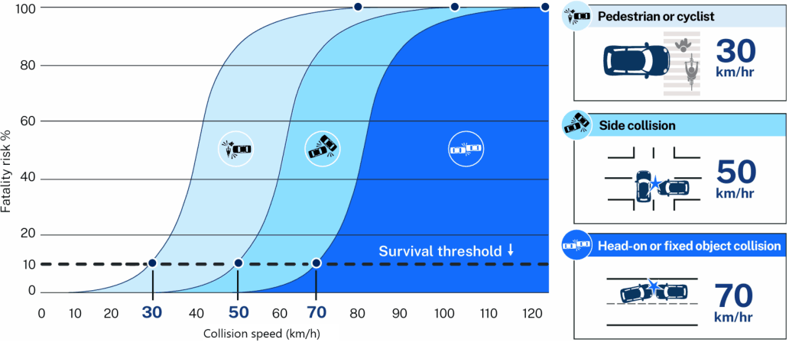

## Section 3 -  General Matters

### 3.1 General

The Civil Works Specification has been compiled to outline Council's general procedures and practices in respect of design and construction requirements for future public infrastructure assets and various private site works in the Central Coast Council Local Government Area (LGA).

This Design Guideline has been prepared to assist Service Providers, by informing them of Council's requirements with respect to the design and construction of assets, which will eventually be vested in and maintained by Council and to ensure that such works are provided to appropriate and sustainable standards, ensuring that the principles of ecologically sustainable development are appropriately considered in accordance with the Local Government Act 1993.

### 3.2 Reference Documents

Reference documents include (but are not limited to) the following:

• Austroads publications for which there is a specific Glossary of Terms publication and also incorporate some definitions in individual documents.

• Transport for NSW (TfNSW) or documents which incorporate definitions.

• Australian Standards documents for which there is a specific Glossary of Terms, such as AS 1348 Road and traffic engineering and incorporated definitions in individual documents.

• Engineers Australia publications.

• Water Services Association of Australia documents relating to supply of water and sewerage services and their respective Supplements.

• Queensland Road Drainage Design Manual (Department of Transport and Main Roads

2013\) and the Queensland Urban Drainage Manual.

• Central Coast Council’s Street Design Guideline, Greener Places Strategy, Walking, Wheeling and Cycling Strategy and other applicable Council documents.

In any instance, where because of terminology, the interpretation of this Design Guideline is in dispute, definitions shall be clarified by Council’s Representative.

### 3.3 Conflicting Standards and Guidelines

The provisions of Council’s Civil Works Specification apply to all works within the Central Coast LGA, but do not override any conflicting provisions of other Parts of Council’s Development Control Plan or any consent issued applying to a particular development.

This Design Guideline is intended to highlight the specific requirements of Central Coast Council, with respect to the requirements of other Councils, Australia/New Zealand Standards and other industry standards, i.e. differences, additions and omissions. Where there is a conflict or ambiguity between a requirement of Council’s Civil Works Specification and that of a referenced document, then the requirements of this Design Guideline shall take precedence over those in the referenced documents in so far as resolution of the point of conflict is concerned.

Where this Design Guideline refers to an Australian Standard, Australian/New Zealand Standard, Austroads or TfNSW publication or other document that has been superseded by a new or updated version, which was issued after commencement of the works, then Council’s Representative shall be consulted as soon as possible to determine which requirements shall apply.

In all cases, the Service Provider shall adequately inform Council’s Representative of any potential and actual conflicts as soon as they become aware to allow Council the maximum time available to resolve the conflict. The Service Provider shall provide all necessary information to adequately inform Council’s Representative of any associated and consequential impacts on design or construction prior to the contract commencing.

Council’s Policies and Procedures take precedence for all Central Coast Council employees.

### 3.4 Departure from the Specification

Consideration may be given for products or work methods which do not strictly comply with Central Coast Council’s Civil Works Specification. Details of the proposed departure from the Specification need to be submitted to Council’s Representative for approval.

### 3.5 Council’s Standard Drawings

Standard Drawings referred to in this Design Guideline can be found in Council’s Civil Works Specification - Standard Drawings and are available to download from Central Coast Council’s website.

### 3.6 Lapsing of Approvals and Certificates

Council’s Specification requirements shall be those current at the time of issuing of the Subdivision Works Construction Certificate and/or Civil Works Approval.

A Construction Certificate and/or Civil Works Approval for subdivision works and/or development related works shall lapse with the Development Consent, or in the instance of a Development Consent that has commenced, the approval shall be limited to a maximum of 5 years from the date of the approval. A Development Consent for a subdivision involving subdivision works or other Development involving civil works will normally lapse after a set time following the issue of the Development Consent. In this event, should a new Development Consent be obtained, a submission of updated engineering plans will be required for a new Construction Certificate and/or Civil Works Approval related to the new consent.

A Civil Works Approval for civil engineering works associated with a Building Development shall lapse with the Development Consent, or in the instance of a Development Consent that has commenced, the approval shall be limited to a maximum of 5 years from the date of the plan approval.

### 3.7 Project Personnel

The Service Provider shall nominate to Council the persons who will hold key roles for the works. These key roles may include the Project Manager, any Accredited Certifier, the Engineering Designers, Registered Surveyors, the Geotechnical Consultant and others as directed by Council.

Detailed engineering designs and specifications must be developed by consultants and designers who possess the appropriate qualifications and experience. This ensures that all engineering design requirements and development conditions of consent are met, and that the resulting work is constructable and aligns with applicable specifications.

The responsibility lies with designers and consultants to interpret and implement the requirements as stipulated, ensuring compliance at every stage of the design process. Such diligence in preparation is critical for achieving both regulatory approval and the intended project outcomes and objectives.

### 3.8 Context Sensitive Design

The design process should use a principles-based approach when competing objectives arise. By relying on established principles, decisions remain consistent and transparent, helping to balance various priorities and values.

Context Sensitive Design (CSD) enables jurisdictions to adapt project criteria to local needs while meeting broader network objectives. By fostering collaboration and thorough analysis, CSD combines engineering judgment with practical experience to deliver efficient, cost-effective and safe solutions tailored to each site. Practitioners should refer to Austroads Guide to Road Design Part 1: Objectives of Road Design, and Austroads Guide to Road Design Part 6: Roadside Design, Safety and Barriers, for further information on this topic.

Designers advise on risks, assess impacts on safety and operations and inform stakeholders about potential consequences when criteria are not optimal. Road and drainage design balances ideal solutions with practical needs, such as safety, driver expectations, economics, environmental impacts and community values, and levels of service, while also considering existing constraints that may influence the ability to achieve specified standards.

### 3.9 Limitations on Accredited Certifiers

Accredited Certifiers when appointed by a Service Provider operate under Part 6 of the Environmental Planning and Assessment Act 1979. Accredited Certifiers may not certify design plans/drawings in respect of works which the Council needs to approve under alternative legislation, even though those works are required by a condition of a Development Consent under the Environmental Planning and Assessment Act 1979.

These works include:

• Water and sewer works or works which affect water and sewer works pursuant to Section 306 of the Water Management Act 2000.

• Works on public roads requiring an approval under the Roads Act 1993.

• Drainage works requiring an approval under the Local Government Act 1993.

• Works where the Local Environmental Plan (LEP) may preclude an Accredited Certifier from being appointed.

Further approvals may be required on Classified Roads where TfNSW is the approval authority.

Compliance Certificates for Development Consent conditions involving such approvals can only be issued by Council once Council is satisfied the condition has been complied with.

Persons accredited or acting under the Environmental Planning and Assessment Act 1979 as private Accredited Certifiers are specifically excluded from varying the requirements of Council’s Civil Works Specification in any way.

### 3.10 Works Subject to Approvals by Other Authorities

Where conditions have been imposed under an integrated approval or where the Service Provider is required by legislation to obtain approval from others the following applies:

• The design and construction of works shall be carried out to meet those Authorities’ specifications in addition to those of Council.

• The Service Provider is responsible for obtaining any permits and licences, achieving required inspection and works standards and gaining final approval of relevant Approval Authorities.

• Copies of approvals, permits and licences to be obtained from Approval Authorities by the Service Provider shall be provided to Council prior to commencement of site activities.

• Copies of final approvals of works and documentation verifying compliance with the requirements of Approval Bodies shall be provided to Council by the Service Provider before completion can be agreed to and accepted by Council.

### 3.11 Classified Roads and Applicable Standards

Transport for NSW (TfNSW) control works on Classified Roads under the Roads Act 1993. Classified Roads include those with a legal class of highway, main road, secondary road, tourist road or transitway. Council controls works on Classified Regional Roads. Refer to Schedule of Classified Roads and Unclassified Regional Roads on the Transport for NSW website.

To manage the extensive network of roads for which Council is responsible under the Roads Act 1993, TfNSW in partnership with local government established an administrative framework of State, Regional, and Local Road categories. State Roads are managed and financed by TfNSW and Regional and Local roads are managed and financed by Councils.

Designers shall obtain from TfNSW the current design and project requirements applicable to classified roads.

Designers shall contact TfNSW at the beginning of the design process to clarify administration processes for design and works agreements (Works Authorisation Deeds).

TfNSW have adopted the Austroads Guides and Australian Standards as their primary technical references related to road design. However, it must be noted that TfNSW has issued Supplements to clarify, add to, or modify these documents.

### 3.12 Constructability, Health and Safety in Design

Designers shall comply with the SafeWork NSW requirements for Health and Safety in Design - CHAIR

- Safety in Design Tool.

CHAIR (Construction Hazard Assessment Implication Review) is a tool to assist designers, constructors, clients and other key stakeholders to come together to reduce construction, ongoing operation, maintenance, repair and demolition safety risks associated with design.

The Australian Council of Building Design Professions (BDP) and the Royal Australian Institute of Architects (RAIA) support the use of CHAIR. The BDP believes that along with the quality and amenity of the built environment, its safety is also determined at the design stage. "CHAIR is a tool that will enable better safety awareness and solutions for improving safety and construction through identifying potential hazards by a co-ordinated approach by all stakeholders.

### 3.13 Safe System Approach

All elements of the road and street network shall be designed to align with Safe System approach and the associated boundary conditions. Safe System boundary conditions for key conflict types are as follows:

• 30km/h in locations where conflicts between vulnerable road users and vehicles are possible.

• 50km/h at intersections where side impacts between vehicles are possible.

• >70km/h on roads where there is no possibility of side or frontal (head-on) impacts.

#### Figure 3.1 Survival Threshold for Different Crash Types

> [Picture on page 26: a picture, saved as a picture (images/civil-works-specification-design-guideline-page-26-24.gif, 150 dpi).]

(Source: adapted from TfNSW’s Design of Roads and Streets Manual - October 2024 TS 00066:1.0)

Designers should refer to the Austroads Guide to Road Safety publications for further information and guidance on the Safe System approach.

### 3.14 Road Safety Audits

The undertaking of Road Safety Audits contributes to the reduction in road trauma and is an important process in the good planning and designing for the foundation of safer roads and road related areas. They are to be undertaken at the appropriate time(s) in the life of the project/development.

Early intervention can be most beneficial, especially at the strategic stage in terms of road safety, time and costs to the development.

Road Safety Audits are to be undertaken by Road Safety Auditors of a minimum Level 3 (Lead) and Level 2 as identified on the TfNSW Road Safety Audit Register.

If a Road Safety Check is required (usually nominated in a consent), it will be undertaken by a Level 3 Road Safety Auditor, although a team is encouraged. If a project relates to a proposal that is not subject to a consent condition such as a Planning Proposal or similar or where the consent is silent regarding a Road Safety Audit, the requirements of the intervention levels in Table 3.1 below shall apply.

Road Safety Audits and/or Road Safety Checks may also be required for minor works or developments where there will be an increased exposure to risk, for example, where a bus stop is relocated that will influence bus users to cross the road at a different location where risks are different. Refer to Note 10 of Table 3.1 below.

#### Road Safety Audit and Road Safety Check Intervention Levels

These intervention levels are minimum intervention levels and do not preclude Council or TfNSW from requiring additional Road Safety Audits.

Where Road Safety Audits are required, it may be prudent to undertake a concept Road Safety Audit to provide greater confidence with the proposal prior to the commencement of a detailed design as indicated above as early intervention can be very beneficial.

#### Corrective Actions

Any findings identified from the audit or check that requires altered design responses for corrective action, must be undertaken in consultation with Council’s Representative (the future or current Road Authority) prior to approval.

#### Road Safety Audit and Road Safety Check Intervention Levels

| Development or Work Type | Development Type/Traffic/ Cost 2, 8 | Road Safety Audit3 (RSA) or Road Safety Check4 (RSC) |  |  |  |
|---|---|---|---|---|---|
|  |  | Concept Design | Detailed Design | Roadworks 5, 6 | Pre-Open or Finish (PO/F) |
| Residential Subdivision | >15 lots |  | RSA | Note 5 | RSC (PO) |
| Residential Subdivision | >30 lots |  | RSA | Note 5 | RSA (PO) |
| Residential Subdivision | >60 lots | RSA | RSA | Note 5 | RSA (PO) |
| Intersection | ≤$400,000 |  | RSA | Note 5 | RSC (PO) |
| Intersection | >$400,000 | RSA | RSA | RSC | RSA (PO) |
| Intersection | >$4 million | RSA | RSA | RSA | RSA (PO and F) |
| Roadworks | ≤$500,000 |  | RSA | Note 5 | RSC (PO) |
| Roadworks | >$500,000 |  | RSA | Note 5 | RSA (PO) |
| Traffic Control Facility1 | <$50,000 |  | RSA |  | RSC (PO) |
| Traffic Control Facility1 | >$50,000 |  | RSA |  | RSA |
| Shared paths | ≤$100,000 |  | RSC/RSA 9, 11 |  | RSC/RSA 9, 11 |
| Shared paths | >$100,000 |  | RSA |  | RSA |
| Development Access(es) individually or collectively 7 | >100 VMPD |  | RSA |  | RSC/RSA (PO) |
| Developments 7 | >100 VMPD |  | RSA |  | RSA |
| Rezoning/Master Plan, Planning Proposal, etc 14 |  | RSA |  |  |  |
| Minor Works11 |  | Refer to Note 10 below |  |  |  |
| Where there are discrepancies between triggers, apply the lower trigger. |  |  |  |  |  |
| Refer to all notes below. They apply specifically where shown and also entirely. |  |  |  |  |  |

#### Notes:

1\. As defined by the Transport Administration Act 1988.

2\. Excluding Council fees and contributions and consulting fees.

3\. As defined by Austroads.

4\. As defined by the TfNSW Guidelines for Road Safety Audit Practices.

5\. Only required where complex traffic guidance schemes applied and changes occur as a result of a mix of traffic (pedestrians/cyclists/vehicles) and/or switches in construction stages or similar.

6\. These are in addition to any Work Health and Safety routine checks.

7\. Inclusive of tourist, shopping/commercial or industrial, educational/sporting and recreational facilities, places of worship, hospitals, service stations or other developments depending on traffic generation, development layout or likely project risk impact to the network or proposed network. Generally, for developments that generate more than 100 vehicle movements per day or on any single day.

8\. Project values shall be indexed in accordance with CPI amounts. Value is based on a new build, not retrofit.

9\. Either a Detailed Design or a Pre-Opening Audit is required, not both.

10\. Minor works that involve increasing vehicle/vehicle conflict, pedestrian/vehicle conflict, new accesses (temporary or permanent), changes to public transport, loading or delivery areas, etc that increase road user risk will require either a Road Safety Audit(s) or a Road Safety Check.

11\. Subject to availability or where it is deemed necessary due to local knowledge, an Auditor from Council may elect or may need to be involved in the required Road Safety Audit. Confirmation with Council is to be undertaken well prior to the audit to determine Council involvement in the audit.

12\. Road Safety Audits and Checks are only valid for a maximum of 12 months from the date of the site inspection due to potential changes of the site and adjoining the site including transport infrastructure and traffic environments.

13\. Only a Concept or Strategic RSA is required early in the process as this will inform any road safety issues that require addressing for the development to proceed. Refer requirements for Corrective Actions above. A Safe System Assessment (framework) with treatment options may be accepted in lieu of the Concept or Strategic RSA.

14\. Any Road Safety Audits on Classified Roads shall comply with TfNSW requirements.

### 3.15 Bushfire Prone Areas (BPAs)

In carrying out the design and construction of the works, designers shall ensure that bushfire protection measures required by conditions of consent, other approvals or other Authorities’ requirements are incorporated into design plans and specifications. Designers must also ensure that all works do not create previously unidentified bushfire protection issues. This may include the impact of fully established landscaping on fire protection measures.

Designers shall reference relevant current documents published by the NSW Rural Fire service, current Australian Standards and the National Construction Code when designing for provisions related to bushfire protection.

### 3.16 Design in Flood Affected Area

Reference shall be made to Council’s Flood Risk Management Plans when carrying out design in areas that are or may be flood affected.

Filling of Flood Plains and Floodways is not permitted.

Flood Planning Levels (FPL), Flood Levels or Floor Levels with appropriate allowances for climate change (including sea level rise) is available on Council’s website and can also be provided by Council following a Flood Level enquiry made through Council’s Customer Service Centre, 123A Donnison Street, Gosford (4306 7900) or 2 Hely Street, Wyong (4306 7900).

Where no reliable information is held by Council and where Council’s records indicate that the land has flood controls or if the land is likely to be flood affected, the determination of the flood extent must be supported by a flood study, supplied by the Service Provider and prepared by a qualified engineer experienced in flood modelling. This study shall be provided to Council for consideration.

All work carried out as part of this study shall comply with the following documents:

• The Institution of Engineers, Australia, Australian Rainfall and Runoff, A Guide to Flood Estimation latest edition.

• DTM/DEM LiDAR survey data, digital aerial photography and spatial modelling products: The supply of these products is to satisfy the specifications produced by the NSW Land and Property Management Authority (LPMA Standard LiDAR Product Specifications (Including RCD105 Imagery) Version 2.0, July 2010 copy available from (Office of Environment and Heritage) on request).

All flood model results shall be provided to Council in a format suitable for use with ESRI as specified within Council’s Spatial Data Standards available on request from Council’s Representative.

All model output data files shall be in a format compatible with WaterRideTM as detailed below:

• TUFLOW: *.2dm, *h.dat (or *d.dat) and *v.dat or

\*.2dm, *.xmdf

• MIKE21: *.dfs2 or *.dfsu

• MIKE11: *.res11

• SOBEK:

Time series ASCII grids: level and velocity. Static: terrain or SOBEK project folder

• DELFT3D: *.dat

• ASCII Grid: Time series ASCII grids: level and velocity (total or u/v direction).

Static: terrain

• ANUGA: *.sww

• SELFE 2D: hgrid.gr3 and *_dahv.62

• InfoWorks: v6+ : CSV network export and CSV/Binary Results export

v5 or earlier: CSV network export and CSV results export

CSV network export and 2D Tri GIS and Binary results export

### 3.17 Consideration of Coastal Hazard Areas

Reference shall be made to Council’s Coastal Zone Management Plans when carrying out design in areas that are currently or may be in the future, affected by coastal hazards.

Coastal hazard information (including erosion, recession, slope instability and coastal inundation) with appropriate allowances for climate change (including sea level rise) can be provided by Council following a Coastal Hazard enquiry made through Council’s Customer Service Centre, 123A Donnison Street, Gosford (4306 7900) or 2 Hely Street, Wyong (4306 7900).
