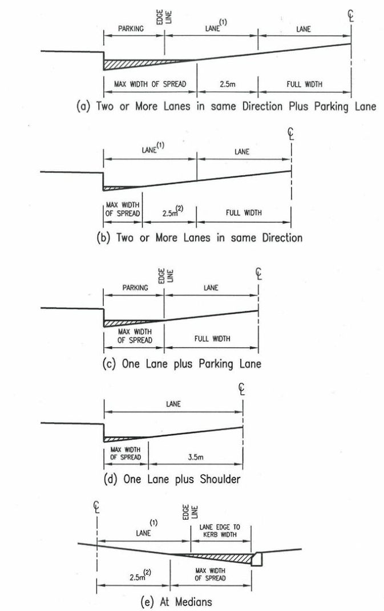
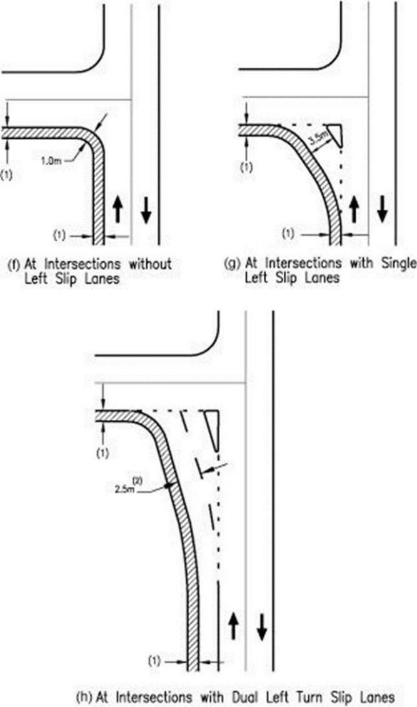
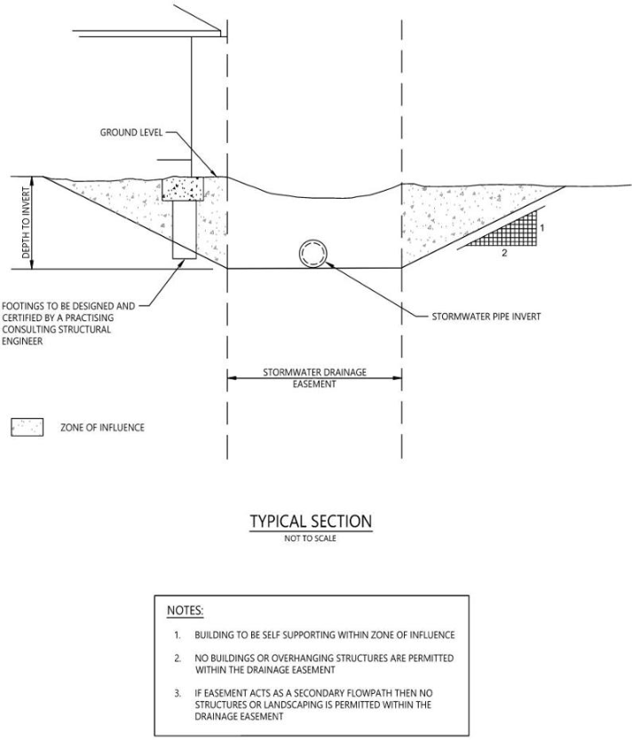

## Section 10 -  Stormwater Drainage Design

### 10.1 General

Council’s Civil Works Specification - Design Guideline shall be read in conjunction with the associated Construction Specification and Council’s Policies and Plans relating to flooding.

The broad objectives seek to achieve an optimum urban environment within the principles of ecologically sustainable development.

Stormwater objectives are considered as being achieved when the following applies:

• Planning, design and construction of new facilities is adequate to service new and future developments consistent with both the engineering, environmental, asset management and planning best practice.

• There is compatibility with existing facilities, operational methods and maintenance techniques.

• Facilities provide adequate environmental, community and asset protection consistent with accepted design and construction requirements set out in this document and with developments in technology as approved from time to time.

• Whole-of-catchment-based approach for design is taken.

The Designer is to provide a design report that sets out the basis for the design of stormwater drainage (stormwater quantity and quality). This should include explanatory text including all relevant assumptions and input parameters, together with supporting tables and diagrams, sufficient for Council’s Representatives to confirm the adequacy of the design without the need to obtain further information. Although the onus is on the Designer to provide sufficient information in the design report, there will be some cases where Council’s Representatives will stipulate specific information to be included in the design report.

### 10.2 Design Philosophy

#### General

In preparing stormwater drainage designs, Council requires use of the latest edition of Australian Rainfall and Runoff: A Guide to Flood Estimation (ARR 2019). Where it is necessary to provide a full reference for ARR, the following description should be used:

• Ball J, Babister M, Nathan R, Weeks W, Weinmann E, Retallick M, Testoni I, (Editors), 2019, Australian Rainfall and Runoff: A Guide to Flood Estimation, Commonwealth of Australia.

The following restrictions shall apply when preparing stormwater drainage designs:

1\. Use of the Probabilistic Rational Method to determine peak discharges on rural catchments is not permitted.

2\. Use of the urban Rational Method with the hydraulic grade line approach (HGL), as outlined in ARR 1987, is not permitted.

Other current Australian published design guides, for example Austroads Guides, and Australian Standards may also be applied to particular design situations. Design parameters specified in ARR 2019 shall be used, unless agreed with Council’s Representative to use alternative parameters.

The probability of design flood events is to generally be described in terms of the Annual Exceedance Probability (AEP), as discussed in Chapter 2 (Fundamental Issues) within ARR 2019 Book 1 (Scope and Philosophy). The previously used terminology Average Recurrence Interval (ARI) is not encouraged. Given that ARI terminology has in the past been used extensively, the Designer is referred to Figure

1.2.1 in Chapter 2 of Book 1 for a comparison of AEP and ARI for different event probabilities.

An AEP/ARI comparison for frequencies in the range 63.21% to 0.1% AEP (1-year to 1000-year ARI) is shown below:

| 1 | 63.21% AEP is equivalent to 1-year ARI1 | 7 | 5% AEP is equivalent to 20-year ARI |
|---|---|---|---|
| 2 | 50% AEP is equivalent to 1.44-year ARI | 8 | 2% AEP is equivalent to 50-year ARI |
| 3 | 39.35% AEP is equivalent to 2-year ARI1 | 9 | 1% AEP is equivalent to 100-year ARI |
| 4 | 20% AEP is equivalent to 4.48-year ARI1 | 10 | 0.5% AEP is equivalent to 200-year ARI |
| 5 | 18.13% AEP is equivalent to 5-year ARI | 11 | 0.2% AEP is equivalent to 500-year ARI |
| 6 | 10% AEP is equivalent to 9.49-year ARI1 | 12 | 0.1% AEP is equivalent to 1000-year ARI |

Note 1: For practical purposes in day-to-day practice, the 60%, 40%, 20% and 10% AEP events are taken to be equivalent to the 1-year, 2-year, 5-year and 10-year ARI events respectively.

For events more frequent that 50% AEP, expressing frequency in terms of AEP is not particularly meaningful since AEP is constrained to a maximum of 100%. For example, a 1-month ARI has a 99.999386% AEP and a 3-month ARI event has a 98.168436% AEP. Consequently, events more frequent than 50% AEP should be expressed as ‘X’ Exceedances per Year (EY). For example, 12 EY and 4 EY are equivalent to 1- and 3-month recurrence intervals respectively and more meaningful than their AEP equivalents.

An EY/ARI comparison for the more common frequencies in the range 12 EY to 1 EY (1-month to 1-year ARI is shown below:

| 1 | 12 EY is equivalent to 1-month ARI | 4 | 3 EY is equivalent to 4-month ARI |
|---|---|---|---|
| 2 | 6 EY is equivalent to 2-month ARI | 5 | 2 EY is equivalent to 6-month ARI |
| 3 | 4 EY is equivalent to 3-month ARI | 6 | 1 EY is equivalent to 1-year ARI |

For determining design rainfalls, particular attention is to be given to the following chapters in ARR 2019 Book 2 (Rainfall Estimation):

• Chapter 3 (Design Rainfall) - refer in particular to Section 3.9 (Application).

• Chapter 5 (Temporal Patterns).

The approach to temporal patterns has changed considerably in ARR 2019 to account for the significant variability in temporal patterns between rainfall events of similar magnitude, and the effect

differing patterns can have on peak flow estimates. This has led to the concept of modelling an ensemble of temporal patterns to account for the variability of patterns. Hence for each AEP of interest, using multiple temporal patterns for each storm duration results in a range of peak discharges (or volumes) at each duration - when multiple results are graphed for each duration this presents as a 'duration box plot' as shown in Figure 2.5.17 in Chapter 5 (Temporal Patterns) of Book 2 (Rainfall Estimation).

When assessing temporal patterns using ARR 2019, the Designer is to be cognisant of the following matters:

1\. Temporal patterns derived by the regional burst approach are recommended for general use.

2\. The use of an ensemble of 10 temporal patterns at each duration is recommended to appropriately represent the variability in observed patterns.

3\. If 10 temporal patterns are not available for a given region, duration and frequency then patterns can be taken from other similar regions.

4\. When selecting a small ensemble of temporal patterns it is important to capture the typical variability of the observed events.

5\. Testing of large numbers of ensemble patterns show results tend to cluster around the mean and median, which should be preferred in design. Generally, temporal patterns representing the worst (or best) case are not suitable for design.

6\. Where two-dimensional hydraulic model run times are excessive using 10 temporal patterns (for multiple durations), the pattern closest to the average is likely to be suitable. Alternatively, doubling the grid cell size will decrease run time eightfold.

7\. Using an ensemble of 10 temporal patterns provides a range of plausible answers. The Designer should also consider the benefits of investigating a larger number of temporal patterns with a Monte Carlo simulation for sensitive designs and solutions.

Where appropriate for a particular catchment, the design rainfall assessment is to also consider the following chapters in ARR Book 2:

• Chapter 4 (Areal Reduction Factors).

• Chapter 6 (Spatial Patterns of Rainfall).

The following approaches in ARR 2019, which were not available in ARR 1987, are to be used where circumstances warrant:

1\. Regional Flood Frequency Estimate Method can be used to estimate peak discharges on small to medium rural catchments - refer to Chapter 3 (Regional Flood Methods) within Book 3 (Peak Flow Estimation). NOTE: Alternatively, and for larger catchments, flood hydrograph approaches are applicable

- refer to Chapter 6 (Flood Hydrograph Modelling Approaches) within Book 5 (Flood Hydrograph Estimation).

2\. Blockage of Hydraulic Structures - refer to Chapter 6 (Blockage of Hydraulic Structures) within Book 6 (Flood Hydraulics).

3\. Safety Design Criteria for people, vehicles and buildings - refer to Chapter 7 (Safety Design Criteria) within Book 6 (Flood Hydraulics).

4\. Interaction of Coastal and Catchment Flooding - refer to Chapter 5 (Interaction of Coastal and Catchment Flooding) within Book 6 (Flood Hydraulics).

The stormwater drainage design for new subdivisions shall be based on a Flood Study undertaken previously by a suitably qualified professional as deemed appropriate by Council’s Representative.

All designs shall be calibrated to the current flood study which is available on Council’s website.

#### The Major/Minor Stormwater Systems

The provision of stormwater drainage consists of a pipe system for controlling nuisance flooding (minor system) combined with a continuous overland flow path or floodway system (major system) to accommodate less frequent flood events and flows in excess of the minor systems. The major/minor concept may be described as a 'system within a system' for it comprises two distinct but conjunctive drainage networks.

All new urban development shall be provided with a major drainage system designed with sufficient capacity and freeboard to ensure that flood flows up to 1% Annual Exceedance Probability (AEP) do not encroach upon private land.

The major drainage system typically consists of the arrangement of pavements, roadway reserves, engineered flow paths and waterways, detention basins, flood protection levees, and major cut-off drains planned to convey a design flow up to 1% AEP in conjunction with the available capacity of the minor drainage system.

#### Provision for Failure

If failure of stormwater drainage system components occurs during periods of extreme rainfall, the risk to life and property could be significantly increased.

It is important to ensure that the combined major/minor system can safely cope with reasonable surcharge due to blockages and flows in excess of the design AEP.

In establishing the layout of the pipe network, Designers shall ensure that surcharge flows will not discharge onto private property during flows up to and including 1% AEP. For flows in excess of 1% AEP, Designers shall ensure that the likelihood of nuisance flooding or damage to private properties is considered, minimised and the likelihood of catastrophic consequences are considered and averted.

All stormwater detention basins and ponds involving dams shall be assessed by the Designer under the Dams Safety Committee (DSC) Guidelines. The assessment report shall be submitted to Council for concurrence and referred by the Designer to the DSC where required.

#### Natural Drainage Paths

The major and minor drainage systems shall be planned and designed to conform to natural drainage patterns and discharge to natural drainage paths in the catchment. If the Designer deems that natural drainage paths require modification to accept the higher peak flows resulting from urban development, the Designer shall seek advice from Council’s Representative before proceeding with the drainage design.

Runoff must be discharged from a development in a manner that will not cause adverse impacts on downstream property, stormwater systems and natural watercourses. In general, runoff from

development sites within a catchment shall be discharged at the existing natural drainage outlet(s). If the Designer wishes to change discharge points or apportionment of catchment flows between discharge points, they must demonstrate that the change will not have unacceptable adverse impacts on downstream properties or stormwater systems.

#### Surface Flows

Surface flow safety criteria must be applied to minimise both nuisance flooding and major hazards from flooding of roadways, buildings and other areas that have regular public access. Refer to the latest edition of Australian Rainfall and Runoff: A Guide to Flood Estimation, Commonwealth of Australia and the Queensland Urban Drainage Manual for further guidance.

#### Interallotment Drainage

Interallotment drainage shall be provided for every allotment which does not drain directly to its street frontage and for high side properties fronting roads with either kerb unable to satisfactorily accommodate kerb outlets, or where carriageways have one-way crossfall. Interallotment drainage shall be deep enough to serve the entire allotment; property inlets shall be constructed at the low corner of each lot in accordance with Council’s Civil Works Specification - Standard Drawings. Refer to Section 10.7 Interallotment Stormwater Drainage of this Design Guideline for further details.

#### Disposal of Stormwater Drainage – Low-Level Properties

For stormwater management on low-level land, the applicant shall demonstrate that the drainage system has been designed to provide a safe and effective method of stormwater discharge in accordance with Central Coast Council’s Development Control Plan (DCP) and this guideline.

All stormwater systems shall comply with the requirements of the following:

1\. Central Coast Council DCP - Stormwater Management/Water Cycle Management Chapters.

2\. Central Coast Council Civil Works Specification (including stormwater drainage design requirements).

3\. Relevant Australian Standards (including AS/NZS 3500).

Solutions shall be assessed by an Accredited Certifier being either Council or Private, having regard to long-term operational performance, maintenance requirements, and potential impacts on upstream and downstream properties and public infrastructure.

In assessing proposed drainage arrangements, Council will consider the following options in order of priority.

#### 10.2.7.1 Hierarchy of Acceptable Drainage Solutions

1\. Gravity Connection to Council Stormwater Drainage System

a. Stormwater shall discharge via gravity to a Council pipe system, open channel, or other approved point of discharge.

b. Design must demonstrate available hydraulic capacity and compliance with Council’s design criteria for drainage systems.

c. Systems shall not cause surcharge or adverse impacts, consistent with DCP requirements for no worsening of flooding or nuisance.

2\. Gravity Drainage via Interallotment Piped System with Easement

a. Where direct connection to a Council stormwater drainage system is not feasible, drainage may be achieved via an interallotment drainage system located within a registered drainage easement.

b. Easements shall be created in accordance with Council and NSW LRS requirements.

c. Designs shall address whole-of-life maintenance, access requirements, and single or shared asset responsibilities.

3\. On-Site Detention (OSD) with Controlled Discharge

a. On-site detention shall be provided where:

1\. OSD does not remove the requirement for a lawful point of discharge.

2\. Discharge rates shall comply with Council’s post-development flow limits (e.g. no increase in peak discharge).

4\. Pumped Discharge to Council Stormwater System

a. Pump-out systems may be considered where gravity connection cannot be achieved and shall be designed in accordance with AS/NZS 3500.

5\. Pumped Discharge to Alternative Lawful Point of Discharge

a. Discharge to interallotment drainage, or other approved system may be considered subject to Council approval.

b. Hydraulic assessment shall demonstrate no adverse impact, nuisance, or damage to downstream properties or infrastructure.

c. Additional controls such as energy dissipation and flow regulation shall be provided where required.

6\. On-Site Infiltration Systems

a. Infiltration systems may be permitted, only where supported by geotechnical investigation.

b. Systems shall demonstrate suitability of soil conditions, adequate separation to groundwater, and no risk of failure.

c. Infiltration shall not be permitted in areas subject to high groundwater levels or where site conditions are otherwise unsuitable.

7\. Alternative or Non-Standard Solutions

a. Any alternative solution shall be supported by detailed engineering design and justification.

b. Proposals must demonstrate equivalent or improved outcomes in relation to hydraulic performance, environmental protection, and asset sustainability.

c. Approval will be at Council’s discretion.

### 10.3 General Requirement for Developments

The level of runoff control required is dependent on the type of development proposed. Flow control requirements are stipulated for the following:

• New developments.

• Redevelopment of existing sites.

• Augmentation of existing stormwater systems.

#### New Developments

Each new development shall be considered individually regarding existing and proposed drainage systems, location in the catchment and other matters relating to stormwater.

Generally, it can be expected for new development proposals that, the post-development peak flow from the outlet point(s) of the site to the downstream public drainage system or receiving water shall not exceed the pre-development peak flow for both the major and minor system design storm AEP. Pre-development peak flow shall be the estimated flow from the site based on known or estimated catchment conditions prior to the new development.

To reduce peak outflows, the stormwater system may be provided with flow attenuation measures such as infiltration devices, detention basins and water quality control ponds and/or the compensating augmentation of existing drainage systems.

Design storm AEPs for the major and minor drainage systems shall be selected in accordance with Section 10.4.2 Design Annual Exceedance Probability of this Design Guideline.

The provision of additional stormwater infiltration, retarding, detention, storage or other control facilities may be required by Council after consideration of relevant stormwater drainage analysis and concept plans required as part of the development application documentation.

#### Redevelopment of Existing Developed Sites

Each redevelopment proposal shall be considered individually regarding existing and proposed drainage systems, alteration or abandonment of existing infrastructure, location in the catchment and other pertinent matters. Preferred treatment of abandoned infrastructure is removal of the disused asset. Other options shall be approved by Council’s Representative.

Redevelopment includes land redevelopment and subdivision redevelopment. Land redevelopment is the redevelopment of single lots or multiple adjacent lots where all the stormwater system will be privately owned. This includes both Unit and Dual Occupancy developments. Subdivision redevelopment is redevelopment where all or parts of the stormwater system will become part of the public drainage system.

Generally, it can be expected for redevelopment sites that, the post-redevelopment peak flow from the outlet point(s) of the redevelopment site to the existing downstream public drainage system or receiving water shall not exceed the pre-redevelopment flow for both major and minor system AEP.

The pre-redevelopment peak flow shall be the estimated flow from the site based on the development conditions (including any existing flow attenuation facilities) prior to redevelopment. The degree of runoff control required will depend on the scale of the development and the net change in impervious

area. Flow control will be required for any redevelopment where the density (measured as the total equivalent impervious area) of the redevelopment is greater than that of the existing development.

The stormwater drainage design for redevelopment site is to ensure that the redevelopment does not create or worsen any capacity problems in the existing public drainage system. This will generally require the construction of on-site and/or off-site public detention/retention systems and/or the compensating augmentation of existing drainage systems.

The major and minor system design storm AEPs referred to shall be those appropriate for the existing development in accordance with Section 10.4.2 Design Annual Exceedance Probability of this Design Guideline. Note that these are the AEPs that the existing public drainage system must have been designed for, not the as-constructed capacity of the system.

The requirements for the provision of stormwater retarding, detention, storage or other control facilities shall be determined by Council’s Representative after consideration of relevant stormwater drainage analysis and concept plans required as part of the development application documentation. Augmentation of Council’s existing drainage system may be considered in lieu of on-site detention systems, subject to approval by Council’s Representative.

#### Stormwater System Augmentation

Stormwater system augmentations are undertaken in existing urban catchments to alleviate flood hazards due to under-capacity major and/or minor drainage systems. The main objectives for such augmentation works shall improve flood protection for land and to increase pedestrian safety and vehicle stability on roadways.

The potential to increase the flow carrying capacity of existing roadways is usually limited.

To achieve the objectives of the stormwater drainage augmentation it may be necessary to increase the AEP capacity of the minor drainage system above that specified in Table 10.1 Major/Minor System Design in order to ensure that:

• The 1% AEP “gap flow” on roads (refer to Section 10.4.2 Design Annual Exceedance Probability) meets the surface flow criteria limits.

• Overland flow from storms up to and including the 1% AEP is not discharged through easements over private land on the low side of road verges, particularly at steep T-intersections and trapped road low points.

#### Stormwater Inlet and Outlet Discharge

The following requirements shall apply to the design of system inlets and outlets:

• Where no Council drainage system exists, the maximum permissible site discharge from a development to either the kerb and gutter or table drain shall be up to 25L/s at any one discharge point. Discharge points shall be at least 15m apart.

• For other than single residential or dual occupancy developments, Council’s Representative shall confirm the maximum discharge that will be allowed to discharge into the street surface drainage system.

• Design of all inlets and outlets shall ensure that there are no adverse impacts arising from any changes of upstream and downstream water surface levels, flow velocities and flow direction.

• The Designer shall design for scour protection at inlets and outlets to suit local conditions. Consideration shall be given to current best practice. Detailed design calculations shall be provided to support the need for and type of energy dissipation devices.

• The Designer shall design inlets and outlets with due diligence, considering public safety requirements based on a risk assessment methodology. Refer to the latest edition of Australian Rainfall and Runoff: A Guide to Flood Estimation, Commonwealth of Australia and the Queensland Urban Drainage Manual for further guidance.

• At points of discharge of gutters or stormwater drainage lines or at any concentration of stormwater from or to adjoining properties, Council will require the Service Provider to enter into a Deed of Agreement with the adjoining owner(s) granting permission to the discharge of stormwater drainage and the creation of any necessary easements with all costs being met by the Service Provider prior to development approval.

• Where the drainage is to discharge to an area under the control of another statutory authority e.g. the Crown or Public Works, the design requirements of that Statutory Authority shall be met.

• Stormwater drainage systems discharging to or through reserves, if permitted under the relevant plan of management, shall be taken to a natural watercourse and discharged through an approved outlet structure or alternatively taken to the nearest stormwater line. All works shall be subject to detailed design. The creation of easements may be required.

#### Stormwater Quality Control

Urban development will generally result in an increased level of export of a wide range of non-point source pollutants. To protect the quality of local streams, lakes, and river systems, the provision of stormwater quality control strategies acceptable to Council shall be considered. These may include (but not be limited to) the following:

• Establishment of urban lakes, primarily as biological treatment systems.

• Utilisation of water quality control ponds (WQCP) and constructed wetlands, as physical and biological treatment systems, upstream of urban lakes.

• Incorporation of gross pollutant traps (GPTs) on inlets to urban lakes and WQCPs to intercept trash and debris and the coarser fractions of sediment.

• Incorporation of 'off-stream' sediment interception ponds (SIP) in land development works to intercept and treat runoff prior to its discharge to the stormwater system.

• Signs/tags (imprinted on the concrete lintel) at pit entry “No dumping to drains” or similar.

The Service Provider and their consultants must consult with Council at the stormwater drainage concept plan stage which strategies have been implemented or planned to be implemented for the catchment in which the development is located.

The Service Provider will be required to demonstrate by recognised modelling and other calculation that stormwater quality treatment objectives quoted in the Australian Runoff Quality - A Guide to

Water Sensitive Design published by Engineers Australia can be met and maintained by implementation of a stormwater quality strategy for the Development.

#### Landscaping and Stormwater Infrastructure

The following landscape requirements are intended to ensure that the stormwater drainage system will enhance an area while ensuring that tree planting does not result in flooding or tree root intrusion problems.

Tree planting must be restricted within 3m of a stormwater drainage system, except in the case of tree planting in street verges. Vigorous rooting tree species shall not be planted within 10m of a stormwater drainage system. Where a drainage system passes near or under existing mature trees, consideration shall be given to the use of an alternative alignment.

Allowance shall be made for the effects of landscaping in the hydraulic calculations of floodways and engineered waterways. Approval from Council’s Representative is required for the design factors used.

The design of landscaping shall also consider any increased frequency and the facilitation of maintenance of the stormwater system infrastructure.

#### Maintenance

The stormwater drainage system shall be designed to be readily and economically maintained. Allowances for maintenance including adequate and stable access for maintenance machinery shall be detailed in the design.

Designs incorporating the need for special or unusual equipment must not be prepared without the prior approval of the Council. This approval also extends to the use of special techniques or the hire of special equipment.

The Designer shall refer to Council’s Representative for specific maintenance requirements for situations not covered by this document.

### 10.4 Hydrology

#### Design Principles

Design methods and data for urban drainage shall be based on ARR 2019, in particular:

• Chapter 6 (Flood Hydrograph Modelling Approaches) within Book 5 (Flood Hydrograph Estimation).

• Book 9 (Runoff in Urban Areas).

For catchment areas greater than 50 hectares, two recognised flow estimation methods shall be used for comparative purposes.

Design methods for internal drainage of developments and improvements within a single allotment shall generally be in accordance with the most current version of AS/NZS 3500.3 Plumbing and drainage: Stormwater drainage and the National Construction Code: Volume 3 (PCA).

#### Design Annual Exceedance Probability (AEP)

The major/minor drainage system design AEP shall be selected in accordance with Table 10.1 below:

#### Major/Minor System Design AEP

| Major System | AEP (%) |
|---|---|
| Overland Flow Paths and Trunk Drainage Minor System Urban Residential (single allotments) Use Urban Residential (medium-high density - see text below) Land Commercial Industrial Rural Developments | 1 AEP (%) 20 5 5 5 10 |

The following provisions also apply to adoption of the design AEP:

• Design AEP for shared paths and bridges shall be consistent with Austroads design guides.

• Analysis carried out by the Designer shall in any instance consider the possibility of property damage or danger to life that might occur in specific situations outside the recommended design AEP.

• Major overland flow paths within developments such as pathways or roadways shall cater for the 1% AEP event minus 50% of the minor flow (piped system, e.g. 20% AEP, see above). This is generally referred to as the "gap flow".

• Trunk drainage is excluded from the above “gap flow” design procedure and shall cater for the 1% AEP flow within the drainage structure and provide a secondary flow path that will cater for a 50% blockage.

In addition to the above, where a development is designed in such a way that the major system flows involve surcharge across private property, the underground system (both pipes and inlets with designated blockage factors) shall be designed to capture and contain 1% AEP flows from the upstream catchment. An emergency overland flow path shall also be provided for these systems. Easements shall be provided in private property over such pipe systems and overland flow paths. Restrictions shall also be placed on the property so as not to permit changes in surface levels or the construction of certain structures within these easements.

#### Impervious Area Assumptions

#### 10.4.3.1 Minimum Lot Design Impervious Fraction

The following minimum design impervious percentages shall be used for design purposes unless alternative percentages which are based on site specific details of a proposed development are justified. Justification shall be provided to and approval shall be sought from Council’s Representative.

The minimum design impervious percentage for single residential lots shall be:

• 85% for lots 450m2 and smaller.

• 80% for lots 450m2 to 700m2.

• 75% for lots greater than 700m2.

The minimum design impervious percentage for other lot types shall be:

• 5% for non-urban lots.

• 90% for medium and high density residential.

• 95% commercial or industrial developments.

#### 10.4.3.2 Composite Areas

For modelling of urban catchments, sub-catchments are typically composite areas that include land, road reserves and open space areas, etc.

The Designer shall assess whether the adoption of typical values shown in Table 10.2 below are accurate enough for the purposes of the drainage analysis. This may be sufficient for preliminary design or master planning; however, a more accurate assessment of total impervious area may be necessary for the investigation of stormwater system failures or detailed design. For values different to those in Table 10.2 below, justification shall be provided to and approval shall be sought from Council’s Representative.

#### Composite Impervious Area Guidelines

| Type of Development | Design Impervious Area (%) |
|---|---|
| Single Residential Lot Subdivisions | 80 |
| Multi-Units | 90 |
| Commercial and Service Trades | 90 |
| Group and Neighbourhood Shopping Centres | 90 |
| Town Centres | 90 |
| Industrial | 90 |

### 10.5 Road Drainage

#### Road and Street Network

Urban road stormwater drainage systems are required to operate in an effective manner with minimal maintenance requirements.

The following provisions shall apply to road drainage design:

• Gutters shall be provided for all kerbs where pavement areas drain to the kerb.

• Adequate pipe and pit inlet capacity shall be provided such that surface flows up to the minor system design AEP are drained from the surface.

• Consideration must be given to the placement and location of pit inlets to minimise driveway conflicts and to adequately intercept surface water from steep grades. This particularly applies where a steep side street intersects a cross street at a T-intersection.

• The design of vehicle access crossings across the verge must take account of water flowing in the street. The verge and vehicle access crossing/driveway profile must maintain a positive grade for sufficient distance behind the kerb to avoid road flows in excess of the pipe system capacity up to the 1% AEP level from entering adjacent land.

• The use of high inlet capacity pits (0.5m3/sec) must be avoided wherever possible.

• Grate only inlet pits will not be permitted except in carriageways with narrow verges or no verges and where a kerb inlet type sump would conflict with other services.

• A cul-de-sac which falls toward the head shall have an overland flow drainage reserve from the low point in the head to ensure that flows in excess of the capacity of the pipe system, up to 1% AEP, do not cause flooding within properties. The verge shall be shaped to direct overflows to the drainage reserve.

#### Surface Flow Criteria

Surface flow criteria must be applied to minimise both nuisance and hazardous flooding conditions on roadways. The criteria shall comprise three basic limits, depending on the road lane configuration and the design storm AEP as follows:

• Flow width limit.

• Pond or flow depth limit.

• Flow velocity x depth limit (for stability of pedestrians and vehicles).

Kerb flow widths may be estimated in accordance with the procedure contained in Australian Rainfall and Runoff: A Guide to Flood Estimation, Queensland Department of Main Roads (Australia) methods, or using various drainage software programs.

#### 10.5.2.1 Surface Flow Criteria for Roads in Minor Storm Flow

Adopting the 20% AEP flood as that arising from the design minor storm of the same Annual Exceedance Probability, flow width criteria are shown in Table 10.3, Figure 10.1 and Figure 10.2 below.

#### Surface Flow Criteria for Roads in Minor Storm Flow

(Source: adapted from Queensland Road Drainage Manual Chapter 11, 2015)

| Minor System Flow (20% AEP) |  |  |
|---|---|---|
| Situation Code | Situation Description | Surface Flow Limit |
| a | Two lanes (or more) in the same direction plus parking lane | The inside and any lane-locked lanes clear plus 2.5m clear width in the remaining lane i.e. water kept out of the wheel paths of lanes |
| b | Two lanes (or more) in the same direction | The inside and any lane-locked lanes clear plus 2.5m clear width in the remaining lane |
| c | One lane plus parking lane | Water is not allowed to spread past the edge of the through lane |
| d | One lane plus shoulder | A minimum clear width of 3.5m is to remain in the lane |
| e | At medians | 2.5m clear width in the traffic lane next to the median |
| f | At intersections without left slip lanes | The allowable width of spread adjacent to the kerb is 1.0m |
| g | At intersections with single left slip lanes | The allowable width of spread leaves 3.5m clear width in the slip lane |
| h | At intersections with dual left slip lanes | The allowable width of spread leaves 2.5m clear in outer turning lane |
| i | For road of lesser importance, in situations where it is difficult to achieve the required clear width of 2.5m in cases (b), (e) and (h) above | The clear width may be reduced to 1.0m. This practice is not recommended for reasons of consistency, and the use of a reduced clear width must be specified in design brief and/or contract documents or approved by Council’s Representative |
| j | Where pedestrians will cross the road | No more than 0.45m width of spread (100% AEP flow); Where risk of injury is reasonably foreseeable, velocities must be limited by: dgVavg ≤ 0.4 m2/s Where: dg=flow depth in the channel adjacent to the kerb (m), and Vavg = average velocity of the flow (m/s). |

#### Figure 10.1 Allowable Flow Widths on Roadways - 20% AEP Flood

(cross section views)

> [Picture on page 96: a picture, saved as a picture (images/civil-works-specification-design-guideline-page-96-3.gif, 150 dpi).]

#### Notes:

1\. Lane includes auxiliary lanes and any parking lane that has the potential in the future to become used as a through lane for full or part time.

2\. In situations where it is difficult to achieve the required clear width of 2.5m, the clear width may be reduced to 1.0m for roads of lesser importance (refer Table 10.3 above).

#### Figure 10.2 Allowable Flow Widths on Roadways - 20% AEP Flood

(plan views)

> [Picture on page 97: a picture, saved as a picture (images/civil-works-specification-design-guideline-page-97-3.gif, 150 dpi).]

#### Notes:

1\. Refer to Figure 10.1.

2\. In situations where it is difficult to achieve the required clear width of 2.5m, the clear width may be reduced to 1.0m for roads of lesser importance (refer to Table 10.3 above).

3\. At pedestrian crossings check both width and velocity (refer to Table 10.3 above).

4\. See Section 10.5.2.2 for allowable widths in Major Storms.

#### 10.5.2.2 Surface Flow Criteria for Roads in Major Storm Flow

The 1% AEP flood must be used as the major storm flow for consideration of any detrimental effects.

Table 10.4 below gives roadway flow limits for a major storm, with particular reference to floor levels of adjacent buildings, pedestrian and vehicle safety.

At sags in State-controlled roads, additional inlets and underground drainage must be provided, if necessary, to limit ponded water in a 2% AEP storm so that there is:

• One lane in each direction of travel, free of water, in a multi-lane road; or

• Width of 3.5m clear of water down the centre of a two-lane road.

#### Surface Flow Criteria for Roads in Major Storm Flow

(Source: adapted from Queensland Road Drainage Manual Chapter 11, 2015)

| Major System Flow (1% AEP) |  |  |
|---|---|---|
| Situation Code | Situation Description | Surface Flow Limit |
| k | Where floor levels of adjacent building are above road level | Total flow contained within road reserve. Peak water levels at least 300mm below floor level of adjacent buildings (i.e. freeboard of at least 300mm) |
| l | Where floor levels of adjacent buildings are less than 350mm above top of kerb. • where fall on footpath towards kerb is greater than 100mm; • where fall on footpath towards kerb is less than 100mm; Where no kerb is provided | Water depth to be limited to 50mm above top of kerb. Water depth to be limited to top of kerb in conjunction with a footpath profile that prevents flow from the roadway entering onto the adjacent property. Above depths shall be measured from the theoretical top of kerb |
| m | Pedestrian Safety # (a) No obvious danger (b) Obvious danger | dgVavg ≤ 0.6 m2/s dgVavg ≤ 0.4 m2/s |
| n | Vehicular Safety | Maximum energy level of 300mm above roadway surface for areas subject to transverse flow |
| Notes: dg = flow depth in the channel adjacent to the kerb i.e. at the invert (m) Vavg = average velocity of the flow (m/s) |  |  |

#### Major System Flow (1% AEP)

\# Obvious danger is interpreted as areas where pedestrians are directed to or most likely to cross water paths (such as marked crossings and corners of intersections).

#### Major Traffic Routes

Major traffic routes (arterials and sub-arterials) shall remain at least partially operational during major storm events. Where drainage from major traffic routes is connected to urban drainage designed for a lower AEP, consideration shall be given to making the drainage for the two systems compatible to address any potential system surcharging issues.

#### Protection Drains

Carriageways in cuttings and cut batters must be adequately protected from runoff originating beyond the limits of the road. This protection will generally be cut-off drains or dished gutters.

#### Major Drainage Crossings

Crossings (e.g. bridges, culverts, etc) over major floodways and natural waterways shall be designed with reference to AS(/NZS) 5100:2017 Bridge Design Series; Austroads Guide to Bridge Technology

- Set; and Austroads Guide to Road Design - Drainage Set.

Unless a full blockage analysis is undertaken in accordance with Chapter 6 (Blockage of Hydraulic Structures) within ARR 2019 Book 6 (Flood Hydraulics), the following shall apply:

• Waterway crossings with diagonal openings equal to or less than 6m, shall be designed for 50% blockage - applied from the bottom up, where applicable.

• Larger waterway openings shall be designed for 20% blockage - applied from the bottom up, where applicable.

#### Pedestrian Underpasses

Pedestrian underpasses shall be provided with sufficient longitudinal grade to facilitate free drainage wherever possible.

Where a self-draining underpass is not possible, the underpass drainage system shall be designed for a 1% AEP capacity.

Where an underpass is part of an engineered waterway, the free draining underpass drainage system shall be designed for a 20% AEP. The level of footpaths and/or cycleways shall be above the 40% AEP flood level in the engineered waterway. A floodway advisory sign shall be provided on each approach to the underpass.

### 10.6 Stormwater Drainage Systems

#### General Stormwater Drainage Conduit Requirements

Stormwater drainage conduit types shall be in accordance with the requirements of Council’s Civil Works Specification - Construction Specification Section 6.2 Acceptable Materials for Stormwater Pipes and Box Culverts.

Reinforced concrete is the preferred material for stormwater drainage systems. Proposals for the use of other materials shall be referred to Council’s Representative for consideration.

The minimum pipe size shall be nominal 375mm diameter. The minimum internal dimensions of any box culvert in a Council drainage system shall be 600mm width and 300mm depth.

All pipes proposed for use shall be manufactured, supplied and used in accordance with relevant Australian Standards.

Pipes need to be capable of resisting mines subsidence, root intrusion, hydraulic pressure, soil and construction loading, and have some flexibility at joints. Pipe jointing types shall be as required by Council’s Civil Works Specification - Construction Specification Section 6.6.1 Pipes.

The maximum allowable pressure head for all pipes shall be in accordance with the appropriate Australian Standard and the manufacturer’s specifications for use.

#### Locations and Alignments

#### 10.6.2.1 General

Council will not approve any structure or formation over a public drainage system which will result in Council incurring additional costs by having to use specialised equipment or construction techniques for ongoing maintenance and renewal activities.

Any pavement constructed on the surface over Council’s drainage system shall include construction joints along each longitudinal edge of the easement over the drainage system, to facilitate Council’s access to the drainage system.

Zone of influence - footings of any building or structures located adjacent to an easement or constructed public drainage system are to be a minimum of 300mm below the invert of the public drainage system and may rise at 1:1 from the edge of the easement or from 1.0m horizontal clearance if no easement is in place.

#### Figure 10.3 Building Adjacent to a Drainage Easement

> [Picture on page 101: a picture, saved as a picture (images/civil-works-specification-design-guideline-page-101-2.gif, 150 dpi).]

#### 10.6.2.2 Road Reserves

The longitudinal alignment of pipes and culverts in roads shall be located under the kerb alignment and the back outside face of the pipe or culvert shall not extend behind the back of the kerb.

The alignment of standard grated gully pits with extended kerb inlet shall comply with Council’s Civil Works Specification - Standard Drawings.

Straight drainage alignments are preferred. However, curved alignments may be permitted with approval of Council’s Representative (refer to Section 10.9.11 Curved Pipelines).

#### 10.6.2.3 Private Land

New stormwater systems through existing private land must be avoided. However, where such works cannot be avoided, the Designer shall refer the proposed design to Council’s Representative for review before completion of the design.

Generally, a stormwater system shall not be located within proposed private land, except where it is intended solely for the purpose of providing interallotment drainage. Stormwater systems shall be located such that access for maintenance and future upgrades can be readily achieved and restrictions imposed on the use of the land due to the presence of the stormwater system are minimised.

Generally, no permanent structures, filling, or overhanging structures are permitted over Council’s stormwater drainage system, to enable access and maintenance and to ensure that any required overland flow path is not impeded, particularly by debris blockage, unless specifically approved by Council’s Representative.

Wherever stormwater systems are required along common boundaries, they must be located along the low side of the uphill property.

Stormwater systems proposed to be constructed in parallel to sewers shall generally be shallower than the sewer to facilitate future connections.

Where a proposed development abuts undeveloped land, which has the potential to be developed, the possibility of shared stormwater drainage shall be considered as it is undesirable to maintain unnecessary parallel drainage systems. Co-ordination of stormwater drainage to avoid future doubling up of services shall be discussed with Council’s Representative.

Alignments shall be offset sufficient distance from building lines to allow working room for excavation equipment, and all excavation trenches shall be outside the zone of influence of any structures.

#### 10.6.2.4 Public Land

Proposals to locate stormwater systems within public land such as open space shall be brought to the attention of Council’s Representative. Alignment of stormwater systems on public lands shall be located with consideration to public safety, maintenance access and future land use.

#### 10.6.2.5 Clearance from Other Services and Utilities

Minimum clearances have been established to reduce the likelihood of damage to stormwater systems or other services and utilities, and to protect personnel during construction or maintenance

work. Refer to Council’s Civil Works Specification - Construction Specification Section 7.7.2 Stormwater Drainage.

Under no circumstances shall stormwater systems be:

• Locally deflected from their proposed alignment to avoid other services, utilities or other obstacles.

• Located longitudinally directly above or below other underground services or utilities in the same trench.

Where a stormwater system crosses or is constructed close to an existing service, potholing shall be undertaken to confirm depth, alignment and asset details at the design stage. Design documentation shall instruct the Service Provider to confirm the location and level of the existing services prior to constructing the proposed stormwater system.

Minimum clearances between stormwater systems and other underground services and utilities shall be in accordance with requirements specified by the service or utility asset owner. It is the Designer’s responsibility to obtain the current minimum clearances from each service or utility asset owner. The required minimum clearances shall be clearly stated on the Design Drawings so that the Service Provider is able to confirm that the required clearances can actually be achieved. Where a stormwater system will be located within close proximity to another service, the Designer shall ensure that the requirements of the relevant Authority are met, and the estimated clearance is clearly labelled on the Design Drawings.

Stormwater systems shall be designed such that maintenance and future upgrades can be performed without the risk of inadvertent damage to the assets of other Authorities.

#### Pits in Driveways in Road Reserves

Construction of pits in vehicle access crossings and laybacks within the road reserve is generally not supported.

### 10.7 Interallotment Stormwater Drainage

Interallotment drainage shall be provided for every allotment which does not drain directly to its street frontage and for high side properties fronting roads with either kerbing that is unable to satisfactorily accommodate kerb outlets or where the road has one-way crossfall. The interallotment drainage shall be deep enough to serve the entire allotment; property inlets shall be constructed at the low corner of each lot in accordance with Council’s Civil Works Specification - Standard Drawings.

A maximum of 10 allotments shall be served by an interallotment drainage system. Council reserves the right to restrict the maximum number of allotments served based on catchment characteristics and potential for runoff concentration onto downstream properties.

Interallotment drainage in residential areas shall be designed to accept concentrated drainage from buildings and paved areas on each allotment for 5% AEP design flow rates unless otherwise advised by Council’s Representative for other land use zones.

Stormwater discharge from adjoining existing lots onto proposed development sites shall be catered for by the Service Provider by the provision of an interallotment drainage system providing a point of connection for each existing adjoining lots. This will necessitate the construction of the drainage system and creation of easements in favour of the existing properties.

Interallotment drainage shall be placed centrally within easements with a minimum width of 1.5m. The easements shall be created in favour of benefiting allotments. Ongoing maintenance of interallotment drainage remains the responsibility of the benefitting allotments.

Where future developed impervious areas cannot be determined, the assumed impervious surface areas in Table 10.5 below shall be used.

#### Assumed Impervious Surface Area

| Development Type | Minimum % of Lot Area |
|---|---|
| Residential lots | 85 |
| Industrial | 90 |
| Commercial | 90 |

Pipes shall have a minimum diameter of 225mm and designed to flow full at the design discharge without surcharging of pits. Consideration shall be given where connections are proposed to other systems designed under pressure.

Interallotment drainage systems shall be constructed from the following pipe types and joints types shall be rubber rings:

• Fibre-reinforced concrete pipe - AS 4139:2003 Fibre reinforced concrete pipes and fittings.

• Reinforced concrete pipe - AS/NZS 4058:2007 Precast concrete pipes (pressure and non-pressure).

• uPVC pipe - AS/NZS 1254 PVC-U pipes and fittings for stormwater and surface water applications.

Pipes shall have a minimum cover of 300mm and a desirable minimum grade of 1%.

Where interallotment drainage and sewer mains are laid adjacent and parallel to each other they shall be aligned at 750mm between pipe centre lines unless pipelines are greater than 300mm diameter for which the minimum clearance between pipes shall be at least 450mm. The sewer shall be located closest to the dwelling being served and may need to be contained within a separate easement.

Where sewer mains are in close proximity to interallotment drainage lines they shall be shown on the interallotment drainage plan.

#### Interallotment Drainage Pits

Inter-allotment drainage pits shall be located at the low corner of each lot, at all changes of direction and at distances no greater than 60m.

All pits shall be cast in-situ and/or precast concrete to the relevant Australian Standards, as required by specific pit dimensions and constructability requirements. Council reserves the right to approve the type and quality of any proposed precast products prior to installation and shall require all quality documentation to be submitted in support of the proposed products prior to approval.

Connection of roof water drainage for single residential dwellings shall be provided by connecting a minimum 100mm diameter stub into the side of the pit.

The use of pits other than precast or cast in-situ are prohibited, i.e. pits shall not be constructed of plastic or fibreglass.

All pit grates shall be hinged and lockable. Grates not complying shall be removed and replaced with hinged and lockable grates, i.e. drop-in grates are not acceptable. All pit grates shall be locked at all times and re-locked after final inspection and acceptance of pits by Council's Representative.

Minimum pit sizes; inlet and grate types shall be in accordance with Table 10.6 Pits in Driveways (Right of Carriageway, Right of Way and Access Handle) and Table 10.7 Interallotment Drainage Pits (for Pits not Situated in Driveways).

Pits located in driveways (Right of Carriageway, Right of Way and Access Handle) shall be cast in-situ. Where an inlet is located in an open drain, the inlet shall be a raised grated inlet.

Pits in excess of 3.5m in depth require a design by a Structural Engineer with details submitted to Council for approval. Certification shall be provided to Council following construction of the pits. The minimum length of kerb inlet shall be 900mm. Where the flow rate and/or grade warrant, an extended kerb inlet shall be used. In circumstances where physical constraints such as width do not permit a kerb inlet, an adequate number of grated inlet pits shall be installed.

#### Pits in Driveways (Right of Carriageway, Right of Way and Access Handle)

| Depth to invert D (mm) | Internal Pit Size (mm) | Inlet type | Grate size and type |
|---|---|---|---|
| D < 1800 | 900 x 670 | Kerb Inlet | 900 x 450 Heavy-duty hinged grate |
| D ≥ 1800 | 900 x 900 | Kerb Inlet | 900 x 450 Heavy-duty hinged grate |

#### Interallotment Drainage Pits (for Pits not Situated in Driveways)

| Depth to Invert D (mm) | Internal Pit Size (mm) | Inlet Type | Grate size and type |
|---|---|---|---|
| D < 450 | 450 x 450 | Grated Surface Inlet | 450 x 450 hinged grate |
| 450 ≤ D < 900 | 600 x 600 | Grated Surface Inlet | 600 x 600 hinged grate |
| 900 ≤ D <1200 | 900 x 600 | Grated Surface Inlet | 900 x 600 hinged grate |
| 1200 ≤ D < 1800 | 900 x 600 | Grated Surface Inlet | 900 x 600 hinged grate |
| D ≥ 1800 | 900 x 900 | Grated Surface Inlet | 900 x 900 hinged grate |

### 10.8 Stormwater Drainage Easements and Reserves

#### General Requirements - Easements

A drainage easement shall be wide enough to contain the pipeline and provide working space on each side of the pipeline for future maintenance activities. Stormwater pipelines shall be laid centrally within the easement unless otherwise approved by Council’s Representative.

Only pipelines up to and including 675mm diameter may be located in easements within private properties. Larger diameter pipelines shall be located outside private properties in open space or in separate drainage reserves.

In some developments, direct maintenance access to a stormwater system within a lot may be difficult or prevented entirely. In such cases, easements and interallotment pipelines shall not terminate at a dead end but shall be extended to a point where access may be gained from a road reserve or other public area with direct access. A junction pit shall be located on both ends of the pipeline to facilitate access. Easements shall be provided in private property over public and interallotment drainage systems and overland flow paths. The minimum width of easement shall be as follows:

#### Minimum Easement Widths

| Pipe Diameter (mm) | Minimum Easement Width (m) |
|---|---|
| Interallotment drainage (≤ 300 maximum) | 1.5 |
| 375 to 675 | 2.5 |
| 750 to 900 | 3.0 |
| 1050 to 1200 | 3.5 |
| 1350 to 1500 | 4.0 |
| 1650 to 1800 | 4.5 |

For multi-cell pipes/culverts a minimum clearance of 500mm from the outer edge of the pipes/culverts will be required for the easement width, with the easement width increasing in 500mm intervals.

Where the depth of stormwater pipe is greater than 3m the easement width shall be approved by Council’s Representative.

Generally, no permanent structures, filling, or overhanging structures are permitted over drainage easements for Council’s stormwater drainage system. Overland flow paths within drainage easements shall require property restrictions to ensure the shape, alignment and capacity of the overland flow path remains unaltered.

#### General Requirements Drainage Reserves

Consideration shall be given to the multi-purpose use of drainage reserves such as open space or pedestrian corridors.

Minimum widths of drainage reserves or pathways and public reserves containing stormwater pipes shall be in accordance with Table 10.9 below unless otherwise directed by Council’s Representative.

#### Minimum Drainage Reserve Widths

| Drain Width (mm) | Reserve Width (m) |
|---|---|
| 0 – 3.0m deep |  |
| Less than 750 | 3.0 |
| 750 to 900 | 3.5 |
| 1050 to 1200 | As directed |
| 3.0 – 6.0m deep |  |
| Less than 525 | 3.5 |
| 525 to 675 | 4.0 |
| 750 to 900 | 4.5 |
| 1050 to 1200 | As directed |

Note: Where other services are located within the same reserve, the required reserve width shall be increased to provide adequate clearance between services.

### 10.9 Hydraulic Design and Pipeline Design

#### Hydraulic Grade Line (HGL)

Hydraulic calculations shall be undertaken by a qualified person experienced in hydrological and hydraulic design, and be based on ARR 2019, in particular:

• Chapter 4 (Numerical Models) within Book 6 (Flood Hydraulics).

• Chapter 5 (Stormwater Conveyance) within Book 9 (Runoff in Urban Areas). NOTE: The approach will be reviewed upon completion of Chapter 6 (Modelling Approaches

- currently in preparation) within Book 9 (Runoff in Urban Areas).

The hydraulic design shall be calculated assuming full pipe flow and shall be described in the Design Drawings and supporting documentation by:

• Hydraulic grade line on pipe profiles with accompanying levels at inlets, pits and outlets.

• Calculations of adopted water level controls, tail water levels and flood levels applying to the site.

• Appropriate allowances for climate change shall form part of the design flow rate.

• Tabulation of calculations in association with hydrological calculations.

• Inclusion of listings of all software program input and output.

Downstream hydraulic grade line level requirements for design are available from Council’s Representative and shall be determined from the following criteria:

• If the outlet is into a Coastal Lagoon, then the adopted HGL at the downstream outlet shall be equal to the adopted “let out” level adopted at that time for that particular lagoon.

• If the outlet is at a location where Council has flood mapping available, then the 20% AEP (5-year ARI) flood level at that location shall be adopted. This will apply for estuaries, creeks and areas of overland flooding.

#### Design Criteria

Pipes shall be designed by a hydraulic grade line (HGL) method assuming full pipe flow using appropriate pipe friction and drainage structure head loss coefficients.

The hydraulic grade line level in drainage pits shall be limited to 150mm below the gutter invert, 150mm below surface inlet level and 150mm below the underside of the lid for junction pits unless otherwise approved by Council’s Representative.

#### Grades

The longitudinal grade of a pipeline between drainage structures shall be calculated from midpoint to midpoint of such structures. A minimum of 50mm fall shall be allowed in all drainage structures which shall be shown by the level difference of the inflowing pipe(s) and the out flowing pipes at the midpoint. In areas where this cannot be achieved approval shall be obtained from Council’s Representative.

#### Minimum Grades and Velocity

Stormwater pipelines shall be designed and constructed to be self-cleansing, e.g. free from accumulation of silt. The desirable minimum grade for pipelines with a diameter less than or equal to 600mm is 2% and with a diameter greater than 600mm is 1.0%. The minimum pipe full flow velocity shall be 0.6m/s.

A minimum grade of 0.5% may be acceptable where steeper grades are not practicable. Such instances require the approval of Council’s Representative prior to finalising designs.

#### Maximum Grades and Velocity

Pipeline grades shall be chosen to limit the pipe full flow velocity to a desirable maximum value of 3.5m/s. The manufacturer’s guidelines shall not be exceeded. Where the manufacturer’s guidelines allow greater than 3.5m/s, approval from Council’s Representative is required. Particular care shall be taken to consider the requirements of high energy flows on pit design, pipeline joint pressure capabilities and the potential need for pipe outlet scour protection measures.

#### Scour Stops, Trenchstops, Bulkheads

Pipelines laid on steep slopes and in relatively impervious materials such as rock shall be protected from failure due to wash-out of bedding and backfill by the use of scour stops, trenchstops or bulkheads. Measures shall be considered by the Designer and detailed on the drawings. Details will be required for all pipeline grades are greater than 20%. Refer to Council’s Civil Works Specification - Standard Drawings.

#### Vertical Angles

Stormwater pipelines shall be constructed so that the bore of the pipe has no point where debris can lodge and cause reduction in capacity. The use of vertical angles shall not be permitted.

#### Allowable Pipe Diameters

#### 10.9.8.1 Minimum Diameters Council Drainage Systems

The minimum diameter for stormwater pipelines is 375mm.

#### Interallotment Drainage Systems

The minimum diameter for stormwater pipelines is 225mm other than for individual residential stubs and connections which may be 90mm diameter where capacity is sufficient.

#### Private Drainage Systems

The minimum diameter for stormwater pipelines shall be in accordance with AS/NZS 3500.3 Plumbing and drainage - Stormwater drainage.

#### Structural Design of Pipelines and Box Culverts

#### 10.9.9.1 Minimum Design Service Life

Pipelines and culverts shall be designed and installed for a minimum effective service life of 100 years. All stormwater conduits subject to continual submergence, particularly at stormwater system outlets into waterways, coastal locations or other potentially corrosive environments, shall have a marine grade durability classification.

#### 10.9.9.2 Minimum Depth

The minimum cover over stormwater pipelines that will become Council’s Asset shall be 700mm from top of pipe to finished surface level or gutter invert level for road drainage.

Pipe depth shall satisfy the cover requirement for the nominated class of pipe, bedding type and construction loadings determined from AS/NZS 3725 Design for installation of buried concrete pipes.

Box culvert depths shall satisfy the cover requirement for box culvert roadway load class, bedding type and construction loadings determined from AS 1597.1 and AS 1597.2 Precast reinforced concrete box culverts.

#### 10.9.9.3 Maximum Depth

The maximum depth of stormwater pipelines to invert level shall be 6m.

In special cases (e.g. for a short length of pipeline through a ridge), approval must be obtained from the Council’s Representative to exceed this limit.

#### 10.9.9.4 Reinforced Concrete Pipe and Box Culvert Class

Pipe class shall be selected to provide adequate strength to meet overburden and traffic loads determined from AS/NZS 3725 Design for installation of buried concrete pipes. Pipe class shall be calculated assuming a HS support condition for pipes under road pavements and for pipes not under a road pavement.

In calculating pipe class consideration shall be given to design loading and assumed construction loads. Where load limits are intended to apply, the location and load limitation shall be clearly shown on the drawings along with appropriate signs to be installed identifying the load limit.

Box culvert roadway load class shall be selected to provide adequate strength to meet overburden and road traffic loads determined from AS 1597.1 and AS 1597.2 Precast reinforced concrete box culverts.

When designing box culverts for use in marine environments, requirements for exposure classification in accordance with AS 3600 Concrete structures shall be provided on the Design Drawings.

Drainage pipes installed within road reserves where TfNSW is the roads authority shall be RCP Class 4.

#### Connection to Structures

Where pipes are connected to rigid structures or are embedded in concrete, flexible joints shall be provided to minimise damage caused by differential settlement. Details of required flexible joints and their locations shall be detailed on the drawings.

Private connections into Council’s stormwater drainage system are to be made at a drainage pit. Direct connections into Council’s drainage pipelines are not favoured and are generally not permitted. However, Council may consider a direct connection into a drainage pipeline with a 150mm diameter or smaller PVC pipe connection using a proprietary connection fitting system, which shall be approved by Council’s Representative - refer to Council’s Civil Works Specification - Standard Drawings.

#### Curved Pipelines

Curved stormwater pipelines may be utilised wherever there are significant advantages in their use. Ad hoc curving of pipelines to avoid obstacles such as trees, power poles, gas mains, etc is not permitted. Curved pipelines should be positioned to follow easily identifiable surface features, e.g. parallel to a kerb line.

When curved pipelines are used the following shall apply:

• Curved pipelines shall have a constant radius.

• Curved pipelines shall have a single horizontal plane only (no vertical curves or reverse curves).

• The maximum deflection angle shall be as recommended by the pipe manufacturer for a particular pipe.

• Splayed pipes may be used to construct a curved pipeline provided that the curve is totally formed by the splays. Splayed pipes shall be factory formed.

Design Drawings shall show the following curve information:

• Centre line radius.

• Pipe type (normal or splayed).

• Effective length of individual pipes (if other than standard length).

• Type of jointing.

• The Designer shall provide documentation to show that the above details are within the pipe manufacturer’s specifications.

#### Dead End Pipelines

Dead end pipelines are not permitted. All Council or proposed Council stormwater pipes shall terminate at pits or inlet/outlet structures. Short lengths of pipe may be detailed at end pits to facilitate future connection.

#### Interallotment Drainage Connections

Connection of interallotment pipe systems to Council’s drainage systems shall be made at a Council stormwater pit or by way of an approved discharge structure into an open channel or watercourse.

Where a new junction pit is required to accommodate interallotment drainage connection approval is required from Council’s Representative.

### 10.10 Road Culvert Design

A culvert is a stormwater drainage structure designed to satisfy the hydraulic requirement associated with conveying water under roads and to have structural strength to carry construction or highway traffic loads and loads associated with the road formation.

#### General

Box and pipe culverts shall be designed in accordance Austroads - Guide to Road Design - Drainage Sets - Part 5, Part 5A and Part 5B.

Design of pipe or box culverts shall consider and make provisions acceptable to Council for maintenance of the culvert.

#### Major System Requirements

Box or pipe culverts may be used as part of the major stormwater system in engineered waterways for road crossings.

Culvert crossings shall be designed for a 1% AEP flow and be in accordance with Council’s Flood Policy. The policy requires that new structures do not increase the 1% flood level more than 10mm for areas outside the development site both upstream and downstream of the structure or outside the immediate site. Appropriate allowances for climate change shall form part of the design flow rate.

An upstream freeboard of at least 600mm, for a 1% AEP flow, shall be provided, unless an alternative is approved by Council’s Representative.

Culvert crossings shall be designed without afflux unless otherwise agreed with Council’s Representative.

Major structures within rural area shall be designed to accommodate the 1% AEP flood events. A maximum 200mm depth of flow combined with a maximum velocity of 1m/s is permitted over the top of the structure (Refer to 10.12.1 General Requirements – Flow Paths).

A minimum clearance of 500mm between the 1% AEP flood level and the underside of any bridge superstructure is required to allow for passage of debris without blockage.

Certified structural design shall be required on bridges and other major culvert structures and may be required on some specialised structures. The design shall be carried out in accordance with AS(/NZS) 5100 Bridge Design Series and Austroads Guide to Bridge Technology.

Culverts (either pipe or box section) shall be designed with due regard being given to inlet and exit losses, inlet and outlet control and scour protection.

### 10.11 Stormwater Pits – Inlet and Junction

#### General

Stormwater pits shall be designed to efficiently conduct storm flows from the design surface to the underground pipe system.

When designing pit locations, consideration shall be given to stormwater overland flow widths, hydraulic efficiency, vehicle, bicycle and pedestrian safety, debris collection potential and maintenance. A risk assessment approach shall be applied when designing stormwater pit and pipe inlets that may be accessed by the public. Inlet pipe diameters greater than 300mm shall be covered with a grate, grille and/or safety screen structure with a maximum gap of 150mm to prevent entry by a child. Refer to the latest edition of Australian Rainfall and Runoff: A Guide to Flood Estimation, Commonwealth of Australia and the Queensland Urban Drainage Manual for further guidance.

#### Council Standard Pit Types

Stormwater pits shall conform to Council's current Civil Works Specification - Standard Drawings. Where a proposed pit does not comply with Council’s Standard Drawings, the pit shall be detailed on the Design Drawings and approved by Council’s Representative.

Inlet capacities of kerb inlet pit shall be documented within the design report.

#### Design Kerb Inlet Sizes

Kerb inlet lengths (lintels) shall be a minimum of 1.2m and maximum of 3m. Kerb inlet lengths of 900mm may be considered by Council’s Representative in justifiable circumstances. Kerb inlet lengths refer to clear opening.

All grates within road reserves and pathways shall be ‘bicycle friendly’.

All grate types shall have a load rating suitable for the location of the grate and adjacent areas. Heavy-duty grates shall be a minimum requirement in all locations. However, extra heavy-duty grates shall be used where frequent heavy vehicle loading will be encountered. The load rating of the grate shall be specified on the Design Drawings. Lintels and grates in road reserves shall be specified in the design and installed with a minimum Load Class D rating in accordance with AS 3996 Access covers and grates.

#### Location

Inlet pits shall be located to prevent ponding and to limit flow widths and depths to acceptable levels in accordance with this Design Guideline. Preference shall be given to the location of drainage pits at the upstream side of lots, upstream side of pedestrian crossing points and kerb returns.

Stormwater pits shall be provided as follows:

• To enable access for maintenance.

• At changes in pipeline direction, grade, size, level or class of pipe (if required due to dimensional difference).

• At junctions of pipelines.

• At low points in road gutters, i.e. sag pits.

• Within overland flow paths.

Stormwater pits within the road pavement shall be avoided unless otherwise approved by Council’s Representative. Future maintenance access requirements shall be considered as part of this approval.

Kerb inlet pits for all roadways shall be located such that gutter flow widths do not exceed the surface flow limits specified in Section 10.5.2 Surface Flow Criteria.

Stormwater pits positioned adjacent to vehicle access crossing laybacks shall be located so that the kerb inlet lintel is offset 500mm minimum to the top of the layback wing.

#### Maximum Pit Spacing

The maximum recommended spacing of pits where flow widths are not critical is 80m. However, closer pit spacing (say 50m maximum) is desirable for pipe grade control and future pipe maintenance requirements.

#### Junction Pits

Junction pits may be used where there is no requirement at the pit location to collect surface water. Refer to Council’s Civil Works Specification - Construction Specification Section 6.9.6 Access Opening Covers for Junction Pits and Drainage Structures.

Stormwater drainage junction pits shall be raised to the surface and fitted with an access cover suitable for the required traffic loading and future maintenance activities. Buried or blind junction pits shall not be accepted by Council.

### 10.12 Flow Path and Open Channel Design

#### General Requirements – Flow Paths

Flow paths shall be designed in accordance with ARR 2019, in particular:

• Chapter 5 (Stormwater Conveyance) within Book 9 (Runoff in Urban Areas), and

• Chapter 7 (Safety Design Criteria) within Book 6 (Flood Hydraulics).

Flow path designs shall address the following items as a minimum:

• Velocity depth criteria for safety of vehicles and pedestrians.

• Containment of flows within the designated flow path area.

• Transition of flows between different flow path formations to ensure no inundation of private property.

• Surface treatment of the flow path to ensure ongoing flow path capacity with minimal maintenance.

#### General Requirements – Open Channels

Open channels that form part of the trunk drainage system to cater for major event (1% AEP) flows shall be designed to have smooth transitions with adequate access provisions for maintenance and cleaning.

Design of open channels shall be in accordance with:

• Chapter 2 (Open Channel Hydraulics) within ARR 2019 Book 6 (Flood Hydraulics).

• Chapter 5 (Stormwater Conveyance) within ARR 2019 Book 9 (Runoff in Urban Areas).

• Chapter 7 (Safety Design Criteria) within ARR 2019 Book 6 (Flood Hydraulics).

• Austroads - Guide to Road Design - Drainage Set unless otherwise specified.

Open channel systems shall be designed to contain the major flow with the required freeboard.

Designs shall be carried out to adequately accommodate the following:

• Hydraulic jumps/supercritical flows.

• Transitions and constrictions of the channel - backwater effect.

• Superelevated flows (around bends).

• Freeboard/provisions for debris under structures, etc.

• Prevention of persons falling or being swept into the open channel.

• Permit easy escape by persons from flood waters.

• Catch rails, side bays or other escape devices as required.

• Minimise velocities or average velocity depth products recognised to safe limits.

Surface treatments of open channels shall be designed to retain channel capacity with minimal maintenance. Due allowance in design capacity shall be made to cater for proposed fully established vegetation treatments. Proposed surface treatments shall be discussed with Council’s Representative at the preliminary design stage.

The open channel design must be in accordance with the current, NSW Department of Primary Industries, NSW Office of Water and NSW Local Land Services requirements.

Suitable exclusion fencing acceptable to Council’s Representative shall be provided along open channel sections that cannot satisfy safety criteria. Fencing shall make adequate allowance for other safety treatments, maintenance and emergency access.

Calculations supporting the design of all open channels shall be provided as part of the approval process for Design Drawings.

#### Location

Flow paths and open channels shall be located wholly outside private property unless specifically approved by Council’s Representative.

Open channels shall generally be located along the alignment of existing watercourses and drainage depressions. Diversion of open channels away from natural drainage paths shall not be permitted.

#### Freeboard

The minimum freeboard above the “gap flow” for flow paths shall be as shown in Table 10.10 below. Where Table 10.10 does not address a particular situation, freeboard requirements shall be discussed with Council’s Representative.

#### Minimum Freeboard Flow Paths

| Flow Path Type | Minimum Freeboard# (mm) |
|---|---|
| Where adjacent to habitable floor levels | 500 |
| Swales and pedestrian pathways adjacent to property boundaries | 300 |
| Open channels to the top of channel formation | 300 |

\# Additional allowance for sea level rise (SLR) shall be applied in accordance with the current Council policy and/or relevant Floodplain Risk Management Study or Plan.

The minimum freeboard above the 1% AEP design flow level for open channels shall be 300mm to the top of the channel formation. This shall be increased to 600mm in mine subsidence areas.

#### Grades

#### 10.12.5.1 Minimum Grades

Open Channels and flow paths shall be constructed with sufficient longitudinal grade to ensure that unintentional ponding and/or the accumulation of sediment does not occur, particularly in locations where sediment removal would be difficult.

Flow paths shall generally have a minimum longitudinal grade of 0.5%.

#### 10.12.5.2 Maximum Grades

Open Channels and flow paths shall be designed with longitudinal grades that minimise:

• Hydraulic jumps.

• Dangerous conditions for the public.

• Potential erosion.

Longitudinal grades shall be chosen such that the 1% AEP flow or “gap flow” will not exceed the average velocity limits shown in Table 10.11 below.

#### Maximum Average Flow Velocities

| Location | Average Flow Velocity (m/s) |
|---|---|
| Open channels | 2 |
| Swales and flow paths | 2 |
| Open channel low flow inverts | 4 |

#### 10.12.5.3 Drop Structures

Drop structures must be provided to reduce waterway longitudinal grades such that 1% AEP average flow velocities meet the requirements of Table 10.11 Maximum Average Flow Velocities above.

Drop structures shall be in accordance with the current NSW Department of Primary Industries, NSW Office of Water and NSW Local Land Services requirements.

Scour protection shall be provided at the upstream edge and downstream toe of the structure.

#### Advisory Signs

Floodway advisory signs shall be provided adjacent to open channels, natural waterways and flow paths where pedestrian safe velocity depth ratios cannot be achieved, refer to Section 10.12.1 General Requirements – Flow Paths. The location of signs shall be shown on the Design Drawings.

The signs shall be located at points of anticipated pedestrian traffic and shall be discussed with Council’s Representative prior to incorporation into any design.

#### Batter Slope Requirements

Batter side slopes on open channels and flow paths shall generally not exceed six horizontal to one vertical (6:1) for reasons of public safety. Steeper side slopes up to a maximum of four horizontal to one vertical (4:1) may be allowed where adequate provision for public safety have been incorporated into the design. The use of steeper batter slopes shall be discussed with Council’s Representative prior to incorporation into any design.

#### Low Flow Provision

Low flow provisions in open channels (man-made or altered channels) will require low flows to be contained within an approved treatment generally at the invert of the main channel.

The low flow system shall be designed to covey as a minimum a 1 in 3-month return interval flow. Adequate scour protection shall be provided adjacent to and within the above ground low flow system and any other areas as required.

The low flow system may also incorporate water quality treatment measures. Subsurface drainage may be required for grass-lined low flow channels to prevent waterlogging of the channel.

#### Erosion and Scour Protection

The design average flow velocity limits specified have been selected to prevent erosion and scour of surfaces under normal flow conditions. However, waterways may be subject to intense local erosion or scour at obstructions (e.g. bridge piers and pipe headwalls), sudden changes in waterway cross sections, drops, regions of changes in waterway bed materials and other similar conditions.

Locations where specific erosion and scour prevention measures shall be considered include:

• Transitions - any changes in cross section or changes in the channel or flow path surface material. Particular attention must be paid to the region immediately alongside low flow inverts.

• Bends - the outside bank on bends subject to higher flow velocities.

• Pipeline outlets - flows from pipelines will normally be of relatively high localised velocity.

• Tributaries - other open channels entering the main channel/natural system may cause turbulence and erosion of the channel invert and banks.

• Energy dissipater structures - changes in the flow regime will usually occur immediately upstream and downstream of drop structures and energy dissipation basins.

• Culverts - exit velocities from culvert crossings will normally be supercritical.

• Bridges and underpasses - flow velocities around piers and abutments may be higher than the waterway limit.

Permanent erosion and scour protection must be provided to suit the location soil characteristics. Measures shall be detailed on the Design Drawings. Advice from a Geotechnical Engineer or soil erosion consultant may be required to identify soil characteristics.

All measures based on the identified soil characteristics shall be detailed on the Design Drawings.

### 10.13 Detention Basins

#### General

Detention basins may be provided as an integral part of the major drainage systems to either:

• Provide a more economic system by reducing downstream flow rates and waterway reserve widths; or

• Meet a specific planning or floodplain risk management plan requirement that downstream flow rates do not exceed pre-development values for both the major and minor system design AEP.

It must be recognised that the provision of a detention basin is only one method in several techniques available to manage stormwater runoff and therefore must be tested against other drainage strategies to arrive at the optimum solution to meet either of the above objectives.

The provision of detention basins in the drainage system must be planned and designed as part of an overall catchment drainage strategy.

The Designer shall satisfy the requirements of the NSW Dams Safety Committee. Submission of design plans and risk assessment may be required.

Embankments shall be designed and constructed such that they will not breach under any operating conditions for all flows up to and including 1% AEP. Generally, the maximum inundation period during the critical duration 1% AEP design storm shall be 72 hours to prevent long term damage to surfaces. However, this will depend on any secondary usage of the basin.

Detention basins shall not cause floodwaters up to and including the 1% AEP event to inundate upstream roads or land.

#### Analysis

The Designer shall model the performance of the basin using a range of design storms and long-term records of rainfall to determine the maximum storage requirements and the size of outlets for the basin.

A hydrograph estimation technique shall be used to estimate appropriate inflow hydrographs to the basin. Inflow hydrographs shall be routed through the basin using full reservoir routing calculations to determine the basin characteristics and resultant outflow hydrographs.

Modelling of flood routing shall demonstrate that the basin does not have an adverse impact on the total catchment mainstream flooding, and be based on ARR 2019, in particular:

• Chapter 5 (Flood Routing Principles) within Book 5 (Flood Hydrograph Estimation).

• Chapter 4 (Stormwater Volume Management) within Book 9 (Runoff in Urban Areas).

#### Outlet Design

#### 10.13.3.1 Bypass Flows

Provision shall be made in a detention basin design to bypass low flows through or around the basin. This is necessary to ensure that the basin floor, particularly if it is grassed, is not inundated by small storms or continually wetted by dry weather base flow. The minimum amount of bypass shall be the 12 EY flow or required environmental flow.

In existing developed areas, it may be desirable to bypass a larger amount than the 1 EY flow if a chosen site has insufficient capacity to attenuate both the major and minor system design storms. However, the level of flow bypassed should not exceed the downstream minor system design AEP.

#### 10.13.3.2 Primary Outlet

To achieve the design flow control requirements, the primary outlet configuration will generally consist of a multi-outlet structure or several outlet structures combined to provide multi-stage outlet control.

The Designer shall ensure that the stage-discharge relationship adequately reflects the range of different flow regimes that the structure will operate under. The outlet hydraulics for multi-outlet structures may be complicated and difficult to analyse. Care must be taken to ensure that the stage-discharge relationship adequately reflects the range of different flow regimes that the structure will

operate under. In some cases, particularly if the consequence of failure of the structure is high, the stage-discharge characteristics may need to be verified by physical modelling

Primary outlets shall be designed to minimise the risk of blocking. The consequences of partial blockage of primary outlets shall be investigated and accounted for in the basin design if found to be significant.

Where a headwall or an open type structure is provided at the entrance to an outlet, consideration must be given to minimising the effect of vortex on the entrance to the outlet to maximise hydraulic efficiency. The need for venting of the outlet must also be investigated.

Pipe systems shall contain the design flow through the detention basin wall and be suitably protected to prevent infiltration of water between the pipe outer surface and the basin wall.

Consideration must be given to the need to protect the toe of the basin embankment and the bed and banks of the downstream waterway from erosion by high velocity outlet discharges.

#### 10.13.3.3 Secondary Outlet

A secondary outlet to allow a non-catastrophic means of failure above the 1% AEP event shall be provided. The most common outlet is a high-level weir crest and overflow spillway. Spillway design criteria shall be based on the Australian National Committee on Large Dams (ANCOLD) publications and guidelines by the NSW Dams Safety Committee.

The high-level outlet to any detention basin must have a capacity to contain the 1% AEP flood event. Additional spillway capacity may be required due to the hazard category of the structure. The hazard category must be determined by reference to ANCOLD publications and guidelines by the NSW Dams Safety Committee.

The design water level of the emergency spillway, when in operation, shall have a minimum 500mm freeboard to the floor levels of dwellings. An additional 300mm freeboard shall be provided in mine subsidence areas.

The surfaces of the embankment and secondary outlet (normally an overflow spillway) must be protected against damage by scour when subject to high velocities. An open stilling basin may be considered at the bottom of the spillway prior to discharge into the downstream waterway.

#### Embankment and Floor Slopes

Retention basin embankment slopes shall generally have a maximum batter of six horizontal to one vertical (6:1). Slopes up to four horizontal to one vertical (4:1) may be approved in special circumstances by Council’s Representative. In any case the design of the basin embankment shall be verified by a suitably qualified engineer.

The floor of the basin shall be designed with a minimum fall of fifty horizontal to one vertical (50:1) to minimise the likelihood of ponding.

#### Safety

It is inevitable that people will have access to a detention basin, especially if it is designed for multi-purpose usage. A detention basin must be designed with public safety in mind both when the facility is in operation and also during periods between storms when the facility is empty. Measures to prevent and discourage the public from being exposed to high-hazard areas during these periods shall be incorporated into the design, based on a risk assessment methodology.

The Designer must consider the following safety measures in the basin design:

• Provision of signs that clearly indicate the purpose and potential danger of a basin during storms. Signs must be located such that they are clearly visible at public access points and at entrances and exits to outlet structures.

• Gratings and trash racks at the inlet of a primary outlet structure shall ensure that a person will not be held under the water against the grating or trash rack. These must be inclined at an angle of 60o to the horizontal and placed a sufficient distance upstream of the inlet to a location where the velocity through the rack is low.

• Safety fencing on steep or vertical drops, such as headwalls and wingwalls, at the inlet and outlet to a primary outlet structure to discourage public access. Safety fencing can also prevent a person inadvertently walking into or falling off these structures during periods when the basin is not in operation.

• Screening of outlet structures with bunds or shrubs to reduce their attraction potential to playing children or curious adults during periods that the basin is not in operation.

• Side slopes shall be a maximum of six horizontal to one vertical (6:1) to allow easy egress.

• Water depths shall be, where possible, less than 1.2m in the 5% AEP storm event. Where this requirement is not practical or economic, greater depths may be acceptable. In that case the provision of safety refuge mounds must be considered.

• Depth indicators must be provided indicating maximum depth in the basin.

#### Landscaping

Wherever possible, designs must incorporate naturally shaped basins with landscaped banks, and selective planting of vegetation to help enrich the area and provide a focal point for surrounding development. Design shall ensure that the inlet and outlet capacity is not inhibited, and maintenance costs are minimised.

Trees and shrubs shall not be planted on basin embankments as they may increase the danger of embankment failure by ‘piping’ along the line of the roots.

#### Access

Retention basins shall be provided with adequate access for its intended and secondary use and maintenance machinery to remove silt or debris from the floor of the basin. Access for maintenance shall also be provided to the primary and secondary outlets.

### 10.14 On-site Stormwater Detention

On-site stormwater detention (OSD) may be required for individual building developments and on redevelopment sites to attenuate the runoff to discharge levels expected from the pre-developed site for the major and minor storm events.

The stormwater drainage design shall ensure that the works do not create or worsen any capacity problems in the existing public drainage system.

On-site detention calculations shall include any upstream catchments which contribute to the runoff. The use of on-site stormwater detention within lower catchment areas shall be assessed to ensure it does not adversely impact peak flows within the public system.

Various storm durations shall be modelled to determine the critical duration both pre-development and post-development. The on-site detention system must be designed to limit post-development flows back to pre-development flows for all design storms up to and including the 1% AEP. A runoff routing method must be used in the design and analysis of the proposed system.

The temporary storage of water shall be contained within the site and is not to encroach onto adjacent properties or public and road reserves. Pedestrian access is not to be included within the storage area unless readily available alternative routes are provided.

The on-site detention is not to be located within private courtyard, drainage easements, or secondary flow paths.

The maximum water depth for the 1% AEP event is 200mm for car parks and 600mm for gardens.

An overland flow path (or spillway) must be provided for the on-site detention area. A minimum freeboard of 300mm must be provided to floor levels (including adjacent properties) for the 1% AEP event, assuming 100% blockage of the piped discharge.

The piped discharge from the detention area is to connect directly to the street drainage system, Council drainage easement, and/or an interallotment drainage system that discharges to a public stormwater system. However, other discharge locations may be considered.

### 10.15 Other Drainage Structures

All other drainage structures such as flood protection levee banks, constructed wetlands, prescribed dams and infiltration devices shall be designed in accordance with the relevant Australian Standard and industry guidelines and approved by Council’s Representative.
