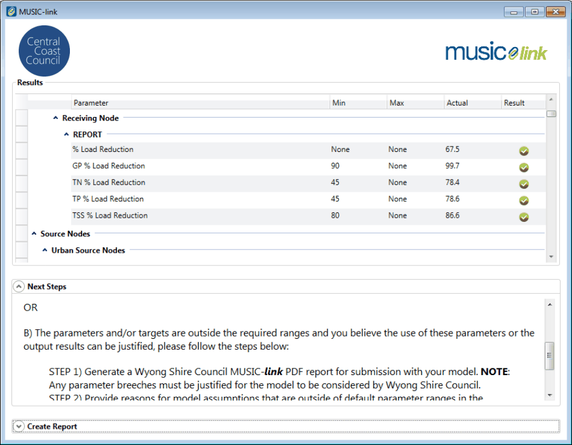
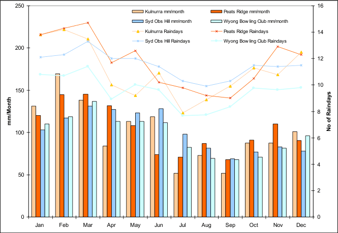
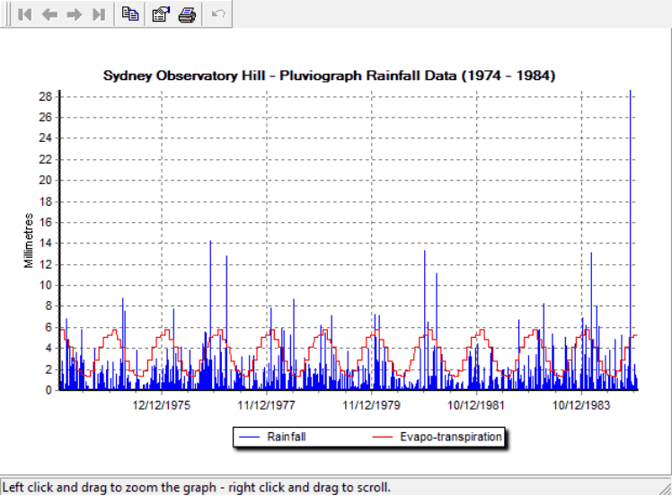
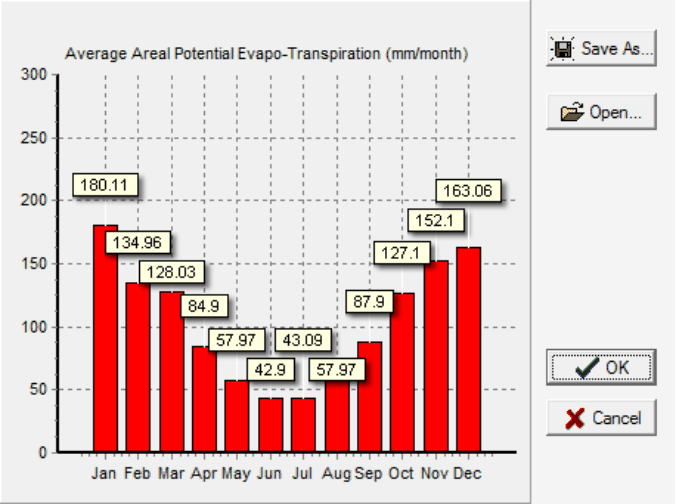
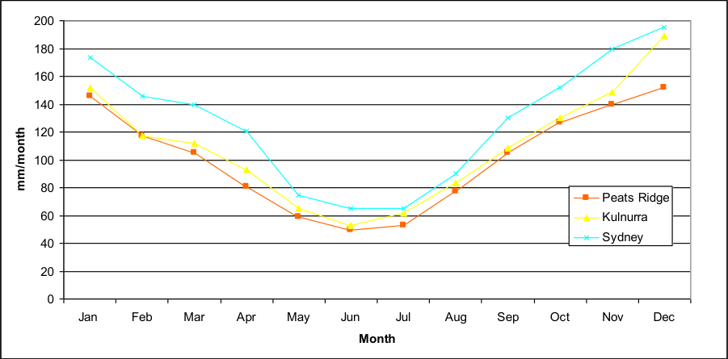
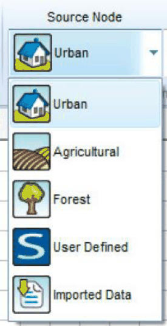
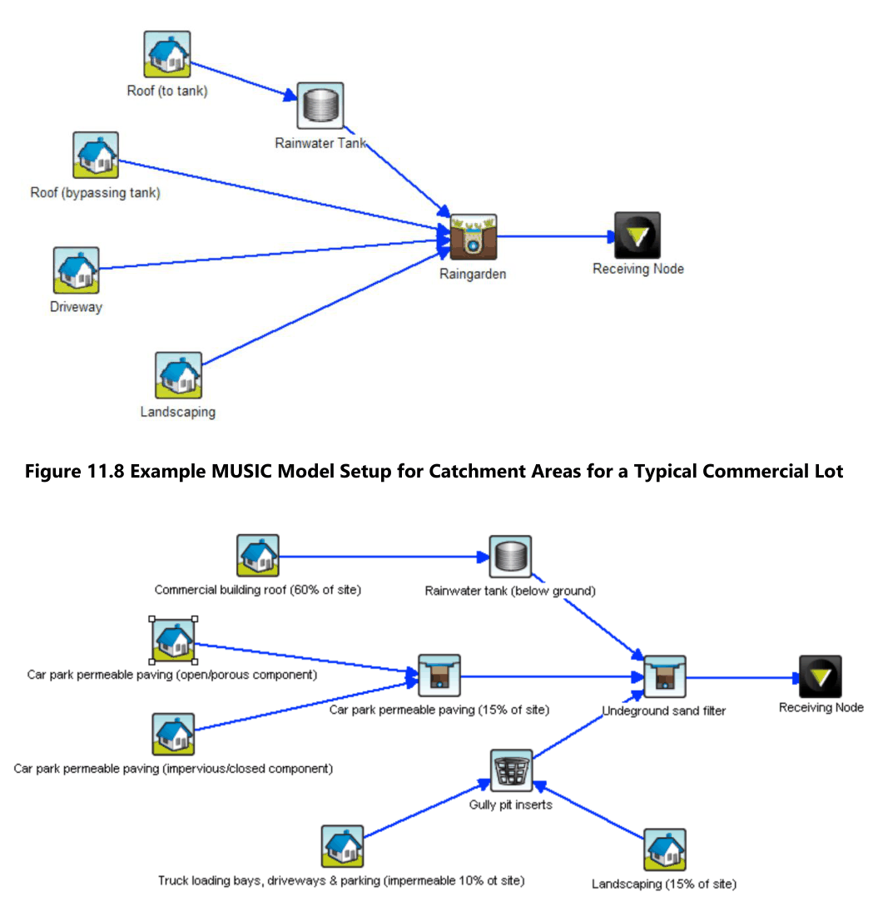
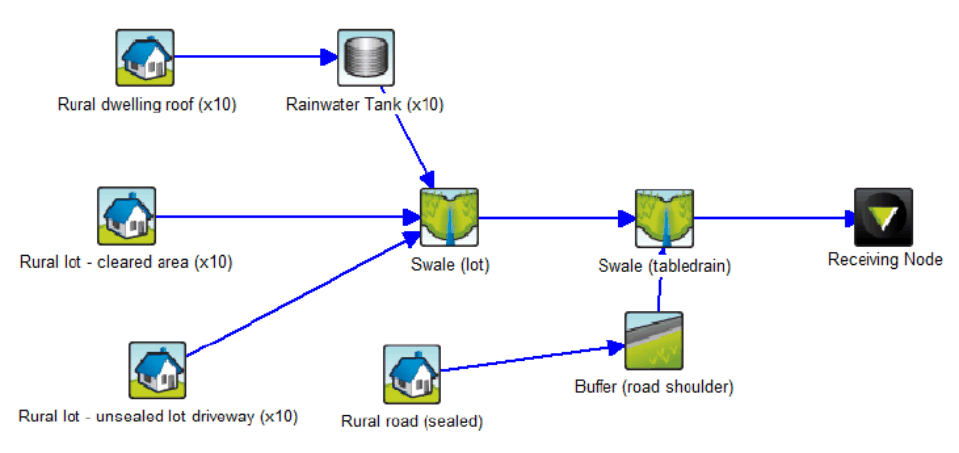
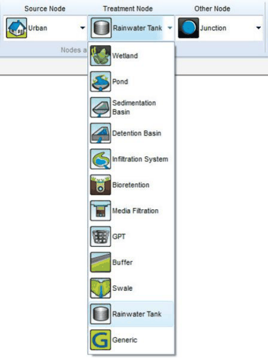
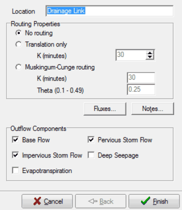

## Section 11 -  Water Sensitive Urban Design (WSUD) and MUSIC Modelling Guidelines

### 11.1 General

Council’s Civil Works Specification - Design Guideline shall be read in conjunction with the associated Construction Specification and Standard Drawings, and any applicable Council Policies and Plans relating to WSUD. Council’s Development Control Plans are to be referenced for requirements applying to different development types in the Central Coast Local Government Area.

This Section provides guidance on modelling parameters and approaches to be used when modelling WSUD elements in MUSIC (Model for Urban Stormwater Improvement Conceptualisation). It is applicable to Proposed Development in the Central Coast Council Local Government Area.

Water Sensitive Urban Design (WSUD) is a set of principles that can be applied to sustainably manage water, providing opportunities for the development industry, local government and their communities to achieve more liveable cities with vibrant and healthy waterways.

Urban development using conventional approaches can have a negative impact on the natural water cycle. WSUD seeks to minimise the impact of urbanisation on the water cycle by integrating developments with a site’s natural features and promoting the integration of stormwater.

Application of these principles includes:

• Minimise the volume of stormwater runoff.

• Reduce stormwater runoff and peak flows from urban developments by local detention basins and minimising impervious areas.

• Treating urban stormwater to best practice standards for reuse and/or discharge to receiving waters.

• Reducing potable water demand through water efficiency, stormwater harvesting and wastewater reuse.

• Minimising wastewater generation and treatment of wastewater so that is can be reused.

• Integrating vegetated stormwater treatment into the landscape, to provide increased biodiversity, amenity and micro-climate benefits which can reduce the heat island effect.

• Providing green infrastructure and green links to improve habitat corridors.

This Section supports those submitting MUSIC models relating to development within the Central Coast Council Local Government Area and has been developed to:

• Ensure a consistent and uniform based approach is applied when submitting MUSIC models to Council.

• Provide guidance on parameters to be used when using MUSIC to assess compliance with Central Coast Council’s stormwater management objectives.

• Reduce the time taken by Central Coast Council in assessing and reviewing models.

This document should be read in conjunction with the MUSIC User Manual. Users of these guidelines are expected to know how to use MUSIC software and be sufficiently trained in the use of MUSIC software.

### 11.2 WSUD Requirements for Developments

The development types that are required to meet Council’s Water Sensitive Urban Design Requirements are identified in Council’s Development Control Plans.

#### Stormwater Quality

Recent developments in urban stormwater quality modelling software have resulted in a significant advancement in the ability to simulate the pollutant removal efficiency of a range of stormwater treatment devices. Specifically, MUSIC developed by the Cooperative Research Centre for Catchment Hydrology (CRC-CH) now provides stormwater practitioners with a conceptual design tool that estimates stormwater pollutant generation and the performance of stormwater treatment measures.

The program can be used to estimate pollutant generation from a catchment and to demonstrate the performance of stormwater quality improvement systems. Central Coast Council requires treatment of stormwater so that annual pollutant loads achieve the minimum targets set out in the Best Practice Environmental Management Guidelines (BPEMG) and the Engineers Australia publication - Australian Runoff Quality (Wong, 2006) - A Guide to Water Sensitive Urban Design these are:

#### Minimum Pollutant Removal Performance Targets (Australian Runoff Quality 2006)

| Pollutant | Performance Requirements (Targets) |
|---|---|
| Total Suspended Solids (TSS) | 80% reduction in the post-development mean annual load |
| Total Nitrogen (TN) | 45% reduction in the post-development mean annual load |
| Total Phosphorous (TP) | 45% reduction in the post-development mean annual load |
| Gross Pollutants | 90% reduction in the post-development mean annual load (for pollutants greater than 5mm in diameter |
| Hydrology | The post-development peak discharge must not exceed the pre-development peak discharge for flows for the 5, 20 and 100% AEP event |

There are, however, many cases where individual treatment measures will have different targets, for instance if the receiving aquatic ecosystem is identified as being of very high value, then Central Coast Council may require a higher treatment level in accordance with a site-specific Development Control Plan (DCP) for new urban release areas.

The design intent for any treatment system must be clearly documented and discussed with Council’s Representative early in the conceptual design stage. Stormwater drainage pit litter baskets are not accepted for assets to be handed over to Council for its care and control. Central Coast Council uses MUSIC to assess the impacts of proposed development against adopted performance targets. If

alternative methods or models are used, the developer must demonstrate to Council’s Representative satisfaction that performance targets can be achieved. This document provides guidance on input parameters and modelling approaches for MUSIC modelling that are recommended by Central Coast Council.

#### Proposed Updates to MUSIC (and this guideline)

At the time of writing this guideline, the current version of the MUSIC software was version 6.3. eWater MUSIC version 6 introduced the MUSIC-link function. This new feature streamlines the process of assessing the compliance of water sensitive urban designs submitted against guidelines from a council or other Local Government Authority. MUSIC-link, allows developers and their consultants the ability to streamline the assessment by using pre-defined parameters applicable to the particular Local Government Area to which the development is located. Central Coast Council has set-up MUSIC-link functionality within MUSIC for this purpose and encourages the Service Provider to self-validate results prior to submitting with Development Application and/or Construction Certificate documentation to Council.

Figure 11.1 Screenshot of the MUSIC-link Interface for Central Coast Council LGA

> [Picture on page 124: a picture, saved as a picture (images/civil-works-specification-design-guideline-page-124-16.gif, 150 dpi).]

#### Figure 11.2 MUSIC-link Validation Report for Central Coast Council LGA

> [Picture on page 125: a picture, saved as a picture (images/civil-works-specification-design-guideline-page-125-2.gif, 150 dpi).]

Further updates to the guideline will occur on a regular basis (every 1 - 2 years) in response to new science and research into stormwater quality and stormwater treatment.

Note: The consultant preparing the MUSIC model shall also include an appropriate background image when prompted when setting up the model to aid in the assessment process and the visualisation of proposed treatment measures. This process is outlined in the MUSIC User Manual.

#### Submission Requirements for Development Applications

To demonstrate compliance with Council requirements as outlined above, a Water Cycle Management Plan (WCMP) must be submitted with the development application. A WCMP details the WSUD strategy and the water management measures to be implemented on a proposed development site including water conservation objectives and stormwater quality control to meet Council’s stormwater quality targets.

The main elements to be included within a WCMP are:

• Background Information and Site Analysis.

• Proposed development description.

• WSUD objectives applicable.

• MUSIC-link modelling results report demonstrating compliance with parameters and targets and an electronic copy of the MUSIC file (.sqz) for internal review.

• Costs and maintenance requirements.

Table 11.2 outlines the detail required under each of the headings and provides links to supporting information and key resources and tools available to assist in the preparation of the WSUD Strategy. The supporting information is contained both within this document as well as in external documents which are available on the internet.

#### Contents of a WSUD Strategy and Tools and Resources Available

| Outline Contents | Details to be Provided in the WSUD Strategy | Supporting Information |
|---|---|---|
| Background Information and Site Analysis | Summarise any background information available on the site, including previous studies, existing site conditions and constraints and details of the development – layout, size catchments, topography, land use etc. |  |
| Proposed Development | Describe the proposed development at the site, including boundaries, land uses, existing/proposed infrastructure, staging etc. | Proponents supporting DA documentation |
| WSUD Objectives | This section should identify the WSUD objectives which apply to the development including water conservation and stormwater quality objectives and how the treatment measures will integrate with the development layout and the surrounding area. |  |
| Stormwater Quality control measures and modelling | Establish a conceptual stormwater quality (MUSIC) model for the proposed development to predict expected pollutant loads generated from the development and develop an appropriate strategy to achieve the performance targets. Run a MUSIC-link report for Central Coast Council LGA. The information submitted with the WSUD Strategy should include: • Schematic of the model including, Location (including background image) and layout of stormwater treatment train measures. • Provide a copy of the results and MUSIC-link report in an appendix demonstrating compliance with the parameters and performance targets. A functional electronic copy of the MUSIC (.sqz) program file is to be provided. • Any variation from the recommended MUSIC parameters must be reported and suitable justification provided. | MUSIC modelling software (e-water) Standard MUSIC parameters for Central Coast Council (Section 3 of this document and MUSIC-link) NSW MUSIC Modelling Guidelines (BMT WBM 2015) WSUD Conceptual Design Guidelines (external link section) |

| Outline Contents | Details to be Provided in the WSUD Strategy | Supporting Information |
|---|---|---|
| Cost – Operation and Maintenance | Prepare capital and operation and maintenance cost estimates of the proposed water cycle management measures. Both typical annual maintenance costs and corrective maintenance or renewal/adaptation costs should be included. | Concept Design Guidelines for WSUD (external link Section) |

### 11.3 Supporting Information for the Preparation of a Water Quality Strategy for a Development Application

When preparing supporting documentation for a Development Application, a proponent is required to employ the services of appropriately qualified and experienced practitioners for the development of an appropriate WSUD strategy for their site.

The following information should be referenced when developing the strategy:

1\. MUSIC Model: The Model for Urban Stormwater Improvement Conceptualisation (MUSIC), derives default water quality parameters for a range of pollutants generated from various land use types. As presented in Australian Runoff Quality (Engineers Australia) most verified and published Australian water quality research has been synthesised and incorporated into MUSIC. The latest version of MUSIC is version 6.3

(2018) and is available for purchase at MUSIC by eWater. The MUSIC model includes a modelling guideline which should be referred to when using the MUSIC software. Location specific parameters for the MUSIC model in the Central Coast Region are outlined in this document and have been implemented into MUSIC-link.

> [Picture on page 127: a picture, saved as a picture (images/civil-works-specification-design-guideline-page-127-19.gif, 150 dpi).]

2\. MUSIC Modelling guide: The development of a MUSIC model requires specific inputs and parameters. For proposed developments in the Central Coast Region LGA key parameters for undertaking any MUSIC modelling are outlined in Section 11.4 of this Guideline and provided in MUSIC-link documentation. Further information on MUSIC modelling best practice is available in the NSW MUSIC Modelling Guidelines 2015 (BMT WBM).

3\. WSUD Conceptual Design Information: Information on specific WSUD elements (such as rainwater tanks, bio-retention/raingardens

and wetlands) and where they are appropriate is available in the South East Queensland’s (SEQ) Water by Design program’s Concept Design Guidelines for WSUD. This document provides an industry standard and seeks to assist multi-disciplinary teams conceptualise and develop design solutions that integrate best practice sustainable urban water management within the urban form.

#### Engaging a Consultant to Develop a WSUD Strategy

Applicants and Service Providers are required to engage the services of appropriately qualified and experienced practitioners for the development of the Water Management Plan. The benefit of using consultants with demonstrated capacity to undertake a WSUD strategy will generally reflect a smoother and straight forward approval process. Consultants should possess the following skills:

• Advanced MUSIC modelling training and experience.

• Demonstrated experience in designing WSUD elements.

### 11.4 MUSIC Modelling for the Central Coast Region

This section provides guidance on modelling parameters to be used when modelling WSUD elements in MUSIC for development within the Central Coast Council Region. These guidelines are provided to ensure Service Providers have a consistent and uniform approach to stormwater quality modelling in the Central Coast LGA.

The approaches and parameters outlined in this section shall always be used when developing a WSUD Strategy to meet the minimum targets specified above. Further information on MUSIC Modelling is available in the most current version of the NSW MUSIC Modelling Guideline (BMT WBM). The information is an adaption of the NSW MUSIC Modelling Guideline and should be read in conjunction with the eWater MUSIC User Guide which is provided with the MUSIC software when installed.

This guideline provides specific guidance on rainfall and evaporation inputs, source node parameters, rainfall runoff parameters, pollutant generation parameters and stormwater treatment nodes. Any MUSIC models that are not consistent with this guideline must provide suitable justification for the differences in parameters and/or assessment methods.

These guidelines should be read in combination with the most current version of the NSW MUSIC Modelling Guidelines and the MUSIC User Guide, which outlines all the definitions, assumptions and methodologies provided within the MUSIC tool.

#### MUSIC Model Setup

A MUSIC model requires a significant amount of information during the model set-up stage. These steps include the selection and input of the following information:

• Appropriate meteorological data (rainfall and evaporation inputs).

• Defining catchment areas (source nodes) to be incorporated into the model.

• Appropriate soil properties (rainfall runoff properties).

• Pollutant generation characteristics for selected source nodes.

#### MUSIC Parameters

#### 11.4.2.1 Rainfall and Evaporation Inputs

Stormwater runoff is represented as both surface runoff and baseflow in the MUSIC model. It is generated in MUSIC through the interaction of rainfall, evapotranspiration and the MUSIC Rainfall- Runoff Model (see MUSIC User Manual for full description of Rainfall-Runoff Model). The following sections outline Council’s preferred rainfall and evapotranspiration datasets to be used when undertaking stormwater quality designs and hydrologic investigations for stormwater harvesting.

#### 11.4.2.2 Rainfall Data for Water Quality (WSUD) Modelling

Council requires the following approach to rainfall simulation be adopted for stormwater quality modelling:

• Continuous simulation of 5 years minimum to 10 years (ideal).

• A 6-minute time step is to be utilised as this allows for the appropriate definition of storm hydrograph movement through small-scale stormwater treatment processes such as vegetated swales and bioretention systems.

To provide a consistent approach to stormwater modelling, Council has identified an appropriate rainfall station for the Central Coast Region LGA, and periods of modelling to be utilised within the MUSIC model. Three 6-minute rainfall data (i.e. pluviography) stations were investigated for their suitability. These included rainfall stations at:

• Kulnura (William Road), approximately 25km west of Wyong.

• Peats Ridge, approximately 20 km west-southwest of Wyong.

• Sydney (Observatory Hill), approximately 70-75 km south-southwest of Wyong.

Comparison of rainfall at various stations within the Central Coast Council LGA and Sydney Observatory Hill are shown in Figure 11.3 below.

#### Figure 11.3 Six-Minute Rainfall Station Comparison

> [Picture on page 129: a map, saved as a picture (images/civil-works-specification-design-guideline-page-129-25.gif, 150 dpi); the street names and other small labels are on the picture.]
> Words printed on the picture (title and legend, copied from the PDF):
> Kulnurra mm/month Peats Ridge mm/month
> Syd Obs Hill mm/month Wyong Bow ling Club mm/month
> Kulnurra Raindays Peats Ridge Raindays
> Syd Obs Hill Raindays Wyong Bow ling Club Raindays
> No of Raindays
> Jan Feb Mar Apr May Jun Jul Aug Sep Oct Nov Dec

Central Coast Council has identified that the 6-minute rainfall data record at Sydney Observatory Hill (over 150 years of recorded rainfall data) best represents the rainfall variability experienced in the Central Coast Region, with the rainfall and number of rain days per month, when compared to Kulnura, Peats Ridge and Wyong Bowling Club rainfall records. It consistently has about one more rain day a month than Wyong, suggesting that rainfall at Wyong Bowling Club is more intense than at Sydney. The Kulnura station has limited, and incomplete pluviograph data and Peats Ridge has significant missing data periods in the 30 years of rainfall records. The average annual rainfall for the period chosen for modelling closely matches the long-term average for the Central Coast Region for the Peats Ridge rainfall station of 1249mm.

Given the above, Council requires all stormwater quality modelling in MUSIC to be undertaken using the Sydney Observatory Hill rainfall data and the modelling period between 1974 and 1984 (refer Table 11.3).

#### Recommended 6-Minute Rainfall Station

| Rainfall Station | Modelling Period | Average Annual Rainfall (mm) |
|---|---|---|
| Sydney (Observatory Hill) :066062 | 01/01/1974- 31/12/1984 | 1238 |

Figure 11.4 Rainfall Time-Series Graph for Sydney (Observatory Hill) – 1974-1984

> [Picture on page 130: a picture, saved as a picture (images/civil-works-specification-design-guideline-page-130-16.gif, 150 dpi).]

#### 11.4.2.3 Rainfall Data for Water Quantity (Hydrologic) Modelling

The following approach is to be undertaken for water quantity/hydrologic assessment modelling. That is, modelling required for stormwater harvesting analysis and stormwater storage design in response to wetland hydrology and waterway stability objectives.

Continuous simulation of 10 years minimum to 20 years (ideal) should be used, including:

• Daily time step is to be utilised for simulating stormwater storage.

• The rainfall data contains a wet, dry and average rainfall year.

Central Coast Council has identified two appropriate daily rainfall stations to be utilised within the MUSIC model for hydrologic modelling. Sydney Observatory Hill is the preferred rainfall station. However, if daily rainfall data is required, then the Wyong Bowling Club rainfall records can be used.

#### Recommended Daily Rainfall Station

| Rainfall Station | Modelling Period1 | Average Annual Rainfall (mm) |
|---|---|---|
| Sydney (Observatory Hill) (preferred) | 01/01/1963 - 31/12/1984 | 1237 |
| Wyong Bowling Club | 1918-1965 | 1184 |

#### 11.4.2.4 Evapotranspiration Data

Central Coast Council found that Sydney evaporation data closely matches that from the Central Coast region (although slightly higher) and is therefore suitable for use in MUSIC modelling for water quality and hydrology. The monthly evapotranspiration values for Sydney are shown in Table 11.5 and the comparison with Peats Ridge and Kulnura is illustrated in Figure 11.6.

#### Figure 11.5 Potential Evapotranspiration Data for Sydney (Observatory Hill)

> [Picture on page 131: a picture, saved as a picture (images/civil-works-specification-design-guideline-page-131-13.gif, 150 dpi).]

#### Monthly Evapotranspiration Values

| Month | J | F | M | A | M | J | J | A | S | O | N | D |
|---|---|---|---|---|---|---|---|---|---|---|---|---|
| Evapotranspiration (mm) | 180 | 135 | 128 | 85 | 58 | 43 | 43 | 58 | 88 | 127 | 152 | 163 |

1  Select a period that has minimal gaps in the data

#### Figure 11.6 Comparison of Evaporation Data for Sydney and Central Coast Regions

> [Picture on page 132: a map, saved as a picture (images/civil-works-specification-design-guideline-page-132-2.gif, 150 dpi); the street names and other small labels are on the picture.]
> Words printed on the picture (title and legend, copied from the PDF):
> Jan Feb Mar Apr May Jun Jul Aug Sep Oct Nov Dec

#### 11.4.2.5 Rainfall Runoff Parameters

Stormwater runoff (represented as storm flow and baseflow) is generated in MUSIC through the interaction of rainfall, evapotranspiration and the MUSIC Rainfall-Runoff Model. A full description of the MUSIC Rainfall-Runoff Model is provided in the MUSIC User Manual.

MUSIC rainfall-runoff parameters were derived for the Central Coast Council LGA through a calibration process to stream flow information for Jilliby - Jilliby Creek (upstream tributary of Wyong River). Details of this calibration process are provided in the DRAFT Discussion Paper Modelling Rationale for the Porters Creek Stormwater Harvesting Strategy (Ecological Engineering 2006).

Based on the calibration to stream flow data at Jilliby - Jilliby Creek two general pervious source nodes were developed, an ‘upland’ and ‘lowland’ node, based on the following catchment geography:

• Upland nodes are areas within the catchment where slopes are generally greater than 5% and are typically found in the headwaters of the catchments.

• Lowland nodes are areas with slopes generally less than 5% and are typically found in the floodplain zone of unconfined valleys of a higher order creek.

Pervious areas must be modelled as upland or lowland area depending on the location of the development within the Central Coast LGA.

#### 11.4.2.6 Defining Upland and Lowland Areas

To delineate between upland and lowland areas, the following steps should be undertaken:

• Obtain the best available contour data for the catchments of interest.

• Make an initial visual assessment of the contour information based on obvious changes in slope and topography for a rough estimation of upland and lowland areas.

• Calculate ground slopes (%) for the area of interest. A Digital Elevation Model may be of assistance in delineating upland and lowland areas for larger catchments.

• Analyse slope data to identify areas greater than and less than approximately 5% slope. Slopes <5% are considered lowland and slopes >5% are considered upland. Note: It

may be necessary to repeat this step with slopes of 2-6% to achieve a reasonable delineation between upland and lowland areas.

• Perform a manual check and edit anomalies. Common anomalies include relatively flat areas in the upper part of the catchment (e.g. gently sloping hill tops). These areas should be modelled as upland to reflect the likely soil properties.

A site-specific assessment should be performed for most developments, to generate more detailed information at a scale appropriate to the individual development.

#### 11.4.2.7 Rainfall – Runoff Parameters for Upland and Lowland Areas

The following soil characteristics are to be used in the rainfall-runoff parameters of upland and lowland areas:

#### Soil Characteristics

| Parameter | Upland (>5% slope) | Lowland (<5% slope) |
|---|---|---|
| Impervious area parameters |  |  |
| Rainfall Threshold (mm) | 1 | 1 |
| Pervious area parameters |  |  |
| Soil Capacity (mm) | 200 | 250 |
| Initial Storage (%) | 30 | 30 |
| Field Capacity | 80 | 100 |
| Infiltration Capacity Coefficient a | 200 | 200 |
| Infiltration Capacity Coefficient b | 1 | 1 |
| Groundwater Properties |  |  |
| Initial Depth (mm) | 10 | 10 |
| Daily Recharge Rate (%) | 0.5 | 4 |
| Daily Baseflow Rate (%) | 0.16 | 2 |
| Deep Seepage (%) | 2 | 0.4 |

Note: The above rainfall threshold values are an average value for the various land-use types. Refer to the current version of the NSW MUSIC Modelling Guidelines (i.e. Table 5-4) for specific threshold values relating to roofs, roads/paths etc.

### 11.5 MUSIC Source Nodes

The source nodes must be defined to reflect the details of the contributing catchments of the development. Source Nodes for Central Coast Council catchments are defined below:

• The Urban Source Node is used to describe low to high density residential, commercial and industrial areas. These land uses include lots with all associated facilities, such as roads and parks.

• The Agricultural Source Node refers to areas of large-scale cropping or grazing. This node should only be used for low density rural areas situated in predominantly agricultural settings.

• The Forested Source Node is to be used for natural bushland areas. This node is to be utilised in areas where canopy densities are greater than 50%.

• The Imported Data Source Node is to be utilised in the regional storage and harvesting scenario modelling.

Each individual Source Node, with the exception of the Imported

> [Picture on page 134: a picture, saved as a picture (images/civil-works-specification-design-guideline-page-134-19.gif, 150 dpi).]

Data Node, requires the total area and effective impervious area (EIA) percentage of the site to be defined.

An initial estimate of percentage impervious for each particular land use should be based on the ultimate zoning of the area, reflecting the ultimate land use of the catchment. Building density controls for urban areas must also be considered, including elements such as minimum soft landscaping area, maximum building envelopes, floor space ratios and road design guidelines. These estimates should also be compared to aerial photos of similar recent housing developments in the vicinity of the proposed development. Where differences between the estimates and the on ground impervious area are significant then estimates should be revised or the differences justified. Section 10

- Stormwater Drainage Design of this document provides information on determining appropriate development impervious areas.

#### Urban Land Use Split

The urban node must be split into the various land use types (i.e. road reserve, roof, ground level pervious and impervious) when the following proposed developments are modelled:

• A single lot (including commercial and industrial).

• A single street (including multiple lots).

• The influence of rainwater tanks within a development (regardless of the size of development).

When utilising this approach:

• Roof areas are to be modelled as 100% impervious.

• Road reserve areas include the road and adjacent landscaping and paths contained within the road reserve. Imperviousness of this node should be approximately 70%.

• Remaining ground areas can be further split into pervious and impervious areas when required.

An example of an urban land-use split in MUSIC is shown below:

Figure 11.7 Example MUSIC Model Setup for a Typical Single Low-Density Residential Lot

#### Including a Rainwater Tank

> [Picture on page 135: a picture, saved as a picture (images/civil-works-specification-design-guideline-page-135-6.gif, 150 dpi).]

Figure 11.8 Example MUSIC Model Setup for Catchment Areas for a Typical Commercial Lot

#### Multiple Lots

To simplify the model, the modeller should look to combine areas with similar characteristics, such as where a subdivision is proposed of similar lots. The individual lots do not need to be modelled

separately, but can be aggregated, or “lumped” such that the source node used represents several lots of similar characteristics. The imperviousness used in this case should reflect the aggregated lots. The size of the treatment measures estimated using this modelling approach can also be aggregated and proportioned within the site based upon the actual size any individual treatments on each individual

lot. The example in Figure 11.9 below shows an area being modelled where 10 lots are lumped into a single source node for each of surface types required. The rainwater tank node is also used to lump 10 rainwater tanks into a single treatment node.

#### Figure 11.9 Combining Areas to Simplify MUSIC Modelling

> [Picture on page 136: a picture, saved as a picture (images/civil-works-specification-design-guideline-page-136-9.gif, 150 dpi).]

#### Pollutant Generation

The recommended model defaults for various land use categories is based on research by Fletcher et

al. (2004). These are adopted from the current version of NSW MUSIC Modelling Guidelines.

Note: For all simulations the MUSIC model must be run with pollutant export estimation method set to “stochastic generated” as opposed to the “mean” estimation method.

#### Stormwater Quality Parameters for MUSIC Source Nodes (BMT WBM)

| Land-use Category |  | Log10 TSS (mg/L) |  | Log10 TP (mg/L) |  | Log10 TN (mg/L) |  |
|---|---|---|---|---|---|---|---|
|  |  | Storm Flow | Base Flow | Storm Flow | Base Flow | Storm Flow | Base Flow |
| Large Areas of Interest |  |  |  |  |  |  |  |
| General Urban (including public open space) | Mean Standard Deviation | 2.15 0.32 | 1.20 0.17 | -0.60 0.25 | -0.85 0.19 | 0.30 0.19 | 0.11 0.12 |
| Residential |  |  |  |  |  |  |  |
| Industrial |  |  |  |  |  |  |  |
| Commercial/Business |  |  |  |  |  |  |  |
| Rural | Mean Standard Deviation | 1.95 0.32 | 1.15 0.17 | -0.66 0.25 | -1.22 0.19 | 0.30 0.19 | -0.05 0.12 |
| Small Areas of Interest |  |  |  |  |  |  |  |
| Sealed Road Areas | Mean Standard Deviation | 2.43 0.32 | ---* ---* | -0.30 0.25 | ---* ---* | 0.34 0.19 | ---* ---* |
| Roof Areas | Mean Standard Deviation | 1.30 0.32 | ---* ---* | -0.89 0.25 | ---* ---* | 0.30 0.19 | ---* ---* |

\* Base flows are only generated from pervious areas; therefore, these parameters are not relevant to impervious areas. Refer to NSW MUSIC Modelling guidelines for other land uses (e.g. Forest, Agricultural, Quarries, etc).

#### Link Routing

Routing may be used to reflect the travel time for flood wave propagation through the catchment. For all MUSIC model simulations, it is recommended that the channel routing option in MUSIC be set to “No Routing” as this is the most conservative modelling scenario.

If the routing option is used in the model, suitable justification is required to be submitted with the concept design. Translation only method or Muskingham-Cunge method are to be used if the routing option is chosen. The user is referred to the MUSIC User Manual for further details.

### 11.6 Stormwater Quality Treatment Nodes

To meet the site’s stormwater quality objectives, the development will need to incorporate an appropriate stormwater treatment process for the development, dependent on-site constraints and opportunities.

The default parameters in MUSIC for the first order decay k-C* model used to define the treatment efficiency of each treatment device should be used unless local relevant treatment performance monitoring can be used as reasonable justification for modification of the default parameters. Reference should be made to the MUSIC User Manual.

Several stormwater treatment elements are available in MUSIC as shown adjacent. Once the WSUD objectives have been determined for a site, an appropriate treatment train can be modelled in MUSIC.

In order to avoid any confusion relating to treatment node implementation Council provides the following advice for modelling stormwater quality treatment systems within the Central Coast Council LGA.

> [Picture on page 138: a picture, saved as a picture (images/civil-works-specification-design-guideline-page-138-37.gif, 150 dpi).]

The following devices are not to be modelled within the MUSIC program:

• Natural waterways.

• Natural wetlands.

• Naturalised channel systems.

> [Picture on page 138: a picture, saved as a picture (images/civil-works-specification-design-guideline-page-138-42.gif, 150 dpi).]

• Environmental buffers.

• Natural lake/pond systems.

Table 11.8 below briefly outlines each treatment element available in MUSIC, and parameters to be used, if applicable. Reference should be made to the current version of MUSIC user manual for further details and modelling requirements for rainwater reuse, pervious pavements and other treatment measures

Please note that MUSIC is a conceptual comparison tool only, not a design tool. It is essential that devices included in a model are achievable within the modelled catchment. The designer should carry out preliminary calculations to ensure that devices included can be drained and adequate allowance has been made for batters in restricted areas.

#### Stormwater Treatment Parameters

| Stormwater Treatment Measures | Selected Key Parameter Values and Design Guidance |
|---|---|
| Bioretention systems are a combination of vegetation and filter substrate that provides treatment of stormwater through filtration, extended detention and some biological uptake | High flow bypass = generally 3-month ARI flow (to be calculated by consultant) • Extended detention (i.e. ponding) depth = 100 - 300mm (for basins) • Saturated hydraulic conductivity = 125mm/hr (maximum) • Filter depth = 500 - 800mm • TN content of filter media = 400mg/kg (where unknown) • Orthophosphate content of filter media = 40mg/kg • Exfiltration (seepage) rate = 0mm/hr Note that a submerged (saturated) zone requires a specially designed outlet pit configuration. |

| Stormwater Treatment Measures | Selected Key Parameter Values and Design Guidance |
|---|---|
| Gross Pollutant Traps (GPTs) typically remove rubbish, sediment and hydrocarbons from stormwater runoff | There are no specific input parameters for GPTs High flow bypass for the device = 3-month ARI peak flow (50% 1 yr ARI). It is suggested that the default treatment performance values shown below be adopted where no data is provided. • Total Suspended Solids (TSS) removal = 65% (unless CDS-type system, when TSS removal can be up to 70% for inflow concentrations greater than 75mg/L). • Total Phosphorus (TP) removal = 15% (unless a CDS-type system, when TP removal can be up to 30% for inflow concentrations greater than 0.5mg/L). • Total Nitrogen (TN) removal = 14% If alternative performance values are adopted, independent testing data shall be provided with the report to support their use. Stormwater drainage pit litter baskets are not accepted for assets to be handed over to Council for its care and control. * Central Coast Council can provide acceptable GPT nodes. Generally, the Rocla CDS and HumeGard units are preferred due to their extensive performance testing and monitoring. Refer to Gross Pollutant Removal From Urban Waterways and Field evaluation of the Nutrient Removal Performance of a Gross Pollutant Trap (GPT) in Australia |

| Stormwater Treatment Measures | Selected Key Parameter Values and Design Guidance |
|---|---|
| Constructed wetland systems use enhanced sedimentation, fine filtration and pollutant uptake processes to remove pollutants from stormwater | High Flow bypass = 1-year ARI flow (to be calculated by consultant) Inlet pond volume calculated using: • Inlet pond surface area = 10% of macrophyte zone (storage surface) area • Inlet pond depth = 2.0m recommended • Extended detention depth = 0.25 - 0.75m based on outlet design • Notional detention time target = 48 - 72 hours for optimal treatment and to allow nutrient uptake. • Evaporative loss shall be left as default at 125% of PET • Seepage loss should be modelled as 0mm/hr (i.e. 300mm impermeable clay liner) unless it can be shown that infiltrated flows with re-contribute to observable downstream flows (i.e. secondary flow link) Adjust the pipe diameter or orifice size to ensure the device has adequate residence time. Sizes less than 100mm diameter are to consider appropriate screening to prevent blockage. * A fixed default of 50% coverage of vegetation applies to the constructed wetland node. If less vegetation is proposed, the constructed wetland node k and C* values should be modified to the pond node values to represent a lower level of treatment. |

| Stormwater Treatment Measures | Selected Key Parameter Values and Design Guidance |
|---|---|
| Vegetated swales are open vegetated channels that can be used as an alternative stormwater conveyance system to pipes or can be used in conjunction with a pipe system | • The longitudinal bed slope between 1 - 4% grade • Swales with bed slopes between 1 - 2% must incorporate a low-flow subsoil drainage line. • Vegetation heights of 50 - 500mm are acceptable; however, MUSIC assumes that swales are heavily vegetated when modelling their treatment performance. Mown grass swales should not be expected to provide significant stormwater treatment and should not be modelled in MUSIC. • Set low flow bypass to 0m3/s unless low flows draining to the swale would bypass in low flow events (i.e. low flow pipe under the swale). • Ensure side batters are a minimum of 1 (vertical): 4 (horizontal). Swale depths should be between 150 and 300mm in road reserves and can be deeper in other areas (e.g. open space areas). Model seepage loss as 0mm/hr unless it can be proven that infiltrated runoff would not contribute to observed flows downstream. |

| Stormwater Treatment Measures | Selected Key Parameter Values and Design Guidance |
|---|---|
| In order to appropriately model the treatment efficiency of a rainwater tank within an urban development, the rainwater tank that is entered into MUSIC must comply with any BASIX certificate for that residential site | Only roofs should be connected (100% impervious). Given constraints due to gutter and downpipe arrangement, typically a maximum of 50% of the total roof area can be connected to one tank for retrofits. An assumption of no more than 75% connection is feasible for greenfield developments. • High flow bypass = 0.005m3/s per dwelling • 80% of the physical rainwater tank volume should be adopted for modelling. This caters for 10% allocated for sediment storage and 10% allowance for an air gap above the overflow pipe. If using stored water for irrigation, insert annual irrigation demand (kL/yr) and provide other irrigation estimation details. For a daily demand (kL/day), make estimation based on proposed building design with calculations of proposed demands to be connected (e.g. toilet flushing and/or washing machines). Water demand must be justifiable. * If rainwater tanks are used for on-site detention (OSD) storage, the proportion of the tank available for harvesting below the OSD outlet may be significantly lower than 80% and this should be allowed for in the model. Modelling on-site detention (OSD) with rainwater reuse tanks. • The rainwater tank should have the depth above the overflow pipe set to the storage depth of the tank above the OSD outlet, and the volume below the overflow set 0. No reuse should be specified from the tank. • In some circumstances a BASIX rainwater tank may be required in addition to an OSD tank. For this situation, two rainwater tanks in series can be configured. The first rainwater tank would be modelled with water demands and a storage volume below the overflow to suit BASIX requirements. The second tank in the series would be simulated as an OSD tank as above. |

| Stormwater Treatment Measures | Selected Key Parameter Values and Design Guidance |
|---|---|
| Infiltration measures encourage stormwater to infiltrate into surrounding soils | Infiltration measures are highly dependent on local soil characteristics and are best suited to sandy soils with deep groundwater. Generally geotechnical assessment is to be undertaken before infiltration is considered at a particular site. Establish the infiltration rate based on findings from a geotechnical engineering report or soil percolation test to determine the likely infiltration rate from the device to the surrounding soils. Infiltration is not a stormwater treatment measure and stormwater treatment should be provided upstream of infiltration basins. MUSIC pollutant removal parameters assume that the basin is vegetated and that stormwater is pre-treated to remove coarse sediment upstream of the retention/infiltration basin. If these assumptions are not true, then the basin should not be expected to meet the pollutant removal performance estimated in MUSIC. |
| Water quality ponds (note there are separate procedures for modelling water storage ponds) | • Permanent pool = 1.0 - 2.0m • Extended detention depth = 0.25 - 1.0m Parameters within the MUSIC model assume that stormwater is pre-treated to remove coarse sediment upstream of the pond, therefore ponds should never be designed without pre-treatment (such as a swale or sedimentation basin) |
| Sediment basins are used to retain coarse sediments from runoff. They operate by reducing flow velocities and encouraging sediments to settle out of the water column | Permanent pool volume based on 2m depth (e.g. with a surface area 50m2 the permanent pool volume would be 100m3) Extended detention depth = 0.25 - 1.0m Exfiltration (Seepage loss) = 0mm/hr unless soil tests indicate otherwise |

| Stormwater Treatment Measures | Selected Key Parameter Values and Design Guidance |
|---|---|
| A detention basin is assumed to be a dry detention basin | Whilst MUSIC is not an appropriate model for the sizing and concept design of on-site detention storages, MUSIC can be used to estimate the impacts of on-site detention on runoff quality and frequent flows resulting from temporary detention of stormwater in these tanks. * For locations where dedicated on-site stormwater detention is required, the rainwater tank node in MUSIC can be used to simulate this situation. |
| Buffer or filter strips, in the context of urban stormwater, are grassed or vegetated areas over which stormwater runoff from adjoining impervious catchments traverses en route to the stormwater drainage system or receiving environment | Buffer strips are only applicable where runoff is distributed across the whole buffer strip and the buffer strip slope is < 5% |
| Media filtration systems (e.g. sand filters, permeable paving) | As per bioretention systems (i.e. without vegetation) |

| Stormwater Treatment Measures | Selected Key Parameter Values and Design Guidance |
|---|---|
| Generic (i.e. user defined) | For modelling a treatment device that is not a specific node within the program. Examples of applications include proprietary treatment devices, flow diversions, or sewer overflows. This option should only be used if the user has sufficient data to model it effectively. For proprietary SQIDs verified water quality performance reports must be appended to the stormwater report clearly demonstrating that the proposed SQID achieves the pollutant reductions adopted in the MUSIC node. |
| ALL TREATMENT NODES | Seepage loss (exfiltration rate) should normally be zero in most cases. If site specific geotechnical investigations and hydraulic conductivity tests are carried out these can be used to set alternative exfiltration rates. Evaporative loss should normally range from 75% of PET for completely open water to 125% of PET for heavily vegetated water bodies. |
| ALL “ADVANCED PROPERTIES” (k-C* values, orifice discharge and weir coefficients, void ratio, number of CSTR cells) | As per MUSIC default values. Appropriate justification is required to change the advanced properties |

#### Modelling of Treatment Systems with Infiltration

MUSIC v4 did not contain the necessary functionality to model treatment systems with infiltration for compliance with pollutant load reduction targets. MUSIC v6 allows for the use of secondary drainage links. This new link allows infiltration systems to be appropriately modelled by introducing a secondary node and link to capture the infiltration and pollution that would normally be lost from the model by seeping into the surrounding soils and bring it back in. For more information refer to Healthy Land and Water’s MUSIC Modelling Guidelines.

### 11.7 References

MUSIC Modelling Guidelines 2010 - Water by Design

Northern Beaches Council - WSUD and MUSIC Modelling Guidelines - June 2016

Using MUSIC in Sydney's Drinking Water Catchment December 2012

Developer Handbook for Water Sensitive Urban Design - Blacktown City Council 2013

Penrith City Council - WSUD Technical Guidelines 2015

Hornsby Shire Council - WSUD Reference Guidelines 2015
