# Central Coast Development Control Plan 2022 - Coastal Hazard Mapping (Northern Area)

Source PDF: [3.2_Coastal_Hazard_Mapping_Northern_Area.pdf](https://planfortomorrow.sharepoint.com/sites/Planfortomorrow/Shared%20Documents/00%20NSW-Planning-Resources/dcp/central-coast-development-control-plan-2022/supporting-guides/coastal-hazard-mapping-northern-area/3.2_Coastal_Hazard_Mapping_Northern_Area.pdf)

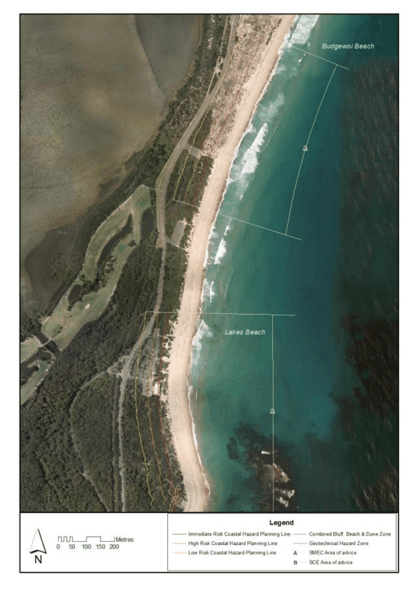

> [Picture on page 1: a picture, saved as a picture (images/coastal-hazard-mapping-northern-area-page-1-1.gif, 150 dpi).]

#### Budgewoi Beach to Lakes Beach

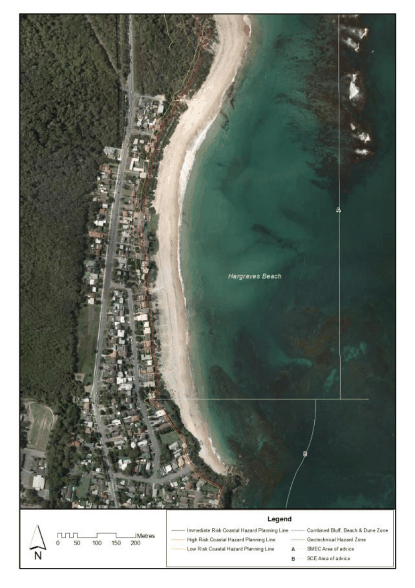

> [Picture on page 2: a picture, saved as a picture (images/coastal-hazard-mapping-northern-area-page-2-1.gif, 150 dpi).]

#### Jewfish Point to Hargraves Beach

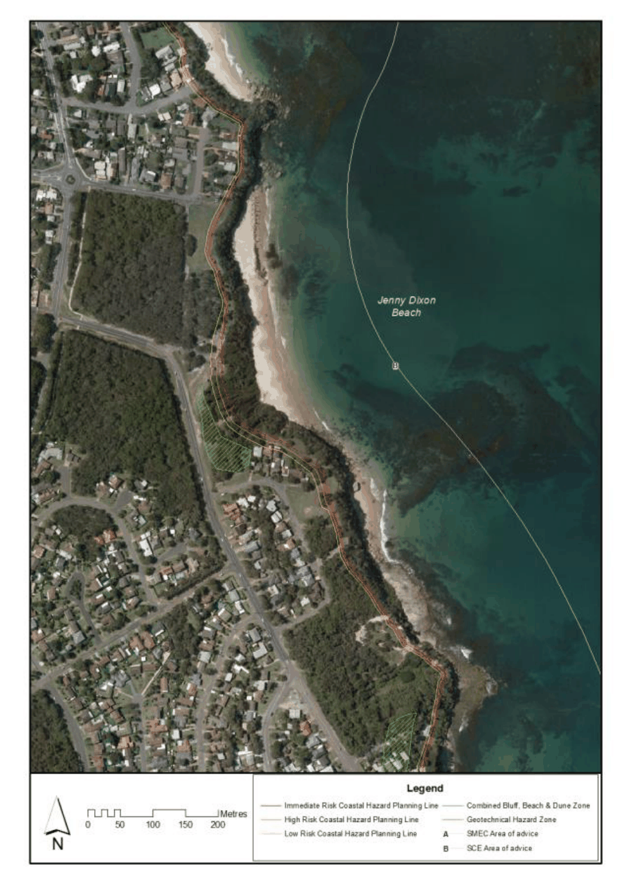

> [Picture on page 3: a picture, saved as a picture (images/coastal-hazard-mapping-northern-area-page-3-1.gif, 150 dpi).]

#### Hargraves Beach to Jenny Dixon Beach Noraville

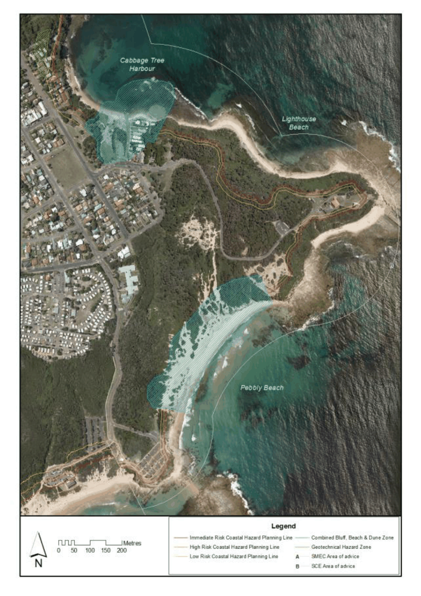

> [Picture on page 4: a picture, saved as a picture (images/coastal-hazard-mapping-northern-area-page-4-1.gif, 150 dpi).]

#### Cabbage Tree Harbour to Soldiers Point

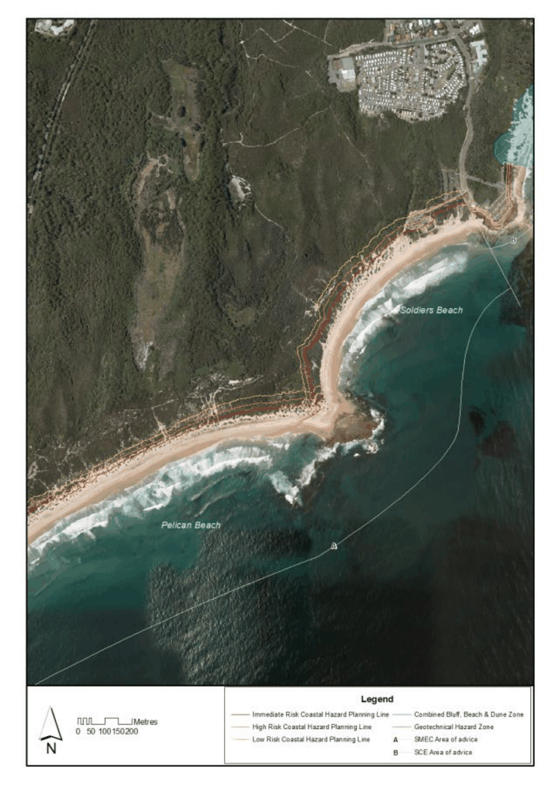

> [Picture on page 5: a picture, saved as a picture (images/coastal-hazard-mapping-northern-area-page-5-1.gif, 150 dpi).]

#### Soldiers Beach to Pelican Beach

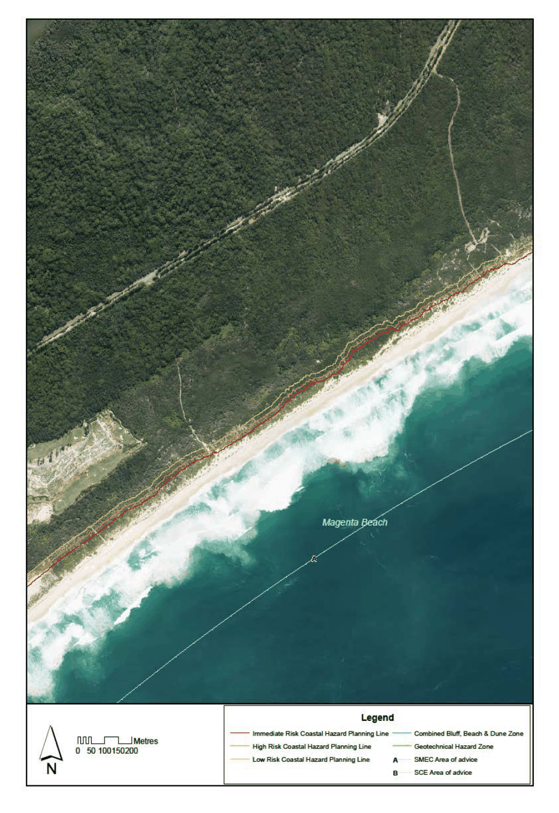

> [Picture on page 6: a picture, saved as a picture (images/coastal-hazard-mapping-northern-area-page-6-1.gif, 150 dpi).]

#### Magenta Beach

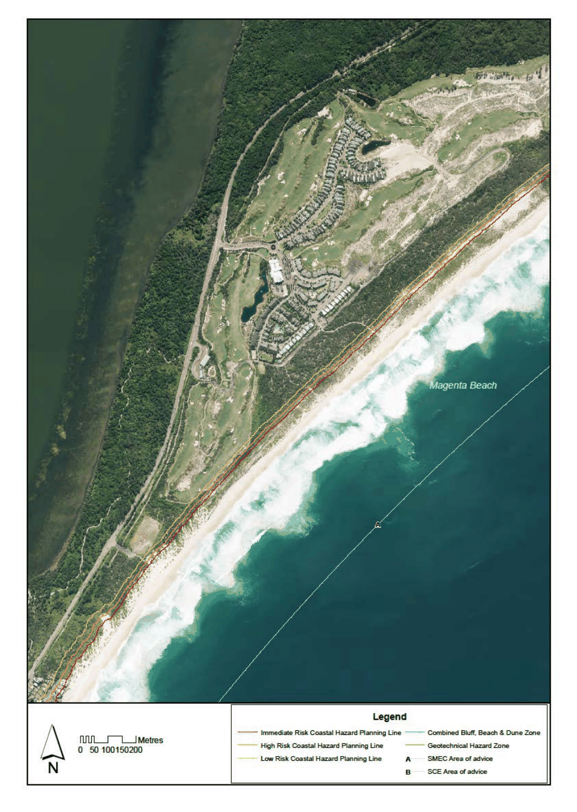

> [Picture on page 7: a picture, saved as a picture (images/coastal-hazard-mapping-northern-area-page-7-1.gif, 150 dpi).]

#### Magenta Beach to North Entrance Beach

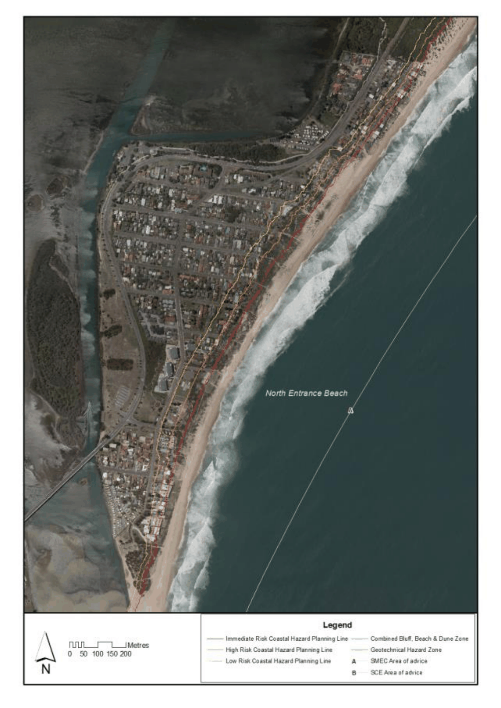

> [Picture on page 8: a picture, saved as a picture (images/coastal-hazard-mapping-northern-area-page-8-1.gif, 150 dpi).]

#### North Entrance Beach

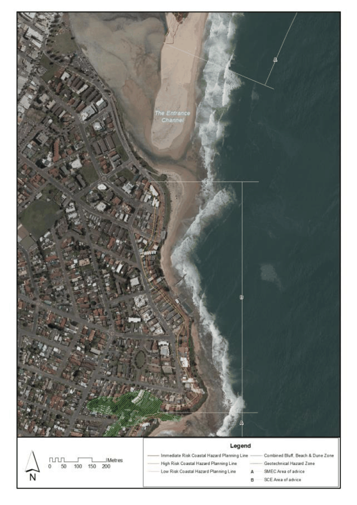

> [Picture on page 9: a picture, saved as a picture (images/coastal-hazard-mapping-northern-area-page-9-1.gif, 150 dpi).]

#### North Entrance Beach to South Entrance Beach

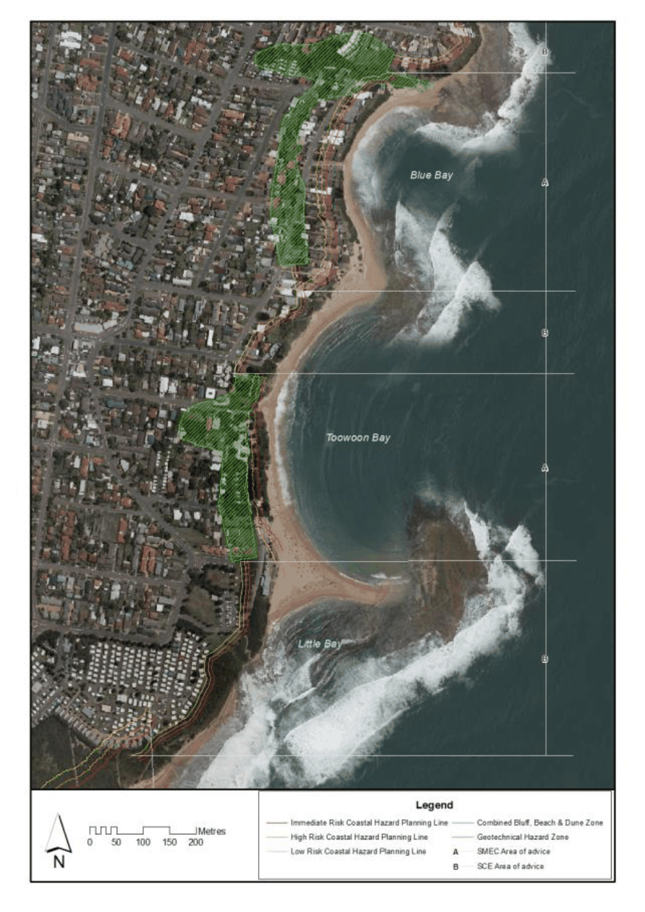

> [Picture on page 10: a picture, saved as a picture (images/coastal-hazard-mapping-northern-area-page-10-1.gif, 150 dpi).]

#### Blue Bay to Little Bay

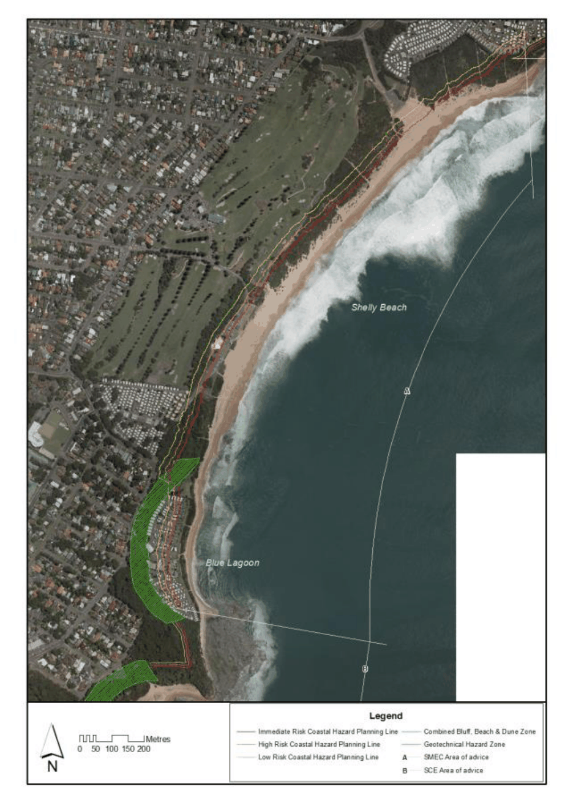

> [Picture on page 11: a picture, saved as a picture (images/coastal-hazard-mapping-northern-area-page-11-1.gif, 150 dpi).]

#### North Shelly Beach to Blue Lagoon Beach

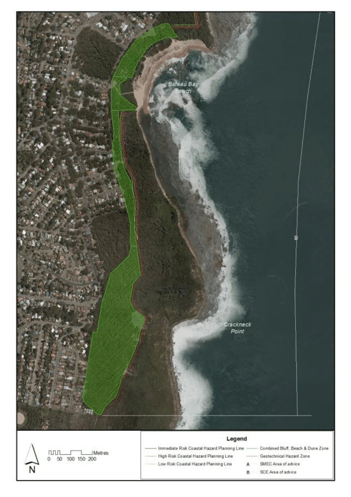

> [Picture on page 12: a picture, saved as a picture (images/coastal-hazard-mapping-northern-area-page-12-1.gif, 150 dpi).]

#### Bateau Bay Beach to Yumbool Point
