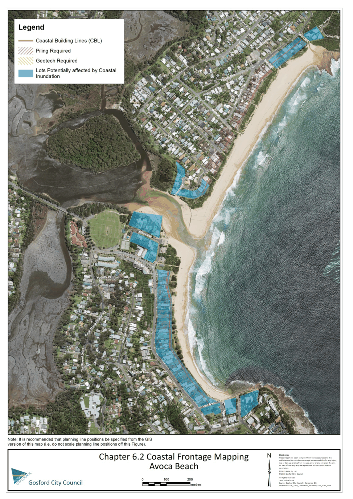
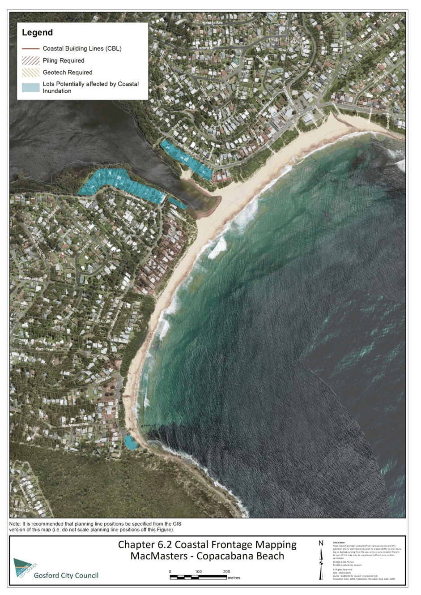
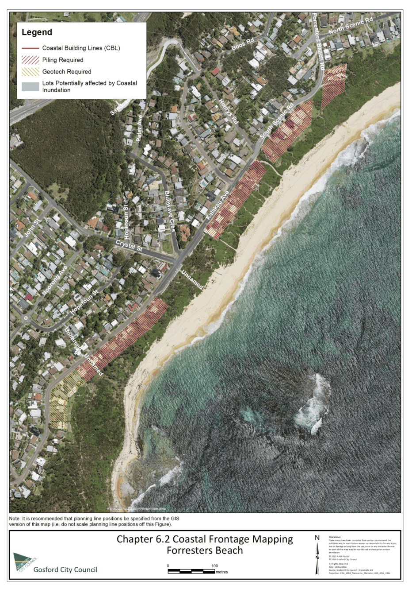
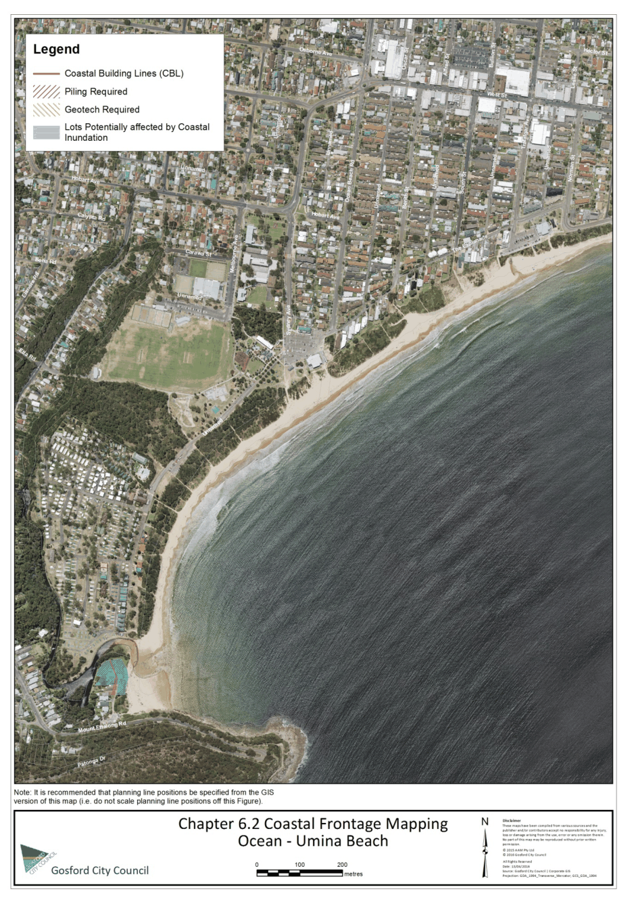
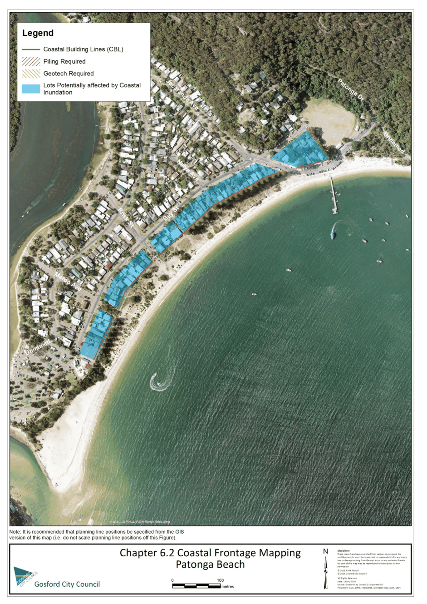
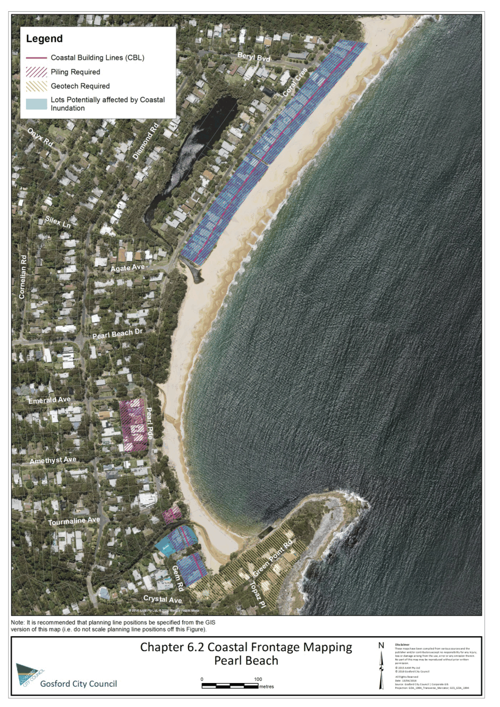
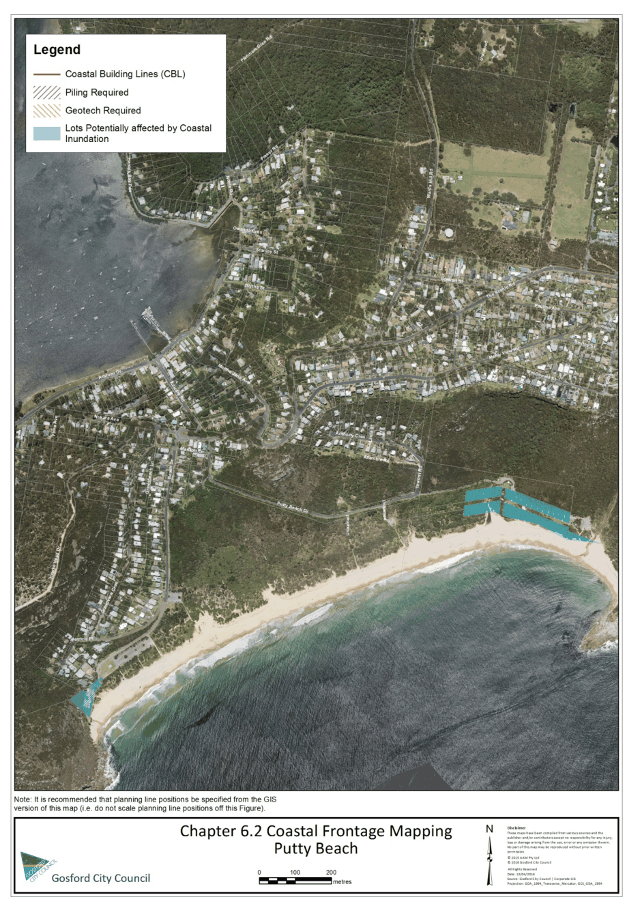
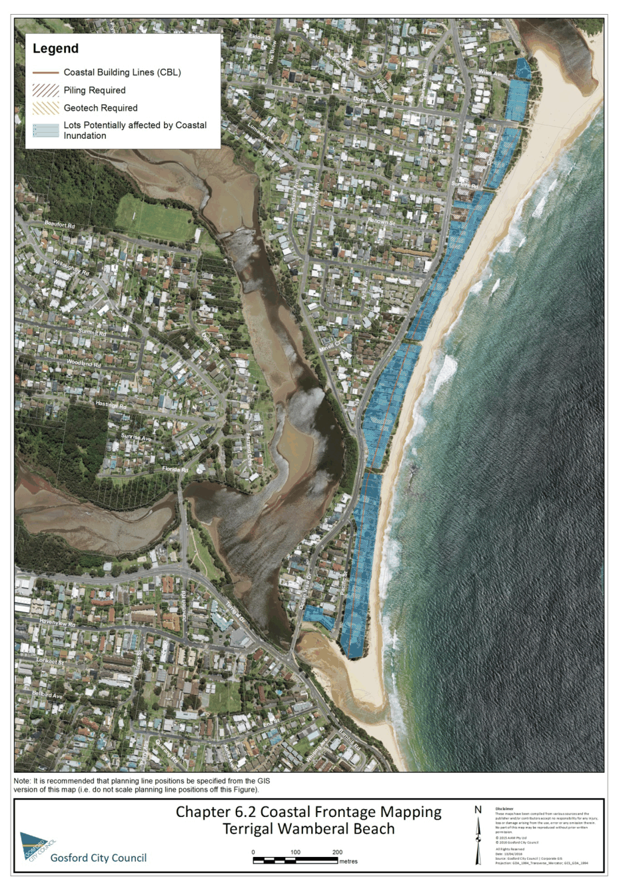

# Central Coast Development Control Plan 2022 - Coastal Hazard Mapping (Southern Area)

Source PDF: [3.2_Coastal_Hazard_Mapping_Southern_Area_0.pdf](3.2_Coastal_Hazard_Mapping_Southern_Area_0.pdf)

#### Avoca Beach

> [Picture on page 1: a picture, saved as a picture (images/coastal-hazard-mapping-southern-area-page-1-2.gif, 150 dpi).]

#### MacMasters - Copacabana Beach

> [Picture on page 2: a picture, saved as a picture (images/coastal-hazard-mapping-southern-area-page-2-2.gif, 150 dpi).]

#### Forresters Beach

> [Picture on page 3: a picture, saved as a picture (images/coastal-hazard-mapping-southern-area-page-3-2.gif, 150 dpi).]

#### Ocean - Umina Beach

> [Picture on page 4: a picture, saved as a picture (images/coastal-hazard-mapping-southern-area-page-4-2.gif, 150 dpi).]

#### Patonga Beach

> [Picture on page 5: a picture, saved as a picture (images/coastal-hazard-mapping-southern-area-page-5-2.gif, 150 dpi).]

#### Pearl Beach

> [Picture on page 6: a picture, saved as a picture (images/coastal-hazard-mapping-southern-area-page-6-2.gif, 150 dpi).]

#### Putty Beach

> [Picture on page 7: a picture, saved as a picture (images/coastal-hazard-mapping-southern-area-page-7-2.gif, 150 dpi).]

#### Terrigal - Wamberal Beach

> [Picture on page 8: a picture, saved as a picture (images/coastal-hazard-mapping-southern-area-page-8-2.gif, 150 dpi).]
