# Central Coast Development Control Plan 2022 - DA Guidelines: Resource and Waste Management Planning

Source PDF: [DA Guidelines Resource and Waste Management Planning.PDF.pdf](DA%20Guidelines%20Resource%20and%20Waste%20Management%20Planning.PDF.pdf)

### DA Guidelines

### Resource and Waste

### Management Planning

> [Picture on page 1: a picture, saved as a picture (images/da-guidelines-resource-and-waste-management-planni-page-1-4.gif, 150 dpi).]

### Contents

### 4

### Introduction

Purpose

6

Context

7

Required outcomes 12

#### Site Preparation Construction

### 14

### How to use

### these Guidelines

Resource and Waste

Management

Planning touchpoints 17 Assessment and

approval process

20

The Resource and Waste

Management Plan

submission

21

The Resource and Waste

Management Plan

submission guide

> [Picture on page 2: a picture, saved as a picture (images/da-guidelines-resource-and-waste-management-planni-page-2-26.gif, 150 dpi).]

22

### 24

### Site Preparation

SP-RWMP guide

26

Site Preparation

requirements

30

Site Preparation resources 31

### 32

### Construction

C-RWMP guide

34

Construction requirements	 38 Supporting resources 39

### 40

### Occupancy

O-RWMP guide

42

Occupancy requirements 49

### 57

### Appendices

#### Appendix A

Resource and Waste

Management Plan Form 58

#### Appendix B

Waste generation rates 59

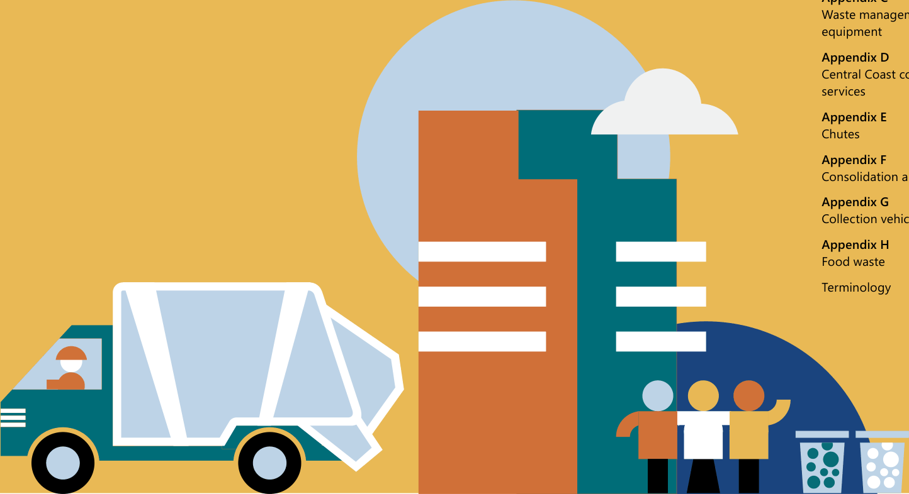

> [Picture on page 2: a picture, saved as a picture (images/da-guidelines-resource-and-waste-management-planni-page-2-54.gif, 150 dpi).]
> Words printed on the picture (title and legend, copied from the PDF):
> Waste management
> equipment
> Central Coast collection
> services
> Chutes
> Food waste
> Terminology

#### Appendix C

62

#### Appendix D

64

#### Appendix E

65

#### Appendix F

Consolidation area 67

#### Appendix G

Collection vehicle access 70

#### Appendix H

73 75

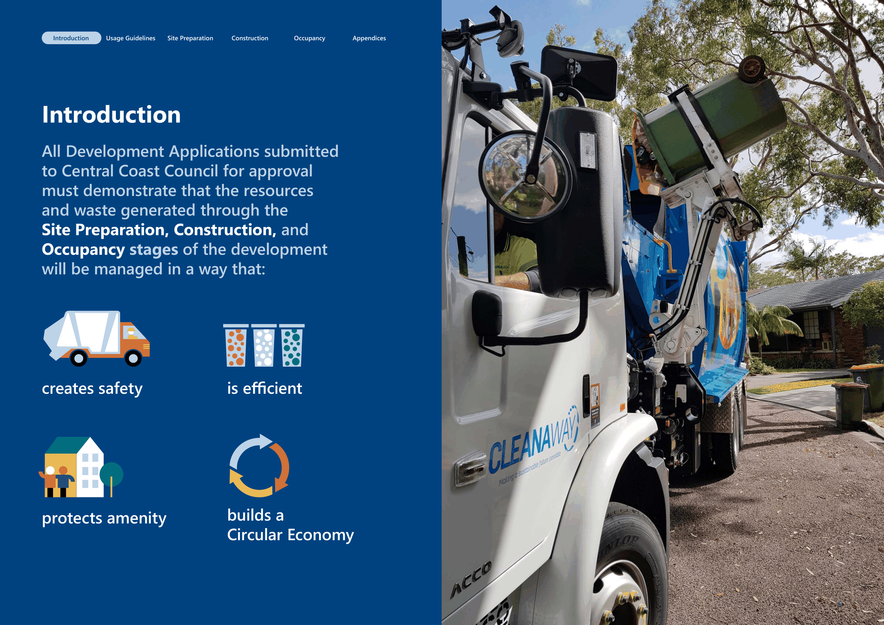

> [Picture on page 3: a picture, saved as a picture (images/da-guidelines-resource-and-waste-management-planni-page-3-1.gif, 150 dpi).]
> Words printed on the picture (title and legend, copied from the PDF):
> Appendices
> Occupancy
> Usage Guidelines
> Introduction

### Introduction

### All Development Applications submitted

### to Central Coast Council for approval

### must demonstrate that the resources

and waste generated through the

Site Preparation, Construction, and

### Occupancy stages of the development

### will be managed in a way that:

### creates safety

### is efficient

### protects amenity

builds a

### Circular Economy

#### Introduction Usage Guidelines Site Preparation

### Purpose

An appropriate Resource and Waste Management Plan (RWMP) must be submitted for

all Development Applications (DAs) requiring consent (including residential, industrial,

#### commercial, leisure and accommodation proposals).

#### It is a requirement under the Central Coast

Council Development Control Plan (DCP) that the

#### RWMP satisfies the requirements and objectives

contained in these DA Guidelines for Resource

and Waste Management Planning (the Guidelines)

and be approved and supported by the

#### Assessing Officer.

These Guidelines take an outcomes focused approach

and include limited prescriptive requirements. It is the

responsibility of the applicant to demonstrate how the

Resource and Waste Management proposal meets the

outcomes set out in these Guidelines.

#### The RWMP submission must include as a minimum:

#### A completed

#### RWMP Form

#### A Resource and Waste

#### Management site

plan for each relevant

development stage

This approach allows applicants to have flexibility

and the opportunity to use innovative solutions

to satisfy the Guideline requirements whilst

also meeting the needs of future residents

and promoting a Circular Economy. Accurate, site specific details in relation to Site

Preparation, Construction, and Occupancy as

applicable must be provided within the required

RWMP submission. Additional details may be

requested subject to the complexity, scale, and nature

of a proposal.

Attached supporting evidence to

demonstrate that the requirements

set out in these Guidelines have

been met

These Guidelines provide guidance to applicants on: How to prepare a RWMP submission How to develop the RWMP for each development stage

#### Information to include in the submission The technical requirements

Applicants must demonstrate good planning for Resource and Waste Management across each relevant

development stage. Following these Guidelines will enable applications to be efficiently reviewed and processed

through the RWMP assessment process.

### Context

#### Council’s Waste Resource

#### Management Strategy

The Central Coast Waste Resource Management

Strategy 2020-2030 sets a clear vision in line with the

State strategy to “Promote the Central Coast as a

creative environment for developing a local circular

economy that values the recovery of resources and

advocates prevention of waste.”

In 1920, Frederick Talbot in his book ’Millions from

Waste’ wrote that “Waste is merely raw material in the

wrong place”. More than a century later, consultation

on the Central Coast Waste Resource Management

Strategy 2020-2030 showed that better management

of our resources and materials is still a priority for our

community. The Central Coast community was very

clear in its views about the goals and issues around

managing resources and waste with almost 90% of

surveyed residents rating reducing waste to landfill as

‘very important’.

#### Council’s overarching strategy priorities:

#### Increase recycling

options available

on the Central Coast

#### Reduce the waste

generated on the

#### Central Coast

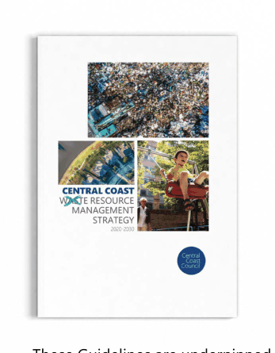

> [Picture on page 4: a picture, saved as a picture (images/da-guidelines-resource-and-waste-management-planni-page-4-75.gif, 150 dpi).]

These Guidelines are underpinned by the modern view

of that same philosophy from 100 years ago – “waste

is a resource to be managed and not a problem to

be rid of”. Throughout these Guidelines the terms

‘materials and waste’ and ‘resource and waste’ have

been used in place of ‘waste’ to emphasise that not all

discarded items need to end up in landfill.

#### Reduce waste

landfilled on the

#### Central Coast

#### Explore funding

opportunities to facilitate

waste avoidance and

diversion

#### These overarching priorities are oriented around four objectives:

#### •	 Drive waste avoidance

#### •	 Deliver a step change in diversion from landfill and build a Circular Economy

#### •	 Strengthen triple bottom line outcomes

#### •	 Enhance street and open space appeal

#### Introduction Usage Guidelines Site Preparation

To achieve Council’s Strategy objectives and the State

targets, Council and the community will need to

significantly increase landfill diversion and resource

recovery of household (municipal), commercial and

industrial, and construction and demolition waste. Appropriate Resource and Waste Planning for new

developments plays a key role for the Central Coast

as increasing building density in our urban centres

influences the design and amenity impact of waste

services. Council must ensure that new facilities and

infrastructure are planned to meet the needs of our

future communities, with a Circular Economy approach

built in, and onsite resource and waste collection

servicing as standard to enhance street appeal.

#### Transitioning to a Circular Economy

The New South Wales (NSW) Waste and Sustainable

Materials Strategy 2041 (the NSW Strategy) sets

the context for Resource and Waste Management

in NSW over the coming years with a focus

on transitioning to a Circular Economy. A Circular Economy is an economic system

aimed at minimising waste and promoting

the continual reuse of resources. The Circular

Economy aims to keep products, equipment, and

infrastructure in use for longer, thus improving

the productivity of these resources.

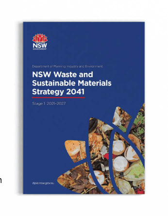

> [Picture on page 5: a picture, saved as a picture (images/da-guidelines-resource-and-waste-management-planni-page-5-28.gif, 150 dpi).]

Materials are cycled through the economy as shown in

Figure 1 and recovered materials reduce the need for

raw material inputs.

Waste materials should become input for other

processes as shown in the circular diagram

(Figure 1). In contrast to the traditional ‘take, make,

dispose’ linear economy, Circular Economy is based on

three key principles:

• design out waste and pollution

• keep products and materials in use

• regenerate natural systems

### The NSW Strategy sets key targets for Resource and Waste

### Management in the region which are fundamental to keeping

### products and materials in use and regenerating natural systems:

> [Picture on page 5: a picture, saved as a picture (images/da-guidelines-resource-and-waste-management-planni-page-5-43.gif, 150 dpi).]

#### Reduce total waste

#### generated by 10%

#### per person

#### Have an 80%

#### average recovery

#### rate from all waste

#### streams

#### By 2030

#### Halve the amount

#### of organic waste

#### sent to landfill

Energy

recovery and

disposal

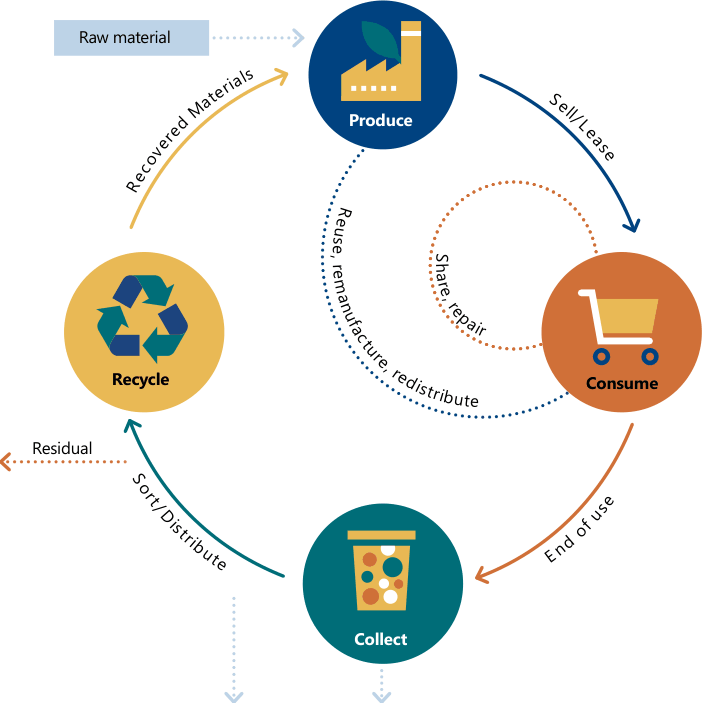

> [Picture on page 5: a map, saved as a picture (images/da-guidelines-resource-and-waste-management-planni-page-5-58.gif, 150 dpi); the street names and other small labels are on the picture.]

Leakage

(litter and illegal dumping)

#### Figure 1: A Circular Economy

Source: NSW Waste and

Sustainable Materials Strategy 2041

#### Eco Destination Certification

#### Local planning controls

The Central Coast Council obtained ECO Destination This guidance document supports the Central Coast

Local Environmental Plan 2022 (LEP) and Central Coast

Development Control Plan 2022 (DCP). The LEP is the primary legal planning document for

certification in 2022, establishing the region as a

premier destination for sustainable and nature-based

tourism. Council must continue to provide visitors to

the region with an experience of good material and

waste collection, separation, reduction, and reuse

wherever they stay, eat, and interact.

guiding land use and planning decisions made by

Council. The LEP allows Council to manage the way in

which land is used to shape our local communities. The DCP supports the LEP and provides

detailed planning and design guidance. The

DCP guides Council staff, developers and

landowners in the necessary requirements and

provides guidance for development. Chapter

2.14 ‘Site Waste Management’ sets out the

Resource and Waste Management controls.

Introduction Usage Guidelines Site Preparation Construction Occupancy Appendices

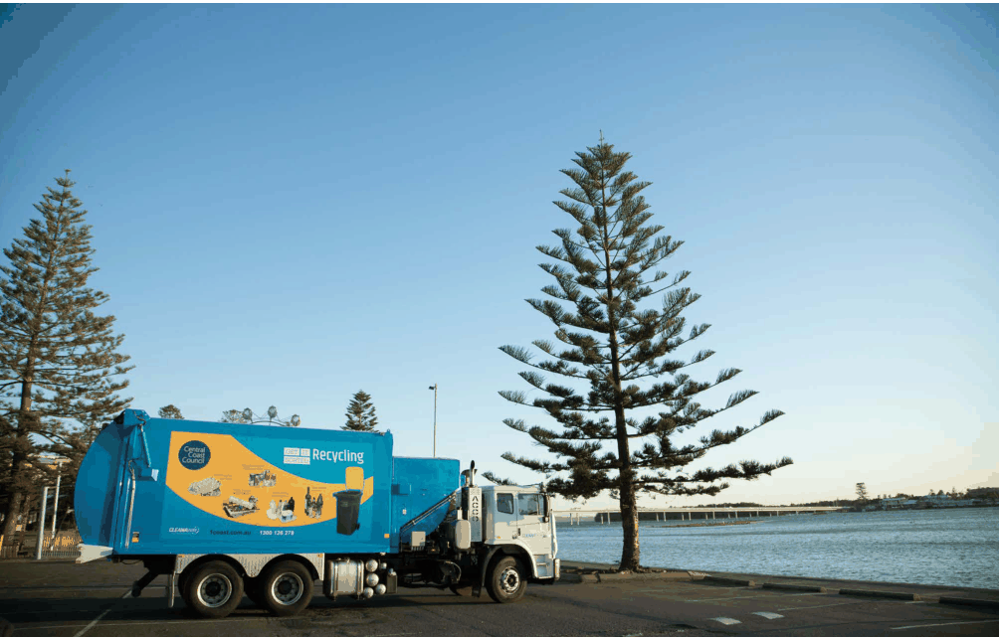

> [Picture on page 6: a picture, saved as a picture (images/da-guidelines-resource-and-waste-management-planni-page-6-2.gif, 150 dpi).]
> Words printed on the picture (title and legend, copied from the PDF):
> Waste Control Guidelines
> Waste Management Plan (WMP)
> submission
> RWMP submission Form
> Resources and waste
> Materials and waste
> Site preparation
> Occupancy
> Non-residential

Resource and waste management is a rapidly evolving area and thus the terminology used has evolved since the

DCP publication. The table below maps key DCP terms to the new terminology used in these Guidelines.

#### DCP terminology

WMP template

Waste

Waste and recyclable materials

Clearing, demolition, Site Preparation, and subdivision Long term operation/On-going use Commercial and industrial

#### Good work design

‘Good work’ is healthy and safe work where the

hazards and risks are eliminated or minimised so far as

is reasonably practicable. Waste management systems

must be designed in accordance with workplace

health and safety (WHS) requirements, in particular

safe design. Safe Work Australia defines safe design as:

#### “The integration of control measures early

in the design process to eliminate or, if this

is not reasonably practicable, minimise

risks to health and safety throughout the

lifecycle of the product being designed. Buildings, structures, machinery and

equipment, tools and vehicles all need

safe design to protect the people who use

them from getting sick or injured.” Safe design must be considered and incorporated into

the design of all Resource and Waste Management

systems. This starts at the concept phase when the

applicant is deciding and identifying:

• design and intended purpose

• materials

#### New terminology

DA Guidelines for Resource and Waste Planning Resource and Waste Management Plan (RWMP)

• how it will be built

• how it will be maintained and operated

• how it will be demolished, dismantled and

disposed of

• legislation, codes of practice and standards it will

need to comply with

The Safe Work Australia Principles of Good Work

Design Work Health and Safety Handbook outlines

the 10 principles of good work design which should

be applied to the design of all Resource and Waste

Management structures and plans as well as all

work, work processes and systems relating to the

management of resources and waste across all

development stages.

The NSW Work Health and Safety Act 2011 & Work

Health and Safety Regulation 2017 establishes the WHS

laws that are designed to protect the health, safety,

and welfare of all workers at work. The regulation sets

out the requirements for specific hazards and risks,

such as noise, machinery, and manual handling.

#### Resource and Waste Planning in NSW

The NSW Government has published helpful guidance

documents for the planning of waste systems in new

developments. These Guidelines draw extensively from

the Environmental Protection Authority (EPA) Better

Practice Guides below and should be referred to by

the applicant wherever further clarification is required. The NSW EPA Better Practice Guide for Resource

Recovery in Residential Developments 2019 (available

on the NSW EPA website) is designed to support

developers, architects, urban designers, building

designers and other professionals to incorporate

better practice in the design, establishment, and

ongoing management of Resource and Waste

Management systems in residential developments. The NSW EPA Better Practice Guidelines for Waste

Management and Recycling in Commercial and

Industrial Facilities 2012 (available on the NSW

EPA website) provides advice to help architects,

developers, Council staff, and building managers

to incorporate better waste management practice

into the design, establishment, operation, and

ongoing management of waste services in

commercial and industrial developments.

The NSW State Environmental Planning Policy No 65

Design Quality of Residential Flat Development 2017

sets out nine ‘Design quality principles’, many of which

should be applied to the design of Resource and

Waste Management systems including:

#### Principle 4: Sustainability

Good design combines positive environmental, social,

and economic outcomes. Good sustainable design

includes recycling and reuse of materials and waste

and use of sustainable materials.

#### Principle 6: Amenity

Good design positively influences internal and external

amenity for residents and neighbours. Achieving good

amenity contributes to positive living environments

and resident wellbeing.

#### Principle 7: Safety

Good design optimises safety and security within

the development and the public domain. It provides

for quality public and private spaces that are clearly

defined and fit for the intended purpose. A positive

relationship between public and private spaces is

achieved through clearly defined secure access points

and well-lit and visible areas that are easily maintained

and appropriate to the location and purpose.

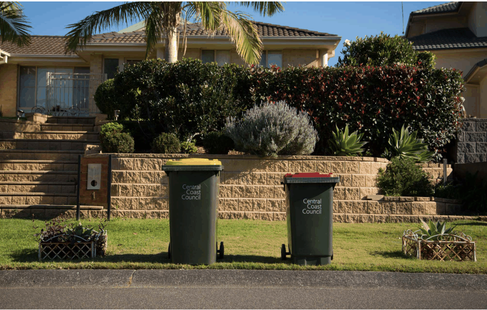

> [Picture on page 6: a picture, saved as a picture (images/da-guidelines-resource-and-waste-management-planni-page-6-105.gif, 150 dpi).]

#### Introduction Usage Guidelines Site Preparation

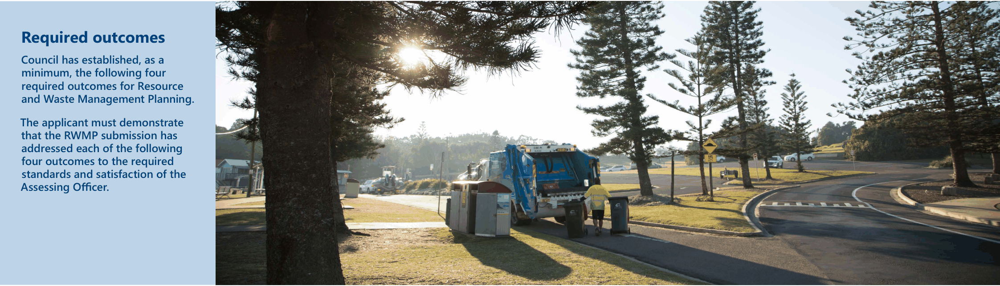

> [Picture on page 7: a picture, saved as a picture (images/da-guidelines-resource-and-waste-management-planni-page-7-2.gif, 150 dpi).]

### Required outcomes

Council has established, as a

#### minimum, the following four

#### required outcomes for Resource

#### and Waste Management Planning. The applicant must demonstrate

#### that the RWMP submission has

#### addressed each of the following

#### four outcomes to the required

standards and satisfaction of the

#### Assessing Officer.

### Create safety

The generation, transfer, consolidation, and collection

of materials and waste all pose health and safety risks.

The implementation of good materials and waste

management planning can reduce these health and

safety risks for the users.

All management of materials and waste must comply

with WHS regulation requirements and the transport

of materials and waste, consolidation areas, collection

points, and collection vehicle access must be designed

to occur in a way that eliminates and minimises risk.

### Protect amenity

Protecting amenity can assist in framing resource

recovery in a positive manner and improve the user

experience when managing all materials and waste. All material and waste management systems must be

designed to minimise disturbances at all development

stages to both the occupier and the surrounding

community, including visual unsightliness, noise,

odour, dust and debris, and impacts from transfer

vehicle movements.

Developments must also consider urban design and

landscaping with the design of the waste area. A

good Resource and Waste Management system will

minimise these disturbances to protect the amenity of

the streetscape and within the site itself through clean

and organised areas.

### Deliver efficiency

Materials and waste that are collected for offsite

recovery or disposal must be consolidated effectively

and collected at an appropriate frequency to avoid

unnecessary offsite vehicle movements. Delivering efficiency in design with improved resource

management onsite will assist in minimising the

number of transport vehicles required on the road and

the associated costs. However, efficiency of material

and waste consolidation should not adversely impact

the ability to recycle the materials and waste if mixed

with other waste types, with the materials to be stored

and collected separately as required. For the Occupancy stage, the Resource and Waste

Management system will have a significant impact

on behaviours by occupants when disposing of their

materials and waste. A well designed system will

support occupants to recycle correctly and as often

as possible to reduce contamination, avoid material

losses to landfill, and additional maintenance and

cleaning.

### Build a Circular Economy

Good management of materials and waste

generated by a development starts with enabling

and encouraging waste avoidance, followed

by improving resource recovery and reducing

the amount of waste sent to landfill. Planning,

designing, and providing facilities that support

and encourage waste avoidance and resource

recovery will assist in building a Circular Economy. Building a Circular Economy will assist in meeting

targets set by Council, the State and nationally

for improved resource recovery and reduction of

waste to landfill. Clear expectations by Council have

been set for the minimum standard of resource

recovery to be achieved to ensure that the region

is delivering on the targets set by the State. Building suitable and user-friendly resource and waste

infrastructure facilitates improved behaviour change

and participation outcomes. A well designed and

constructed development or building will both reduce

the generation of waste in its Construction, and

allow generations of occupants to engage with, and

participate in, achieving Circular Economy objectives.

### How to use these Guidelines

### These Guidelines are designed to support

developers, designers, architects,

consultants, planners, and builders,

### to develop comprehensive Resource

and Waste Management Plans that are

### required to be submitted and approved

### as part of the Development Application

### and approval process for each new

### development on the Central Coast.

#### Site Preparation Construction

#### Usage Guidelines

#### Introduction

### Development stages

#### Resource and Waste Management Planning

#### must be considered in three stages, each

#### of which requires a distinct RWMP.

Each stage is likely to generate different materials that require a

considered approach to ensure they are managed in line with Council’s

required outcomes.

The three distinct RWMPs are known as:

Site Preparation (SP-RWMP) – including demolition Construction (C-RWMP)

Occupancy (O-RWMP)

#### Site Preparation Construction

#### Occupancy

#### Appendices

#### Occupancy

#### Key information

The RWMP submission must

address and provide as a

minimum at each stage: The location, types, and

amounts of materials

and waste that will be

generated.

Travel paths of materials

and waste to be

transferred within the site. Design and details

of materials and

waste storage, and

consolidation areas. Detail of any onsite reuse

of materials.

Design and details

of collection point

arrangements (including

contractor and material

destination).

Vehicle access path for all

collection vehicles.

### Each development stage will require a different

approach to Resource and Waste Management and

### thus each stage requires an independent RWMP.

### Some developments may require only one or all stages

### to be completed depending on the activities proposed

### or included in the Development Application.

### Resource and Waste Management Planning touchpoints

#### Council has defined eight touchpoints that assist applicants to design

#### good RWM systems.

Each RWMP must address each relevant touchpoint

to clearly demonstrate how all materials and

waste generated will be managed in line with the

requirements set out in these Guidelines. Every relevant touchpoint must be designed to create

safety, deliver efficiency, protect amenity, and build a

Circular Economy.

Good design and planning of each touchpoint will: Reduce hazards to create safety Avoid disturbance to protect amenity Avoid unnecessary movements to deliver

efficient material and waste management Encourage waste avoidance and resource

recovery to build a Circular Economy

In considering these touchpoints, it should be

noted that:

• The touchpoints are applicable to ALL development

stages and development types

• Not all touchpoints will be required for every

material or waste stream

• Some RWM systems may require more than one of

a specific touchpoint (e.g. three consolidation areas)

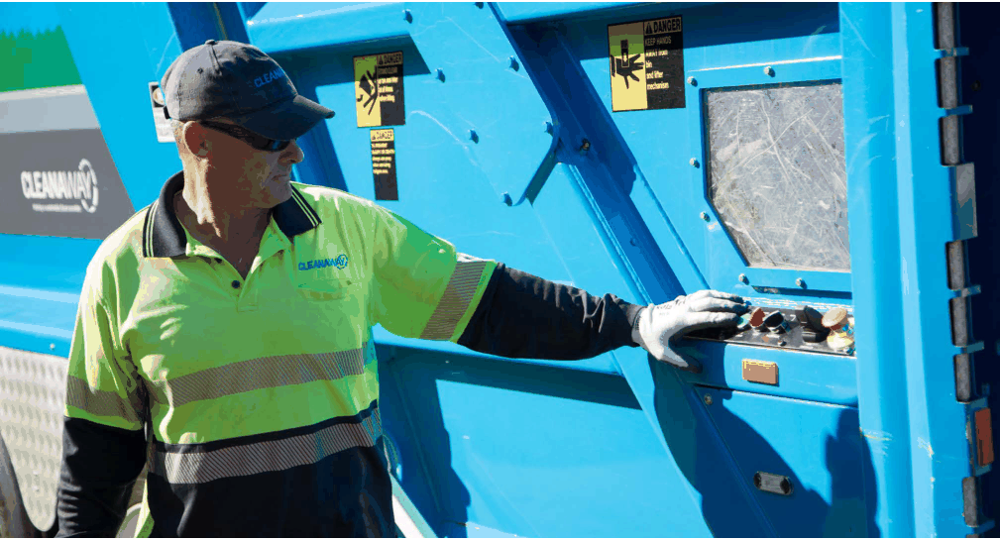

> [Picture on page 9: a picture, saved as a picture (images/da-guidelines-resource-and-waste-management-planni-page-9-74.gif, 150 dpi).]

### The touchpoints

#### Generation

The creation of materials and waste.

#### Capture

Materials and waste generated across the site are ‘captured’ into the

Resource and Waste Management system commonly through a series of

smaller locations/bins which are dispersed across the site.

#### Transfer

Materials and waste are transported/transferred from one location

to another. Often this is the movement of material from smaller

capture locations/bins into larger consolidation areas/bins or from the

consolidation area to the collection point. More than one transfer will

often be required, particularly in larger developments.

#### Consolidation

For materials and waste to be efficiently managed they are commonly

consolidated into larger bins (or stockpiles) which are often located within

a designated collection area.

#### Onsite reuse

Materials that are destined to be reused onsite will exit the waste

management system when they have been applied to their designated and

appropriate use.

#### Collection

#### point

Materials and waste that are destined to be taken offsite for recovery

or disposal are commonly presented for a short time at a designated

collection point for the collection vehicle to access. The resource and waste collection vehicles must be provided an

appropriate route to access the collection point and depart.

#### Collection

#### vehicle access

The location or facility where the material will be recovered, or waste

disposed of.

#### Offsite

#### destination

### Typical touchpoint journeys

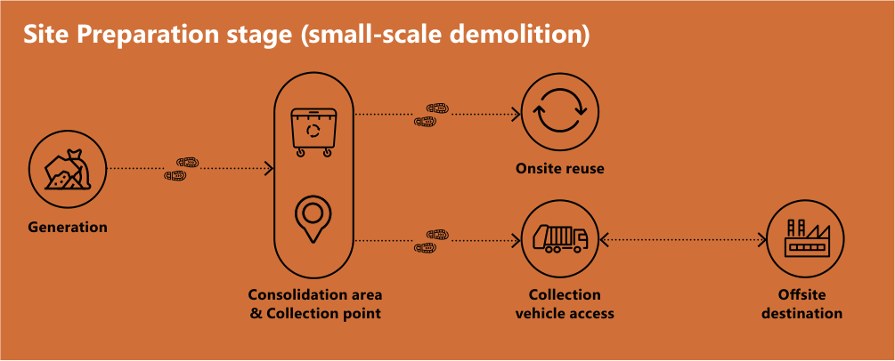

> [Picture on page 10: a picture, saved as a picture (images/da-guidelines-resource-and-waste-management-planni-page-10-36.gif, 150 dpi).]
> Words printed on the picture (title and legend, copied from the PDF):
> Onsite reuse
> Generation
> Consolidation area
> & Collection point
> Collection
> vehicle access
> Offsite
> destination

### Site Preparation stage (small-scale demolition)

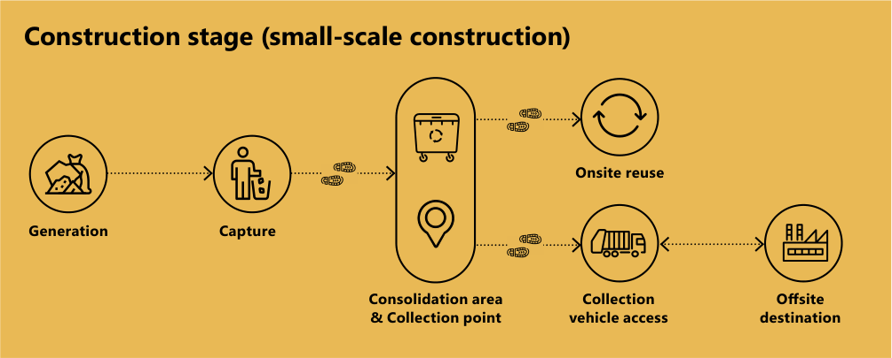

> [Picture on page 10: a picture, saved as a picture (images/da-guidelines-resource-and-waste-management-planni-page-10-38.gif, 150 dpi).]
> Words printed on the picture (title and legend, copied from the PDF):
> Onsite reuse
> Generation
> Capture
> Consolidation area
> & Collection point
> Collection
> vehicle access
> Offsite
> destination

### Construction stage (small-scale construction)

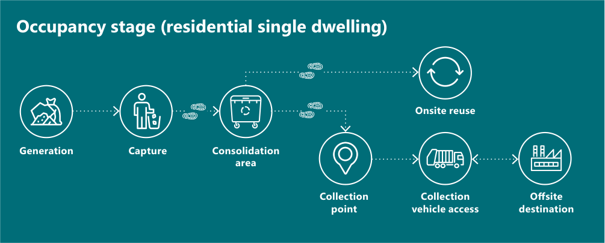

> [Picture on page 10: a picture, saved as a picture (images/da-guidelines-resource-and-waste-management-planni-page-10-40.gif, 150 dpi).]
> Words printed on the picture (title and legend, copied from the PDF):
> Onsite reuse
> Generation Capture Consolidation
> area
> Collection
> point
> Collection
> vehicle access
> Offsite
> destination

### Occupancy stage (residential single dwelling)

### Assessment and approval process

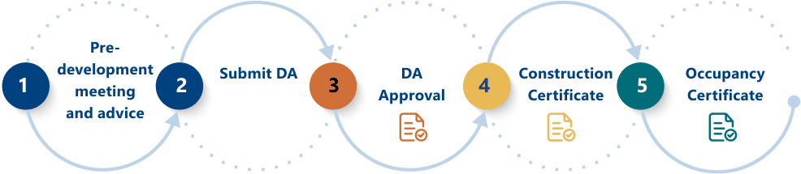

> [Picture on page 11: a picture, saved as a picture (images/da-guidelines-resource-and-waste-management-planni-page-11-2.gif, 150 dpi).]
> Words printed on the picture (title and legend, copied from the PDF):
> DA

#### Pre-

development

#### Construction Occupancy

#### Certificate

#### 1

#### 2

#### 3

#### 4

#### 5

#### Submit DA

#### Approval

#### Certificate

meeting

and advice

#### Pre-development advice

Council will assess the RWMP submission to make sure

it includes the following:

• A clear Resource and Waste Management system

for each relevant development stage which

addresses all materials generated

• All Resource and Waste Management systems

address and support Council’s requirements

and deliver on required outcomes:

A pre-development meeting can be arranged with

Council, where detailed advice can be sought on

technical matters including Resource and Waste

Management planning. Any development with

challenges meeting the requirements set out in these

Guidelines should make use of the pre-development

advice process to present their solution and seek

advice from Council prior to the DA submission.

–	Create safety

#### Submission of Development Application

–	Protect amenity

–	Deliver efficiency

–	Build a Circular Economy Importantly, sufficient details of the Occupancy RWMP

must be provided to demonstrate that the proposed

development has been designed to accommodate

good materials and waste management systems

across the entire life of the development.

The RWMP submission must be included within the

DA application and must provide sufficient detail

for each relevant stage of the development (Site

Preparation, Construction, and Occupancy) as laid

out in these Guidelines. The RWMP Form is separated

into sections to enable the applicant to articulate the

different aspects of Resource and Waste Management

at each development stage. All relevant sections

must be completed for the DA to be assessed.

#### Construction Certificate

The complete RWMP submission will be

assessed by Council through the development

assessment process and must be approved

and supported by the Assessing Officer for

the development approval to be granted.

A Construction Certificate will not be issued without

an approved Site Preparation stage RWMP and/or an

approved Construction stage RWMP (as required).

Council may require an updated SP-RWMP and/

or C-RWMP to be submitted prior to issue of the

Construction Certificate.

#### Occupation Certificate

The Occupancy Certificate will not be issued without

an approved Occupancy stage RWMP. Council may

require an updated O-RWMP to be submitted prior to

issue of the Occupancy Certificate.

### The Resource and Waste Management Plan submission

The Form is set out in five parts:

• Part A: Overview of development

• Part B: Site Preparation RWMP

• Part C: Construction RWMP

The RWMP submission will be assessed by Council to

determine the adequacy of the waste management

provisions for each stage of the development.

The RWMP submission must address all relevant

requirements outlined in these Guidelines. An

inadequate or incomplete RWMP can delay

development approval decisions.

• Part D: Occupancy RWMP

• Part E: Declaration

#### Who should prepare the RWMP

#### submission?

A distinct Resource and Waste Management

system must be clearly presented for each relevant

development stage in Parts B, C, and D of the Form.

For each development stage this must include:

For all developments with a Construction value less

than $5 million the RWMP submission can be prepared

by the applicant. Where the Construction value is

greater than $5 million, the RWMP submission must be

prepared by a suitably qualified waste consultant.

#### What should a RWMP include?

#### The completed Form (Part B, C, or D)

The Form must be fully completed and include clear

referencing to details, included in attached site plans

and supporting evidence.

#### Site plans

If referencing separate submitted plans, location

details, and plan references must be included.

The Resource and Waste Management Plan Form is

provided in Appendix A. This Form must be completed

and submitted with appropriate site plans and

supporting evidence attached.

#### Supporting evidence

This must be appropriately referenced and identified.

Requirements of

the RWMP for

each stage are

outlined in the

#### following sections:

#### Site Preparation Construction

#### Occupancy

#### Supporting guidance

• Better Practice Guide for Resource Recovery in

Residential Developments 2019.

• Better Practice Guidelines for Waste Management

and Recycling in Commercial and Industrial

Facilities 2012.

Further technical guidance to support the

preparation of a RWMP submission is included in

the Appendices. Wherever further detail is required,

the applicant should refer to the NSW EPA Better

Practice Guides (available on the NSW EPA website):

Introduction Usage Guidelines Site Preparation Construction Occupancy Appendices

### The Resource and Waste Management Plan

### submission guide

#### These steps are presented as a general guide for completing the RWMP Form

#### (the Form) and compiling the submission. The Form can be downloaded from

#### Council’s website or via the link included in Appendix A.

#### Step 1	 Complete Part A

Provide general details of the development and identify the relevant development

stages and sections that must be included in the submission:

### Site Preparation RWMP

### Construction RWMP

### Occupancy RWMP

### Form Part B

### Form Part C

### Form Part D

### Guidance

### Guidance

### Guidance

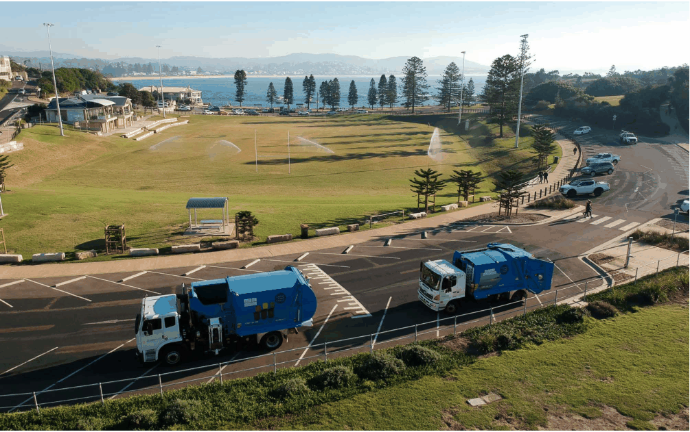

> [Picture on page 12: a picture, saved as a picture (images/da-guidelines-resource-and-waste-management-planni-page-12-19.gif, 150 dpi).]

#### Step 2	 Create a RWMP for each respective development stage

Review the relevant guidance and requirements detailed in these Guidelines and the Form:

#### Generation

Identify and substantiate every material and waste that will be generated and determine the

quantity of each.

#### Destination

For each material and waste, determine its destination. Input this information into the ‘Recycling details’

(as applicable) and the ‘System overview’ table. Common destinations include onsite reuse, collection

for offsite recovery, and collection for offsite disposal.

#### Journey

For each material and waste, map out and explain the journey from generation to destination

through the relevant touchpoints as presented in the ‘Typical touchpoint journey diagrams’. Input

this information in the ‘System overview’ table and onsite plan(s). This should clearly demonstrate the

design, management, and logistics planning details for each relevant touchpoint and material stream to

show that the system will function well and meets Council’s requirements as set out in these Guidelines.

Prepare and provide supporting evidence.

#### Complete risk assessment

Identify the hazards that exist within the RWM system and detail the mitigation control measures that

will be put in place. Complete the ‘Risk assessment’ table.

#### Meet required outcomes (Form Part D only)

Demonstrate that required outcomes have been met using the touchpoints framework. Fill in details on

the Form or clearly reference evidence in supporting documentation.

#### Site plan(s)

Present the RWM system on a site plan (or plans). Ensure the plan(s) includes the required minimum

information as set out in the site plan checklist.

#### Complete the Form and prepare supporting evidence

Complete relevant part of the Form. The RWMP Form provides a framework for providing required

information to Council in a clear and well-presented format.

•	 Where supporting evidence is attached, this must be specifically referenced in the Form with sufficient

details to enable Council to understand the purpose and relevance of the attached information.

•	 Where any field in the Form does not provide adequate space to provide all details, the applicant must

provide the full information in supporting evidence with a specific reference included on the Form.

•	 For example, the RWM ‘System overview’ tables can be reproduced, filled out, and attached with a

note on the Form indicating the location of the table within the supporting evidence attached.

#### Step 3	 Compile the RWMP submission

Include the completed Form, site plan(s) and supporting evidence in a clear and organised format.

Ensure that specific references are included to enable Council to easily understand the Resource and

Waste Management system and see that all requirements have been met.

#### Step 4	 Complete Part E: Declaration

Complete the ‘Lawful disposal of waste declaration’ and ‘General declaration’ with the name and

signature of the applicant and date signed.

The declaration should be thoroughly reviewed before completing and signing to ensure that all items

are addressed in the submission. An incomplete, poorly thought out or unclear Resource and Waste

Management Plan submission will be rejected.

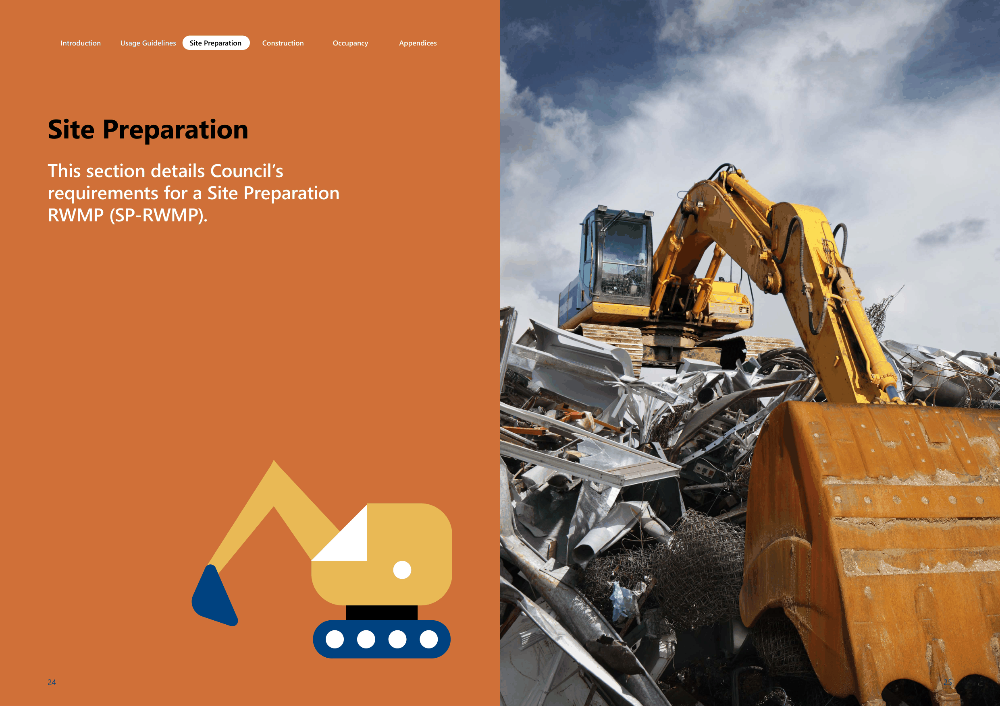

> [Picture on page 13: a picture, saved as a picture (images/da-guidelines-resource-and-waste-management-planni-page-13-1.gif, 150 dpi).]
> Words printed on the picture (title and legend, copied from the PDF):
> Introduction Usage Guidelines Site Preparation
> Usage Guidelines
> Introduction
> Site Preparation Construction Occupancy Appendices

### Site Preparation

### This section details Council’s

### requirements for a Site Preparation

### RWMP (SP-RWMP).

Introduction Usage Guidelines Site Preparation Construction Occupancy Appendices

### Site Preparation RWMP guide

Any Development Application that includes preparatory works such as subdivision,

clearing, excavation, or demolition must prepare a SP-RWMP in line with the

#### requirements outlined in this section.

The SP-RWMP must demonstrate that RWM systems will meet Council’s required outcomes:

### Create safety

All management of materials and waste must comply

with all WHS regulation requirements. The transport

of materials and waste, consolidation areas, collection

points, and collection vehicle access must be designed

to create safety.

### Protect amenity

All material and waste management systems must be

designed to minimise disturbances to the surrounding

community, including visual unsightliness, noise,

odour, and dust.

### Deliver efficiency

Materials and waste that are collected for offsite

recovery or disposal must be consolidated effectively

and collected at an appropriate frequency to avoid

unnecessary vehicle movements.

### Build a Circular Economy

The Site Preparation stage has a high resource

recovery potential because the materials generated

through excavation and demolition can be either

reused onsite in the new development or sent for

offsite recovery at a construction and demolition

waste processing facility. Therefore, all SP-RWMPs

should demonstrate an overall 80% recovery rate.

Provisions for effective source separation of material

while it is onsite, must be detailed in the SP-RWMP.

#### All Resource and Waste Management must be conducted lawfully and in compliance

with all waste legislation and regulation.

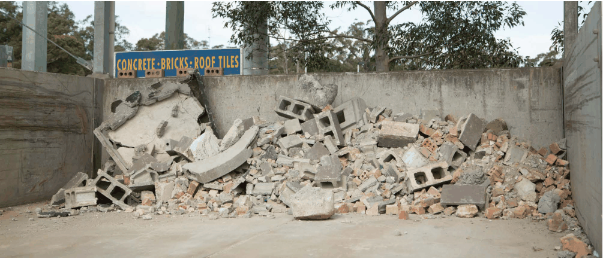

> [Picture on page 14: a picture, saved as a picture (images/da-guidelines-resource-and-waste-management-planni-page-14-35.gif, 150 dpi).]

The SP-RWMP must include:

#### How to develop the Site Preparation

#### RWMP

• The RWMP Form Part B completed with the

information specified below

• A SP-RWMP or site plan (drawing)

Use the touchpoints framework to develop the

SP-RWMP. For a step-by-step guide, refer to the

RWMP submission guide.

• Supporting evidence

In any instance that Part B of the Form does not

provide sufficient space for completion of the

required details, the applicant should address the

item in supporting documentation and include

a specific reference in the Form to direct the

Assessing Officer to the relevant information.

#### General information

Complete the following fields to provide an overview of the Site Preparation activities.

| Form field | Information required |
|---|---|
| Description of Site Preparation works: | Size of site. Description of works, structures to be demolished, clearing, and/or excavation. Anticipated duration of works. |
| Demolition or works contractor: | Name and contact details (including website) of contractor. |
| Workers Compensation Insurance details: | Insurer name, policy number, and limit of liability. |
| Asbestos management details: | Amount of asbestos containing material known to be at the site. Name and licence details of asbestos removalist. Name, operator, location, and licence number of asbestos disposal facility. |
| Hazardous waste management details | Name and licence details of hazardous waste transporter. |
| (including soils): | Suitable or compliant waste assessment report where required. Name, location and licence number of hazardous waste disposal or treatment facility. |
| General waste management facilities details: | Name, operator, location, and licence number of all general waste disposal or processing facilities. |
| Resource recovery facilities details: | Name, operator, location, and licence number of all licenced resource recovery facilities. |

Introduction Usage Guidelines Site Preparation Construction Occupancy Appendices

#### Site Preparation declaration

#### Typical Site Preparation touchpoint

#### journey example

Confirm that all asbestos and hazardous waste

generated through Site Preparation will be managed

appropriately.

A typical touchpoint journey is provided as

an example for the applicant to understand

the touchpoints framework.

Tick yes to declare that all asbestos will be

#### Materials (and waste) generation

managed in accordance with the provisions

of the NSW Work Health and Safety

Regulation 2022.

Tick yes to declare that all hazardous waste

will be managed and tracked in accordance

with the provisions of the NSW Protection

of the Environment Operations (Waste)

Regulation 2014.

The quantity of all materials and waste generated must

be detailed in this table. For any materials where the

total quantity is less than 10m3 a tick can be placed in

the first column and no further detail is required. For

all other materials and waste, the quantity of material

must be detailed, the management option selected

(tick), and the total quantity that will be diverted from

landfill provided.

#### Site Preparation system overview table example

Material or

waste stream

#### Quantity

Capture and

#### Consolidation area

#### Internal

transfer

#### Onsite reuse

\*C&D refers to construction and demolition

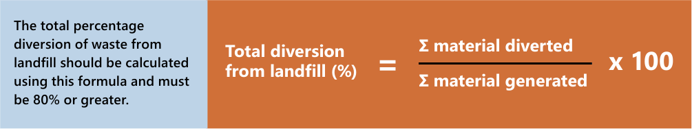

> [Picture on page 15: a picture, saved as a picture (images/da-guidelines-resource-and-waste-management-planni-page-15-39.gif, 150 dpi).]

#### Ʃ material diverted

#### Total diversion

### from landfill (%) = Ʃ material generated

### x 100

#### The total percentage

diversion of waste from

landfill should be calculated

using this formula and must

be 80% or greater.

#### Risk assessment

#### Recycling details

Complete the table. Each material to be

recovered must be listed and the principal

offsite recycler details provided as well as

the market for the recovered resources.

The risk assessment must be completed to identify all

risks presented by the RWM system and demonstrate

the mitigation control measures that will be

implemented to manage these risks.

#### System overview

#### Site plan checklist

Provide site plan(s) and ensure they clearly indicate the

items detailed in the checklist.

#### Supporting evidence

Complete the table (directly or in supporting evidence)

to demonstrate how each material and waste stream

will journey from generation to its destination. Each

material and waste stream must be identified and

an overview of its management provided. See the

example provided below.

Provide a list of supporting evidence and details of the

purpose of each.

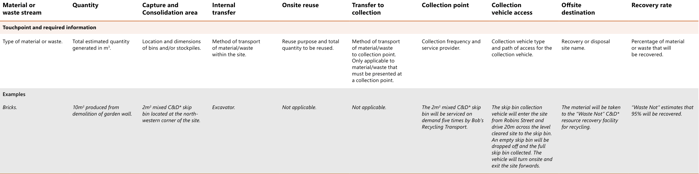

> [Picture on page 15: a map, saved as a picture (images/da-guidelines-resource-and-waste-management-planni-page-15-72.gif, 150 dpi); the street names and other small labels are on the picture.]
> Words printed on the picture (title and legend, copied from the PDF):
> Touchpoint and required information
> Type of material or waste. Total estimated quantity
> generated in m3.
> Location and dimensions
> of bins and/or stockpiles.
> Reuse purpose and total
> quantity to be reused.
> Method of transport
> within the site.
> 10m3 produced from
> demolition of garden wall.
> 2m3 mixed C&D* skip
> bin located at the north-
> western corner of the site.
> Collection frequency and
> Recovery or disposal
> Collection vehicle type
> and path of access for the
> Percentage of material
> or waste that will
> Method of transport
> to collection point.
> Only applicable to
> must be presented at
> a collection point.
> “Waste Not” estimates that
> 95% will be recovered.
> The 2m3 mixed C&D* skip
> bin will be serviced on
> demand five times by Bob’s
> The material will be taken
> to the “Waste Not” C&D*
> resource recovery facility
> The skip bin collection
> vehicle will enter the site
> from Robins Street and
> drive 20m across the level
> cleared site to the skip bin.
> An empty skip bin will be
> dropped off and the full
> skip bin collected. The
> vehicle will turn onsite and
> exit the site forwards.

#### Recovery rate

Transfer to

collection

#### Collection point Collection

vehicle access

#### Offsite

destination

Introduction Usage Guidelines Site Preparation Construction Occupancy Appendices

### Site Preparation requirements

#### Create safety

1\.	 Onsite reuse of materials (subject to planning

approvals) should be considered for waste

materials that are not hazardous to human

health or safety and in accordance with the NSW

Protection of the Environment Operations Act 1997

and associated regulations.

2\.	 The collection point must be within the site and

safely accessible by all collection vehicles.

3\.	 Any asbestos-contaminated material must be

managed and transported in line with asbestos-

safe work procedures and disposed of at an

appropriately licensed facility.

4\.	 All hazardous waste generated must be

tracked, transported, and disposed of

as per the requirements under Part 4 of

the NSW Protection of the Environment

Operations (Waste) Regulation 2014.

5\.	 General solid waste (putrescible and non-

putrescible) and recoverable materials must be

received by appropriately licensed disposal and

resource recovery facilities.

#### Protect amenity

6\.	 The management of materials and

waste onsite must minimise odour,

noise, vibration, and dust impacts.

7\.	 All bins must be stored away from

public access and view.

8\.	 The collection of materials and waste must occur at

appropriate times to minimise noise disturbances

to any nearby residential areas.

#### Deliver efficiency

9\.	 Materials must be sorted onsite for separate

recycling collection e.g. the use of separate skip

bins for wood and concrete. If this is not possible,

sorting and recycling offsite for mixed materials

from Site Preparation is required. If the ability to

recycle a material is adversely affected by being

mixed with other waste types, the material is to be

stored and collected separately. Justification for

combined waste and resource disposal to landfill

should be included where resource recovery is not

undertaken or possible.

#### Build a Circular Economy

10\.	Disposal of waste to landfill must be minimised

by avoidance and reduction practices and onsite

reuse of materials or offsite reuse or recycling.

Any materials landfilled must be identified and

an explanation as to why landfill was selected as

disposal method over resource recovery.

11\.	An overall 80% recovery rate of materials and

waste should be achieved or explained as to why

this may not be possible.

### Site Preparation resources

The resources provided below are intended to support applicants in developing their SP-RWMP

and are not requirements.

#### Common Site Preparation materials

• Asbestos

• Bricks

• Concrete

• Excavation material

• Contaminated soils

• Floor coverings

• Fixtures & fittings

• Garden organics

and trees

• Glass

• Hazardous waste

• Metals (ferrous)

• Metals (non-ferrous)

• Mixed recycling

• Plasterboard

• Roof tiles

• Tiles

• Timber (clean)

• Timber (treated)

• Residual waste

#### Conversion table for common materials*

#### Material

Bricks Concrete Metals Timber

#### Density for conversion

800kg/m3

800kg/m3

140kg/m3

200kg/m3

\* Source: Encycle Consulting (2013) A study into

commercial & industrial (C&I) waste and recycling in

Australia by industry division.

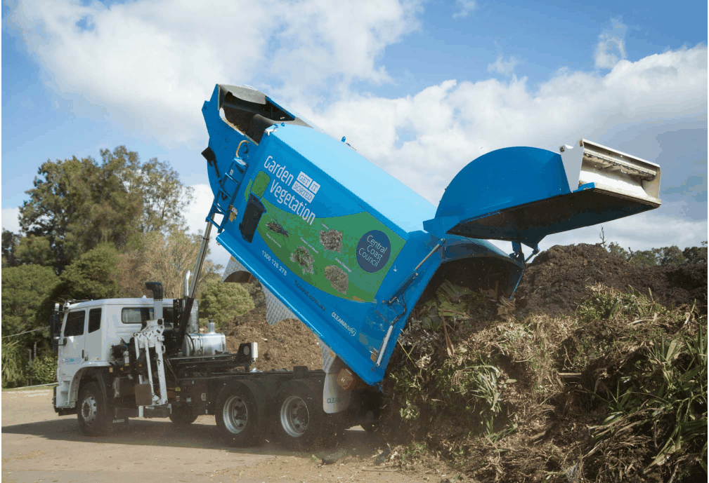

> [Picture on page 16: a picture, saved as a picture (images/da-guidelines-resource-and-waste-management-planni-page-16-94.gif, 150 dpi).]

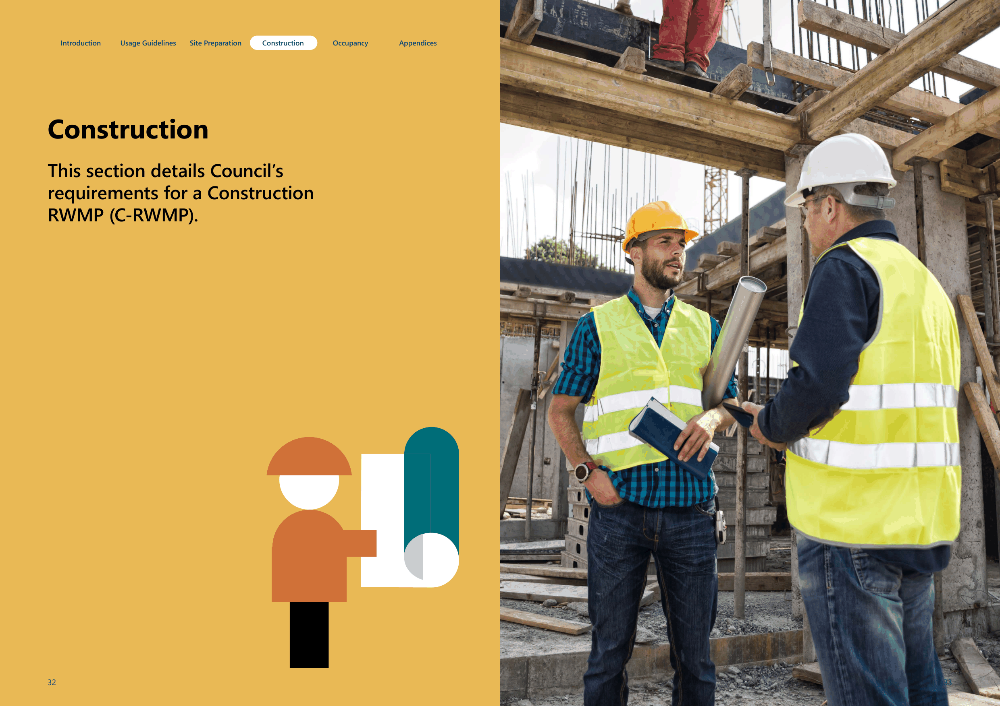

> [Picture on page 17: a picture, saved as a picture (images/da-guidelines-resource-and-waste-management-planni-page-17-1.gif, 150 dpi).]
> Words printed on the picture (title and legend, copied from the PDF):
> Introduction Usage Guidelines Site Preparation Construction

### Construction

### This section details Council’s

### requirements for a Construction

### RWMP (C-RWMP).

#### Introduction Usage Guidelines Site Preparation

### Construction RWMP guide

#### Any Development Application that includes Construction works must prepare

#### a C-RWMP in line with the requirements outlined in this section.

The C-RWMP must demonstrate that RWM systems will meet Council’s required outcomes:

### Create safety

All management of materials and waste must

comply with all WHS regulation and good design

requirements. The transport of materials and waste,

consolidation areas, collection point, and collection

vehicle access must be designed to create safety.

### Protect amenity

All material and waste management systems must be

designed to minimise disturbances to the surrounding

community, including visual unsightliness, noise,

odour, and dust.

### Deliver efficiency

Materials and waste that are collected for offsite

recovery or disposal must be consolidated effectively

and collected at an appropriate frequency to avoid

unnecessary vehicle movements.

### Build a Circular Economy

The Construction stage has a high resource recovery

potential because the materials generated through

Construction can often be reused onsite or easily

recycled at an offsite construction and demolition

waste processing facility. Therefore, all C-RWMPs

must demonstrate an achievement of an overall

80% recovery rate. Provisions for effective source

separation of material while it is onsite must be

detailed in the C-RWMP.

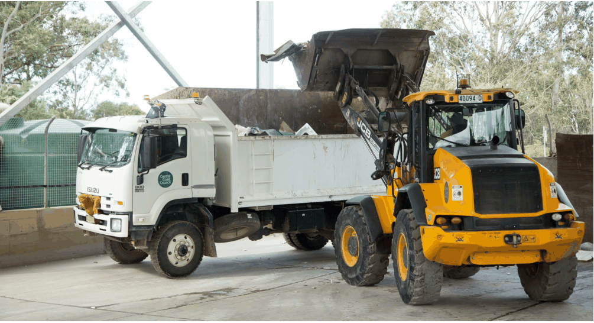

> [Picture on page 18: a picture, saved as a picture (images/da-guidelines-resource-and-waste-management-planni-page-18-32.gif, 150 dpi).]

The C-RWMP must include:

#### How to develop the Construction RWMP

• The RWMP Form Part C completed with the

information specified below

Use the touchpoints framework to develop the

C-RWMP. For a step-by-step guide, refer to the

RWMP submission guide.

• A C-RWMP or site plan (drawing)

• Supporting evidence

In any instance that Part C of the Form does not

provide sufficient space for completion of the

required details, the applicant should address the

item in supporting documentation and include

a specific reference in the Form to direct the

Assessing Officer to the relevant information.

#### General information

Complete the following fields to provide an overview of the Construction activities.

| Form field | Information required |
|---|---|
| Description of Construction works: | Existing site structures. Description of all structures to be constructed and methods to be used. Anticipated duration of works. |
| Construction works contractor details: | Name and contact details (including website) of main contractor(s) or Principal Contractor. |
| Workers Compensation Insurance details: | Insurer name, policy number, and limit of liability. |
| Hazardous waste management details: | Name and licence details of hazardous waste transporter. Name, location, and licence number of hazardous waste disposal facility. |
| General waste management facilities details: | Name, operator, location, and licence number of all general disposal facilities. |
| Resource recovery facilities details: | Name, operator, location, and licence number of all licenced resource recovery facilities. |

#### Construction declaration

#### Materials (and waste) generation

Confirm that all hazardous waste generated through

Construction will be managed appropriately.

Tick yes to declare that all hazardous waste will

be managed and tracked in accordance with

the provisions of the NSW Protection of the

Environment Operations (Waste) Regulation 2014.

The quantity of all materials and waste generated must

be detailed in this table. For any materials where the

total quantity is less than 10m3 a tick can be placed in

the first column and no further detail is required. For

all other materials and waste, the quantity of material

must be detailed, the management option selected

(tick) and the total quantity that will be diverted from

landfill provided.

#### Typical Construction touchpoint journey

#### example

A typical touchpoint journey is provided as

an example for the applicant to understand

the touchpoints framework.

#### Construction System overview table example

Material or

waste stream

#### Quantity

#### Capture

#### Internal

transfer

#### Consolidated area Onsite reuse

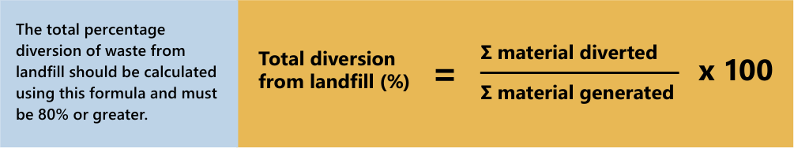

> [Picture on page 19: a picture, saved as a picture (images/da-guidelines-resource-and-waste-management-planni-page-19-30.gif, 150 dpi).]

#### Ʃ material diverted

#### Total diversion

### from landfill (%) = Ʃ material generated

### x 100

#### The total percentage

diversion of waste from

landfill should be calculated

using this formula and must

be 80% or greater.

#### Recycling details

#### Risk assessment

Complete the table. Each material to be

recovered must be listed and the principal

offsite recycler details provided as well as

the market for the recovered resources.

The risk assessment must be completed to identify all

risks presented by the RWM system and demonstrate

the mitigation control measures that will be

implemented to manage these risks.

#### System overview

#### Site plan checklist

Provide site plan(s) and ensure they clearly indicate the

items detailed in the checklist.

#### Supporting evidence

Complete the table (directly or in supporting evidence)

to demonstrate how each material and waste stream

will journey from generation to its destination. Each

material and waste stream must be identified, and

an overview of its management provided. See the

example provided below.

Provide a list of supporting evidence and details of the

purpose of each.

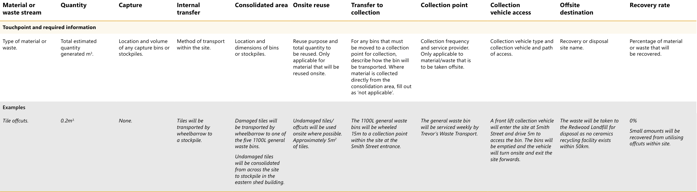

> [Picture on page 19: a map, saved as a picture (images/da-guidelines-resource-and-waste-management-planni-page-19-63.gif, 150 dpi); the street names and other small labels are on the picture.]
> Words printed on the picture (title and legend, copied from the PDF):
> Touchpoint and required information
> Type of material or
> Method of transport
> within the site.
> Location and volume
> of any capture bins or
> dimensions of bins
> Reuse purpose and
> total quantity to
> be reused. Only
> material that will be
> Tiles will be
> Damaged tiles will
> be transported by
> wheelbarrow to one of
> the five 1100L general
> offcuts will be used
> onsite where possible.
> will be consolidated
> from across the site
> to stockpile in the
> eastern shed building.
> Recovery or disposal
> Collection vehicle type and
> collection vehicle and path
> Percentage of material
> or waste that will
> and service provider.
> Only applicable to
> material/waste that is
> to be taken offsite.
> For any bins that must
> be moved to a collection
> point for collection,
> describe how the bin will
> be transported. Where
> material is collected
> directly from the
> consolidation area, fill out
> as ‘not applicable’.
> The general waste bin
> will be serviced weekly by
> Trevor’s Waste Transport.
> Small amounts will be
> recovered from utilising
> offcuts within site.
> The 1100L general waste
> bins will be wheeled
> 15m to a collection point
> within the site at the
> Smith Street entrance.
> The waste will be taken to
> the Redwood Landfill for
> disposal as no ceramics
> recycling facility exists
> A front lift collection vehicle
> will enter the site at Smith
> Street and drive 5m to
> access the bin. The bins will
> be emptied and the vehicle
> will turn onsite and exit the

#### Recovery rate

Transfer to

collection

#### Collection point Collection

vehicle access

#### Offsite

destination

#### Introduction Usage Guidelines Site Preparation

### Construction requirements

#### Create safety

1\.	 Onsite reuse of materials is allowed for waste

materials that are not hazardous to human health

or safety.

2\.	 The collection point must be within the site and

safely accessible by all collection vehicles.

3\.	 All hazardous waste generated must be

tracked, transported, and disposed of

as per the requirements under Part 4 of

the NSW Protection of the Environment

Operations (Waste) Regulation 2014.

4\.	 General solid waste (putrescible and non-

putrescible) and recoverable materials must be

received by appropriately licensed disposal and

resource recovery facilities.

#### Protect amenity

5\.	 The management of materials and

waste onsite must minimise odour,

noise, vibration, and dust impacts.

6\.	 All bins must be stored away from public access

and view.

7\.	 The collection of materials and waste must occur at

appropriate times to minimise noise disturbances

to any nearby residential areas.

#### Deliver efficiency

8\.	 Materials must be sorted onsite for separate

recycling collection. If this is not possible, sorting

and recycling offsite for mixed materials from

Construction is required. If the ability to recycle a

material is adversely affected by being mixed with

other waste types, the material is to be stored and

collected separately.

#### Build a Circular Economy

9\.	 Methods to avoid and reduce Construction waste

generation should be considered. See suggested

measures on the following page.

10\.	Disposal of waste to landfill must be minimised

by avoidance and reduction practices and onsite

reuse of materials or offsite reuse or recycling.

Any materials landfilled must be identified and

explanation as to why landfill was selected as

disposal method over resource recovery.

11\.	An overall 80% recovery rate of materials

should be achieved or explained as to

why this may not be possible.

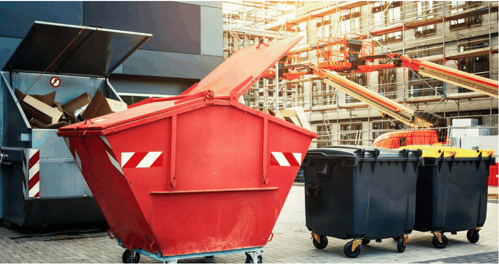

> [Picture on page 20: a picture, saved as a picture (images/da-guidelines-resource-and-waste-management-planni-page-20-48.gif, 150 dpi).]

### Supporting resources

The resources provided below are intended to support applicants in developing their C-RWMP

and are not requirements.

#### Suggested measures to reduce

#### Construction waste generation

Waste avoidance and material recovery can offer

savings on landfill disposal costs (including the waste

levy). Savings can also be achieved through designing

out waste in the Construction stage through the

following measures:

• Procuring the right quantities of materials

• Procuring prefabricated materials

• Reusing formwork

• Using a modular Construction approach and basic

designs to reduce the need for off-cuts

• Minimising site disturbance to limiting unnecessary

excavation

• Careful source separation of off-cuts to facilitate

onsite reuse

• Co-ordination and sequencing of various trades

#### Common Construction materials

• Asbestos

• Bricks

• Concrete

• Excavation material

• Floor coverings

• Fixtures & fittings

• Garden organics

and trees

• Glass

• Hazardous waste

• Metals (ferrous)

• Metals (non-ferrous)

• Mixed recycling

• Plasterboard

• Roof tiles

• Tiles

• Timber (clean)

• Timber (treated)

• Residual waste

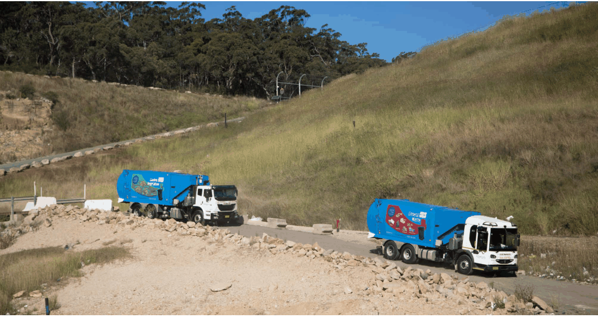

> [Picture on page 20: a picture, saved as a picture (images/da-guidelines-resource-and-waste-management-planni-page-20-89.gif, 150 dpi).]

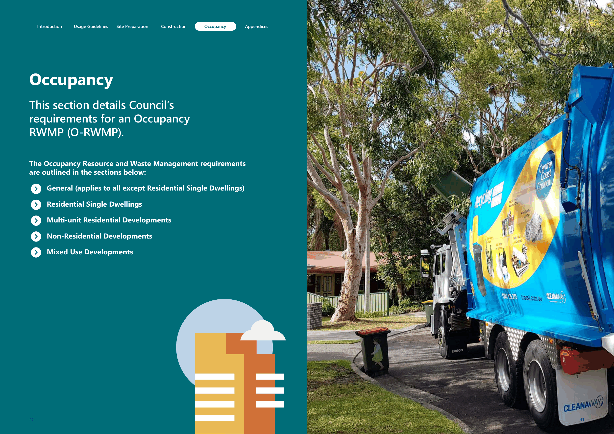

> [Picture on page 21: a picture, saved as a picture (images/da-guidelines-resource-and-waste-management-planni-page-21-1.gif, 150 dpi).]
> Words printed on the picture (title and legend, copied from the PDF):
> Occupancy
> Appendices

### Occupancy

### This section details Council’s

### requirements for an Occupancy

### RWMP (O-RWMP).

### The Occupancy Resource and Waste Management requirements

### are outlined in the sections below:

General (applies to all except Residential Single Dwellings) Residential Single Dwellings Multi-unit Residential Developments

### Non-Residential Developments Mixed Use Developments

#### Introduction Usage Guidelines Site Preparation

### Occupancy RWMP guide

#### Any Development Application that results in an occupied facility must prepare

#### an O-RWMP in line with the requirements outlined in this section.

The O-RWMP must demonstrate that RWM systems will meet Council’s and future occupancy and utilisation

required outcomes:

### Create safety

All management of materials and waste should comply

with all WHS regulation requirements. The transport

of materials and waste, consolidation areas, collection

point and collection vehicle access must be designed

to create safety.

### Protect amenity

All material and waste management systems must be

designed to minimise disturbances to the surrounding

community, including visual unsightliness, noise,

odour, and dust.

### Deliver efficiency

Materials and waste that are collected for offsite

recovery or disposal must be consolidated effectively

and collected at an appropriate frequency to avoid

unnecessary vehicle movements.

### Build a Circular Economy

The Occupancy stage contributes the most significant

material and waste volumes over the development

lifespan. A good RWM system with adequate source

separation provisions has the potential to divert

significant quantities of recoverable materials from

landfill and play a key role in delivering on the NSW

State targets to:

• reduce total waste generated by 10% per person

by 2030

• have an 80% average recovery rate from all waste

streams by 2030

• halve the amount of organic waste sent to landfill

by 2030

Provisions for effective source separation of material

must be detailed in the O-RWMP.

The O-RWMP must include:

#### How to develop the Occupancy RWMP

• The RWMP Form Part D completed with the

information specified below

Use the touchpoints framework to develop the

O-RWMP. For a step-by-step guide, refer to the

RWMP submission guide.

• A O-RWMP or site plan (drawing)

• Supporting evidence

In any instance that Part D of the Form does

not provide sufficient space for completion

of the required details, the applicant should

address the item in supporting evidence

and include a specific reference to direct the

Assessing Officer to the relevant information.

#### General information

Complete the following fields to provide an overview of the Occupancy activities.

| Form field | Information required |  |
|---|---|---|
| Development type: | Select from the list: |  |
|  | - | Residential Single Dwelling |
|  | - | Multi-unit Residential Development |
|  | - | Non-Residential Development |
|  | - | Mixed Use Development |
| Description of development: | Description of new development including: |  |
|  | • | Number and types of Residential Dwellings |
|  | • | Number and types of Non-Residential Dwellings |
|  | • | Number of floors |

#### Introduction Usage Guidelines Site Preparation

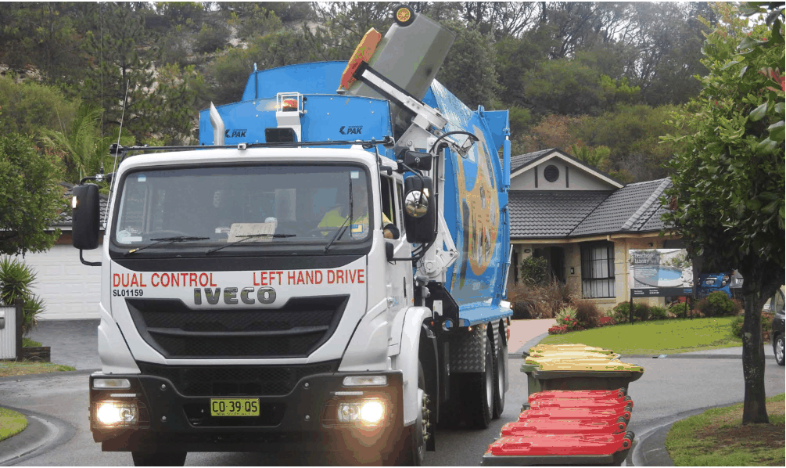

> [Picture on page 23: a picture, saved as a picture (images/da-guidelines-resource-and-waste-management-planni-page-23-2.gif, 150 dpi).]

#### Management arrangements

Building managers, occupants, workers, visitors,

patrons, and those involved with the operation and

management of a building’s waste and recycling

systems are considered key stakeholders. These

should be identified and their roles and responsibilities

described to demonstrate that adequate consideration

has been given to the functional operation of the

RWM system.

#### Typical Occupancy touchpoint

#### journey example

A typical touchpoint journey is provided as

an example for the applicant to understand

the touchpoints framework.

#### System overview

Complete the table (directly or in supporting evidence)

to demonstrate how each material and waste stream

will journey from generation to its destination. Each

material and waste stream must be identified and an

overview of its management provided. See example

provided on following page.

#### Risk assessment

The risk assessment must be completed to identify all

risks presented by the RWM system and demonstrate

the mitigation control measures that will be

implemented to manage these risks.

#### Required outcomes

The complexity and long-term nature of Occupancy

RWM systems requires more detailed consideration

for Council’s required outcomes. Demonstrate how

each touchpoint will create safety, deliver efficiency,

protect amenity, and build a Circular Economy. Refer

to table on the next page for more information.

#### Site plan checklist

Provide site plan(s) and ensure they clearly indicate the

items detailed in the checklist.

#### Supporting evidence

Provide a list of supporting evidence and details of the

purpose of each.

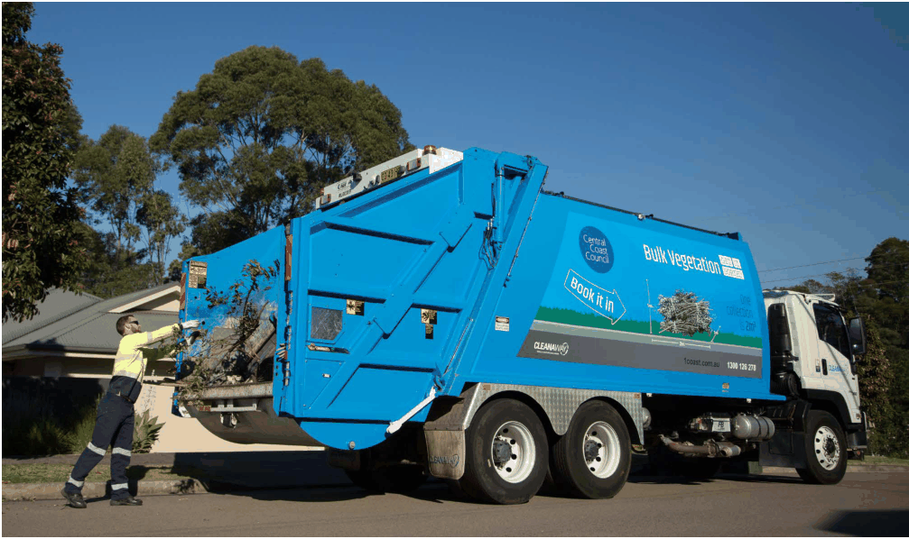

> [Picture on page 23: a picture, saved as a picture (images/da-guidelines-resource-and-waste-management-planni-page-23-42.gif, 150 dpi).]

| Form field | Key outcomes | Information required |
|---|---|---|
| Generation | Circular Economy | List all waste streams generated and provisions made to encourage |
| & Capture: |  | avoidance, reuse, and source separation for recovery. |
| Internal | Create safety | Describe how the material and waste transport to the consolidation |
| transfer: | Protect amenity | area will create safety and protect amenity. |
| Consolidation | Create safety | Detail design elements of the consolidation area and its location that |
| area: | Protect amenity Deliver efficiency Circular Economy | improve safety and protect amenity. Detail all bins and equipment to demonstrate safe access, good consolidation, and sufficient capacity for a variety of waste streams. Detail any provisions made for ensuring the correct materials are placed into the correct bins. |
| Transfer to collection: | Create safety Protect amenity | Describe how the material and waste transport to the consolidation area will create safety and protect amenity. |
| Collection | Create safety | Detail all design elements of the collection point that reduce the |
| point: | Protect amenity | safety hazards and negative amenity impacts inherent in material and waste collection. |
| Vehicle | Create safety | Provide details of the collection vehicle(s) and path of access to |
| access: | Protect amenity Deliver efficiency | demonstrate how the design creates safety, protects amenity, and minimises collection frequency to deliver efficiency. |

#### Occupancy system overview table example

| Material or waste stream | Quantity | Capture | Internal transfer | Consolidation area | Onsite reuse | Transfer to collection | Collection point | Collection vehicle access | Recovery rate |
|---|---|---|---|---|---|---|---|---|---|
| Touchpoint and required information |  |  |  |  |  |  |  |  |  |
| Type of material or waste. Total estimated quantity generated in L or m3 per day or week. |  | Location and volume of any capture bins. | Method and distance of transport from capture to consolidation. * | Location and total dimensions of bin room or consolidation area. Number, type, and total capacity of bins. | Reuse purpose and total quantity to be reused. Only applicable for material that will be reused onsite. | Method and distance of transport from consolidation to collection. | Location of collection point. | Collection vehicle type and collection vehicle and path of access. | Recovery or disposal site name. |
| Example: Residential Single Dwelling |  |  |  |  |  |  |  |  |  |
| General waste. | 40L per week. | Space for on-floor garbage bin is provided in the kitchen. | The resident will carry the waste out in a plastic bag. | One 140L red lid MGB (mobile garbage bin) to be stored in a fenced off area at the side of the property. The storage area is 2m2 and lockable. | Not applicable. | The transfer path from the consolidation area to the collection point does not exceed 30m. | 140L red lid MGB to stand kerbside at the front of the property. The area is 2m2. | The collection point is easily accessed by waste collection vehicles and collections staff, with no traffic or environmental obstructions. | Not applicable. |
| Example: Multi-unit Residential Development |  |  |  |  |  |  |  |  |  |
| Comingled recyclables. | 240L per day based on EPA Waste Generation Rates for multi-unit dwelling (MUD). | Reasonable space for smaller interim storage bins will be provided for in the kitchen. | The resident will carry the bagged recyclables to the interim storage room (or chute). Where the waste will be stored until emptied by facilities management staff and transferred to the consolidation area. See attached Plan 1 for details of storage area design and risk assessment. | Three 660L yellow lid MGBs will be used for the storage of comingled recycling and emptied weekly. 6m2 has been allocated for the storage of these bins accounting for access, movement requirements and no bin stacking. | Not applicable. | Waste collections personnel will cart waste MGBs to the collection point, the path does not exceed 10m and is of a flat gradient. | The comingled recycling MGB will be taken to the loading area by the contractor and emptied into the waste collections vehicle. | A rear-lift waste collection vehicle will be used, the vehicle dimensions are included in the RWMP and swept paths proving accessibility to the loading area can be seen in the attached Attachment 2. | Not applicable. |

\* If an interim storage is part of the RWM system design, please provide details of the area, bins, and additional transfer movement to the

consolidation area. This can be addressed in supporting documentation.

### Occupancy requirements

#### General

This section applies to all development types with the exception of Residential Single Dwellings.

#### Generation

#### The O-RWMP must clearly show waste volume

estimations for the core waste streams.

1\.	 Operational waste management planning for

the development must include a minimum

separation of three core waste streams: Comingled

recyclables, Food Organics and Garden Organics

(FOGO), and residual waste.

6\.	 If the development will generate hazardous and

liquid wastes, then a suitably sized space must be

allocated to the storage of these waste streams.

Hazardous and liquid wastes may include paint,

needles, chemicals, cooking oil, commercial

cleaning products, and solvents. Hazardous waste

should be kept secure and inaccessible to everyone

but facilities management staff and specific

hazardous waste collections contractors.

2\.	 The three core waste streams must be source

separated, with three separate distinctly coloured

and identifiable bins provided, to reduce the risk of

cross-contamination by the user.

7\.	 Appropriately sized bins must be used in the

development, accounting for the expected

waste generation of all areas, practicality of

bin movement and frequency of emptying.

Additionally:

3\.	 Additionally, space must be provided for the

separation and storage of bulky waste and

electronic waste.

a.	 FOGO bins are not to be larger than 240L due

to the density of this waste stream making it

difficult to transfer in large quantities.

b.	All other waste streams to be transferred in a

4\.	 Estimated waste generation for comingled

recycling, FOGO, and residual waste must be

calculated and evidenced using the waste

generation rates provided in Appendix B.

maximum of 1100L bins.

c.	 Bins can either be swapped for empty ones or

decanted into larger bins using bin lifts.

5\.	 One or more interim storage rooms or areas

must be provided and indicated on planning

documentation, these areas must be:

d.	Allow sufficient space for manoeuvrability of

a.	 Adequately sized to accommodate at least one

days’ worth of waste stored in MGBs.

b.	Easily and safely accessible to building users.

c.	 Located in a place or places within the

bins within storage areas. A minimum additional

70% of actual bin size is required e.g. 3 x 660L

bins = 3 x (1.4m x 0.8m) = 3.36m2 + 70% = 5.7m2.

Additional space must be allowed where items

such as drainage, doors, equipment, hoses, and

other items are co-located.

development that minimises the transfer

distance of waste to the central waste

consolidation area. Considerations should be

given to proximity to vertical transport such as

service lifts or waste chutes.

8\. 	 Sufficient space around the collection vehicle must

be allowed within the collection or service zone to

allow the collection operatives to safely manoeuvre

and empty bins. The development must allow at least the following:

a.	 1m pedestrian clearance for operatives to walk.

b.	1.5 x the largest bin size for wheeling bins.

c.	 2.5 x the largest bin size within the

emptying zone.

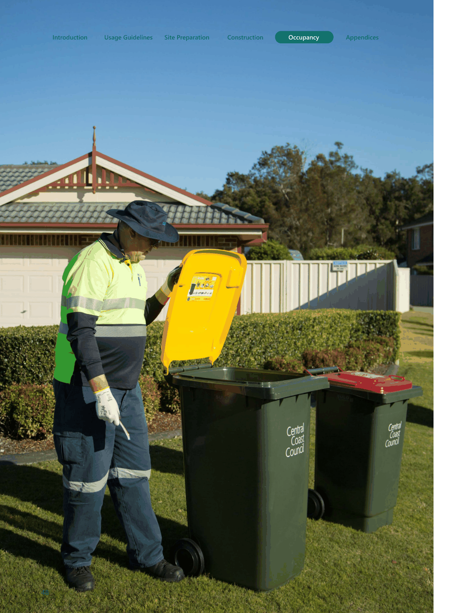

> [Picture on page 25: a picture, saved as a picture (images/da-guidelines-resource-and-waste-management-planni-page-25-72.gif, 150 dpi).]

#### Introduction Usage Guidelines Site Preparation

#### Transfer to Consolidation

#### The O-RWMP must clearly display the safe

transfer of materials from interim storage areas

to the central waste consolidation area.

8\.	 Equipment such as MGBs or cleaner’s trolleys are

to be used to transfer waste from interim storage

areas to the central waste consolidation area.

9\.	 The central waste consolidation area must be

located in a place within the development that

minimises travel distance from the interim storage

areas.

10\.	The transfer path should avoid high thoroughfare

areas, slopes, and stairs.

11\.	The unassisted transfer of large or heavy bins must

not be more than 5m, this applies to bins over

600L in size or FOGO bins larger than 140L.

12\.	For multi-levelled developments the use of vertical

transport such as service lifts to cart the waste to

the consolidation area must be employed.

a.	 If a chute system is installed this can be used

to transfer comingled recyclables and residual

waste to a chute service room located on

the same level or within the central waste

consolidation area. For more information on

chutes and their requirements please see

#### Appendix E.

#### Consolidation area

The O-RWMP must clearly describe the

location and size of the central waste

consolidation area, as well as the number

and type of bins that it will contain.

13\.	The central waste consolidation area will

be primarily used for the storage of all the

development’s waste materials and associated

equipment and therefore must be adequately sized

to accommodate the following:

a.	 At least two days’ worth of comingled recycling,

FOGO, and residual waste storage. This must

be evidenced in the O-RWMP using waste

generation estimations.

14\.	Safe and effective movement of bins within the

consolidation area:

a.	 A minimum bin scaling factor of +70% must be

used to calculate the extra space required for

the manoeuvring of bins.

b.	The access paths within the consolidation area

must be kept free and clear of obstructions or

items which can impact bin movements such as

open drains or steps.

c.	 Bin storage arrangements must avoid bin

blocking and ensure that all core waste streams

always have readily accessible bins.

d.	FOGO bins must not be larger than 240L due

to the density of this waste stream making it

difficult to transfer in large quantities.

15\.	Space for bulky waste (see development specific

sections for bulky waste space requirements) and

other intermittently collected waste stream such as:

a.	 E-Waste

b.	Printer toner cartridges

c.	 Charity donatable goods

16\.	The consolidation area must be suitably located

within an enclosed area of the building envelope,

to minimise unwanted pests and vermin, vandalism,

and disturbances / amenity impacts.

17\.	The consolidation area should be located in a

suitable position that is both convenient for users

and waste collection staff, promotes simplified

resource recovery, and separation of waste

streams.

18\.	The consolidation area must have facilities to

enable the cleaning of bins, this will reduce any

odour impacts to amenity and minimise pests.

Cleaning must be undertaken regularly – especially

FOGO bins which should be cleaned after each

empty.

a.	 Bin washing facilities must be provided within or

adjacent to the waste consolidation area.

19\.	Waste compaction machinery and waste chute

outlet areas must address all health and safety

considerations, such as:

a.	 Appropriate PPE

b.	Hazard signage

c.	 Any other bespoke operational requirements

d.	Spillages and or liquids from waste

20\.	Detailed design considerations and requirements

for waste consolidation areas are outlined in

Appendix F.

#### Transfer for collection

#### The O-RWMP must clearly describe how waste

materials will be safely transferred from the

consolidation area to the point of collection.

21\.	The waste vehicle collection point must be

located within 10m of the entrance to the waste

consolidation area, with the following exception:

a.	 Bins larger than 660L must not be transferred

unassisted more than 5m.

22\.	The route from consolidation area to collection

point must not exceed a grade of 1:14 for bins sized

360L or smaller and must not exceed a grade of

1:24 for bins larger than 360L at any point.

23\.	Collection points must be located to avoid the

potential for disturbances.

#### Collection point and Vehicle access

#### The O-RWMP must clearly describe where

the collection point is located and how

the collection vehicle accesses this.

24\.	Waste and recycling storage containers must

not be stored outside of the bounds of the

development at any stage of the collection process.

25\.	The collection point must be located where the

collection vehicle(s) can stand and function safely.

26\.	The collection point must be as close to the

consolidation area as possible and not further than

10m away.

27\.	The waste collection vehicle must be able to enter

and exit the site in a forward direction from the

direction of approach on the same side of the road

as the development i.e. turning left in and left out.

28\.	Reversing of collection vehicles within the

development is to be minimised as much as

possible. Detailed swept paths showing how waste

collection vehicles manoeuvre within, and enter

and exit the development must be provided along

with the RWMP.

#### Other Considerations

29\.	An individual domestic waste management charge

will be levied by Council on every individually

residential rateable property, regardless of whether

Council provide the services, or a private contractor

is engaged directly by the property manager.

30\.	Council will assess the O-RWMP using and

applying the same levels of criteria and

requirements regardless of whether Council

services or contractor services are proposed.

#### Council Service Contracts

31\.	The structure of Central Coast Council’s waste

collection and recycling services plays an important

role in ensuring efficient servicing. Waste service

flexibility is an important issue that should be

considered in relation to deciding an appropriate

best practice system for the development. It is

important to talk to Council as early as possible

to identify potential servicing issues; this can be

discussed at a Pre-development meeting.

#### Introduction Usage Guidelines Site Preparation

#### Residential Single Dwellings

#### This section applies to all Single Dwelling Residential Developments.

This section does not need to be read in conjunction with General Occupany Requirements.

#### Specific requirements for Residential

#### Single Dwellings

1\.	 A minimum of two days’ worth of comingled

recyclables and residual waste storage must be

provisioned for inside each residence.

2\.	 A floor plan of the proposed development must be

included which shows:

a.	 Space allocated within the property boundaries

for 3 x 240L bins (comingled recycling, FOGO,

and residual waste). Note: actual bin sizes

provided may differ but the minimum space for

3 x 240L bins must be available.

b.	The transfer path that the bins will take from

their storage point to the kerbside collection

point. This path should be less than 30m in

distance, transitioning between less than 2 floor

levels, avoid steep gradients and be adequate

for the transfer of 240L bins.

c.	 The location of the proposed kerbside collection

point capable of holding 3 x 240L bins

(3m x 1m).

3\.	 An individual domestic waste management charge

will be levied by Council on every individually rated

residential property.

#### Council Service Contracts

4\.	 Waste collection points must be easily accessed by

Council waste collections staff with the following

criteria evidenced in the O-RWMP:

a.	 Preference for kerbside waste collection, in

circumstances where Council vehicles need to

provide onsite collection then swept paths must

be provided showing how the waste collection

vehicle will service the development accounting

for vehicle height (including the maximum

height of a bin lift), length, width, turning circle,

and maximum weight (see Appendix G).

b.	Kerbside collection points need to consider

issues such as the following:

i.	 Car parking spaces that may impede

collection.

ii.	 Possible interference with trees, street

furniture, bus stops, loading zones, or other

noted ordinance.

iii.	 Sized to accommodate all bins presented and

allowing sufficient manoeuvrability.

The structure of Central Coast Council’s waste collection and recycling systems play an important role in

ensuring efficient servicing. Waste service flexibility is an important issue that should be considered in

relation to deciding an appropriate best practice system for the development. It is important to talk to

Council as early as possible to identify potential servicing issues; this can be discussed at a

Pre-development meeting.

#### Multi-unit Residential Developments

This section applies to all Multi-unit Dwelling Residential Developments and must be read

in conjunction with General Occupancy Requirements.

#### Specific requirements for MUDs

In addition to the considerations described in the

general requirements section, RWMPs for Multi-

unit Residential Developments must also display

the following.

1\.	 Residents must not be required to transfer waste

more than 30m in distance or over 2 floor levels

from their residences to a communal waste

storage/disposal point, i.e. an interim waste storage

room or waste disposal chute inlet. Multiple

storage points should be considered for larger

developments.

2\.	 Onsite collection of waste is required for all

MUDs. Collections from a basement area should

be the preference, however some development

circumstances may not permit this as a viable

option in which case the following may be

considered in order of preference:

a.	 A dedicated waste collection or loading bay on

the same grade as the building.

b.	Kerbside collections – for developments with six

or less dwellings.

3\.	 Note: any collection proposals will need to consider

other development controls and impacts and

although the proposal may provide an acceptable

waste outcome it may not be permissible under

other planning requirements.

4\.	 Waste collection points must be accessible to

Council collection vehicles. Swept paths showing

how Council waste collection vehicles will enter and

exit the development must be supplied.

5\.	 A bulky waste storage space is to be designated

for residents to temporarily store large waste items

awaiting collection by Council’s clean up service,

such areas must be:

a.	 Minimum 10m2 of space for developments up

to 40 units in size, an extra 2m2 is required for

every additional 10 units. For example, a 60 unit

development would require 14m2 minimum of

bulky waste storage space.

b.	Easily accessible by buildings residents.

c.	 Secured and caged to prevent illegal dumping

and for the contents to be viewed from the

outside.

d.	Access doorways leading from the bulky waste

storage area to the collection point must be at

least 1.5m wide.

e.	 Located on ground or basement level and can

be integrated with the centralised waste storage

area.

6\.	 Kerbside collection utilising 240L bins is

permittable for developments with six or less

residential units in certain circumstances if it can be

proven that the space required for onsite storage

of waste would be of detriment to the feasibility of

the project and the presentation of kerbside bins

is acceptable and in line with these Guidelines.

Kerbside collections must also adhere to the

following design considerations as referenced in

the NSW EPA Better Practice Guide for Resource

Recovery in Residential Developments 2019:

a.	 Bins fit in a row with a minimum 50cm space

between them.

b.	Bins are within the site’s frontage (not impeding

driveway or neighbours’ lots).

c.	 Bins are a minimum 2m away from trees, bus

stops, street furniture, and road infrastructure.

d.	The development includes parking free zones

at least 10m each side of the bin presentation

space to allow safe collection.

7\.	 Kerbside collections should not be located adjacent

to the following structures and services:

a.	 Intersections, roundabouts, or traffic-calming

devices.

b.	Along arterial roads.

c.	 Narrow lanes which heavy rigid class vehicles

cannot access.

d.	Obstructions such as trees, overhanging

buildings, under eaves and low overhead

powerlines.

e.	 Walls and garage doors.

f.	 ‘No stopping’ signs, loading zones, parked cars,

or other enforceable penalty zones.

#### Introduction Usage Guidelines Site Preparation

#### Non-Residential Developments

#### This section applies to all Non-Residential Developments and must be read

in conjunction with General Occupancy Requirements.

#### Generation

1\.	 Bulky waste storage space is to be determined

based on the size and type of Non-Residential

Development:

a.	 2m2 for developments under 100m2,

b.	4m2 for developments between 100m2 and

2,000m2.

c.	 Retail, accommodation, and entertainment

developments must provide an extra 4m2 of

bulky waste storage space for every 2,000m2 (i.e.

a retail development of 5000m2 must provide

8m2 of bulky waste storage).

e.	 Office developments must provide an extra 4m2

of bulky waste storage for every 20,000m2.

f.	 Bulky waste storage areas must be secured and

caged to prevent illegal dumping and for the

contents to be viewed from the outside.

2\.	 An area must be provided for the temporary

storage of reusable commercial items such as

pallets, kegs, and crates. This area should be

located in an easily accessible location adjacent

to a goods loading dock or stored within each

applicable commercial premises.

3\.	 Reusable and recyclable fit out waste is to be

stored and managed in a separate interim storage

room, unless it is stipulated in contracts with the

organisations conducting the fit out that they are

required to remove old furnishings and materials

as they are generated.

#### Collection area and Vehicle access

4\.	 Commercial waste contractor vehicles may differ in

size to the Council fleet; however, the Council waste

vehicle specifications, methodology, and objectives

must still be used when creating swept paths to

confirm access to the waste collection point.

5\.	 Contracts with waste collection contractors

must cover all waste streams applicable to the

development type and copies of the contract

deliverables must be supplied to tenants of the

development.

6\.	 Preference should be given to the onsite weighing

of materials as this yields the best quality data.

#### Specific Non-Residential requirements

#### Offices, universities, and light industrial

7\.	 The source separation of waste is to be provisioned

on each floor of an office development. This can be

achieved by providing centrally located bin stations

for each waste stream that remove the need for

under desk bins.

8\.	 Paper and cardboard are a significant waste stream

for office developments and provisions must

be made to ensure that this waste is stored in a

vermin-proof area and must not be held for more

than two weeks to deter nesting of vermin.

9\.	 Printing or photocopying areas should

have space provisions for at least one

MGB of up to 240L in volume.

10\.	Developments of more than 20,000m2 of office

area must provide space for a cardboard baler or

in-bin compactor, within or adjacent to the waste

consolidation area.

Cafés, supermarkets, pubs, clubs,

and commercial kitchens

11\.	Food premises are to comply with the

requirements of AS4674-2004 Design, Construction,

and fit-out of food premises, including the general

waste and recyclable materials requirements. These

Guidelines are not intended to alter obligations

under that Standard and in the event of any conflict

between these Guidelines and the Australian

Standard, the Standard prevails.

12\.	If the food waste from the development is

estimated to produce more than 50L of seafood,

poultry, and meat waste per day, or contain more

than 20% of these by weight or volume, then this

should be collected daily.

13\.	Kitchen preparation areas must have space

designated for the separate storage of comingled

recyclables, food scraps, and residual waste. These

waste receptacles are to be emptied daily.

14\.	Waste oils must be kept separately from other

waste streams.

#### Retail

15\.	Retail developments of over 2,000m2 must provide

space for either a baler or bin press for cardboard

waste located within or adjacent to the waste

consolidation area.

#### Mixed Use Developments

### Appendix A Resource and Waste Management Plan Form

#### This section applies to all Mixed Use Developments and must be read

in conjunction with General Occupancy Requirements.

### Appendix B Waste generation rates Appendix C Waste management equipment

6\.	 Proof that the residential and non-residential

waste generation estimations have been calculated

separately. Calculating these together may lead to

incorrect bin estimation numbers.

### Appendix D Central Coast collection services Appendix E Chutes

Additional considerations for

#### Mixed Use Developments

In addition to the considerations described in

the general requirements section, RWMPs for

Mixed Use Developments must also meet the

requirements of Multi-unit Residential and Non-

#### Residential, and demonstrate the following:

### Appendix F Consolidation area Appendix G Collection vehicle access

7\.	 Consideration must be given to the servicing

hours of both residential and non-residential waste

and recycling, ensuring that noise disturbance

does not impact residents or neighbours of the

development. This includes the collection of non-

residential waste and recycling which must adhere

to Council’s current collection timelines.

### Appendix H Food waste

> [Picture on page 29: a picture, saved as a picture (images/da-guidelines-resource-and-waste-management-planni-page-29-30.gif, 150 dpi).]

1\.	 Residential and non-residential waste streams must

be kept physically separated due to a difference in

charging for waste collection services. Residential

waste is levied by Central Coast Council. Non-

residential waste is a business expense, and the

waste collection services is paid for by the waste

generating business (or businesses).

2\.	 Residential and non-residential waste handling

and storage systems must be kept separate and

eliminate operational interferences or the flow of

waste between each other.

8\.	 If a facilities management contractor is employed

to assist with the management of waste for

both residential and non-residential elements

of the development, then waste equipment

such as bin washes, bin compactors, and bin

lifts may be shared. It is not recommended

to share a baler or bin press due to the

potential to mix cardboard between residential

and non-residential waste streams.

3\.	 Residential and non-residential tenants must not

be able to access each other’s waste storage areas.

4\.	 Collection points may be shared between

residential and non-residential waste and recycling

as long as each waste stream is clearly identifiable

or presented at different times.

5\.	 The O-RWMP must specify interim waste and

recycling storage areas, waste, and recycling

consolidation areas and collection points for both

residential and non-residential.

### Appendix B

### Waste generation rates

### Appendix A

### Resource and Waste Management

### Plan Form

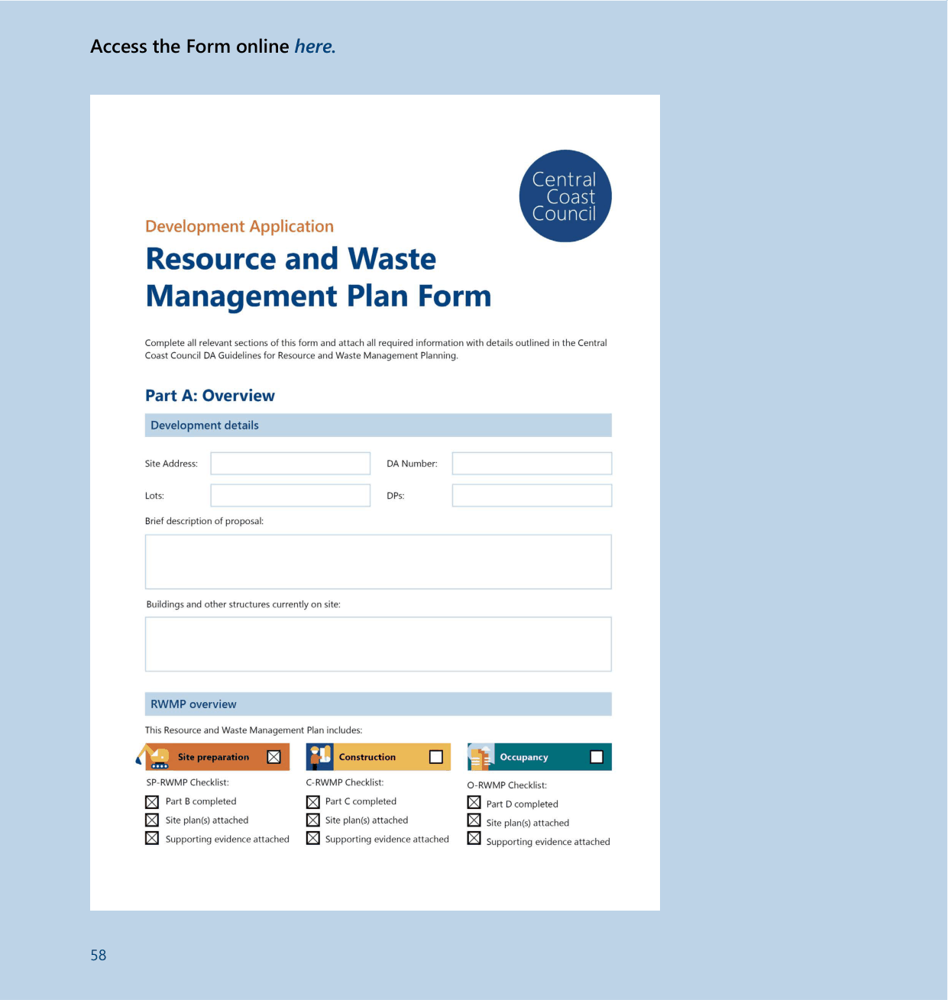

> [Picture on page 30: a picture, saved as a picture (images/da-guidelines-resource-and-waste-management-planni-page-30-6.gif, 150 dpi).]

#### Access the Form online here.

#### Having an idea of the amount of materials that the development

will generate when in operation is crucial to the planning of a good

#### Resource and Waste Management system.

#### Estimated residential waste and recycling generation rates

Accounting for variances and increases in waste generation, the allowance

for waste and recycling storage for residential developments can be

calculated using the following figures:

| Single Dwelling |  | Litres per week |  |
|---|---|---|---|
| Developments* | Comingled Recycling | Food & Garden Organics | Residual Materials & Waste |
| Single-dwellings (houses, small | 120 | 160 | 100 |
| scale villas, or townhouse-type |  |  |  |
| developments) |  |  |  |

\* Waste and recycling generation rates for single dwellings also depend upon the number of people residing in the dwelling. The waste generation rates above provide a guide only and are in line with the City of Sydney Guidelines for

Waste Management in New Developments 2018.

| Multi-unit Residential |  | Litres per week |  |
|---|---|---|---|
| Developments* | Comingled Recycling | Food & Garden Organics | Residual Materials & Waste |
| 1 Bedroom Apartment or Studio | 80 | 25 | 80 |
| 2 Bedroom Apartment | 100 | 25 | 100 |
| 3 Bedroom Apartment or greater | 120 | 50 | 120 |

\* This assumes a 7L kitchen caddy for food preparation and food scraps is emptied 3.5 times per week. In addition to food waste

there may also be organics waste generated from the maintenance of communal gardens and pot plants. The waste generation rates above provide a guide only and are in line with the EPA Better Practice Guide for

Resource Recovery in Residential Developments 2019.

#### Estimated commercial waste and recycling generation rates

The following instructions apply when using the data in the table below to calculate waste generation rates for

commercial buildings:

| Premises type | Units | Expected litres per 100m2 per day |  |
|---|---|---|---|
|  |  | Comingled Recycling | Residual Materials & Waste |
| Accommodation: non-hotel/motel | Per number of guest rooms (a) | 5 | 10 |
| Aged care | Per resident (b) | 1 | 5 |
| Cafes | Per 100m² floor space | 120 | 100 |
| Childcare | Per child | 5 | 5 |
| Cultural and recreational services: (museums, theatres, cinemas) | Per 100 m² floor space (C) | 10 | 5 |
| Food retail: takeaway (with sit-down area) | Per premises (80m²) (d) | 240 | 500 |
| Food retail: takeaway (food preparation only) | Per premises (80m²) | 60 | 120 |
| Hotels/pubs (without meals provided at the bar) | Per 100m² floor space (e) | 50 | 50 |
| Licensed clubs (with gaming) | Per 100m² floor space (e) | 50 | 50 |
| Medical | Per number of doctor’s consulting rooms (f) | 10 | 20 |
| Motels | Per number of guest rooms (g) | 5 | 10 |
| Offices | Per 100m² floor space (h) | 15 | 10 |
| Restaurants | Per 100m² floor space | 280 | 400 |
| Retail: chain stores (clothing, manchester etc.) | Per 100m² floor space (i) | 20 | 5 |
| Retail: other non-food | Per premises | 100 | 50 |
| Retail: grocery and convenience stores | Per 100m² floor space | 240 | 120 |
| Showrooms | Per 100m² floor space | 25 | 10 |
| Supermarkets | Per 100m² floor space (j) | 300 | 240 |

a)	 Other types of facilities calculated separately. Function rooms (f)	 Need to determine if other services are offered. Note that other

are based on potential bookings and restaurant data.

waste such as clinical waste will be generated.

(b)	Kitchen to be calculated as per restaurant. Need to determine if (g)	Other types of facilities calculated separately

(h)	Floor space that is used for staff activities (e.g. exclude lobby

other services are offered. Note that other waste such as clinical

waste will be generated.

areas)

(c)	Floor space for patrons (seating areas for theatre/cinema).

(i)	 Other facilities such as cafes calculated separately

Calculate cafes separately. Calculate office areas separately.

(j)	 Larger supermarkets may have a number of recycling streams,

(d)	Day operation only. Note consideration must be given to the

so advice should be sought as to what systems will be provided

number of hours or operation.

(e)	Calculate restaurants separately (including meals served at

bar) as well as accommodation (use motel rate).

The waste generation rates on the previous page provide a guide only and are in line with the NSW EPA Better

Practice Guide for Resource Recovery in Residential Developments 2019.

• This data is for comingled recycling, food organics,

and residual waste. The premises may generate

other waste types (i.e. medical clinics in a shopping

centre) and so generation rates for these should

also be considered.

• For premises that have multiple types of facilities

(i.e. a club that has accommodation, bars, cafes

and restaurants or a residential building with a

convenience store or an office building with café,

gym, and childcare), all such facilities must be

calculated separately and then volumes generated

considered when looking at the bins required,

storage size, and servicing frequencies.

• Consideration should be given for times of peak

generation such as when stock is delivered or sale

times at retail stores.

• Shopping centres can have a variable tenant mix.

Some have large tenancies (used by the major

chains), whereas others have a broad range of small

tenancies as well as offices, medical centres, and

a higher percentage of food outlets as opposed

to general retail. Therefore, these should be

calculated separately.

• The volume calculations do not take into

consideration waste compaction systems that may

be used, such as bin presses or balers for paper/

cardboard or waste.

• If the retail or commercial tenancies are not known

at the DA stage, the rates for the largest waste and

recycling generator permitted in the zoning of the

proposed development must be applied.

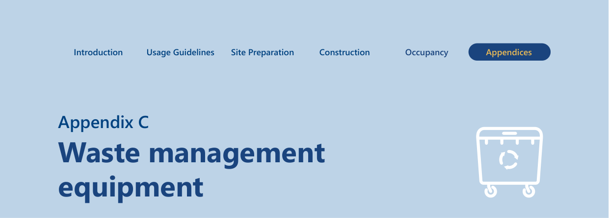

> [Picture on page 32: a picture, saved as a picture (images/da-guidelines-resource-and-waste-management-planni-page-32-1.gif, 150 dpi).]

### Appendix C

### Waste management

### equipment

#### Mobile Garbage Bins (MGBs)

A variety of bins and equipment exist for handling,

collecting, and storing waste and recycling in

commercial and residential buildings. The type of

bin or equipment required depends on the type of

material to be handled and the type of premises in

which it’s used.

These bins are the most commonly used method

of storing waste and recycling due to their good

manoeuvrability, which allows for some flexibility in

where they are stored and where they are collected.

Regardless of their size, MGBs are typically serviced by

rear-lifting vehicles.

All images shown are for illustration purposes

only. Central Coast Council does not endorse the

suppliers of the indicated equipment, nor any

other manufacturers or suppliers of equipment and

applicants must conduct their own investigations and

research to inform their decisions.

#### Australian standard sizes for MGBs

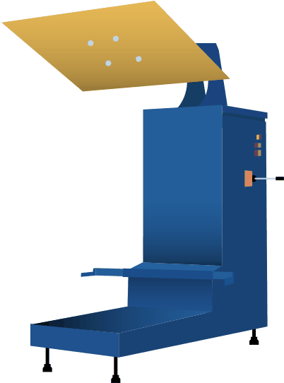

> [Picture on page 32: a picture, saved as a picture (images/da-guidelines-resource-and-waste-management-planni-page-32-25.gif, 150 dpi).]

| MGB Type | Dimensions* |  |  | Footprint (m2) |
|---|---|---|---|---|
|  | Height (mm) | Depth (mm) | Width (mm) |  |
| Two-Wheeled MGBs |  |  |  |  |
| 120L | 940 | 560 | 485 | 0.28 |
| 140L | 915 | 615 | 535 | 0.32 |
| 240L | 1080 | 735 | 580 | 0.43 |
| Four-Wheeled MGBs |  |  |  |  |
| 660L | 1250 | 850 | 1370 | 1.17 |
| 1100L | 1470 | 1245 | 1370 | 1.70 |
| *These dimensions are only a guide and may differ slightly according to manufacturer, some MGBs have flat or domed lids and thus may require different bin lifting devices. |  |  |  |  |

#### Bin press

#### Compaction equipment

Equipment for waste and recycling compaction are

used to condense various waste streams for the

purpose of saving space. They are an effective way to

reduce storage requirements while also keeping waste

collections to a minimum.

#### Bin press

• Condenses waste and recycling contained in MGBs.

• Generally used for 660L and 1100L MGBs.

• Compaction ratios to be used in waste and

recycling calculations:

–	Comingled recyclables 2:1

–	Paper and cardboard 3:1

–	Residual waste 2:1

#### Compactors

• Superior compaction of waste materials usually

used for large commercial developments.

• Bin lifts are usually required to tip bins into the

compactor chamber.

#### Compactor

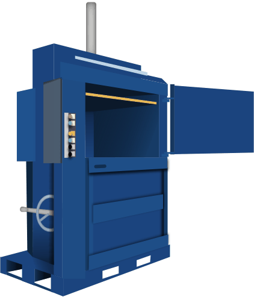

> [Picture on page 32: a picture, saved as a picture (images/da-guidelines-resource-and-waste-management-planni-page-32-48.gif, 150 dpi).]

#### Baler

• Compactor feeds into detachable Roll-on Roll-Off

(RORO) bulk bin which must be collected using a

hook lift truck.

• Compaction ratios to be used in waste and

recycling calculations:

–	Comingled recyclables 3:1

–	Paper and cardboard 5:1

–	Residual waste 3:1

#### Balers

• Highest compaction ratio for paper and cardboard

stream depending on pressing force of baler used.

• Bins must be emptied into these manually.

• Produces heavy bales which should be moved

using a forklift or if palletised using an electric

assist pallet.

• Compaction ratios to be used in waste and

recycling calculations:

–	Paper and cardboard 6:1

#### Introduction Usage Guidelines Site Preparation

### Appendix D

### Central Coast

### collection services

Single Residential Dwellings and

#### Multi-unit Developments (up to 6 units)

Developments are provided with:

• 140L waste bin with a red lid. This

bin is serviced weekly.

• 240L recycling bin with a yellow lid.

This bin is serviced fortnightly.

• 240L garden organics bin with a green

lid. This bin is serviced fortnightly but on

alternate weeks to the recycling bin. Note: Single residential dwelling west of the Freeway

(F3) are currently not entitled to the 240L garden

organics bin. Provision for FOGO services must be

included in any application as FOGO services have

been mandated to all residential properties.

#### Multi-unit Residential Developments

#### (more than 6 units)

Developments are provided with:

• Bulk bins (660L, 1100L, or 1500L) for the storage

of non-recyclable waste. Size and service

frequency depends on unit numbers. Generally,

140L capacity is allowed per unit. Adequate truck

access must be available to service bulk bins.

• 240L waste bins with a red lid. These

bins are serviced weekly.

• 240L recycling bins with a yellow lid. These

bins are generally serviced fortnightly, but

weekly servicing can be arranged subject

to site and proposed constraints.

• 240L garden organics bins with a green

lid. These bins are serviced fortnightly.

• Alternatives to the above may be

proposed and be subject to site specific

agreement and approval if acceptable.

#### Commercial and Industrial Buildings

Buildings can be provided with:

• Bulk bins (660L, 1100L, or 1500L) for the storage of

non-recyclable waste. Size and service frequency

depends on unit numbers. Generally, 140L

capacity is allowed per unit. Adequate truck access

must be available to service bulk bins on site.

• 120L, 140L, and 240L waste bins with a

red lid. These bins are serviced weekly

where kerbside presentation is clear of

driveways or other obstructions.

• 240L recycling bins with a yellow lid. These bins are

generally serviced fortnightly, but weekly servicing

can be arranged where kerbside presentation

is clear of driveways or other obstructions.

• 240L garden organics bins with a green lid.

These bins are serviced fortnightly where

kerbside presentation is clear of driveways

or other obstructions. Bins must not be

kept in front of the premises, unless an

appropriately screened Waste Storage and

Recycling Area is approved and provided.

• Required parking spaces must not be compromised

by storage/servicing of bulk waste bins on site.

• Alternatives to the above may be

proposed and be subject to site specific

agreement and approval if acceptable.

Bins are to be placed at the collection point, no

earlier than the evening prior to the collection day. The owner or occupier should remove bins from the

kerbside on the day of collection, once they have

been serviced or as soon as practicable after service,

but no later than the evening of collection day. Where onsite collection is essential (e.g. bulk

bins are being utilised), Council and service

contractors will require indemnity against potential

damages to property and access roads.

### Appendix E

### Chutes

#### Recycling and waste chutes

Chutes are an effective way to move residual waste and

some recyclables vertically through a development. Recycling and waste chutes run vertically

through a building with openings on each

floor where users can deposit bags of

residual waste and comingled recycling. To accommodate both waste and recycling

either a double chute system can be used,

where two chutes are placed next to each

other, or a single chute with a diverter. Chutes terminate in dedicated chute service rooms

located in the basement of a building where

the waste is captured by bins. Developments

exceeding three storeys must be provided with

an acceptable method of transporting waste

from each level to a central waste consolidation

area. Chutes are an acceptable method. Approval must be sought from Council

before committing to the use of chutes. Bulky recyclables and glass are not appropriate

for transfer using chutes. Bulky recyclables

can cause blockages and glass can break

during transfer which contaminates the

comingled recycling stream. The transfer and

storage of glass and bulky recyclables should

be considered.

#### Chute design

• Recycling and waste chutes must be constructed

in accordance with the requirements

of the Building Code of Australia (BCA).

Chutes must be located and insulated in

a manner that reduces noise impacts.

• Chutes, service openings and charging devices

must be constructed of material (such as metal)

that is smooth, durable, impervious, non-

corrosive, and fire compliant with AS1530.4-2014.

• Chutes, service openings and charging devices

must be capable of being easily cleaned.

• Chutes must be cylindrical and should

have a diameter of at least 500mm.

• There must not be any bends (or sections of

reduced diameter) in the main shaft of the chute.

• Internal overlaps in the chute must

follow the direction of waste flow.

• Chutes must deposit rubbish directly

into a bin or compactor located within

a waste/recycling storage room.

• A cut-off device must be located at or near

the base of the chute so that the bottom

of the chute can be closed when the bin

or compacting device at the bottom of the

chute is withdrawn or being replaced.

• The upper end of a chute should extend

above the roofline of the building.

• The upper end of a chute should be weather

protected in a manner that doesn’t impede the

upward movement of air out of the chute.

#### Introduction Usage Guidelines Site Preparation

#### Chute service opening

• The service opening (for depositing rubbish into

the main chute) on each floor of the building

must be located in a dedicated service room.

• The charging device for each service

opening must be self-closing and must

not project into the main chute.

• Service openings on each floor must be accessible

to anyone with a disability and be compliant

with AS1428 Design for access and mobility.

• Branches connecting service openings to the

main chute are to be no more than 1m long.

• Chutes must be used for the disposal

of the appropriate recyclables and/or

waste. Signage should be displayed near

service openings to inform users of how

to correctly use the chute system.

#### Chute service room design

• Access to the chute service room should be

restricted to authorised personnel only, this is to

ensure against damage to equipment or injury.

• Chutes must not be located adjacent to any

habitable or public space and doors must

have an effective self-sealing system.

• Each service room must include bins at the base of

the chute for the storage of waste and recyclables.

Carousel or linear track systems can also be used

to reduce bin management requirements.

• Each service room must be located for

convenient access by authorised users and

must be well ventilated and well lit.

• The room must be designed to a suitable

standard and consider items such as surfaces,

lighting, ventilation, and drainage.

#### Management

• Arrangements must be in place for the

regular maintenance and cleaning of chutes

and any associated service rooms, service

openings, and charging devices.

• Arrangements must be in place for the

regular transferral of material and waste

containers used in the chute service room

to the main consolidation area.

#### Chute contingency

Any proposal to use a chute system must

include detailed contingency plans for if the

chute system becomes unavailable.

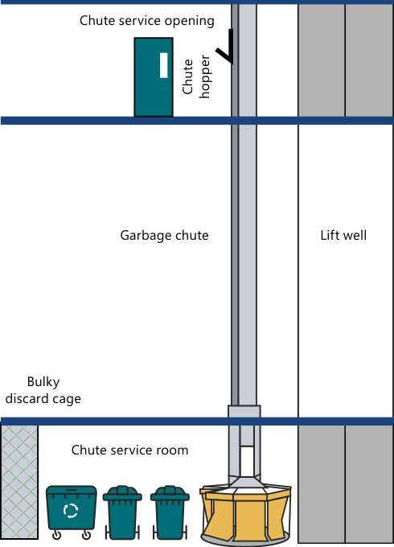

> [Picture on page 34: a picture, saved as a picture (images/da-guidelines-resource-and-waste-management-planni-page-34-49.gif, 150 dpi).]
> Words printed on the picture (title and legend, copied from the PDF):
> Chute service opening
> Chute
> hopper
> Garbage chute
> Lift well
> Bulky
> discard cage
> Chute service room

Bag carousel

compactor

Garbage

skip

Recycling

bin storage

### Appendix F

### Consolidation area

Recycling and waste consolidation areas (also known

as storage areas or bin rooms) must be constructed in

accordance with the following minimum requirements:

• Compliant with the BCA.

• Adequately ventilated in accordance with

AS1668.4-2012 The use of ventilation and air-

conditioning in buildings.

• Consolidation areas are well lit with a preference

given for sensor lighting.

• Bin washing facilities are provided with both hot

and cold water taps available. These taps must be

easily accessible even when the area is at full bin

capacity.

• Floor is constructed of concrete at least 75mm

thick.

• Floor is to be graded so that water from bin

washing can drain to a Central Coast Council

approved drainage connection. This is to avoid

discharge from these areas to a stormwater drain.

• The floors and walls of the consolidation area must

be smooth, cleanable, and durable. Walls must

exhibit these characteristics up to at least the same

height as the tallest bin being held in the area.

• The finishing of the ceiling must be smooth-faced,

non-absorbent, and cleanable.

• All surfaces (walls, floor, and ceiling)

must be light coloured.

#### Location and appearance

• Consolidation areas must be integrated into the

design of the overall development and such areas

be located within the site boundary.

• Consolidation areas must be located and designed

in a manner that reduces adverse impacts upon the

inhabitants of any dwellings on the site and upon

neighbouring properties.

• The location and design of the consolidation

area must adequately control adverse impacts

associated with:

-	 The proximity of the area to any dwellings

-	 Noise generated by any equipment located

within the area

-	 Noise generated by the movement of bins into

and out of the area

-	 Noise generated by collection vehicles accessing

the site

-	 Odours emanating from the area

• Double glazing should be considered for habitable

areas above or near to the waste consolidation area

#### Size

The consolidation areas must be sized to comfortably

accommodate all recycling and waste containers

(bins or MGBs) associated with the development with

sufficient volume to contain the quantity of waste

generated (at the rate described in Appendix B)

between collections.

#### Introduction Usage Guidelines Site Preparation

#### Layout

• The gradient of consolidation area floors for

servicing purposes must be 3% or less and the

gradient of any associated access ramps must be

1:8 or less in accordance with WorkCover and NSW

Occupational Health and Safety requirements.

• Bins used for the storage of recyclable materials

should be kept separate from (but close to) general

waste containers to minimise the potential for

contamination of recyclable materials.

#### Access: General

• In commercial development, public buildings, and

industrial development, there must be convenient

access from each tenancy to a consolidation area.

• There must be step-free access between the

capture point and the consolidation area.

• Arrangements must be in place so that the

consolidation area is not accessible to the

general public.

• Vermin must be prevented from entering the

consolidation area.

• The area should not be used for other purposes

such as a utility room for gas metres, power

boards, or general storage of items.

• The installation of fixed structures should be

avoided in waste consolidation areas to allow for

potential future service changes.

#### Doors and gates

• Doors and gates to consolidation

areas must be durable.

• All doors and gates are to be openable from both

inside and outside the storage area.

• All doors and gates must be wide enough to allow

for the easy passage of containers.

#### Signage

Consolidation areas must include signage that clearly

describes the specific materials and waste that can be

deposited in each bin.

#### Management

• Arrangements must be in place for the regular

maintenance and cleaning of consolidation areas.

• Servicing arrangements for the emptying of bins

must be compatible with the operation of any

other loading and unloading facilities onsite.

#### Refrigerated waste storage

In some instances, Council may require that the

consolidation area is refrigerated. This is likely if

large quantities of food waste are generated onsite

and waste removal from this site is difficult due to its

location or long trading hours.

• The temperature is to be maintained at or below

5°C with all refrigeration equipment installed with

sufficient space for cleaning.

• The floor, walls, and ceiling of the refrigerated

waste room are to be constructed of a rigid,

smooth-faced impermeable material capable of

being easily cleaned.

• The floor is to be graded to the doorway.

• The room is to comply with Section G.1 of the BCA.

• The room should be provided with artificial light

controllable from within the room.

• Noise from the use of the refrigeration equipment

associated with the waste room is not to give rise

to “offensive noise”, as defined under the NSW

Protection of the Environment Operations Act 1997.

#### Requirements for Multi-unit Dwellings

#### less than 6 units

• Enclosures are to be a maximum dimension of

4m x 2.5m.

• The dimensions of the enclosure

are based on the following:

| Length | 0.65m x no. of units |
|---|---|
| Depth & | 1.5m for 1 row and 2.5m for |
| width | 2 rows between engaged piers or other obstructions within the enclosure |

• An individual property’s bins may be stored their

garage, courtyard, or in an enclosure. Shared bins

can be stored in an enclosure subject to sufficient,

suitable kerb side presentation at the front of the

property, clear of driveways, or other obstructions.

No encroachment for bin presentation beyond the

boundaries of the property permitted.

• Internal resident access to the enclosure shall have

a gradient not exceeding 10% and should not

exceed 30m in length.

• Access between the bin enclosure and the kerb

side is to be free of obstructions.

#### Requirements for Multi-unit Dwellings

#### greater than 6 units

The area required for MGB bulk bins can be

•

calculated as set out below. The one metre allows

for adequate corridor space.

| MGB | Depth / Width (1 x number of + 1m number | Length 1.25 x number of bins 1.45 x number of bins 2.25 x number bins |
|---|---|---|
| 660L rows) |  |  |
| 1100L (1.35 x of rows) + 1m |  |  |
| 1500L (1.55 x number of rows) + 1m of |  |  |

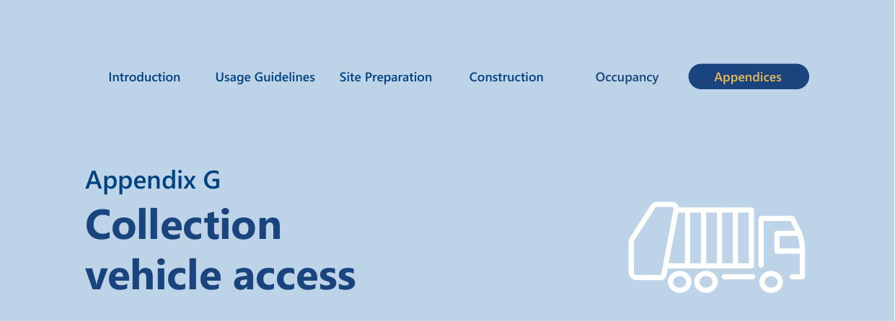

> [Picture on page 36: a picture, saved as a picture (images/da-guidelines-resource-and-waste-management-planni-page-36-1.gif, 150 dpi).]
> Words printed on the picture (title and legend, copied from the PDF):
> Introduction Usage Guidelines Site Preparation

### Appendix G

### Collection

### vehicle access

#### Requirements

• The development must be designed to allow safe

access by collection vehicles to service all bins.

The dimensions and weight of the largest waste

collection vehicle that will service the site must be

proven to have been considered and catered for

within the design of the collections area and any

access routes leading to the collections area. Swept

path drawings for these vehicles showing entry to

and exit from the collection point must be included

with the applicant’s O-RWMP.

• The site must be configured to allow collection

vehicles to enter and exit the site in a forward

direction and so collection vehicles do not impede

general access to, from and within the site.

• Access for the purpose of emptying bins must be

able to occur in accordance with WorkCover NSW

Occupational Health and Safety requirements.

#### Collection vehicles

Generally, there are two types of waste collection

service. The first service type involves emptying the

contents of each customer’s bin or bins into a truck

with waste from many other customers. These trucks

are fitted with a compactor that compresses waste, so

that it takes up as little volume as possible and allows

for as much waste as possible to be loaded on board. The trucks drive between different customers

on a ‘run’ that generally extends over a certain

geographic area. Visits to disposal facilities are

included in the run and most runs also end at a

disposal facility. A good deal of care is taken by

contractors to work out how to service all the

customers along the shortest route and in the quickest

time. Services that lengthen the route or the time

it takes to complete a run generally cost more.

The second service type involves collecting

waste in a single large bin (often an open bin or

compactor) from a customer and delivering it

directly to a disposal facility where it is emptied.

The empty bin is then usually returned to the

customer and the customer is without the bin

for the time it takes for the return journey. The waste collection vehicles may be side-loading,

rear-end loading, or front-end loading. The size of the

vehicle varies according to the type and frequency of

the collection service. Thus, it is impossible to specify

what constitutes the definitive waste collection vehicle.

The vehicle dimensions below provide a guide only

and are in line with the EPA Better Practice Guide for

Resource Recovery in Residential Developments 2019.

Turning circles and collection requirements must also

be in accordance with the latest AS2890.2.

#### Rear lift collection vehicles

The information submitted with the DA must be

supported by scaled site and floor plans that clearly

identify:

• Swept paths suitable for a 10.5m long, rear lift

collection vehicle for the trucks entire travel path

including forward entry and exit and around the

collection point.

• A minimum vertical clearance of 4m in the

collection area.

| Rear lift collection vehicle dimensions |  |
|---|---|
| Length overall | Up to 10.24m |
| Width overall | 2.50m |
| Operational height | Up to 3.50m |
| Travel height | Up to 3.50m |
| Weight – vehicle only | 12.4 tonnes |
| Weight – payload | 9.5 tonnes |
| Turning circle | 18.00m |

#### Side lift collection vehicles

The information submitted with the DA must be

supported by scaled site and floor plans that clearly

identify:

Swept paths suitable for a 10.5m long, side lift

•

waste collection vehicle for the trucks entire travel

path including forward entry and exit and around

the collection point.

A minimum vertical clearance of 4m in the

•

collection area.

| Side lift collection vehicle dimensions |  |
|---|---|
| Length overall | Up to 9.64m |
| Front overhead | 1.51m |
| Wheelbase | 5.20m |
| Rear overhead | 2.93m |
| Turning circle kerb to kerb | 17.86m |
| Turning circle wall to wall | 20.56m |
| Front of vehicle to collection | 3.80m |
| arm |  |
| Maximum reach of side arm | 3.00m |
| Travel height | Up to 3.63m |
| Clearance height for loading | Up to 3.9m |

#### Front lift collection vehicles

The information submitted with the DA must be

supported by scaled site and floor plans that clearly

identify:

• Swept paths suitable for an 11.8m long, heavy

rigid, front lift waste collection vehicle servicing

1 to 4.5m3 bulk bins in line with the EPA Better

Practice Guide for Resource Recovery in Residential

Developments 2019. This is required for the vehicles

entire travel path including forward entry and exit

and around the collection point.

• A minimum vertical clearance of 6.5m in the

collection area in line with the EPA Better Practice

Guide for Resource Recovery in Residential

Developments 2019.

| Front lift collection vehicle dimensions |  |
|---|---|
| Length overall | Up to 11.50m |
| Front overhead | 1.51m |
| Wheelbase | Up to 5.84m |
| Rear overhead | 3.17m |
| Turning circle kerb to kerb | 22.1m |
| Turning circle wall to wall | 23.66m |
| Travel height | 3.82m |
| Clearance height for loading | Up to 6.2m |

#### Introduction Usage Guidelines Site Preparation

#### Hook lift collection vehicles

The information submitted with the DA must be

supported by scaled site and floor plans that clearly

identify:

• Swept paths suitable for a 10m long, heavy rigid,

hook lift waste collection vehicle servicing

1 to 36m3 skip bins in line with the EPA Better

Practice Guide for Resource Recovery in Residential

Developments 2019. This is required for the trucks

entire travel path including forward entry and exit

and around the collection point.

• A minimum vertical clearance of 7.1m in the

collection area in line with the EPA Better Practice

Guide for Resource Recovery in Residential

Developments 2019.

#### Constrained sites

Smaller and isolated sites may be problematic for

waste collection, particularly for when they are unable

to consolidate with surrounding lots. These sites may

require an alternative onsite service arrangement

with a small rigid waste collection vehicle (as defined

by Australian Standard 2890.2). Council may use

the below criteria to determine if an alternative

arrangement is permitted. This may include, but is not

limited to, sites that:

• Cannot accommodate a safe and/or efficient

kerbside collection.

• Have insufficient and/or unsuitable frontage for

kerbside collection.

• Have access off cul-de-sac heads with limited

frontage within in the lot boundary.

• Are located within a 1km radius of Transport for

NSW designated train stations. Here commuter

car parking prevents kerbside collection, and ‘no

parking’ signage is permitted only with approval

from Transport for NSW.

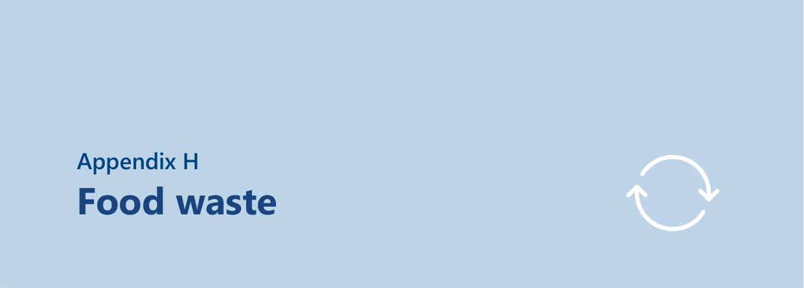

> [Picture on page 37: a picture, saved as a picture (images/da-guidelines-resource-and-waste-management-planni-page-37-38.gif, 150 dpi).]

### Appendix H

### Food waste

Food waste can make up 70% of the average

residential bin. When this is disposed of to landfill,

negatively impacts recycling rates, represents a loss of

valuable resources, and generates methane (a potent

greenhouse gas). When recycled, food waste can be

used to produce valuable fertiliser and reduce the

amount of waste sent to landfill.

Council supports the implementation of food waste

separation and recycling as a key step to improving

recycling rates and achieving targets for reducing

waste to landfill.

Food waste can be managed onsite or collected

for offsite processing. A range of onsite processing

options for food waste are discussed below and

presented as options only. Further investigation is

required by the developer to assess their feasibility.

Any onsite food waste system must be purchased,

maintained and managed by the development. Key considerations for assessing the viability of

separated food waste systems for a development:

• Size of the development, number of households

and quantities of food waste generated.

• Presence of retailers and commercial premises and

quantities and types of food waste generated.

• Availability of trained people to manage and

operate systems.

• Availability of suitable space.

• Willingness and ability to source

separate food waste.

• Availability and cost of food or food and garden

collection services to offsite organic processors.

• Ongoing operation and maintenance requirements

of the selected onsite system.

#### Compost bins

Compost bins and piles are a way of processing

compostable material and garden organics onsite

and produces a useful soil enhancer (compost).

There are a variety of compost bin arrangements

and systems that are available. The footprint area

requirement for a typical compost bin is about 1m2

and they are often situated in a garden. Compost

bins can generally process a range of materials

including all fruit and vegetable scraps and fine

garden waste. Meat, dairy, grains, and processed

food are not generally recommended however,

can be placed in compost bins in moderate

quantities provided the bins are well managed.

#### Worm farms

Worm farms can be a cheap and effective method of

managing fruit and vegetable scraps except for citrus

fruit, garlic, and onions. Vermiculture systems (worm

farms) transform compostable material into vermicast

(worm compost) and vermi-liquid (liquid extract from

the worm farm). These outputs can be used in gardens

to promote plant growth. Worm farms can occupy a

small footprint and can be located on balconies or in

gardens. There are a number of commercially available

worm farms of different designs. They are sold

through hardware stores and some specialist suppliers. Space requirements for a typical worm farm for an

average household are (indicative only):

• Height – 300mm per level

• Width – 600mm

• Length – 900mm

#### Introduction Usage Guidelines Site Preparation

#### Food macerators

These systems pulp food and store it in a tank at the

source. They are commonly found in commercial

premises and have the potential for use in residential

buildings. When the tank is full, the contents are

collected by truck and taken to a treatment facility,

such as an anaerobic digester.

#### Decomposers and dehydrators

These systems are scalable and rapidly decompose

or dehydrate food waste by heating and agitating

the waste over 24 hours. They reduce the volume of

food waste by removing most of the water it holds to

produce a dehydrate waste. Generally, decomposers

#### Food waste in commercial premises

To tackle the issue of food waste generated in

commercial premises, the NSW Government offers

programs to help businesses to better understand:

• The amount of food waste they generate

• Adopt simple and practical actions to avoid

food waste

• Donate unwanted good quality food to people

in need

• Recycle any remaining food waste

Further resources from the NSW EPA:

and dehydrators require a sewer connection to dispose • Bin Trim program

of the wastewater and/or a filter for the vapours vented

to the air and may require additional Council approval.

• Love Food, Hate Waste program

The dehydrated waste can be sent to a lawful facility

such as a commercial composting facility.

#### Anaerobic digester

Onsite anaerobic digesters are systems that

use bacteria to break down food waste in

an oxygen-free environment. The resulting

biogas that is produced during this process

can be used as an onsite energy source.

#### Food waste disposal units

A kitchen food waste disposal unit (also known as an

in-sink macerator) is a mechanical appliance that is

installed under the kitchen sink and connects to the

drain. Residents feed food waste into the unit which

grinds it and sends it into the sewer system or into

a septic tank. Council does not support the use of

this technology, due to the increased load it puts on

the sewage system and because of its relatively low

resource recovery rates. However, in-sink macerators

which have onsite collection and containment and do

not connect to the sewer may be considered.

### Terminology

#### Abbreviations

BCA Building Code of

Australia

C-RWMP Construction

Resource and Waste

Management Plan

CE Circular Economy DA Development

Application

DCP Development Control

Plan

EPA Environmental

Protection Authority

FOGO Food Organics and

Garden Organics

LEP Local Environment

Plan

MGB Mobile Garbage Bin NSW New South Wales O-RWMP	 Occupancy

Resource and Waste

Management Plan

RWM Resource and Waste

Management

RWMP Resource and Waste

Management Plan

SP-RWMP	 Site Preparation

Resource and Waste

Management Plan

WHS Workplace Health and

Safety

#### Glossary

Collection point means the

usual (or agreed) point of the

footpath/roadway, or onsite,

where the contents of bins are

loaded onto vehicles. Collection area means the

location where waste or

recycling is transferred from a

building’s storage containers to

a collection vehicle for removal

from the site. Collection areas are

generally only found in Multi-

unit Developments and Non-

Residential.

Compaction equipment means

devices which reduce the volume

of waste or recyclable material

including compressing devices

such as compactors and balers as

well as shredding, pulverising or

crushing devices.

Compostable material means

vegetative material capable of

being converted to humus or

compost by a biological decay

process.

Consolidation area means a

room where waste and recycling

receptacles are stored, awaiting

removal from the premises. Dwelling means a room or

number of rooms occupied

or used, or so constructed or

adapted, as to be capable of

being occupied or used, as a

separate domicile.

Chute means a duct in which

deposited material descends

from one level to another within

the building.

Garden organics means

vegetative matter including trees,

branches, shrubs, cuttings, lawn

clippings and untreated timber

and wood products.

Guidelines means this

document.

Materials and waste any

discarded, rejected, unwanted,

surplus or abandoned item

including any substance

prescribed by regulation to

be waste for the purpose of

the NSW Protection of the

Environment Operations Act 1997.

#### Resource and Waste

#### Management Plan submission

means the completed RWMP

Form with all required

attachments for Council

assessment.

#### Resource and Waste

Management system describes

the set of elements that work

together to manage materials

and waste.

Storey means a habitable or

occupied space within a building

between one floor level and the

next floor level above, or if there

is no floor level above, the roof.

### DA Guidelines

### Resource and Waste

### Management Planning

> [Picture on page 39: a picture, saved as a picture (images/da-guidelines-resource-and-waste-management-planni-page-39-4.gif, 150 dpi).]
> Words printed on the picture (title and legend, copied from the PDF):
> 2 Hely St Wyong
> T 1300 463 954
> centralcoast.nsw.gov.au

#### Council offices
