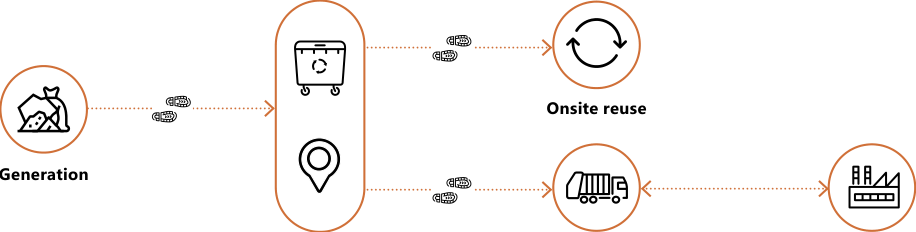
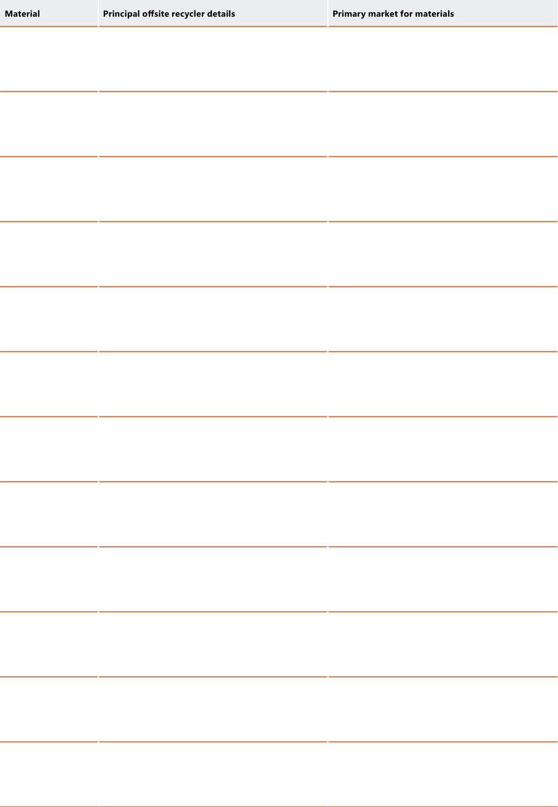
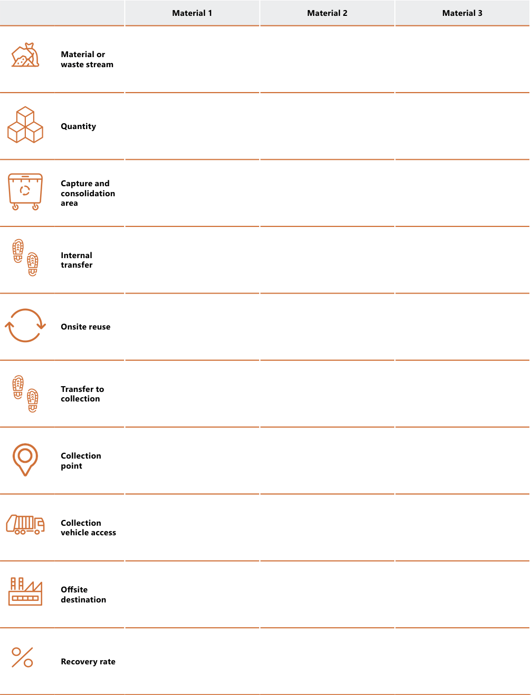
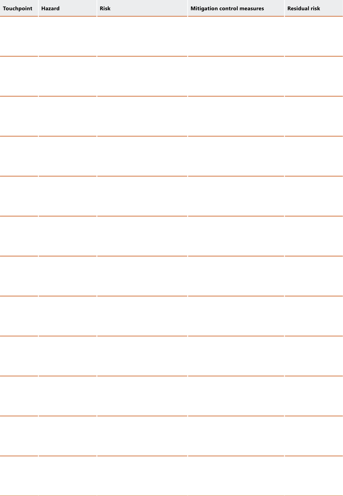

### Part B: Site Preparation

Refer to section: ‘Site Preparation’ of the DA Guidelines for Resource and Waste Management Planning

for guidance to fill out Part B.

#### General information

Description of site preparation works:

> [Picture on page 2: a picture, saved as a picture (images/resource-and-waste-management-plan-form-page-2-6.gif, 150 dpi).]

Demolition or works

contractor details:

Workers compensation

insurance details:

Asbestos

management details:

Hazardous waste

management details:

General waste

management

facilities  details:

Resource recovery

facilities details:

#### Site preparation declaration

Yes No

1\. All asbestos waste will be managed in accordance with provisions of the

NSW Work Health and Safety Regulation 2022.

Yes No

2\. All hazardous waste will be managed and tracked in accordance with the provisions

of the NSW Protection of the Environment Operations (Waste) Regulation 2014.

#### Typical site preparation touchpoint journey example

> [Picture on page 3: a picture, saved as a picture (images/resource-and-waste-management-plan-form-page-3-2.gif, 150 dpi).]
> Words printed on the picture (title and legend, copied from the PDF):
> Onsite reuse
> Generation

#### Consolidation area

#### & collection point

#### Collection

vehicle access

#### Offsite

destination

#### Materials (and waste) generation

#### How will the material be managed?

| Type of Material | >10m3? | Material generated quantity (m3 or tonnes) | On-site re-use | Recycle (source separated & collected) | Recycle (collected unseparated) | Landfill | Quantity diverted from landfill |
|---|---|---|---|---|---|---|---|
| Asbestos |  |  |  |  |  |  |  |
| Bricks |  |  |  |  |  |  |  |
| Concrete |  |  |  |  |  |  |  |
| Ceiling Tiles |  |  |  |  |  |  |  |
| Electronic waste |  |  |  |  |  |  |  |
| Excavation material |  |  |  |  |  |  |  |
| Floor coverings |  |  |  |  |  |  |  |
| Fixtures & fittings |  |  |  |  |  |  |  |
| Garden organics & trees |  |  |  |  |  |  |  |
| Glass |  |  |  |  |  |  |  |
| Hazardous waste |  |  |  |  |  |  |  |
| Metals (ferrous) |  |  |  |  |  |  |  |
| Metals (non-ferrous) |  |  |  |  |  |  |  |
| Mixed recycling |  |  |  |  |  |  |  |
| Plasterboard |  |  |  |  |  |  |  |
| Residual waste |  |  |  |  |  |  |  |
| Timber (clean) |  |  |  |  |  |  |  |
| Tiles |  |  |  |  |  |  |  |
| Timber (treated) |  |  |  |  |  |  |  |
| Other |  |  |  |  |  |  |  |

#### Total percentage diversion of waste from landfill:

#### %

#### Recycling details

> [Picture on page 4: a picture, saved as a picture (images/resource-and-waste-management-plan-form-page-4-2.gif, 150 dpi).]
> Words printed on the picture (title and legend, copied from the PDF):
> Material
> Principal offsite recycler details
> Primary market for materials

#### System overview

> [Picture on page 5: a map, saved as a picture (images/resource-and-waste-management-plan-form-page-5-2.gif, 150 dpi); the street names and other small labels are on the picture.]

If this system overview

is detailed in supporting

evidence, provide

reference details:

#### Risk assessment

> [Picture on page 6: a picture, saved as a picture (images/resource-and-waste-management-plan-form-page-6-2.gif, 150 dpi).]
> Words printed on the picture (title and legend, copied from the PDF):
> Touchpoint Hazard
> Risk
> Mitigation control measures Residual risk

| Site plan checklist |  |
|---|---|
| A site preparation site plan has been provided that clearly indicates: |  |
|  | Areas to be excavated or cleared |
|  | Structures to be demolished |
|  | Locations and dimensions of capture and consolidation bins and stockpiles |
|  | Travel paths of all materials and waste |
|  | Location of any onsite material reuse |
|  | Travel path of bins to collection point |
|  | Collection point location |
|  | Number and total area of bins to be presented at the collection point |
|  | Access paths for collection vehicles |
|  | Direction of traffic flow for internal access driveways and roads |
| Supporting evidence |  |
| Provide an overview of supporting evidence provided to demonstrate how site preparation resources and |  |
| waste will be managed in accordance with the requirements set out in section: ‘Site preparation’ of the |  |
| DA | Guidelines for Resource and Waste Management Planning. |

> [Picture on page 7: a picture, saved as a picture (images/resource-and-waste-management-plan-form-page-7-2.gif, 150 dpi).]
