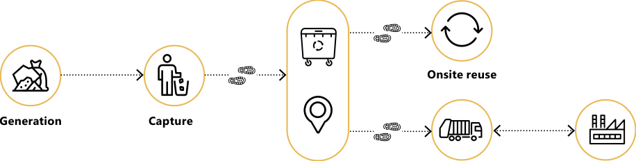
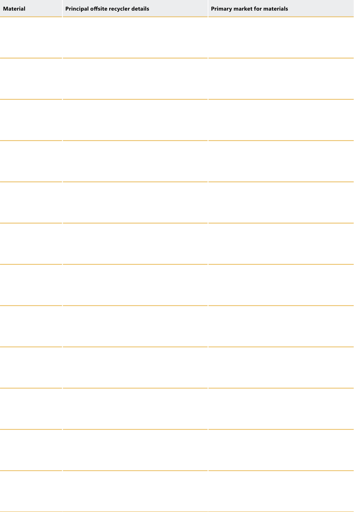
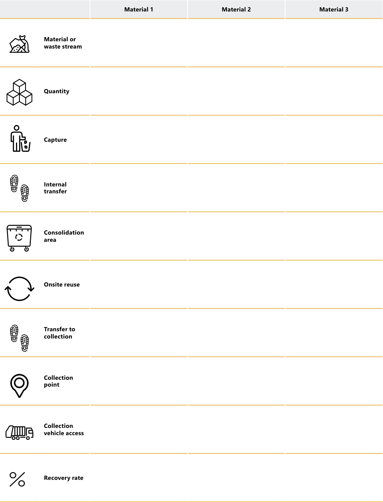
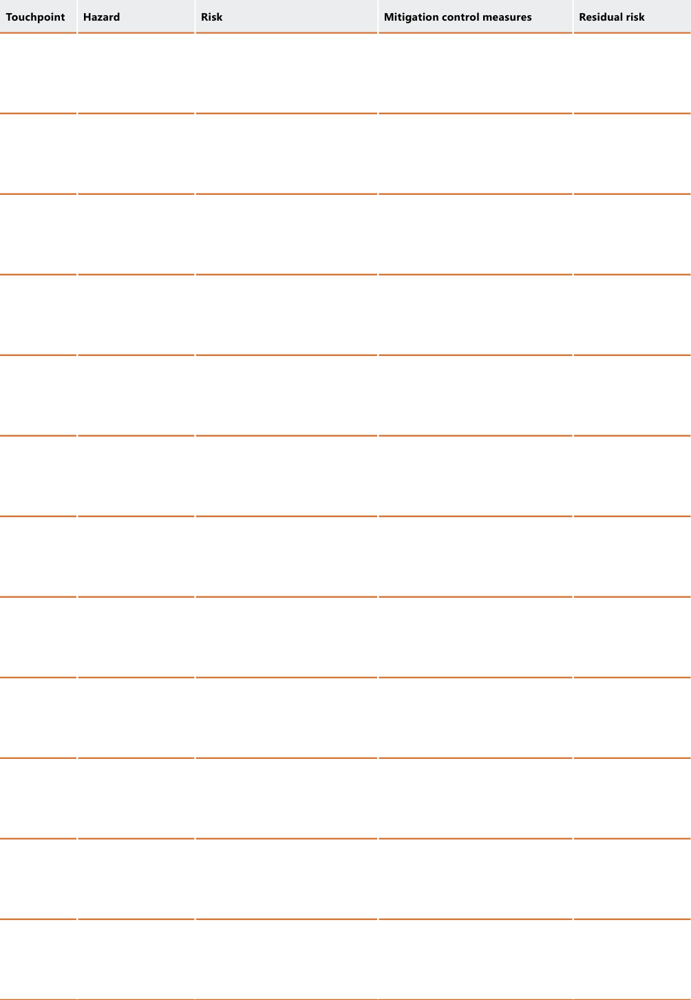

### Part C: Construction

Refer to section: ‘Construction’ of the DA Guidelines for Resource and Waste Management Planning

for guidance to fill out Part C.

#### General information

Description of construction works:

> [Picture on page 8: a picture, saved as a picture (images/resource-and-waste-management-plan-form-page-8-6.gif, 150 dpi).]

Construction works

contractor details:

Workers compensation

insurance details:

Hazardous waste

management details:

General waste

management

facility details:

Resource recovery

facilities details:

#### Construction declaration

Yes No

1\. All hazardous waste generated will be managed and tracked in accordance with

the provisions of the NSW Protection of the Environment Operations (Waste)

Regulation 2014.

#### Typical construction touchpoint journey example

> [Picture on page 9: a picture, saved as a picture (images/resource-and-waste-management-plan-form-page-9-2.gif, 150 dpi).]
> Words printed on the picture (title and legend, copied from the PDF):
> Onsite reuse
> Generation
> Capture

#### Consolidation area

#### & collection point

#### Collection

vehicle access

#### Offsite

destination

#### Materials (and waste) generation

#### How will the material be managed?

| Type of Material | >10m3? | Material generated quantity (m3 or tonnes) | On-site re-use | Recycle (source separated & collected) | Recycle (collected unseparated) | Landfill | Quantity diverted from landfill |
|---|---|---|---|---|---|---|---|
| Asbestos |  |  |  |  |  |  |  |
| Bricks |  |  |  |  |  |  |  |
| Concrete |  |  |  |  |  |  |  |
| Ceiling Tiles |  |  |  |  |  |  |  |
| Electronic waste |  |  |  |  |  |  |  |
| Excavation material |  |  |  |  |  |  |  |
| Floor coverings |  |  |  |  |  |  |  |
| Fixtures & fittings |  |  |  |  |  |  |  |
| Garden organics & trees |  |  |  |  |  |  |  |
| Glass |  |  |  |  |  |  |  |
| Hazardous waste |  |  |  |  |  |  |  |
| Metals (ferrous) |  |  |  |  |  |  |  |
| Metals (non-ferrous) |  |  |  |  |  |  |  |
| Mixed recycling |  |  |  |  |  |  |  |
| Plasterboard |  |  |  |  |  |  |  |
| Residual waste |  |  |  |  |  |  |  |
| Timber (clean) |  |  |  |  |  |  |  |
| Tiles |  |  |  |  |  |  |  |
| Timber (treated) |  |  |  |  |  |  |  |
| Other |  |  |  |  |  |  |  |

#### Total percentage diversion of waste from landfill:

#### %

#### Recycling details

> [Picture on page 10: a picture, saved as a picture (images/resource-and-waste-management-plan-form-page-10-2.gif, 150 dpi).]
> Words printed on the picture (title and legend, copied from the PDF):
> Material
> Principal offsite recycler details
> Primary market for materials

> [Picture on page 11: a map, saved as a picture (images/resource-and-waste-management-plan-form-page-11-1.gif, 150 dpi); the street names and other small labels are on the picture.]

If this system overview

is detailed in supporting

evidence, provide

reference details:

> [Picture on page 12: a picture, saved as a picture (images/resource-and-waste-management-plan-form-page-12-1.gif, 150 dpi).]
> Words printed on the picture (title and legend, copied from the PDF):
> Touchpoint Hazard
> Risk
> Mitigation control measures Residual risk
> Touchpoint Hazard
> Risk
> Mitigation control measures Residual risk

| A construction site plan has been provided that clearly indicates: |  |
|---|---|
|  | Locations and dimensions of capture bins |
|  | Travel paths of all materials and waste onsite |
|  | Locations, numbers and dimensions of consolidation bins and stockpiles |
|  | Dimensions of any designated consolidation areas |
|  | Travel path of bins to a collection point |
|  | Collection point location |
|  | Number and total area of bins to be presented at the collection point |
|  | Access paths for collection vehicles |
|  | Direction of traffic flow for internal access driveways and roads |
|  | Location of any onsite material reuse |
| Supporting evidence |  |
| Provide an overview of supporting evidence provided to demonstrate how construction resources and waste will |  |
| be | managed in accordance with the requirements set out in the section: ‘Construction’ of the DA Guidelines for |
| Resource and Waste Management Planning. |  |

> [Picture on page 13: a picture, saved as a picture (images/resource-and-waste-management-plan-form-page-13-2.gif, 150 dpi).]
