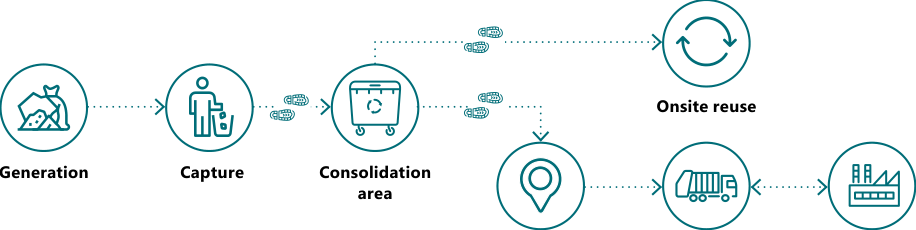
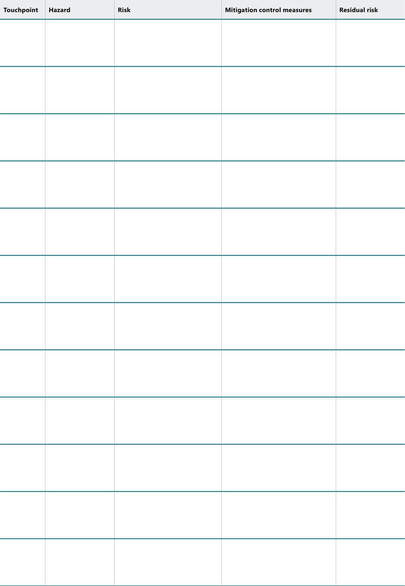

### Part D: Occupancy

Refer to section: ‘Occupancy’ of the DA Guidelines for Resource and Waste Management Planning

for guidance to fill out Part D.

#### General information

Brief description of development:

> [Picture on page 14: a picture, saved as a picture (images/resource-and-waste-management-plan-form-page-14-6.gif, 150 dpi).]

Development type: Residential single dwelling Multi-unit residential development Multi-use development Non-residential development

#### Management arrangements

Identify the key stakeholders that will interface with the system and detail their roles and responsibilities:

#### Stakeholder

#### Role and responsibility

#### Typical construction touchpoint journey example

> [Picture on page 14: a picture, saved as a picture (images/resource-and-waste-management-plan-form-page-14-17.gif, 150 dpi).]
> Words printed on the picture (title and legend, copied from the PDF):
> Onsite reuse
> Generation Capture Consolidation
> area

#### Collection

point

#### Collection

vehicle access

#### Offsite

destination

| Material 1 | Material 2 | Material 3 |
|---|---|---|
| Material or waste stream |  |  |
| Quantity |  |  |
| Capture |  |  |
| Internal transfer |  |  |
| Consolidation area |  |  |
| Onsite reuse |  |  |
| Transfer to collection |  |  |
| Collection point |  |  |
| Collection vehicle access |  |  |
| Offsite destination |  |  |

If this system overview

is detailed in supporting

evidence, provide

reference details:

> [Picture on page 16: a picture, saved as a picture (images/resource-and-waste-management-plan-form-page-16-1.gif, 150 dpi).]
> Words printed on the picture (title and legend, copied from the PDF):
> Touchpoint Hazard
> Risk
> Mitigation control measures Residual risk

#### Required outcomes

Demonstrate how each touchpoint will create safety, deliver efficiency,

protect amenity and build a circular economy across the touchpoints.

> [Picture on page 17: a picture, saved as a picture (images/resource-and-waste-management-plan-form-page-17-4.gif, 150 dpi).]

#### Generation & capture:

#### Internal transfer:

#### Consolidation area:

#### Internal transfer:

#### Collection point:

#### Vehicle access:

| Site plan checklist |  |
|---|---|
| An | occupancy site plan has been provided that clearly indicates The size and locations of material and waste capture bins Internal transfer routes The size and locations of consolidation areas Space provided for access to and manoeuvring of bins and equipment Consolidation areas adequately screened to reduce visibility of bins Construction details of consolidation areas The transfer route to collection point (or destination) The collection point Collection vehicle access route Adequate clearance, layout and strength of collection vehicle access route Direction of traffic flow for internal access driveways and roads Location of any onsite reuse |
| Supporting evidence |  |
| Provide an overview of supporting evidence provided to demonstrate how occupancy resources and waste will |  |
| be | managed in accordance with the requirements set out in section: ‘Occupancy’ of the DA Gudelines for Resource |
| and Waste Management Planning. |  |

> [Picture on page 18: a picture, saved as a picture (images/resource-and-waste-management-plan-form-page-18-2.gif, 150 dpi).]
