# Central Coast Development Control Plan 2022 - Scenic Quality and Character Statements

Source PDF: [Scenic_Quality_and_Character_Statements_0.pdf](https://planfortomorrow.sharepoint.com/sites/Planfortomorrow/Shared%20Documents/00%20NSW-Planning-Resources/dcp/central-coast-development-control-plan-2022/supporting-guides/scenic-quality-and-character-statements/Scenic_Quality_and_Character_Statements_0.pdf)

Note: For Character Statement Links refer to the end of this document.

### SCENIC QUALITY STATEMENTS

This document provides a greater level of detail as to management of the scenic character of the areas identified than that provided through existing planning controls.

This document is based on geographic areas known as landscape units. A landscape unit is a physical area within a land system which has extensive homogeneity of geology, human settlement, landform and natural ecosystems. Landscape units in the chapter generally correspond with localities as defined by the Geographical Names Board.

The studies undertaken for the chapter indicate that scenic quality and significance varies between landscape units. The studies have identified that the level of importance of these landscape units varies from state to regional to local significance. A brief outline of these descriptions is contained below:

#### State Significance

Are high scenic quality landscapes which should be protected as a matter of priority because their significance extends beyond the region.

#### Regional Significance

Are landscapes which are significant within the full range of landscapes present in the region but not beyond that level. Special inclusion criteria were added to the judgement of regional significance to acknowledge the importance of how people, especially regional residents, experience the landscape. For example, regional landscape features, even though they may be of modest scenic quality, may be of high visual sensitivity because they are familiar and frequently seen by regional residents and travellers, their significance is therefore greater.

▪ The special inclusion criteria are:

▪ Regionally characteristic landscapes of high visibility

▪ Landscapes of high sensitivity

▪ Landscapes of low visual absorption capacity

▪ Landscapes representative of the region

▪ Landscapes regionally rare

▪ Landscapes which are vulnerable or isolated

#### Local Significance

Are landscapes which are only significant within a locality but not beyond that level.

The chapter highlights the significant visual components of each landscape unit, the visual significance of the unit, detracting elements within the unit and the recommended visual structure of the unit.

### Objectives

The objectives of this document are:

▪ to provide a detailed assessment of landscape character which highlights the diversity between and within landscape units;

▪ to detail the components of that landscape character;

▪ to provide a comparative ranking of the landscapes; and

▪ to develop appropriate guidelines for the management of the landscape character.

### BROKEN BAY

Landscape Units Covered: Pearl Beach, Patonga, Juno Point to Green Point

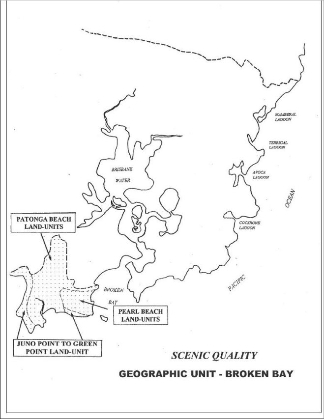

> [Picture on page 3: a picture, saved as a picture (images/scenic-quality-and-character-statements-page-3-1.gif, 150 dpi).]

### Landscape Character

The Juno Point to Green Point Landscape Unit is a largely natural drowned valley environment forming part of the north shore of the entrance to Broken Bay.

The Patonga Landscape Unit is an isolated traditional river settlement contained within a natural backdrop of coastal lagoon and surrounded by National Park landscapes of steep wooded hills on the foreshore of Broken Bay. Urban   form is largely of traditional beachcomber and modest bungalows at low density in an informal setting. The area has a great variety of scenic landscape types in a very small area and is distinctively different from nearby Pearl Beach.

The Pearl Beach Landscape Unit is an isolated beach-side residential and recreational settlement contained within a natural heavily vegetated backdrop and surrounded by National Park landscapes of steep wooded hills on the foreshore of Broken Bay. Urban form is largely of traditional beachcomber, bungalows and more recent residential development, mostly of similar scale, with an almost tropical setting. The area is distinctively different from nearby Patonga, more closely settled, smaller in extent and heavily vegetated.

### Scenic Conservation Issues

For the Juno Point to Green Point Landscape Unit the maintenance of the natural character and small scale of settlement when seen from the waterway. For the Patonga Landscape Unit area, the need to conserve the consistency of small scale residential development and low density which is sensitive to the vernacular from and compact scale of the village. For the Pearl Beach Landscape Unit area, the need to conserve the consistency of small scale residential development, informal street alignments and paths, low speed traffic environment, vernacular form and compact scale of village.

### Absorption Capacity

For Juno Point to Green Point – Low. For Patonga and Pearl Beach – Moderate for developments of similar scale and density to the existing urban fabric but low for developments of high density and bulk.

### Visual Sensitivity

For Juno Point to Green Point – High because of extensive recreational and tourist use of the area and waterway. For Patonga and Pearl Beach – High on waterfront areas and moderate elsewhere.

### Detracting Elements

For Juno Point to Green Point – Nil. For Patonga - Overscale, bulky development which is unsympathetic to the character and development style of the area. For Pearl Beach – Overscale and bulky modern beach side buildings.

### Statement of Significance

For Juno Point to Green Point the area is of State significance as evidenced by the National Trust and Heritage Commission listing of the Broken Bay entrance. For Patonga the area is of State significance forming part of the Broken Bay landscape and is a unique example of a traditional river settlement with a long history of importance to trade and recreation on the river. For Pearl Beach the area is of State significance being of outstanding beauty forming part of the Broken Bay landscapes which are of recognised heritage value.

### Development Objectives

1\. Retain and enforce existing provisions contained within instruments and policies relating to the low density nature of development.

2\. Encourage the maintenance of distinctive vernacular character of development in the Pearl Beach and Patonga landscape units.

3\. Encourage new buildings in all landscape units to blend into existing unique fabric and environment.

4\. Retain in Pearl Beach informal street alignment and paths plus vegetated nature reserves which help to create the scenic character of the area.

5\. Rezoning proposals in all landscape units should aim to preserve the existing scenic character and prevent the creation of further detracting elements.

6\. Restrict zoning density of development to current levels on high visible slopes in Pearl Beach, particularly on steep land.

7\. Recognise importance of privately-owned Environmental/Conservation zoned land in providing a complimentary land system to and a buffer area for National Parks.

### PENINSULA

Landscape Units Covered: Woy Woy, Umina Woy Woy Bays

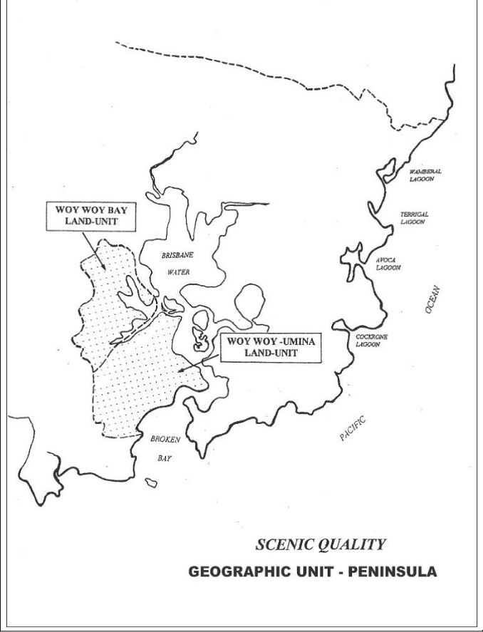

> [Picture on page 6: a picture, saved as a picture (images/scenic-quality-and-character-statements-page-6-3.gif, 150 dpi).]

### Landscape Character

The Woy Woy Bays Landscape Unit consists of mangrove-fringed inlets with naturally vegetated steep hills and cliffs on the Brisbane Water Escarpment as the western backdrop, the railway embankment to the east. Isolated groups of huts and more modern dwellings at the slope foot and lower parts.

The Woy Woy/Umina Landscape Unit is an extensively urbanised area of essentially flat land on sand sheets and sand dunes at the southern entrance to Brisbane Water. Strict road grid pattern with many older style dwellings, beach huts, beachcomber style shacks plus extensive more recent infill redevelopment. Pleasant beach and bay side outlook from locations at the fringes with some enclosure provided from surrounding vegetated escarpment.

### Scenic Conservation Issues

For the Woy Woy Bays redevelopment of waterfront land has the potential to have negative impacts on the scenic quality as well as loss of vegetation cover from redevelopment on higher slopes. For Woy Woy/Umina redevelopment of waterfront areas has the potential to restrict visual access to the waterways from extensive areas because of the flatness of the landscape.

### Absorption Capacity

For Woy Woy Bays – Low. For Woy Woy/Umina – High.

### Visual Sensitivity

For Woy Woy Bays – High. For Woy Woy/Umina – Generally low but higher on waterfront.

### Detracting Elements

For Woy Woy Bays – Increasing bulk and height of waterfront buildings. Woy Woy/Umina - Overscale and bulky residential buildings, particularly on the Umina Escarpment, increasing bulk and height of waterfront buildings restricting visual access to Brisbane Water.

### Statement of Significance

The Woy Woy Bays Landscape Unit is of regional scenic value because of the mixture of natural and cultural elements, the visibility of the area to tourists and commuters and the importance of the area to the history of railway development. The Woy Woy/Umina Landscape Unit is of local scenic value only. It is an example of low cost early suburban and beach retreat development on Brisbane Water. The Brisbane Water Escarpment provides a significant backdrop to Woy Woy/Umina.

### Development Objectives

1\. Recognise importance of Brisbane Water Escarpment with its visual integrity and naturalness being valuable assets which need to be protected from development involving rezonings which increase densities and/or increase the range of uses permissible.

2\. Retain and enforce existing provisions contained within instruments and policies relating to the low density nature of development in Woy Woy Bays and the parts of the Woy Woy/Umina waterfront areas which are not already zoned for medium density development.

3\. On a visual quality basis, higher density development can be supported in more central areas of the Woy Woy/Umina landscape unit subject to other physical constraints being adequately addressed.

4\. Prevent extension of residential areas by way of rezoning within Woy Woy Bay's landscape unit that are viewed from waterways, railway line and main roads.

5\. Retain in Woy Woy Bay's landscape unit informal street alignment and paths plus vegetated nature reserves which help to create the scenic character of the area.

6\. Encourage new buildings in Woy Woy Bay's landscape unit to blend into existing fabric and environment.

7\. Restrict zoning density of development to current levels on higher visible slopes in all landscape units, particularly on steep land.

8\. Recognise importance of privately-owned Environmental/Conservation zoned land in providing a complimentary land system to and a buffer area for National Parks.

### BOUDDI

Landscape Units Covered: Half Tide Rocks to Mourawaring Point, Wagstaffe, Daleys Point, Killcare Heights

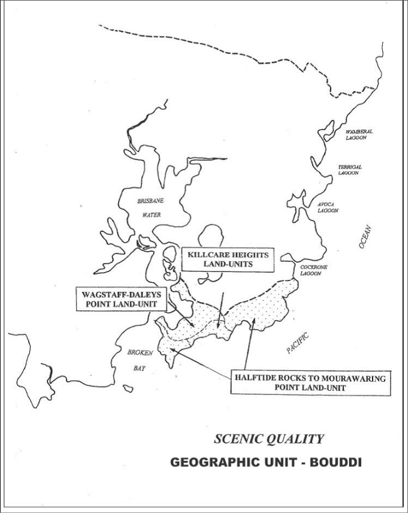

> [Picture on page 8: a picture, saved as a picture (images/scenic-quality-and-character-statements-page-8-9.gif, 150 dpi).]

### Landscape Character

The Half Tide Rocks to Mourawaring Point Landscape Unit consists of spectacular sandstone cliffs and precipitous slopes of the northern entrance to Broken Bay on the seaward side of Bouddi Peninsula, clothes

with coastal heaths, scrub and dense low woodland vegetation above crescent beaches and rock platforms. Largely natural in appearance, except for Killcare Heights, it is an area of outstanding natural beauty.

The Wagstaffe/Daleys Point Landscape Unit consists of, for the most part, secluded water-side settlements surrounded by and set among the lower slopes of steep wooded hills. Urban form in Wagstaffe-Hardys Bay area is largely vernacular and traditional of holiday retreats of low density and scale with many weatherboard structures, small wharves and boat houses, meandering original road patterns and extensive areas of remnant vegetation. By contrast, Daleys Point consists of predominantly large scale residential dwellings.

Killcare Heights Landscape Unit consists of a coastal suburb perched on the steep mid slopes of Bouddi Peninsula above Killcare Beach and surrounded by the spectacular natural landscapes of the Bouddi National Park. The development is haphazard partly on made road tracks, featuring suburban residences of various recent styles, forms and materials, mainly large, bulky and visually prominent.

### Scenic Conservation Issues

For the Half Tide Rocks to Mourawaring Point and Killcare Heights Landscape Units the main negative factor in the scenic quality is the present haphazard urban development in Killcare Heights. The Wagstaffe area has a distinctive foreshore character derived from the age, form and scale of buildings and the relationship of these, their boat houses and wharves to Brisbane Water. These aspects of the character should be encouraged to be preserved in any redevelopment of the area. For the Daleys Point area the main negative factor is the overscale and bulky residential dwellings in waterfront areas where a greater density of development should be discouraged.

### Absorption Capacity

For all landscape units low, the existing residential density and scale of areas could not absorb further development outside existing zoned areas without a further loss of scenic character.

### Visual Sensitivity

High for all landscape units.

### Detracting Elements

For all landscape units, overscale, bulky residential buildings.

### Statement of Significance

The Half Tide Rocks to Mourawaring Point Landscape Unit is of outstanding scenic beauty and is recognised to be of State wide significance. The Wagstaffe/Daleys Point Landscape Unit is of regional scenic significance because of its unique character. Its place in the history of the development of the Central Coast is also significant. The Killcare Heights Landscape Unit is of regional scenic significance because of the area’s outstanding natural landscape.

### Development Objectives

1\. Retain and enforce existing provisions contained within instruments and policies relating to the low density nature of development in all landscape units.

2\. Prevent extension of residential areas by way of rezoning within all landscape units on land are viewed from public areas beyond the immediate area.

3\. Encourage building styles for foreshore and other properties in the Wagstaffe – Hardys Bay area which are generally in keeping with the character and scale of the original development of the area.

4\. Restrict zoning density of development to current levels on higher visible slopes in urban areas, particularly on steep land, in particular on the Daleys Point Peninsula.

5\. Continue to secure lands identified for inclusion in Coastal Open Space System as part of the visual landscape.

6\. Retain in Wagstaffe – Hardys Bay area informal street alignment and paths plus vegetated nature reserves which help to create the scenic character of this area.

7\. Recognise importance of privately-owned Environmental/Conservation zoned land in providing a complimentary land system to and a buffer area for COSS lands and National Parks.

### EAST BRISBANE WATER

Landscape Units Covered: Green Point/Saratoga, Kincumber, Cockle Broadwater

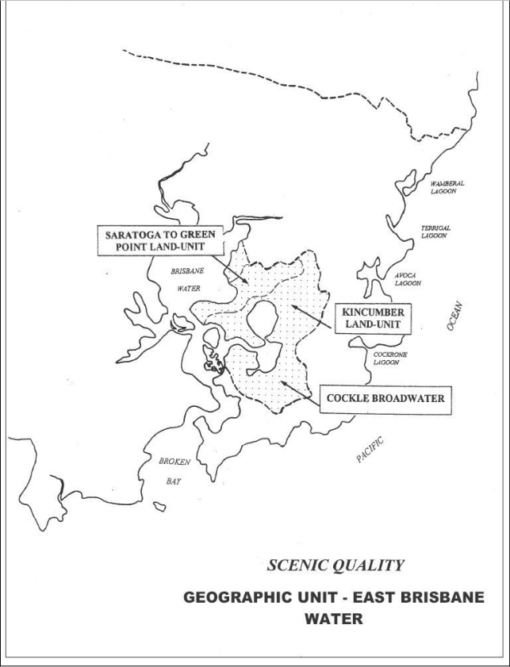

> [Picture on page 11: a picture, saved as a picture (images/scenic-quality-and-character-statements-page-11-3.gif, 150 dpi).]

### Landscape Character

The Green Point/Saratoga Landscape Unit comprises residential landuse development adjacent to Brisbane Water, rural residential land use and an extensive natural/open space area which is associated with the Kincumba Reserve. The open space and rural residential areas provide a visual backdrop to the unit as well as providing a natural visual separation between developed areas within the unit. The area fronts onto Brisbane Water and comprises part of a broad visual catchment. The existing development is generally confined to the foreshore areas, midslopes and some higher slopes with the ridges and waterways containing and visually dominating the development areas.

The Kincumber Landscape Unit is characterised by a mixed residential, commercial and rural landscape at the foothills of Kincumba Mountain and the alluvial flats of Brisbane Water. Kincumba Mountain is visually

dominant and strongly enclosing. The development pattern in the Kincumber landscape unit is rather haphazard.

The Cockle Broadwater Landscape Unit consists of mangrove areas such as Bensville and Kincumber South among extensive stands of natural forests and cleared land. Davistown and Empire Bay are the only extensively developed areas on either side of the mouth of Cockle Channel. Davistown and Empire Bay have similarities to Woy Woy with a mixture of small scale older dwellings and strict road grids. Waterfronts are pleasant with boatsheds, jetties and informal soft edges.

### Scenic Conservation Issues

For the Green Point/Saratoga/Kincumber and Cockle Broadwater area maintenance of the diversity of landscapes within the area, particularly the rural-residential landscapes. Commercial uses in rural-residential areas are breaking down the character of these areas. Loss of substantial vegetation within urban areas particularly on higher slopes associated with new building development. Redevelopment of waterfront properties is removing visual access to Brisbane Water. For the Cockle Broadwater, these localities are characterised by the dominant Daleys Point ridge and western side of the MacMasters Ridge, together with foreshore wetland areas around Brisbane Water. The area is not as visually enclosed as Copacabana/MacMasters Beach and is characterised by more open spaces between urban areas. The relationship between the ridges, Brisbane Water and developed areas will need to be effectively

balanced in the long term to ensure preservation of the scenic qualities of the landscape unit. For the Kincumber area the prominence of commercial buildings, dominance of signage in some locations and lack of coherent development pattern. This area is characterised by Kincumba Reserve/Conroys Mountain that clearly delineates the Erina Valley and Kincumber area. The majority of Environmental/Conservation lands in this geographic unit are complimentary to the public reserves and form an important background to the urbanised valley floors. To date, these areas have not been under the same pressure as the Matcham/Holgate/Lisarow areas, or areas more proximate to the Coast. In the long term, however, it would be expected that this area will come under increasing pressure for rezoning.

### Absorption Capacity

For Green Point/Saratoga & Kincumber – moderate to high for residential uses on areas of lower slope and visibility, lower on the upper slopes and low on natural ridges. Low for rural-residential areas. For Cockle Broadwater – high on most flatter slopes with screening from remnant vegetation. Low for rural-residential areas and environmental/conservation zoned areas.

### Visual Sensitivity

Generally low in all areas but higher on visible slopes, areas viewed from main roads and waterfront areas.

### Detracting Elements

For Green Point/Saratoga increasing bulk and height of waterfront buildings. New buildings of considerable bulk on higher slopes and development on saddle in Saratoga.

### Statement of Significance

All landscape units are of local significance.

### Development Objectives

1\. Maintain broad patterns of land use within area to ensure protection of landscape diversity and in particular Environmental/Conservation and Scenic Protection zoned areas.

2\. Retain current subdivision standards in Environmental/Conservation and Scenic Protection zoned areas to ensure continuing dominance of landscape features over built environment.

3\. Opportunities for increases in densities and scale are available in urban areas, not subject to visibility constraints or other physical constraints. Visually constrained land includes land viewed from main roads, waterfront areas and land on higher slopes.

4\. Uses of a retail and commercial nature and associated signage permitted in scenic protection zoned areas to be, where achievable, of a style and scale which reflects the rural nature of the area in which it is located.

5\. Restrict zoning density of development to current levels on higher visible slopes in urban areas, particularly in steep land zoned areas.

6\. Continue to attempt to secure lands identified for inclusion in the Coastal Open Space System as part of the visual landscape.

7\. Proposals for residential and retail/commercial rezonings be preferred where the result will be the consolidation of existing residential and retail/commercial areas rather than the extension of these areas as ribbon development or as incremental extensions into adjoining areas.

8\. Recognise importance of privately owned Environmental/Conservation zoned land in providing a complimentary land system to and a buffer area for COSS lands.

### GOSFORD CENTRAL

Landscape Units Covered: East Gosford, Point Clare - Koolewong

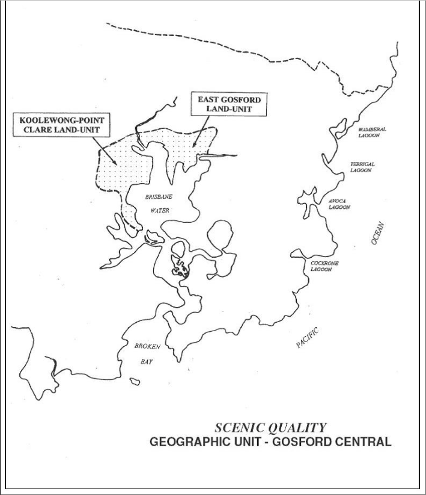

> [Picture on page 14: a picture, saved as a picture (images/scenic-quality-and-character-statements-page-14-3.gif, 150 dpi).]

### Landscape Character

The East Gosford Landscape Unit which covers the localities of East Gosford, Point Frederick, West Gosford, Springfield and Gosford are older lake side areas of Gosford City with a suburban mixture of land uses and dwelling densities which are part of the Brisbane Water visual catchment. Few remnants of natural vegetation remain within these urban areas although Open Space areas such as Rumbulara Reserve, Presidents Hill and foreshore mangroves provide some degree of visual enclosure and along with Brisbane Water provide visual relief.

The Point Clare – Koolewong Landscape Unit consists of older residential suburbs occupying flat to sloping lands at the foot of the scenic Brisbane Water Escarpment which again are part of the Brisbane Water visual catchment. Landscape forms vary from the slopes of Point Clare and Koolewong to the flats of Tascott. Urban form and density varies according to slope constraints and age of developments. The Brisbane Water Escarpment provides the visual backdrop for the area and dominates the landscape unit.

### Scenic Conservation Issues

For East Gosford the full development of the area appears to generally secure the scenic character. Redevelopment of dwellings in foreshore areas and future higher density development in the Gosford CBD area are issues in this landscape unit. For Point Clare – Koolewong the escarpment areas and slope feet should be managed to conserve the existing scenic quality when seen from Brisbane Water, Brisbane Water Drive, Main Northern Railway and areas within the Brisbane Water Visual catchment.

### Absorption Capacity

For East Gosford – moderate but lower on waterfront. For Point Clare – Koolewong – moderate on lower slopes but lower on waterfront locations, depending on visibility from the waterway. Low on steeper slopes and escarpment locations.

### Visual Sensitivity

For East Gosford generally moderate but high on waterfront. For Point Clare – Koolewong moderate on lower slopes and lake side locations depending on visibility from waterway. High on upper slopes and escarpment.

### Detracting Elements

For East Gosford overscale and bulky residential buildings, increasing height and bulk of waterfront buildings restricting visual access to Brisbane Water. For Point Clare – Koolewong overscale and bulky buildings on waterfront areas and dwellings on higher slopes.

### Statement of Significance

Both areas are of local significance.

### Development Objectives

1\. Restrict zoning density of development to current levels on higher slopes, particularly on steep land and waterfront areas not already zoned for medium density development.

2\. Opportunities for increases in densities and scale are available in areas not subject to visibility constraints or other physical constraints. Visually constrained lands includes waterfront lands and lands on higher slopes.

3\. Prevent extension of residential areas by way of rezoning within the Point Clare – Koolewong landscape units on land viewed from more than the immediate area.

4\. Recognise importance of Brisbane Water Escarpment with its visual integrity and naturalness being valuable assets which need to be protected from development involving rezonings which increase densities and/or increase the range of uses permissible.

5\. High rise development in and around the Gosford Town Centre should be of a scale that when viewed from Brisbane Water and waterfront areas is contained within the ridgelines provided by Rumbulara Reserve and Presidents Hill.

### NARARA VALLEY

Landscape Units Covered: Narara Creek, Ourimbah Creek and Cut Rock Creek

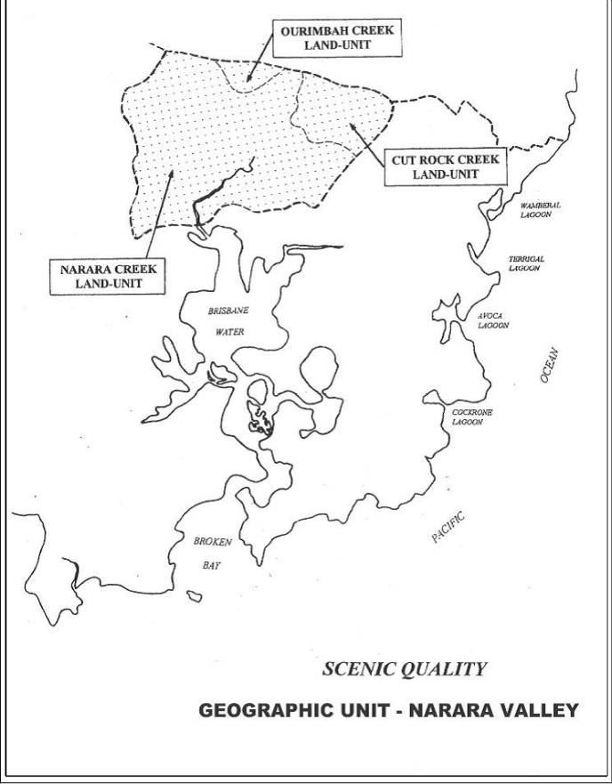

> [Picture on page 16: a picture, saved as a picture (images/scenic-quality-and-character-statements-page-16-3.gif, 150 dpi).]

### Landscape Character

The Narara Creek and Ourimbah Creek Landscape Units are an extensive complex of valleys and valley floors with extensive suburban development bounded by naturally vegetated slopes on the east by Berrys Head and Mt Elliot/Coast Open Space System lands and on the west by the northward extension of the Brisbane Water Escarpment. “Fingers” of green extending from the surrounding natural landscapes partly separate the urban areas.

The Cut Rock Creek Landscape Unit is the southern part of an extensive northern trending valley separated from Narara Creek by the Ridgeway Hills. Character includes urban areas of the valley floor, rural/residential lands and naturally vegetated slopes of the Ridgeway and Tumbi ridges. The diversity of landscape types on a small area is marked. In all landscape units the scenic character derives from a blending of land uses with a

natural backdrop with the breaking up of urban areas by natural creek lines and associated vegetation and vegetated open space areas.

### Scenic Conservation Issues

A lack of easy developable urban land in all landscape units is pushing development into steeper and more visually prominent areas. Development on escarpment lands is affecting the overall scenic quality of the area.

### Absorption Capacity

For all landscape units moderate to high for residential and rural-residential uses on lower slopes, and mid slopes, low for any development on prominent slopes ridges and the escarpment.

### Visual Sensitivity

For all landscape units generally low on flats and mid slopes to high on prominent slopes, ridges and the escarpment.

### Detracting Elements

For all landscape units prominently sited residential dwellings on steep visually prominent slopes. For Narara Creek landscape unit development on the escarpment areas.

### Statement of Significance

All landscape units are of local significance.

### Development Objectives

1\. Restrict zoning density of development to current levels on higher slopes, particularly on steep land.

2\. Opportunities for increases in densities and scale are available in areas not subject to visibility constraints or other physical constraints. Visually constrained land includes lands on higher slopes.

3\. Maintain broad patterns of land use within area to ensure protection of landscape diversity and in particular Environmental/Conservation and Scenic Protection zoned areas.

4\. Recognise importance of Brisbane Water Escarpment with its visual integrity and naturalness being valuable assets which need to be protected from development involving rezonings which increase development densities and/or increase the range of uses permissible.

5\. Continue to attempt to secure lands identified for inclusion in the Coastal Open Space System as part of the visual landscape.

6\. Retain current subdivision standards in Environmental/Conservation and Scenic Protection zoned areas to ensure continuing dominance of landscape features over built environment.

7\. Recognise importance of privately owned Environmental/Conservation zoned land in providing a complimentary land system to and a buffer area for COSS lands.

### COASTAL VALLEYS

Landscape Units Covered: Matcham – Holgate, Erina Valley/Erina

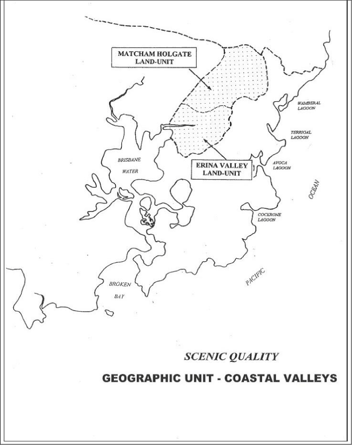

> [Picture on page 18: a picture, saved as a picture (images/scenic-quality-and-character-statements-page-18-5.gif, 150 dpi).]

### Landscape Character

The Matcham – Holgate Landscape Units have a very pleasing visual character that is based on topographic features and the rural vegetation patterns of the valley. The visual features of the valleys include significant topographic enclosure created by major ridge lines, within this framework minor ridges and spans further break up the viewsheds. The valley floors generally retain a pleasant vegetation pattern resulting from cleared fields surrounded by treed edges, treed creek lines as well as forested steep slopes or ridgetop areas. Rural residential development is generally in sympathy with the landscape. It is well integrated due to the topographic and vegetative features of the valleys.

This generally gives the valleys a high visual absorption capacity for subdivision down to one (1) hectare lots. The valley roadways are generally of a very attractive character due to their scale, varied vertical and horizontal alignment as well as the vegetation characteristic of the road verge.

The Erina Valley/Erina Landscape Unit consists of a broad valley bounded on the south by Kincumba Mountain, the north by Mt Elliott and the east by the Erina Heights ridge, falling gently to the west to Brisbane Water. The unit contains a wide diversity of land uses and landscape character. The strongest development characteristic is the Erina shopping centre, while contrasts are provided by the undeveloped ridgelines and rural-residential development also contained in the landscape unit. Within the urban areas of this unit the vegetated hills of the Coastal Open Space System and remnant vegetation contained within public reserves and adjacent to creek lines provides visual relief and some enclosure which enhances the urban character. The rural environmental/conservation areas have landscape character within this unit approaching that of Matcham-Holgate but not of the same quality. The Entrance Road,  Avoca Drive and Terrigal Drive are the main roads through the unit and provide travellers and locals with their primary impression of the unit. These roads are of mixed scenic quality although important rural views are achieved at various points along these roads and in particular on The Entrance Road at Erina Heights and on Terrigal Drive near  Serpentine Road.

### Scenic Conservation Issues

The Matcham – Holgate Landscape Unit serves as a significant regional visual resource. The valleys are frequently used for pleasure driving and horse riding and to a lesser extent walking and cycling. The scenic character depends on maintenance of the development pattern and existing density of settlement for both local residents and travellers. Declining stocks of subdividable land in this unit are creating pressure for a higher density of development than what presently occurs. The significant concentration of Environmental/Conservation land in the Matcham and Holgate area is reflective of the distinctive system of ridgeways that are heavily vegetated with steep, generally vegetated side slopes and cleared valley floors. Land within the floors is typically zoned Environmental Management/ Conservation and Scenic Protection (Scenic Protection - Rural Small Holdings) and the ridges and side slopes zoned Environmental Conservation/ Conservation and Scenic Protection (Conservation). The Environmental Conservation ) land extends beyond the extent of the COSS and its role as a buffer to these more elevated areas   is apparent. The land that is under pressure in this area to be rezoned is generally located on the side slopes, where transitional landscape features (slopes, vegetation, etc) may create speculation as to development potential. The landscape character of Erina Valley/Erina Landscape Unit derives from a mixture of built elements within a natural backdrop. Changing development patterns associated with a major release area is altering the landscape character of the unit. Major roads through the unit which pass through scenic protection zoned areas are increasingly attracting quasi retail uses in the form of ‘home occupations’ and the like which are lowering the scenic quality of the road and the views into adjoining rural residential areas. The unit, because of the intensity of existing urban activity within it, is subject to pressure for incremental urban expansion into adjacent rural-residential areas. Another major concentration of Environmental Conservation  land is found adjoining the Mount Elliott/ Katandra/Rumbulara ridges. The Environmental Conservation zoned lands within this area act as a buffer to, or forms part of, the Coastal Open Space System. This ridgeline is a predominant land form and segregates the Narara Valley catchment from Erina/Matcham/Holgate Valleys. The landform contributes to the visual containment of urban areas and provides scale against the built environment so that the natural environment dominates. The major threat to this area would appear to be either incremental rezoning on the fringes of the landform and also enabling clauses to allow site specific uses.

### Absorption Capacity

For Matcham – Holgate – low, the area depends for its character on the maintenance of the existing density and separation between developments. For Erina Valley/Erina – moderate to high for existing urban areas, low on main roads adjoining rural-residential areas and in rural-residential areas.

### Visual Sensitivity

For Matcham – Holgate – moderate to high, the area receives extensive tourist use and a high visual expectation of local residents. For Erina Valley/Erina – low in urban areas, moderate to high in rural-residential areas and high on main roads adjoining rural-residential areas.

### Detracting  Elements

For Matcham – Holgate areas where development features dominate landscape features of area, ie Manor Hill Close subdivision. For Erina Valley/Erina – quasi-retail uses on main roads in Environmental Management areas and expanding urban uses.

### Statement of Significance

The Matcham – Holgate Landscape Unit is of regional scenic significance as an outstanding example of rural cultural landscape of great charm. The Erina Valley/Erina Landscape Unit is of local significance although main roads through the unit provide important tourist routes.

### Development Objectives

1\. Continue to attempt to secure lands identified for inclusion in the Coastal Open Space System as part of the visual landscape.

2\. Opportunities for increases in densities and scale are available in areas not subject to visibility constraints or other physical constraints. Visually constrained land includes land on main roads within Environmental Management/ zoned areas and Environmental Conservation/ ) zoned areas.

3\. Proposals for residential and retail/commercial rezonings be preferred where the result will be the consolidation of existing residential and retail/commercial zoned areas rather than the extension of these zones as either ribbon development or as incremental extensions into adjoining areas.

4\. Retain current subdivision standards in Environmental/Conservation zoned areas to ensure continuing dominance of landscape features over built environment.

5\. Uses of a retail and commercial nature and associated signage permitted in scenic protection zoned areas to be, where achievable, of a style and scale which reflects the rural nature of the area in which it is located.

6\. Maintain broad patterns of land use within area to ensure protection of landscape diversity and in particular Environmental/Conservation zoned areas.

7\. Recognise importance of privately owned Environmental/Conservation zoned land in providing a complimentary land system to and a buffer area for COSS lands.

### NORTH COASTAL

Landscape Units Covered: Forresters Beach – Wamberal, Terrigal

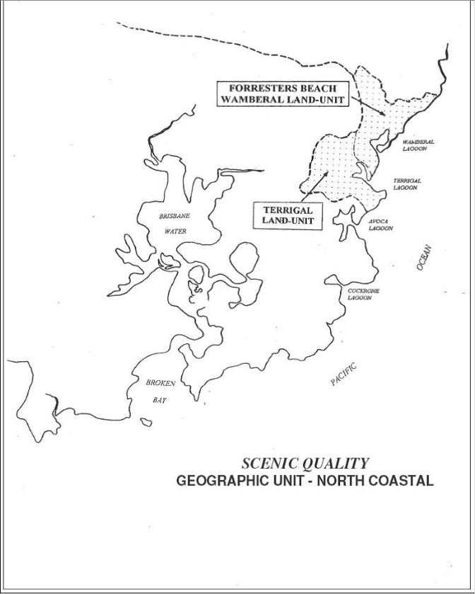

> [Picture on page 21: a picture, saved as a picture (images/scenic-quality-and-character-statements-page-21-5.gif, 150 dpi).]

### Landscape Character

The Forresters Beach – Wamberal Landscape Unit contains a mix of landscape types. The most northerly section of the unit forming the Forresters Beach landscape has characteristics more typical of the Tuggerah landscapes of the Wyong Shire. Forresters Beach occupies a rocky ridge, formerly an offshore island, which is tied back to the land by alluvial sand bodies which drain south into Wamberal Lagoon and north to Tuggerah Lake. Residential development through the elevated areas and adjacent to The Entrance Road is visually dominant. The flat rear dune hinterland, including the Tumbi Road area, comprises a mixture of residential, rural-residential and recreational land uses. The flat landform, low vegetation and stunted characteristics

result in a generally low visual quality. The forested ridgeline and sideslopes of Tumbi Ridge, which form part of the Coastal Open Space System, provide a strong western boundary to the unit.

The Wamberal landscape Unit is more reflective of the area and consists of a diversity of characteristics. Urban development in Wamberal is not intrusive as it is contained within the forested ridge formed by COSS lands, Environmental/Conservation zoned areas and Wamberal Lagoon. The shopping centre does though detract from this character. Within the Wamberal urban areas the landform is generally open and limited large scale vegetation results in a moderate to high level of visual exposure. Rural-residential areas of Wamberal consist of a small enclosed valley stretching between Matcham Road and Reads Road. The western portion of the valley is highly visible from The Entrance Road. This rural-residential area form a significant part of the rural buffer between Erina and Wamberal.

The Terrigal Landscape Unit is strongly enclosed as a result of landform characteristics and contains the most urban of the coastal settlements centred on the beach, Terrigal Haven and The Skillion and surrounding the lagoon. As a result of the landform and vegetation characteristics, the landscape and development is co-dominant. The Terrigal area comprises significant coastal landscape features including the beach to Wamberal Lagoon and foreshore areas and The Skillion. The primary urban and commercial areas concentrate on the sea side of the lagoon while the area to the west is more suburban and surrounded by rural-residential hinterland. The rural-residential hinterland occupies higher ground in the unit and provides a natural backdrop to the unit and a contrast to highly urbanised sections of the unit.

### Scenic Conservation Issues

For the Forresters Beach section of the Forresters – Wamberal Landscape Unit the generally low absorption capacity of the unit make most forms of development visually prominent. Particular areas of concern are those located along and viewed from main roads, on higher parts of the unit and within commercial areas. For the Wamberal section of   this landscape unit, the character of the unit derives from the mix of uses with a natural backdrop. Recognition of the need for retention of this mix and the quality of development along The Entrance Road are issues in this unit. In general, Environmental/Conservation zoned lands in this area fall into three distinct categories – coastal headlands, lowland heath, draining into Wamberal Lagoon and Matcham ridge to the west that provides clear distinction between the urban areas on the Coast and rural-residential areas to the west. The Environmental Conservation zone is complimentary to Regional Open Space at Wyrrabalong trig, and much of the land in this section is within public ownership. Vegetation is highly significant when viewed from The Entrance Road. Those non-elevated Environmental Conservation ) lands within Wamberal Lagoon catchment are ecologically significant being coastal heath, even though from a visual perspective, the vegetation is “scrubby” it provides an important habitat between Forresters   Beach and Tumbi Road and provides variety in the landscape. Having regard to the proximity of urban areas, including tourist facilities, residential land and rural small holdings, there is considerable pressure on this land in the short - term. The eastern section of Matcham ridge is also under pressure, due to favourable location, views etc. For the Terrigal Landscape Unit generally, the maintenance of scenic character requires careful attention to siting and scale of urban elements so as not to overpower the natural elements of the lagoon, beach and surrounding natural backdrop. Particular attention needs to be paid to maintaining co-dominance of landscape and development with regard being given to retention of Environmental/Conservation zoned backdrop to the unit. Environmental Conservation  zoned lands in these areas act as the hinterland to the coastline and are intrinsic to the scenic qualities of the region. Environmental Conservation/7(a) land also adds “definition” to localities and contributes to overall perception of the coastal environment.

### Absorption Capacity

For the Forresters/Wamberal unit – moderate to high for areas not subject to visibility constraints such as land located along and viewed from main roads and on higher parts of the unit. For the Terrigal unit – moderate to high for residential uses on lower slopes, lower on the upper slopes and ridges and low on the beach front, headland slopes and lagoon areas.

### Visual Sensitivity

For the Forresters/Wamberal unit generally low for non-exposed areas but high for areas on higher slopes and along main roads. For the Terrigal unit high in lagoon margins, beach front, sand spit and headland areas and rural- residential hinterland.

### Statement of Significance

For the Forresters/Wamberal unit the area is of regional scenic value as it is a unique landscape within the

area. For the Terrigal unit the area is of regional scenic value. It exhibits a wide range of coastal environments of outstanding beauty within a discrete area, is a tourist destination with a long history and has a mixture of natural and human elements of great charm.

### Development Objectives

1\. Continue to attempt to secure lands identified for inclusion in the Coastal Open Space System as part of the visual landscape.

2\. Opportunities for increases in densities and scale are available in areas not subject to visibility constraints or other physical constraints. Visually constrained areas include land along beach front, sand spit at Terrigal, headlands and lagoon frontages as well as along main roads within Environmental Conservation and Environmental Management/scenic protection and conservation zoned areas and within Environmental Conservation and Environmental Management/scenic protection zoned areas and conservation zoned areas.

3\. Proposals for residential and retail/commercial rezonings be preferred where the result will be the consolidation of existing residential and retail/commercial zoned areas rather than the extension of these zones as either ribbon development or as incremental extensions into adjoining areas.

4\. Retain current subdivision standards in Environmental/scenic protection zoned areas to ensure continuing dominance of landscape features over built environment.

5\. Uses of a retail and commercial nature and associated signage permitted in Environmental Management/scenic protection zoned areas to be, where achievable, of a style and scale which reflects the rural nature of the area in which it is located.

6\. Maintain broad patterns of land use within area to ensure protection of landscape diversity and in particular Environmental zoned areas.

7\. Restrict zoning density of development to current levels on higher visible slopes in urban areas.

8\. Any redevelopment of Central Park area within Forresters/Wamberal landscape unit be of a low scale and which is able to be screened by natural vegetation types evident in the area.

9\. Recognise importance of privately owned Environmental Conservation  zoned land in providing a complimentary land system to and a buffer area for COSS lands and National Parks.

### SOUTH COASTAL

Landscape Units Covered: Picketts Valley, Avoca, MacMasters/Copacabana

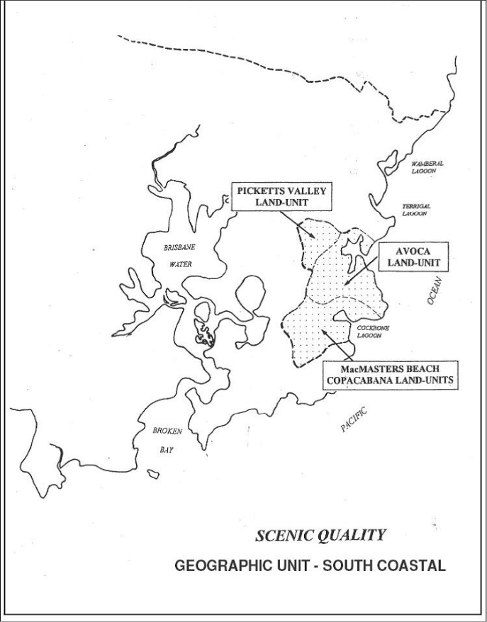

> [Picture on page 24: a picture, saved as a picture (images/scenic-quality-and-character-statements-page-24-5.gif, 150 dpi).]

### Landscape Character

The Picketts Valley Landscape Unit is typical of the higher quality rural valleys within the area. This quality is based on its great topographical diversity as well as the natural and cultural vegetation patterns that occur within the valley. The valley differs from other areas because of its proximity to the coast and is highly visible from the Scenic Highway. Its visual juxtaposition against the coastal landscape when viewed from Kincumba Mountain creates what is arguably one of the most diverse and picturesque regional views within the city.

The Avoca/North Avoca Landscape Unit consists of a moderate to high level of residential development situated around Avoca Beach and Avoca Lake with rural residential development enclosing the area in the southern and western portions of the unit. The area features a high level of visual usage both at the local and the tourist level and comprises an important part of the scenic coastal system. Despite the moderate to high level of residential development within the unit, the landform and vegetation characteristics help to create good visual integration.

The MacMasters/Copacabana Landscape Unit is bounded on the west and south by the natural vegetated ridges of the Bouddi Peninsula and on the north by those on the Cullens Road ridge and is largely rural in nature. Copacabana on the northern headland and beach has the appearance of a mixture of unplanned informality and urbanity with many large and bulky new buildings. MacMasters Beach, on the southern side, has a more traditional and vernacular, smaller scale, more protected and more vegetated character, with many older buildings.

### Scenic Conservation Issues

For Picketts Valley the scenic character depends on the maintenance of the rural character and low density of development. Potential incremental expansion of the Kincumber urban area and demands for more intense rural- residential development beyond the one hectare standard are major threats to the scenic character of the area. For Avoca/North Avoca the scenic character derives from a mix of low key residential and rural-residential uses, beach side character and informality and a rural/natural backdrop. Loss of tall indigenous vegetation within urban areas associated with redevelopment and resubdivision as well as large-scale residential dwellings reduces the visual integration of development. Demands for incremental expansion of residentially zoned areas is a major issue in seeking to retain the Environmental/Conservation and Scenic Protection zoned backdrop to the unit. Further, demands for more intense rural-residential development beyond the one hectare standard in these areas and uses in these areas of a more retail nature is also an issue. For MacMasters/Copacabana the scenic character derives from   a contrast of qualities and an overall informality, combined with a spectacular natural setting, low density and a small scale of development. Two significant landforms characterise these localities, one being the ridgeline that is generally contiguous with Cullens Road (running in an east-west direction) and the other the MacMasters Ridge, to the

west. The ridgelines provide definition of visual catchments and enclose the localities to clearly distinguish each area. The interaction of urban areas, the ocean and lagoons and the forested hinterland contribute to the significant visual qualities. Again, the Environmental Conservation ) lands contribute to the overall Coastal Open Space System and also act as a buffer to Council reserves. Due to the proximity to the coast and significant scenic characteristics of the area, there has been considerable pressure to rezone these lands. In the short term, the Council will need to carefully consider the cumulative impact of such proposals on the overall contextual relationship between Environmental Conservation  lands, the built environment and the coast. The COSS and Environmental Conservation lands also have visual and ecological links to Bouddi National Park to the south.

In general, Environmental Conservation zoned lands in this geographic unit act as the hinterland to the coastline and are intrinsic to the scenic qualities of the region. The Environmental Conservation  land also adds “definition” to localities and contributes to overall perception of the coastal environment. This area is dominated by Conroy’s Mountain to the west, with heavily undulated land between the mountain the coast. There are also areas of Environmental Conservation  land around Avoca Lagoon foreshore. The Conservation lands in these areas are under considerable pressure, having regard to their proximity to the coast and in some instances, previous disturbance, and proximity of other lands zoned Environmental Management/ Environmental Living  and Residential that allow a much more intense level of development. The

Environmental Conservation  lands also act as wildlife corridors between the Cullens Road ridge to the south, Avoca, Avoca Lake, Picketts Valley to Kincumber Reserve.

### Absorption Capacity

For Picketts Valley – moderate for rural-residential development and low for other uses. The character depends on the maintenance of extensive separation between single developments. For Avoca/North Avoca

– moderate for residential uses on lower areas and less visible lower slopes, lower on the upper slopes and low on the beach front and natural ridges to the west and south. For MacMasters/Copacabana – moderate for sympathetically designed and located residential development on lower areas of Copacabana, low on the upper slopes and low in MacMasters Beach.

### Visual Sensitivity

For Pickets Valley – moderate. The area is secluded and is not served by a through route although is viewed from the Scenic Highway and viewed from a major lookout on Kincumba Mountain. For Avoca/North Avoca – moderate to high. For MacMasters/Copacabana – high.

### Detracting Elements

For Picketts Valley overscale and prominently sited residential buildings, clustered developments, over-manicured rural-residential properties. For Avoca/North Avoca urban areas overscale and prominently sited residential buildings, dense developments and excessive site coverage, especially on visible slopes and on beach front areas. Poor visual character of Avoca shopping centre. For MacMasters/Copacabana overscale and prominently sited residential buildings, large developments on visible slopes.

### Statement of Significance

The Picketts Valley unit is of regional scenic significance as a rare example of a rural cultural landscape. Avoca/North Avoca is of regional scenic value. It retains the elements of the original natural and cultural landscape and the most extensive of the coastal lagoons within a distinctly natural setting. It is a tourist and holiday destination with a long history. Its informal layout and low density are significant historical aspects of its character. The MacMasters/Copacabana unit is of statewide scenic value. It is an outstanding example of a traditional coastal settlement with many of its natural and cultural attributes intact.

### Development Objectives

1\. Continue to attempt to secure lands identified for inclusion in the Coastal Open Space System as part of the visual landscape.

2\. Proposals for residential and retail/commercial rezonings be preferred where the result will be the consolidation of existing residential and retail/commercial zoned areas rather than the extension of these zones as either ribbon development or as incremental extensions into adjoining areas.

3\. Retain current subdivision standards in Environmental zoned areas to ensure continuing dominance of landscape features over built environment.

4\. Uses of retail and commercial nature and associated signage permitted in Environmental zoned areas to be, where achievable, of a style and scale which reflects the rural nature of the area in which it is located.

5\. Maintain broad patterns of land use within area to ensure protection of landscape diversity and in particular Environmental/scenic protection and conservation zoned areas.

6\. Recognise importance of Cullens Road Ridge in providing an elevated natural backdrop to the landscape units and the natural qualities of this ridge line should be retained with limited rural/residential development permitted so that the essentially natural backdrop to the units can be retained.

7\. Retain and enforce existing provisions contained within instruments and policies relating to the low density nature of development in all landscape units except in the medium density Avoca Bowl area.

8\. Retain in MacMasters Beach informal street alignment and paths plus vegetated nature reserves.

9\. Encourage new buildings in MacMasters Beach to blend into existing fabric and environment.

10\. Recognise importance of privately owned Environmental Conservation zoned land in providing a complimentary land system to and a buffer area for COSS lands and National Parks.

### PLATEAU

Landscape Units Covered: Kulnura – Somersby Plateau

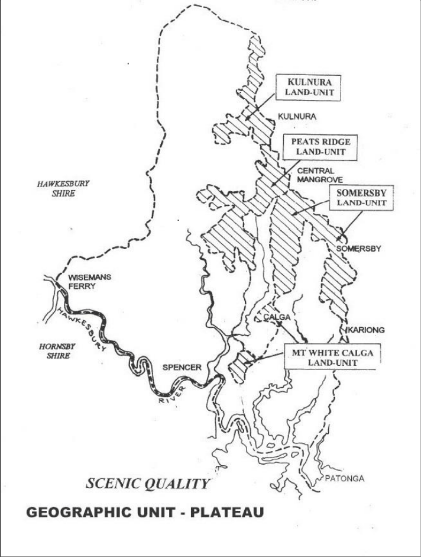

> [Picture on page 28: a picture, saved as a picture (images/scenic-quality-and-character-statements-page-28-1.gif, 150 dpi).]

### Landscape Character

In the areas north of Dodds Saddle the Kulnura – Somersby Plateau Landscape Unit consists of gently rolling plateau landscapes on moderately fertile sandy loam soils derived from shale and sandstone which is mainly cleared of vegetation for agriculture. In areas south of Dodds Saddle, generally around Kariong, landscapes typical of the Hawkesbury sandstone are evident, particularly near the F3 Freeway. Distinctive features in the agricultural areas are wind row tree plantings, plantations of citrus, natural forest verges and remnant native forest stands. Less distinctive landscape features exist in the more urbanised southern sections of the unit due to the intense nature of development and the lower scale and stunted nature of vegetation.

### Scenic Conservation Issues

In the agricultural areas the present conversion of properties from one rural character to another does not have substantial scenic impacts other than increasing densities and unsympathetic housing design. Extraction

sites, however, are prominent in the area and frequently have extensive impacts because of their ridge top locations and lack of screening. Further, pressure is evident for uses in the southern section of the unit for 'urban support’ uses not compatible with the area. The development of the Kariong urban release area, Somersby Industrial Park and the Mount Penang Festival Development Site have had a significant effect upon the scenic quality of the area, particularly as viewed from the F3 Freeway and areas below the Brisbane Water Escarpment.

### Absorption Capacity

Moderate to high for most development types, moderate to areas viewed from the Freeway and low for areas viewed from below the escarpment.

### Visual Sensitivity

Generally low other than areas viewed from the Freeway and from areas below the Escarpment.

### Detracting Elements

Urban development at Kariong, industrial and residential development viewed from the Freeway plus Mount Penang Festival Development Site located on escarpment and viewed from urban Gosford.

### Statement of Significance

The Kulnura to Somersby Plateau Unit is of local significance although areas viewed from the Freeway and escarpment areas are of more than local significance.

### Development Objectives

1\. Recognise importance of Brisbane Water Escarpment with its visual integrity and naturalness being valuable assets which need to be protected from development involving rezonings which increase densities and/or increase the range of uses permissible.

2\. Support application of Somersby Landscape Guidelines for development in Somersby Industrial Park.

3\. Recognise importance to the ‘impressions of Gosford’ for travellers on the Freeway and entering Gosford on the Central Coast Highway created by development viewed from these roads.

4\. Particular attention be paid to visual screening in the determination of development applications for extractive industries.

5\. Recognise importance of wind row tree planting, natural forest verges and remnant native forest stands to the landscape character of the agricultural areas and retain wherever possible particularly when viewed from major roads in area.

6\. Resist rezonings for ‘urban support’ activities which are out of keeping with rural landscape character of agricultural areas.

7\. Recognise importance of privately owned Environmental Conservation  zoned land in providing a complimentary land system to and a buffer for National Parks.

### UPPER HAWKESBURY

Landscape Units Covered: Wisemans Ferry to Spencer, Mangrove Creek, Popran Creek, Dharug

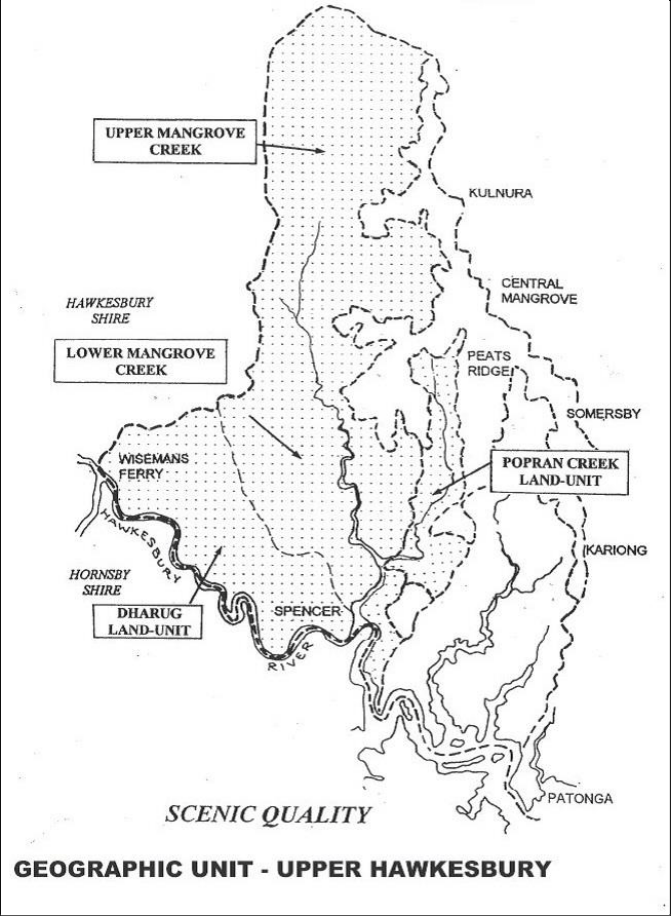

> [Picture on page 30: a picture, saved as a picture (images/scenic-quality-and-character-statements-page-30-3.gif, 150 dpi).]

### Landscape Character

The Wisemans Ferry to Spencer Landscape Unit is identified as a broad but steep sided mature river valley which meanders through the floodplain. High grey weathered sandstone cliffs and benches and dark vegetation create a sombre atmosphere. Clusters of opportunistic settlements above flood level occur with grazing and recreational activities on the floodplain.

The Dharug, Popran Creek and Mangrove Creek Landscape Units which feed into the Hawkesbury River are characterised by deeply dissected steep sided valleys cut into the Hawkesbury sandstone with a strong sense of enclosure. Lower ends of these units are characterised by drowned valleys subject to saline tidal flows. The

top of the catchment located within the Kulnura landscape unit is characterised by gently rolling plateau top landscapes which are mainly cleared of vegetation for agriculture.

### Scenic Conservation Issues

For all landscape units the major issue is to preserve the existing character of these areas and to control development on unsuitable sites.

### Absorption Capacity

Generally low to moderate for all landscape units. For the Hawkesbury landscape units, the breadth and scale of the landscape would permit additional development in carefully selected places.

### Visual Sensitivity

High for all landscape units along ridgetops and edges, mid/upper slopes and water edges and lower in less conspicuous locations.

### Detracting Elements

For the Hawkesbury landscape unit detracting elements include poorly designed cottages with light colours and inappropriate materials, decayed rural structures, caravan parks and boating structures of poor design and layouts, weeds and garden escapes in creeks, houses on ridge edges. For the other landscape units the poor design quality and unsuitability of light colours of buildings and creek edge structures as well as clearings too close to the valley tops and edges.

### Statement of Significance

Except for the Hawkesbury and Dharug landscape units, the other units covered are of local or regional significance. The Hawkesbury landscape unit is an outstanding landscape of national significance, clearly revealing the natural processes which have formed it. Its majestic scale, rich tones, precipitous topography, sinuous meanders and broad reaches combine with its natural vegetation to generate the formal and abstract attributes of high quality landscapes. Its sheer ruggedness and scale have helped retain its isolation from heavy development pressures; those factors also give it a high than normal visual absorption capacity and reduce its vulnerability.

### Development  Objectives

1\. Retain and enforce existing provisions contained within instruments and policies relating to the location and appearance of development within this geographic unit.

2\. Encourage new buildings in all landscape units to blend into existing natural environment with darker colours being preferred.

3\. Rezoning proposals should avoid areas of high visual sensitivity and the creation of further detracting elements.

4\. Rezoning proposals should consider the current zoning of the subject land in the context of the wider river environment rather than just the applicability of the zoning to the site itself.

5\. Development Applications in all landscape units should aim to prevent the creation of further development outcomes which create additional detracting elements.

6\. Development proposals located in Baulkham Hills and Hornsby Council areas, where Council is asked to provide comment, should be assessed against the scenic quality guidelines contained in this Chapter.

7\. Proposals for clearing of land should be considered for its scenic quality impacts as well as other issues normally considered for this type of development.

### LOWER HAWKESBURY

Landscape Units Covered: Spencer to Berowra Creek, Mooney Mooney Creek, Mullet Creek, Brooklyn Estuary

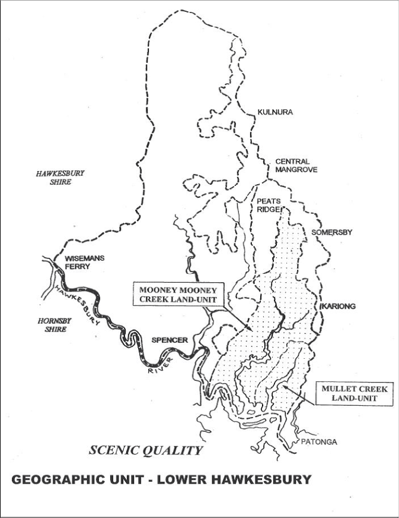

> [Picture on page 32: a picture, saved as a picture (images/scenic-quality-and-character-statements-page-32-11.gif, 150 dpi).]

### Level of Significance

Spencer to Berowra Creek - State Brooklyn Estuary - State Mooney Mooney Creek - Regional Mullet Creek - Regional

### Landscape  Character

Both the Spencer to Berowra Creek and the Brooklyn Estuary Landscape Units are examples of river retreat environments of modest, traditional, maritime housing and settlements of great charm with a variety of form, set back and landscape treatments. A dominantly natural steep sided river valley with widely separated and harmoniously organised water side houses and small settlements.

Mooney Mooney Creek and Mullet Creek Landscape Units have similar landscape character with both being largely natural creek environments dominated by steep wooded hills and open water although different development environments exist with Mullet Creek containing the Main Northern Railway Line and Mooney Mooney Creek containing the township of Mooney Mooney at the creek’s mouth.

### Scenic Conservation Issues

For the Spencer to Berowra Creek Landscape Unit the increasing density of settlement and re-development of  existing properties has the potential to decrease the scenic appeal. For the Brooklyn Estuary Landscape Unit the residential and informal scale of development should be retained with ridge tops, cliff lines and conspicuous slopes exempt from development. For the Mooney Mooney Creek Landscape Unit further development should be confined to the settled area. For the Mullet Creek Landscape Unit the area should be exempt from development with the railway works already unsympathetic.

### Absorption Capacity

Generally low to moderate for all landscape units but higher within existing settlements.

### Visual Sensitivity

High for all landscape units because of visual access to area from road, rail, river and settlements such as Brooklyn and high community esteem that landscape units have.

### Detracting Elements

All landscape units are characterised by obtrusive, overscale and inappropriately coloured buildings in prominent positions, overdevelopment of waterfront, unsightly public utility works and areas approaching maximum carrying capacity.

### Statement of Significance

For both the Mooney Mooney Creek and Mullet Creek Landscape Units the areas are of high scenic quality and are an integral part of an outstanding regional example of a ria coast estuary. The Brooklyn Estuary Landscape Unit is of high scenic quality and is an outstanding regional example of a ria coast estuary, is esteemed by the community for its scenic qualities and is a traditional recreational and water sport destination for Sydney. The Spencer to Berowra Creek Landscape Unit has the formal and abstract attributes

of high quality landscapes. It demonstrates the process of development of the Hornsby Plateau and the Hawkesbury Valley, its form showing the development of the ria coast landscapes of the Sydney area. It is an area valued for generations as a retreat and water sport destination and is  held in high esteem by the community.

### Development Objectives

1\. Retain and enforce existing provisions contained within instruments and policies relating to the location and appearance of development within this geographic unit.

2\. Encourage new buildings in all landscape units to blend into existing natural environment with darker colours being preferred.

3\. Rezoning proposals should avoid large scale developments, particularly on waterfront lands, and should aim to preserve the existing scenic character plus avoid the creation of further detracting elements.

4\. Rezoning proposals should consider the current zoning of the subject land in the context of the wider river environment rather than just the applicability of the zoning to the site itself.

5\. Development Applications in all landscape units should aim to prevent the creation of development outcomes which create additional detracting elements.

6\. Development proposals located in the Hornsby Council area, where Council is asked to provide comment, should be assessed against the scenic quality guidelines contained in this Chapter.

7\. Proposals for clearing of land should be considered for its scenic quality impacts as well as other issues normally considered for this type of activity.

### Character Statement Index

> [Picture on page 35: a map, saved as a picture (images/scenic-quality-and-character-statements-page-35-2.gif, 150 dpi); the street names and other small labels are on the picture.]
> Words printed on the picture (title and legend, copied from the PDF):
> Mooney Mooney Creek
> St Huberts Island
> Ten Mile Hollow
> Woy Woy Bay
