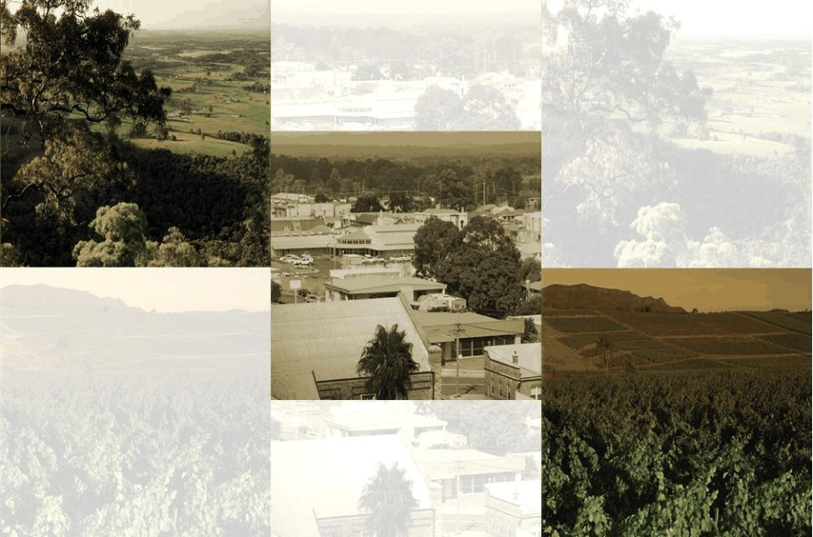
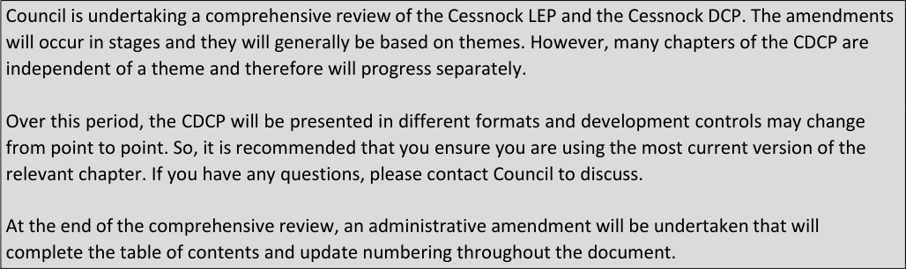

# Cessnock Development Control Plan 2010 - Part A Introduction and Legislative Context

Source PDF: [Part A - Introduction and Legislative Context.pdf](Part%20A%20-%20Introduction%20and%20Legislative%20Context.pdf)

### CESSNOCK

### DEVELOPMENT CONTROL PLAN

### PART A: INTRODUCTION AND LEGISLATIVE CONTEXT

> [Picture on page 1: a picture, saved as a picture (images/part-a-introduction-and-legislative-context-page-1-4.gif, 150 dpi).]

> [Picture on page 1: a picture, saved as a picture (images/part-a-introduction-and-legislative-context-page-1-5.gif, 150 dpi).]

### Introduction and Legislative Context

INTRODUCTION AND LEGISLATIVE CONTEXT .............................................................................. 3 Title ......................................................................................................................................................... 3 Commencement ....................................................................................................................................... 3 Land to which the CDCP applies ................................................................................................................ 3 Purpose of the CDCP ................................................................................................................................. 3 Where the CDCP does not apply ................................................................................................................ 3 Relationship to legislation, other plans, and policies .................................................................................. 4 Definitions ................................................................................................................................................ 4 References ............................................................................................................................................... 4 Structure and how to use this plan ............................................................................................................ 4 Transitional arrangements ........................................................................................................................ 5

### INTRODUCTION AND LEGISLATIVE CONTEXT

#### Title

The name of this plan is the Cessnock Development Control Plan 2010 (CDCP).

#### Commencement

This Chapter commenced on 9th January 2024

#### Land to which the CDCP applies

This CDCP applies to all land within the Cessnock Local Government Area.

#### Environmental Planning Instrument to which the CDCP applies

Cessnock Local Environmental Plan 2011 (Cessnock LEP)

#### Purpose of the CDCP

The purpose of CDCP is to make detailed provisions to guide the design of development proposals to;

• give effect to the aims of the Cessnock LEP;

• facilitate development that is permissible under the Cessnock LEP and;

• achieve the objectives of land zones under the Cessnock LEP.

This CDCP has also been prepared to provide for public advertising and notification of development applications for specified development.

#### Where the CDCP does not apply

This DCP does not apply to development that is:

• Identified as being Permissible without consent by the Cessnock LEP;

• Exempt and complying development as defined by the State Environmental Planning Policy (Exempt and Complying Development Codes) 2008, or within Schedules 2 and 3 of the Cessnock LEP, other than when specifically referenced in the exempt or complying development criteria under the Environmental Planning Instrument;

• Carried out under Part 5 of the Environmental Planning and Assessment Act 1979;

• Assessed under the provisions of another Environmental Planning Instrument (such as a State Environmental Planning Policy) that excludes the provisions of the Cessnock LEP and/or this CDCP.

#### Relationship to legislation, other plans, and policies

This DCP:

• was prepared in accordance with Section 3.43 of the Environmental Planning and Assessment Act 1979 and Clause 16 of the Environmental Planning and Assessment Regulations 2000;

• identifies further detail of Council’s requirements for local development seeking consent under CLEP;

• is generally consistent with the provisions of the LEP and other applicable Environmental Planning Instrument/s (EPI). However, in the event of any inconsistency, the requirements of the EPI will prevail to the extent of the inconsistency;

• does not apply, in whole or part, where specifically excluded by an EPI as per Section 3.45 (3) of the Environmental Planning and Assessment Act 1979;

• is applied in conjunction with other Council development guidelines, policy, and/or technical manuals, where identified.

#### Definitions

A word or expression used in this development control plan has the same meaning as it has in the Cessnock Local Environmental Plan 2011, unless it is otherwise defined in the dictionary or within individual chapters.

#### References

Council has included references to external documents that are relevant to the interpretation and/or application of the development control. Council does not have control over these documents and these may change over time. Where an external document is no longer contemporary, the reference should be interpreted as “or the equivalent document”.

#### Structure and how to use this plan

Parts

The Cessnock Development Control Plan is comprised of 4 parts. Development applications must address all relevant sections of Part 2, Part 3 and Part 4.

## Part 1: Administration

## Part 2: Development-based controls

## Part 3: Issue-based controls

## Part 4: Area-based controls

There are self-contained chapters for a number of urban release areas (URAs) in the existing CDCP, meaning that all relevant DCP controls that apply to development within the URA are contained within a single chapter. As these chapters are reviewed, the generic controls will be moved out of those URA chapters and only those controls unique to the URA will remain in an area-based chapter for that URA.

Clause 6.3 of the Cessnock LEP mandates that a DCP that addresses the list of requirements is prepared for an Urban Release Area. Where these controls exist within the ‘Issue-based’ or ‘Development-based’ provisions, these are deemed to satisfy this requirement.

Area based provisions Area-based provisions apply to discrete areas and may include provisions that are different from those in Parts 2 and 3 of the CDCP. Where there is a difference between any development provision/s in Parts 2 or 3 and Part 4, the provision/s in Part 4 prevail for that area.

Development Guidelines and Merit-based Solutions

Cessnock City Council is committed to encouraging innovation through a merit-based approach to development standards in the CDCP. This needs to be supported by a robust, decision-making framework. The approach is detailed below.

To provide a robust, decision-making framework each development control is accompanied by one or more objectives. The development control will generally be a prescriptive standard. For example; the front setback is 4.5m. If the application meets the prescriptive standards then no further consideration will be given to it and the application will generally be approved. If a prescriptive standard/s cannot be met, then the proponent must demonstrate how the alternative solution meets the objective/s of that control and any other applicable objective/s.

| Objective/s | Development Control |
|---|---|
| Objective 1 Objective 2 | Development Control 1 |

A proposal that pursues an alternative solution to a prescriptive control must justify the variation, including the manner in which the corresponding objective/s will be met. This may require the inclusion of specialist studies or reports.

#### Transitional arrangements

> [Picture on page 5: a picture, saved as a picture (images/part-a-introduction-and-legislative-context-page-5-20.gif, 150 dpi).]

Council is undertaking a comprehensive review of the Cessnock LEP and the Cessnock DCP. The amendments will occur in stages and they will generally be based on themes. However, many chapters of the CDCP are independent of a theme and therefore will progress separately.

Over this period, the CDCP will be presented in different formats and development controls may change from point to point. So, it is recommended that you ensure you are using the most current version of the relevant chapter. If you have any questions, please contact Council to discuss.

At the end of the comprehensive review, an administrative amendment will be undertaken that will complete the table of contents and update numbering throughout the document.

Advisory Notes

Advisory notes (provided in the footnotes where relevant) are for information or clarification only.
