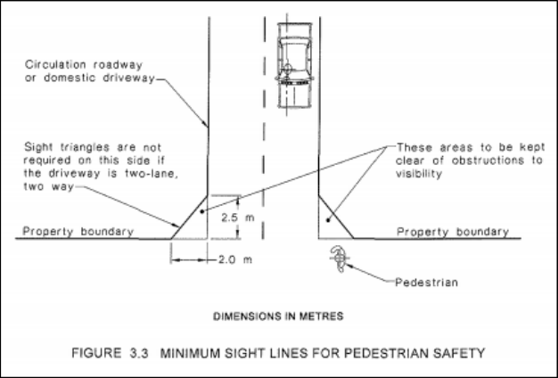
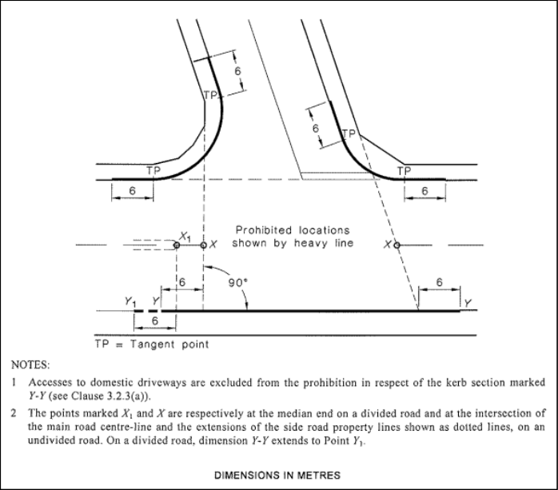
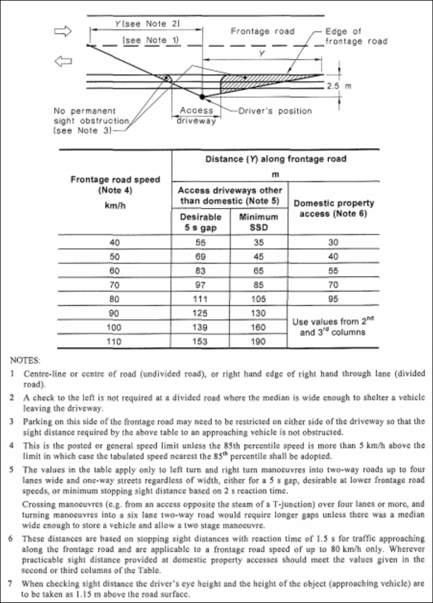
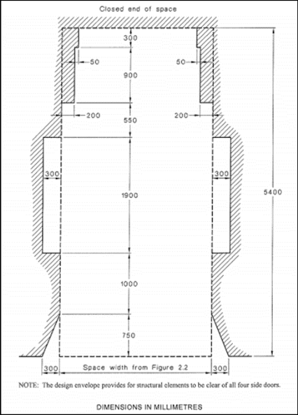
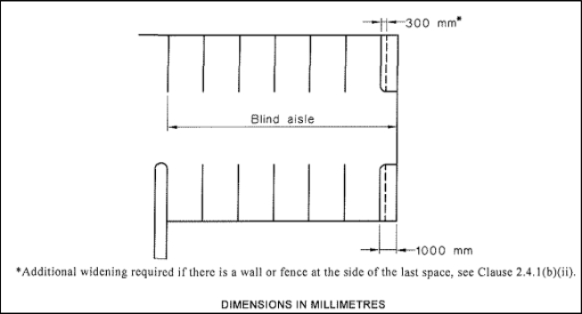
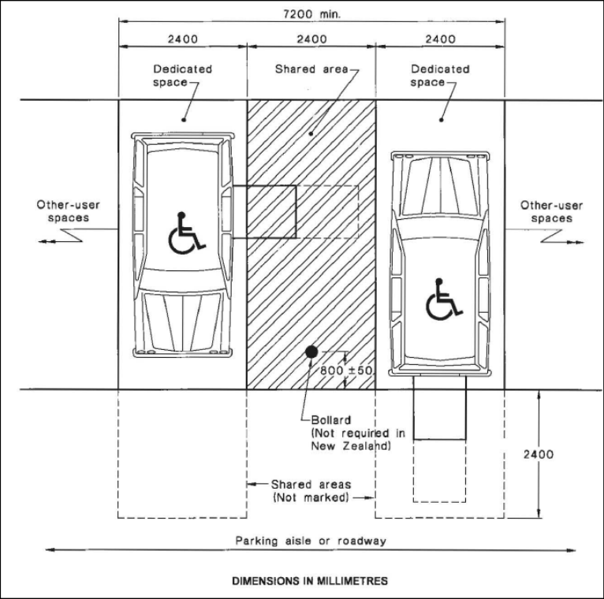

### Appendix A: Standard Drawings and Information

#### Access to the Site

Figure 1: Minimum Sight Lines for Pedestrian Safety

> [Picture on page 26: a picture, saved as a picture (images/part-c1-parking-and-access-page-26-4.gif, 150 dpi).]

Source:  Australian Standards 2980.1 2004 – Part 1: Off-street car parking.

Figure 2: Prohibited Driveway Locations at Intersections

> [Picture on page 26: a picture, saved as a picture (images/part-c1-parking-and-access-page-26-7.gif, 150 dpi).]

Source:  Australian Standards 2980.1 2004 – Part 1: Off-street car parking.

Figure 3: Sight Distance Requirements at Access Driveways

> [Picture on page 27: a picture, saved as a picture (images/part-c1-parking-and-access-page-27-2.gif, 150 dpi).]

Source:  Australian Standards 2980.1 2004 – Part 1: Off-street car parking.

Table 6: Selection of Access Facility Category

| Class of parking facility (see Error! Reference source not found.) | Frontage Road Type | Parking Facility Access Category Number of Parking Spaces (Note 1) |  |  |  |  |
|---|---|---|---|---|---|---|
|  |  | <25 | 25 to 100 | 101 to 300 | 301 to 600 | >600 |
| 1, 1A | Arterial Local | 1 1 | 2 1 | 3 2 | 4 3 | 5 4 |
| 2 | Arterial Local | 2 1 | 2 2 | 3 3 | 4 4 | 5 4 |
| 3 | Arterial Local | 2 1 | 3 2 | 4 3 | 4 4 | 5 4 |

NOTES:

1 When a car park has multiple access points, each access should be designed for the number of

parking spaces effectively serviced by that access.

2 This table does not imply that certain types of development are necessarily suitable location on

any particular frontage road type. In particular, access to arterial roads should be limited as far as

practicable, and in some circumstances, it may be preferable to allow left-turn-only movements

into and out of the access driveway.

Source:  Australian Standards 2890.1 2004 – Part 1: Off-street car parking.

Table 7: Access Driveway Widths

| Category | Entry Width | Exit Width | Separation of Driveways |
|---|---|---|---|
| 1 | 3.0 to 5.5 | (combined) (see Note) | N/A |
| 2 | 6.0 to 9.0 | (combined) (see Note) | N/A |
| 3 | 6.0 | 4.0 to 6.0 | 1 to 3 |
| 4 | 6.8 to 8.0 | 6.0 to 8.0 | 1 to 3 |
| 5 | To be provided as an intersection, not an access driveway, see Clause 3.1.1 Access design principles in AS/NZS 2890.1 (2004). |  |  |

NOTE: Driveways are normally combined, but if separate, both entry and exit widths should be 3.0m minimum.

Source: AS2890.1 2004 – Part 1: Off-street car parking

#### Parking Layout Design

Error! Reference source not found.Table 8:

Classification of Off-Street Car Parking Facilities

| User Class | Required Door Opening | Required Aisle Width | Examples of use (Note 1) |
|---|---|---|---|
| 1 | Front Door, first stop | Minimum for single manoeuvre entry and exit | Employee and commuter parking (generally, all-day parking) |
| 1A | Front Door, first stop | Three-point turn entry and exit into 90° parking spaces only, otherwise as for User Class 1 | Residential, domestic and employee parking |
| 2 | Full opening, all doors | Minimum for single manoeuvre entry and exit | Long term city and town centre parking, sports facilities, entertainment centres, hotels, motels, airport visitors (generally medium-term parking) |
| 3 | Full opening, all doors | Minimum for single manoeuvre entry and exit | Short term city and town centre parking, parking stations, hospital and medical centres |
| 3A | Full opening, all doors | Additional allowance above minimum single manoeuvre width to facilitate entry and exit | Short term, high turnover parking at shopping centres |
| 4 | Size requirements are specified in AS2890.6 (Note 2) |  | Parking for people with disabilities |

NOTES:

1 Except for the requirements specified in Clause 1.4 (in AS2890.1 - 2004) relating to User Class 1A

and 4, the examples of uses are intended to be flexible and allow for progressive improvement In

both the ease of manoeuvring into and out of parking spaces, and in leaving and re-entering the

vehicle as one progresses up the user scale from 1 to 3A. The modelling of vehicle manoeuvring

into Class 1A spaces shows however, that many drives may have difficulty driving into and out of

such spaces, especially those with vehicles larger than the B85 vehicle. Furthermore, they may

have difficulty entering and leaving the vehicle in narrower spaces. Safety issues associated with

delays and congestion caused by manoeuvres into and out of Class 1A spaces in large parking

areas should also be taken into account. See also Appendix B, Paragraph B4.8 in AS2890.1 – 2004.

2 In preparation, see footnote to Clause 1.2 in AS2890.1 – 2004.

Source:  Australian Standards 2980.1 2004 – Part 1: Off-street car parking.

Figure 4: Vehicle Design Envelope

> [Picture on page 30: a picture, saved as a picture (images/part-c1-parking-and-access-page-30-2.gif, 150 dpi).]

Source:  Australian Standards 2890.1 2004 – Part 1: Off-street car parking.

Figure 5: Blind Aisle Extension

> [Picture on page 30: a picture, saved as a picture (images/part-c1-parking-and-access-page-30-5.gif, 150 dpi).]

Source:  Australian Standards 2890.1 2004 – Part 1: Off-street car parking.

#### Parking for People with Disabilities

Figure 6: Example of Two Parking Spaces with a Common Shared Area

> [Picture on page 31: a picture, saved as a picture (images/part-c1-parking-and-access-page-31-3.gif, 150 dpi).]

Source:  Australian Standards 2890.6 2009 – Part 6: Off-street parking for people with disabilities

#### Service Vehicle Dimensions

Design Vehicle Dimensions

Table 9:

| Vehicle Class | Overall Length | Design Width | Wheelbase | Design Turning Radius | Swept Circles | Clearance Height |
|---|---|---|---|---|---|---|
| SRV | 6.4 | 2.3 | 3.80 | 7.1 | 15.3 | 3.5 |
| MRV | 8.8 | 2.5 | 5.00 | 10.0 | 12.6 | 4.5 |
| HRV | 12.5 | 2.5 | 6.85 | 12.5 | 27.8 | 4.5 |
| AV | 20.0 | 2.5 | 14.70 | 12.5 | 26.6 | 4.5 |
| B-Double | 26.0 | 2.5 | 21.70 | 12.5 | n/a | 4.5 |
| A-Double | 36.5 | 2.5 | 32.30 | 15.0 | n/a | 4.5 |
| A-Triple | 53.5 | 2.5 | 49.00 | 15.0 | n/a | 4.5 |

NOTE: All dimensions in metres

NOTE: Clearance height shall increase to 4.8m for animal transport vehicles, vehicle carriers and any other

4.6m high vehicles

Source: Australian Standards 2890.2 2018 – Part 2: Off-street commercial vehicle facilities
