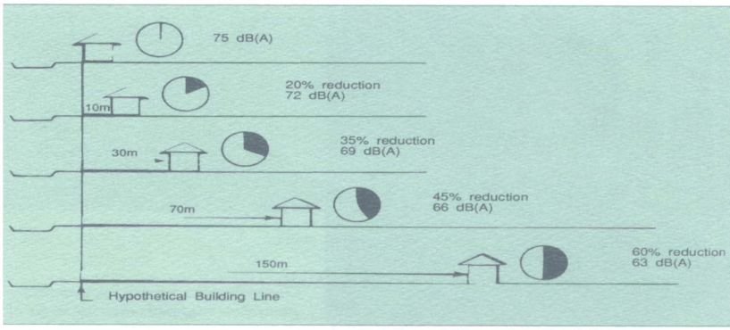
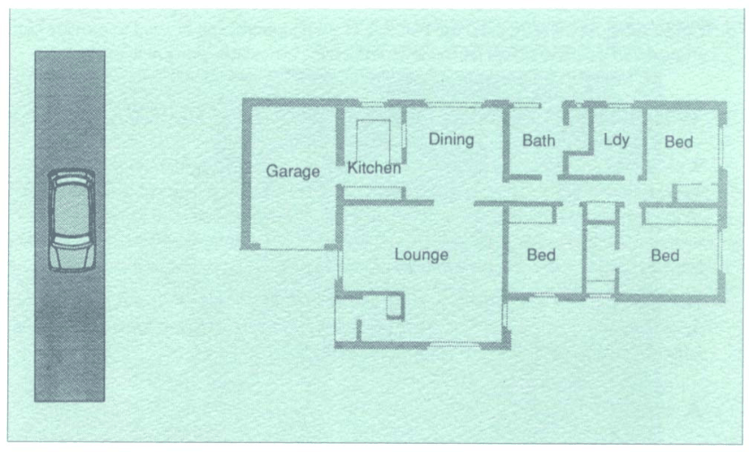
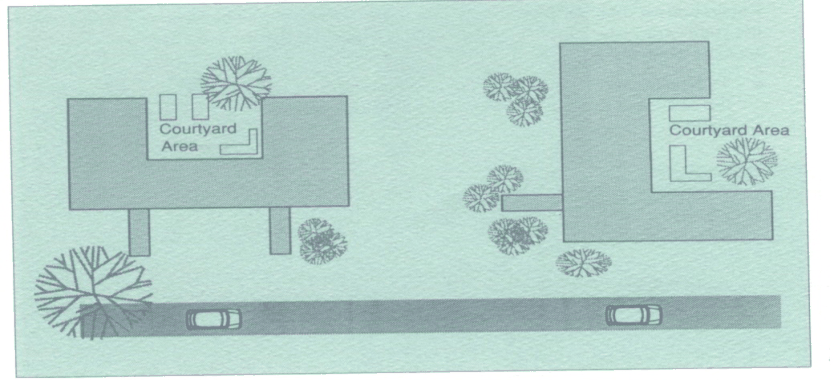
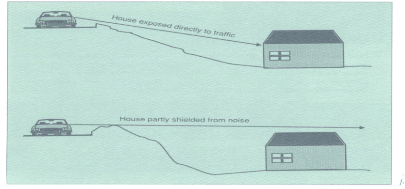

#### 4.3.17 Correctional Centres – Category B Potential Conflicts

Potential conflicts depend largely upon the nature of the facility, and include: visual impact; light spillage; and to a large degree, adverse public perception.

#### Existing Policies or Guidelines

Nil.

#### Methods for Reducing Conflicts

Minimum separation from Category A and B uses of 500 metres. Category C uses to be determined on a merits based assessment.

#### Performance Standards for Reducing Conflicts

Separation distances may be reduced depending on the design of the facility and its compatibility with surrounding developments, and the use of landscaping or other appropriate screening.

#### Appendix 1: Site Design

Careful planning of the building site is a vital first step in reducing traffic noise.  The following techniques can be used to reduce traffic noise levels.

Place the building as far away from the Freeway as possible.  Doubling the distance from the road will reduce the average noise level by 3 – 4 decibels and reduce peak levels by 6 decibels.

> [Picture on page 31: a picture, saved as a picture (images/part-c4-land-use-conflict-and-buffer-zones-page-31-7.gif, 150 dpi).]

Figure 1: How distance reduces traffic noise (Source: Reducing Traffic Noise, 1991)

Use parking lots, open spaces and garages to shield the building from noise.

> [Picture on page 31: a picture, saved as a picture (images/part-c4-land-use-conflict-and-buffer-zones-page-31-11.gif, 150 dpi).]

Figure 2: Good acoustic layout (Source: Reducing Traffic Noise, 1991)

Use the dwelling house and other buildings to shield outdoor living areas such as courtyards or BBQ areas.

> [Picture on page 32: a picture, saved as a picture (images/part-c4-land-use-conflict-and-buffer-zones-page-32-3.gif, 150 dpi).]

Figure 3: Acoustic site planning (Source: Reducing Traffic Noise, 1991)

Exploit existing natural features such as slopes, and in some circumstances, excavate to provide better noise protection.

> [Picture on page 32: a picture, saved as a picture (images/part-c4-land-use-conflict-and-buffer-zones-page-32-8.gif, 150 dpi).]

Figure 4: Use of natural land features (Source: Reducing Traffic Noise, 1991)
