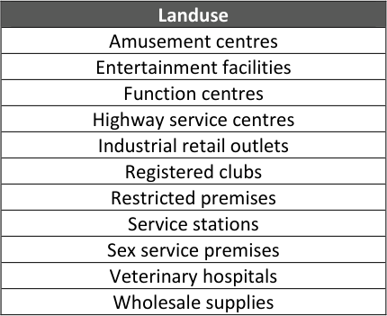

#### Development provisions - Residential flat buildings

These development provisions apply to residential flat buildings, which can house a number of residential units. This residential accommodation type requires a responsive waste management system to the building design and number of residential units within the development. Council’s Waste Management Guideline – Residential Flat Buildings has been prepared to assist with preparing and implementing a waste management system that is suitable for the proposed development.

| Objectives | Controls |
|---|---|
| a) Maximise waste avoidance, reuse and recycling to reduce the amount of waste to landfill. | A Waste Management Plan is to be prepared in accordance with Council’s Waste Management Guideline – Residential Flat Buildings, and address • Estimated quantities of waste types generated by the operation of the development • Operation of waste management systems for the life of the development • Storage of recyclable, organics and residual waste at the site • Waste collection arrangements for the development. |
| b) To ensure residential occupants have appropriate access to the waste transfer system in the building | The Floor Plan(s) accompanying the development application are to identify a waste and recycling storage room, including a waste chute, on each residential floor of the building. Dual waste chute systems, for recyclable and residual waste streams, are to be installed within the building. Access to the chute system is required on each residential floor of the building. |
| c) To provide appropriate space and facilities for the management of waste and recycling | The waste and recycling storage area is to be located within the ground level or basement of the development. The waste and recycling storage area is to be designed to accommodate waste, recycling and organics bins in accordance with Council’s Waste Management Guidelines – Residential Flat Buildings. |

| d) To ensure safe and efficient collection of waste | The waste collection point is to be located on- site and designed with appropriate access for the waste collection vehicle in accordance with Australian Standard AS 2890.2:2018 Off-street Commercial Vehicle Facilities Waste collection vehicle access to the development and waste collection point are to be demonstrated by swept path models for the nominated waste collection vehicle. A structural engineers report confirming the waste collection vehicle access areas can support the vehicle’s ‘gross weight’. |
|---|---|
| e) Provide adequate internal space for sorting of waste materials | The Floor Plan(s) accompanying the development application is to identify within each residential unit within the building • Space for the storage of at least two days generation of waste and recycling • Space within the kitchen area for the separation of food waste or compostable material. |

Development provisions – Commercial premises, industries and community facilities

These development provisions apply to the following landuse types

a) Commercial premises including business premises, office premises and retail premises. The development provisions will also apply to the following specific landuses

> [Picture on page 9: a picture, saved as a picture (images/part-c5-waste-management-page-9-6.gif, 150 dpi).]
> Words printed on the picture (title and legend, copied from the PDF):
> Amusement centres
> Entertainment facilities
> Function centres
> Highway service centres
> Industrial retail outlets
> Registered clubs
> Restricted premises
> Service stations
> Sex service premises
> Veterinary hospitals
> Wholesale supplies
