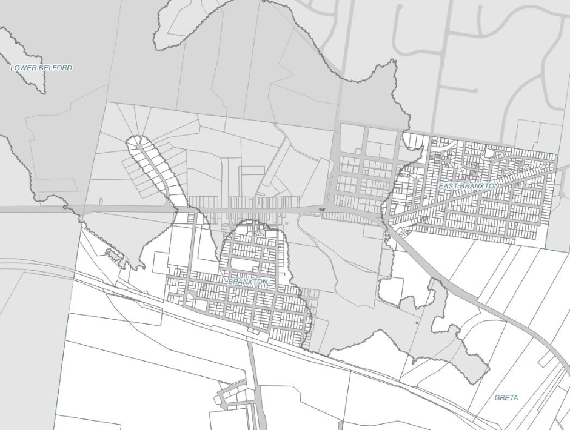

# Cessnock Development Control Plan 2010 - Part C9 Development on Flood Prone Land

Source PDF: [C9 - Development on Flood Prone Land.pdf](C9%20-%20Development%20on%20Flood%20Prone%20Land.pdf)

#### Table of Contents

HAZARDS .......................................................................................................................... 2 Development on Flood Prone Land .................................................................................... 2 Preamble ................................................................................................................................. 2 Application .............................................................................................................................. 2 Flood Hazard Classifications........................................................................................................................... 2 Definitions and Flood Planning Concepts .................................................................................. 2 Development provisions ........................................................................................................... 3 Land Use and Hazard Control Matrix ............................................................................................................. 3 Detailed Survey .............................................................................................................................................. 6 Flood Assessment Report .............................................................................................................................. 7 General Requirements (New Development).................................................................................................. 8 Evacuation...................................................................................................................................................... 9 Car Parks ........................................................................................................................................................ 9 On-Site Wastewater Management .............................................................................................................. 10 Subdivision ................................................................................................................................................... 10 Land to which the Cessnock City Wide Flood Study Applies ........................................................................ 11 Properties impacted by Low Risk Overland Flooding .................................................................................. 11 Hydraulic Controls ........................................................................................................................................ 12 House Raising and Flood Proofing ............................................................................................................... 13 Additions and Renovations .......................................................................................................................... 13 Branxton Commercial Precinct .................................................................................................................... 14

#### List of tables

Table 1: Flood hazard classifications (reference Table 6.7.3 Australian Rainfall and Runoff 2019). ...... 2 Table 2: Development classification for the Flood Hazard Classification. .............................................. 3 Table 3: Sensitive and Hazardous development, including critical infrastructure. ................................ 6

#### List of figures

Figure 1: Branxton Flood Planning Area. .............................................................................................. 15

### HAZARDS Development on Flood Prone Land

#### Preamble

The purpose of this chapter is to provide information and development controls needed to prepare and assess development applications on Flood Prone Land.

#### Application

This Chapter applies to all land in the Cessnock Local Government Area (LGA) that is Flood Prone Land1.

Flood Hazard Classifications

The flood hazard classifications listed in Table 1 apply to this chapter.

Table 1: Flood hazard classifications (reference Table 6.7.3 Australian Rainfall and Runoff 2019).

| Hazard Vulnerability Classification | Description |
|---|---|
| H1 | Generally safe for vehicles, people and buildings. |
| H2 | Unsafe for small vehicles. |
| H3 | Unsafe for vehicles, children and older persons. |
| H4 | Unsafe for vehicles and people. |
| H5 | Unsafe for vehicles and people. All buildings are vulnerable to structural damage. Some less robust buildings are subject to failure. |
| H6 | Unsafe for vehicles and people. All building types considered vulnerable to failure. |

#### Definitions and Flood Planning Concepts

All terms used in this DCP chapter have the same meaning as defined in the Cessnock Local Environmental Plan 2011, the NSW Floodplain Development Manual 2005 and the DPIE guideline, ‘Considering Flooding in Land Use Planning’, unless specified below, or elsewhere in this DCP chapter.

| Defined Flood Event | means Council’s adopted 1% AEP flood event. |
|---|---|
| Flood Planning Level | means the combination of the flood level from the defined flood event plus 0.5 metre freeboard, unless an alternative definition is provided elsewhere in this DCP chapter. |
| Flood Planning Area | means the area of land at or below the flood planning level. |
| Flood Prone Land | means land susceptible to flooding by the PMF event. |
| Low hazard overland flooding | means land that is identified in Council’s online mapping as being subject to low hazard overland flooding. |

1 Council’s flood mapping is available online at www.cessnock.nsw.gov.au

Additional supporting information is available in the following fact sheets: Fact Sheet 1: Flood Planning Concepts Fact Sheet 2: Flood Compatible Building Guidelines

> [Picture text on page 3 is stored in the PDF without readable letters (no character map), so it could not be copied; see the original PDF.]

#### Development provisions

Land Use and Hazard Control Matrix

Table 2 classifies land-use types into Development Categories according to the sensitivity of each land use type to flooding. The table uses a combination of development categories and hazard classification to class developments as either class A, B, C or X. Where the footprint of the proposed building and/or access covers more than one hazard classification, the higher classification shall apply.

A means the development will be impacted by flooding; however the land use is generally suitable to the hazard classification and group A controls apply to the development B means the development will be impacted by flooding and group B controls apply to the development. A merit assessment may need to be undertaken for these developments and additional justification may be needed. C means that the development will be significantly impacted by flooding. If designed appropriately the development may be suitable in the hazard classification. A merit assessment

will need to be undertaken for these developments and additional justification may be needed. means the land use is generally not suitable in the hazard classification.

| Objective/s | Development Controls |
|---|---|
| To ensure that development is compatible for the flood hazard that is present at the site. To ensure that development is responsive to the flood characteristics present at the site. | Development is consistent with Table 2. |

Table 2: Development classification for the Flood Hazard Classification.

|  |  | Based on the defined flood event |  |  |  |  |  |
|---|---|---|---|---|---|---|---|
| Development | Land Use Type | H1 | H2 | H3 | H4 | H5 | H6 |
| Ancillary structures type 1 | Fences (open) | A | A | A | A | C | C |
| Ancillary structures type 2 | Fence (solid) Detached garage Temporary structure Shed Carport (open) Farm building | A | A | B | B |  |  |
| Carpark | Carpark | A | A | B | B |  |  |
| Single Residential | Dwelling house Exhibition home Exhibition villages Home business Home industry Home occupation Home occupation (sex service) Rural worker’s dwelling | A | A | B | B |  |  |
| Dual Occupancies, Attached Dwellings and Secondary Dwellings | Attached dwelling Dual occupancy (attached) Dual occupancy (detached) Secondary dwelling, Semi-detached dwelling | A | A | B | B |  |  |

|  |  | Based on the defined flood event |  |  |  |  |  |
|---|---|---|---|---|---|---|---|
| Development | Land Use Type | H1 | H2 | H3 |  |  |  |
| Multi Residential | Multi dwelling housing Residential flat building Shop top housing | A | A | B |  |  |  |
| Tourism Development | Eco-tourist facilities Backpacker’s accommodation Bed and breakfast accommodation Farm stay accommodation Hotel or motel accommodation Serviced apartments Camping Grounds | A | A | B |  |  |  |
| Commercial Development type 1 | Animal boarding or training establishment Veterinary hospital Medical Centres Health consulting rooms | A | A | B |  |  |  |
| Commercial Development type 2 | Business premise Funeral home Office premise Retail premise Cellar door premises Food and drink premises Pubs Restaurant or café Takeaway food and drink premises Small bar Sex service premises Industrial retail outlets Registered clubs Restricted premises Wholesale suppliers Kiosks Shop Neighbourhood shop Timber yard Vehicle sales or hire premises Specialised retail premises Garden centres Hardware and building supplies Landscape material supplies Markets Plant nurseries Roadside stalls Rural supplies Function centre Amusement centres Entertainment facilities Self-storage units Warehouse and distribution centre Place of public worship Public administration building | A | A | B | B | C |  |
| Industrial Development | Light industry High technology industries General industries Rural industries Agricultural produce industries Livestock processing industries Sawmill or log processing industries Stock and sale yards Vehicle body repair workshop Vehicle repair station Depots Transport depot Truck depot Freight transport facility | A | A | B | B |  |  |
| Agricultural Development | Aquaculture Extensive agriculture Bee keeping | A | A | B | B | C | C |

> [Picture text on page 4 is stored in the PDF without readable letters (no character map), so it could not be copied; see the original PDF.]

|  |  | Based on the defined flood event |  |  |  |  |  |
|---|---|---|---|---|---|---|---|
| Development | Land Use Type Dairy (pasture-based) Intensive livestock agriculture Feed lots Dairies (restricted) Intensive plant agriculture Horticulture Viticulture Turf farming Forestry | H1 | H2 | H3 | H4 | H5 | H6 |
| Recreation type 1 | Recreation Facility (indoor) Recreation facility (major) | A | A | B | B | C |  |
| Recreation type 2 | Recreation facilities (outdoor) Recreation area | A | A | B | B | C | C |
| Earth works | Extractive industries Mining Roads Drainage works | A | A | B | B | C | C |
| Potentially Polluting activities | Service station Highway service centers Heavy Industries Hazardous industries Offensive industries Heavy industrial storage establishments Hazardous storage establishments Liquid fuel depots Offensive storage establishment | A | A | B |  |  |  |
| Event | Music or art festival | A | A | B | B | C | C |
| Infrastructure | Water reticulation systems Water storage facilities Water treatment facilities | A | A | B | B | C | C |
| Subdivision | See subdivision section of this DCP chapter for additional controls Subdivision must be able to demonstrate that the proposed lots will be able to accommodate the uses permitted in the zone. | A * | A* | B* | B* | C* | C* |
| Sensitive uses and facilities type 1 | Community facility (not considered a critical use), Home based childcare | B |  |  |  |  |  |
| Note 1: Where development does not fit within the categories outlined above, Council will determine which land use category the proposal fits into based on the documentation provided to Council. Note 2: Land use types are those as defined in Cessnock LEP 2011, unless otherwise specified. Note 3: Other factors may also need to be taken into consideration when determining the hazard classification, such as access to safe evacuation facilities and the available warning times. |  |  |  |  |  |  |  |

Sensitive and Hazardous Development

Sensitive and hazardous development is development that is vulnerable to greater impact from

> [Picture text on page 5 is stored in the PDF without readable letters (no character map), so it could not be copied; see the original PDF.]

natural hazards because of the particular type of land use or the characteristics of people that are typically associated with that land use. Sensitive development also includes critical infrastructure, the temporary loss of which is likely to cause significant disruption.

| Objective/s | Development Controls |
|---|---|
| To enable the safe occupation and evacuation of people subject to flooding. To ensure development on land is compatible with the land’s flood behaviour in the event of a flood. | Development consent must not be granted to development listed in Table 3 unless Council is satisfied that the development— (a) will not affect the safe occupation and efficient evacuation of people in the event of a flood, and |

(b) incorporates appropriate measures to manage risk to life in the event of a flood, and

(c) will not adversely affect the environment in the event of a flood.

To avoid adverse or cumulative impacts on flood behaviour.

To protect the operational capacity of emergency response facilities and critical infrastructure during flood events.

To avoid adverse effects of hazardous development on the environment during flood events.

Table 3: Sensitive and Hazardous development, including critical infrastructure.

| Development | Land Use Type |
|---|---|
| Sensitive uses and facilities type 2 | airport, boarding houses, caravan parks, Community facility (which provides an important contribution to the notification or evacuation of the community during flood events), correctional centres, early education and care facilities, eco-tourist facilities, educational establishments, electricity generating works, emergency services facilities, group homes, hazardous industries, hazardous storage establishments, heliport, hospitals, hostels, information and education facilities, Manufactured home Manufactured home estates respite day care centres, seniors housing, sewerage systems, telecommunications facilities, tourist and visitor accommodation, waste or resource management facilities, water supply systems. |
| Note 1: Where development does not fit within the categories outlined above, Council will determine which land use category the proposal fits into based on the documentation provided to Council. Note 2: Land use types are those as defined in Cessnock LEP 2011, unless otherwise specified. Note 3: Other factors may also need to be taken into consideration when determining the hazard classification, such as access to safe evacuation facilities and the available warning times. |  |

Detailed Survey

The following control applies to all development that is proposed within the flood planning area.

| Objective/s | Development Controls |
|---|---|
| To ensure that the potential impacts of flooding are considered when assessing development within the flood planning area. | All applications for development within the flood planning area shall be supported by a development site plan that incorporates a detailed survey, drafted by a registered surveyor. |

Flood Assessment Report

A FAR provides information on existing flood risk for a catchment and outlines how the proposed development is consistent with the requirements of this DCP. A FAR is to be consistent with the NSW Floodplain Development Manual 2005. Depending on the scale of the development either a Minor or Major FAR is required to be submitted with the application.

| Objective/s | Development Controls |
|---|---|
| To ensure that the potential impacts of flooding are considered when assessing development on flood prone land. | A Minor FAR will generally be required where: the development is considered to be of a minor scale; and the development is seeking to vary the relevant freeboard that applies to the land. OR flood data is not available and the site: a. is within 10 metres (horizontally) of a public trunk drainage system; natural watercourse, local overland flood path or drainage easement; or b. has a history of flooding. OR Flood data is available but requires updating, interpolation, extrapolation, or refinement to greater detail. |
| To ensure that the potential impacts of flooding are considered when assessing development on flood prone land | A Major FAR will be required where Council considers the development to be at a scale that exceeds that specified by a minor FAR, will result in intensification of development on flood prone land and/or result in an increased risk due to potential affectation by flooding. A Major FAR will generally be required where: development is not considered to be of a minor scale; and the property is impacted (or potentially impacted) by riverine or overland flooding; and the development incorporates habitable floor space, or a commercial or industrial (or similar) function; and the development is seeking to vary the relevant freeboard that applies to the land. OR |

| Objective/s | Development Controls flood data is not available and the site: a. is within 10 metres (horizontally) of a public trunk drainage system; natural watercourse, local overland flood path or drainage easement; or b. has a history of flooding. OR flood data is available but requires updating, interpolation, extrapolation, or refinement to greater detail; and/or the development relates to a residential use of land that is hazard classification H4 or above. |
|---|---|

General Requirements (New Development)

The following controls apply to development class A, B or C.

| Objective/s | Development Controls |
|---|---|
| To reduce risk to life and property resulting from floods by controlling development within the flood planning area. | All habitable finished floor levels are to be at or above the Flood Planning Level. Alternatively, development will be assessed on its merits against the flood planning provisions of the Cessnock Local Environmental Plan 2011. Non-Habitable floor levels are to be at or above the defined flood event, except for Ancillary Structures Type 1 and Ancillary Structures Type 2 (see Table 2). |
| To ensure that development within the flood planning area does not place an unacceptable financial burden on landowners or the community. | Parts of the building constructed at or below the Flood Planning Level are to be constructed with materials identified as ‘suitable’ in Fact Sheet 2: Flood Compatible Building Guidelines |
| To ensure that all land uses and essential services are appropriately sited and designed in recognition of all potential floods. | Electrical fixtures such as power points, light fittings and switches are to be sited above the Flood Planning Level unless they are on a separate circuit (with earth leakage protection) to the rest of the building. |
| To protect the integrity of the flood plain, including riparian vegetation, fluvial geomorphologic environmental processes and water quality. | All hazardous chemicals are to be stored above the Flood Planning Level. |

Evacuation

The following controls apply to development in Group B and C.

| Objective/s | Development Controls |
|---|---|
| To reduce risk to life and property resulting from floods by controlling development on flood prone land. | If intensifying development that incorporates a habitable use on flood prone land, it must be demonstrated that, in the event of a flood, users of the development are able to safely self-evacuate to land that is not flood prone land and do so without the need to traverse flood waters of a higher hazard classification. |
| To ensure that development does not have a significant impact on flood behaviour, people’s safety, surrounding properties and structures and the natural environment. | A structural assessment is required by a suitably qualified engineer to demonstrate that structures in hazard category H5 or H6 will be safe to withstand hydraulic loads (including debris) in a defined flood event. |

Flow of Water

The following controls apply to development in Group C.

| Objective/s | Development Controls |
|---|---|
| To ensure that development does not have a significant impact on flood behaviour, people’s safety, surrounding properties and structures and the natural environment. | Any development with a hazard classification of H5 or H6 must have open structures so that the flow of water is not restricted. All fences are to allow passage of a defined flood event under or through the fence. |

Car Parks

The following controls apply to developments that include carparks.

| Objective/s | Development Controls |
|---|---|
| To ensure that development on flood prone land does not place an unacceptable financial burden on landowners or the community. To ensure that future use of flood prone land does not cause undue stress to individuals or unduly increase potential flood liability to individuals or the community. | The floor level of car parks are to be no lower than the 5% AEP flood level2. Basement or below ground carparks will only be supported where all potential water entry points are at or above the flood planning level. Where it is demonstrated that this cannot be achieved the following requirements are to be met: a. The basement is designed so that the structural integrity of the building is not compromised if the basement is either partially or fully inundated during a flood. b. All exit points below the Flood Planning Level are able to be closed and locked to prevent access during floods. |

2 Hydraulic controls must also be considered, particularly in relation to on site fill.

| Objective/s | Development Controls c. Electrical and water fixtures are sited above the Flood Planning Level unless they are on a separate circuit (with earth leakage protection) to the rest of the building. d. At least one stairwell from the basement is to extend to at least the Flood Planning Level. The door for this exit is to be readily openable without a key from the inside (i.e. the side facing egress). The handle is to be a single downwards pushing action such as a leaver. e. The owner(s) of the building are to consult with the State Emergency Services to determine the most appropriate mechanisms for evacuation/management of the basement car park where the projected flood level would result in inundation. |
|---|---|

On-Site Wastewater Management

The following controls apply to on-site wastewater management

| Objective/s | Development Controls |
|---|---|
| To protect the integrity of the flood plain, including riparian vegetation, fluvial geomorphologic environmental processes and water quality. | All components of the on-site waste water management system (including vents and inspection opening) are to be located above the defined flood event. The land application area must be above the 5% AEP flood level. The Australian Height Datum (AHD) levels at the site of the on-site waste water management facility are to be determined by a Registered Surveyor. |

Subdivision

The following controls apply to applications to subdivide land within the flood planning area

| Objective/s | Development Controls |
|---|---|
| To reduce risk to life and property resulting from floods by controlling development within the flood planning area. To ensure that development within the flood planning area does not place an unacceptable financial burden on landowners or the community. | Subdivision of land within the flood planning area must: a. Consist of a single development application containing: i. The subdivision of land into two or more lots, and |

| Objective/s | Development Controls |
|---|---|
| To ensure that future use of land within the flood planning area does not cause undue stress to individuals or unduly increase potential flood liability to individuals or the community. To protect the integrity of the flood plain, including riparian vegetation, fluvial geomorphologic environmental processes and water quality. | ii. The erection of an dwelling house on each lot resulting from the subdivision that does not contain an existing dwelling and meets the requirements of this DCP Chapter; or, b. be on land that is in an Urban Release Area identified in the Cessnock Local Environmental Plan 2011 prior to this DCP Chapter being adopted; or c. demonstrate that the size and design of the proposed lots are able to accommodate the uses permissible in the zone if the subdivision is in a zone other than a residential zone. d. demonstrate that all components of an on- site waste water management system (including vents and inspection opening) are capable of being located above the flood planning level on each lot within the subdivision. |

Land to which the Cessnock City Wide Flood Study Applies

The following controls apply to land to which the Cessnock City Wide Flood Study Applies

| Objective/s | Development Controls |
|---|---|
| To ensure that future use of land within the flood planning area does not cause undue stress to individuals or unduly increase potential flood liability to individuals or the community. | For land to which the Cessnock Citywide Flood Study applies, the flood planning level is taken to be the defined flood event plus 1 metre freeboard. Note: Any applications that seek to vary the 1 metre freeboard must be accompanied by a FAR. |

Properties impacted by Low Risk Overland Flooding

The following controls apply to properties affected by low risk overland flooding

| Objective/s | Development Controls |
|---|---|
| To ensure that future use of land within the flood planning area does not cause undue stress to individuals or unduly increase potential flood liability to individuals or the community. | For properties impacted by low risk overland flooding, the flood planning level is the defined flood event plus 0.3 metre freeboard, or 0.6 metre freeboard if the Cessnock City Wide Flood Study applies to the land. |

Alternatively, development will be assessed on its merits against the flood planning provisions of the Cessnock Local Environmental Plan 2011.

Note: Any applications that seek to vary the 0.3 metre freeboard must be accompanied by a FAR.

Hydraulic Controls

Flood Storage

| Objective/s | Development Controls |
|---|---|
| To ensure that development does not have a significant impact on flood behaviour, people’s safety, surrounding properties and structures and the natural environment. | Up to 20% of the development footprint in a flood storage area may be filled. Despite clause 1 if more than 20% of the site is to be filled a flood study must demonstrate that the fill does not have a negative impact on neighbouring properties, overland flow and/or the environment. |

Floodway

| Objective/s | Development Controls |
|---|---|
| To reduce risk to life and property resulting from floods by controlling development on flood prone land. | No building or structure is to be erected on land identified as floodway on the Hydraulic Category Maps. |
| To ensure that development does not have a significant impact on flood behaviour, people’s safety, surrounding properties and structures and the natural environment. | No land fill by way of deposition of any material is to occur within an area identified as a floodway except for minor alterations to ground levels which do not significantly alter the fundamental flow patterns for: a. Roads b. Parking c. Below ground structures d. Landscaping New development is to be designed to avoid fences in floodways. Where dividing fences across floodways are unavoidable, they are to be constructed only of open type fencing that does not restrict the flow of water. The fencing design is to be resistant to blockage or designed to be collapsible under heavy flood loadings. |
| To ensure that development on flood prone land is consistent with the NSW Flood Prone Land Policy and NSW Floodplain Development Manual 2005. | Flood mitigation works are to meet the requirements of the relevant Flood Risk Management Plan. |

House Raising and Flood Proofing

The following controls apply to house raising and/or flood proofing.

| Objective/s | Development Controls |
|---|---|
| To ensure that development within the flood planning area does not place an unacceptable financial burden on landowners or the community. | Development is required to meet the ‘general requirements (new development)’ in the following circumstances: a. Following a flood event where there has been inundation of the dwelling necessitating the removal and replacement of external and/or internal cladding material; or b. Following a flood event where there has been structural compromise to the dwelling which requires remediation; or, c. There is a proposal to increase the enclosed habitable floor area of the building by more than: Existing building area Minor addition limit <250m2 50m2 250m2-750m2 75m2 >750m2 100m2 or, d. There is a proposal to undertake major renovations to the dwelling; or, e. The proposed works have the potential to impact on flood behaviours. |

Additions and Renovations

In deciding whether to support an application for additions and/or renovations of the existing floor area below the Flood Planning Level, Council will consider whether the renovations, alterations or additions are likely to add to the life span of any development within the flood affected area of the property and its exposure to future flood impacts.

| Objective/s | Development Controls |
|---|---|
| To reduce risk to life and property resulting from floods by controlling development within the flood planning area. | Additions and renovations are not supported where the habitable floor level of the addition is below the 5% AEP flood level. Additions and renovations are to be completed in accordance with the Fact Sheet 2: Flood Compatible Building Guidelines |

|  | Any additions and/or renovations are to meet the requirements of this DCP Chapter if the floor areas is increased by more than: Existing building area Minor addition limit <250m2 50m2 250m2-750m2 75m2 >750m2 100m2 |
|---|---|
| To ensure sensitive uses and facilities and critical infrastructure are not impacted by flood events. | Alterations or additions to critical infrastructure are not located on flood prone land. |
| To ensure sensitive uses and facilities and critical infrastructure are not impacted by flood events. | Additions and renovations to sensitive uses and facilities are to be located on land with a hazard classification of H1. |
| To ensure that development does not have a significant impact on flood behaviour, people’s safety, surrounding properties and structures and the natural environment. | A structural assessment is required by a suitably qualified engineer to demonstrate the structure would be safe to withstand hydraulic loads (including debris) in a defined event if the development has a hazard classification of H5 or above. |

Branxton Commercial Precinct

The Branxton commercial area is located on land within the flood planning area, a large portion of which is Hazard Category H5 or H6. Typically some types of commercial development are not supported on land with this hazard category; however Branxton has a number of unique factors that mean that flooding needs to be considered on a case by case basis in the Branxton commercial area.

| Objective/s | Development Controls |
|---|---|
| To ensure that future use of land within the flood planning area does not cause undue stress to individuals or unduly increase potential flood liability to individuals or the community. | The Flood Planning Level for land within the Branxton Flood Planning Area (see Figure 1) is 34.2m AHD, which includes a 0.7m freeboard. Alternatively, development will be assessed on its merits against the flood planning provisions of the Cessnock Local Environmental Plan 2011. Note: Any applications that seek to vary the 0.7 metre freeboard must be accompanied by a FAR. |

> [Picture on page 15: a picture, saved as a picture (images/part-c9-development-on-flood-prone-land-page-15-1.gif, 150 dpi).]

Figure 1: Branxton Flood Planning Area.
