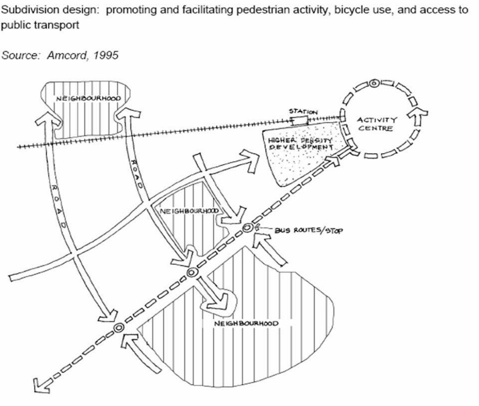
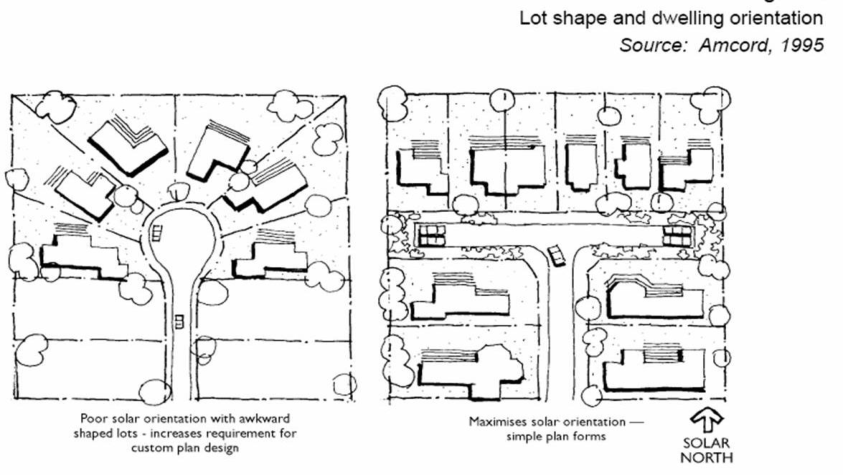
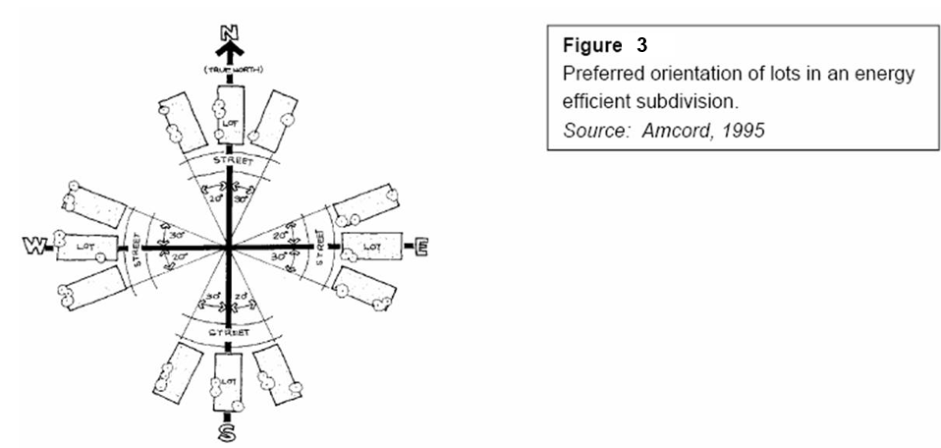
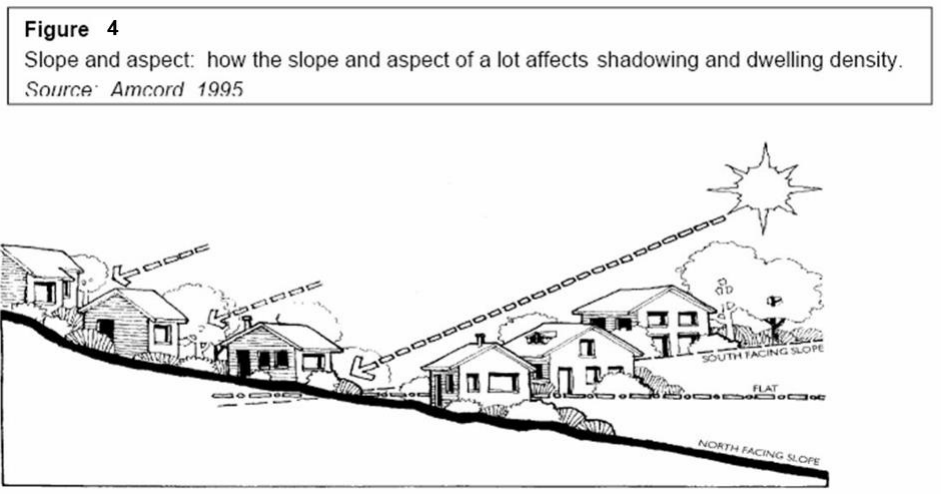
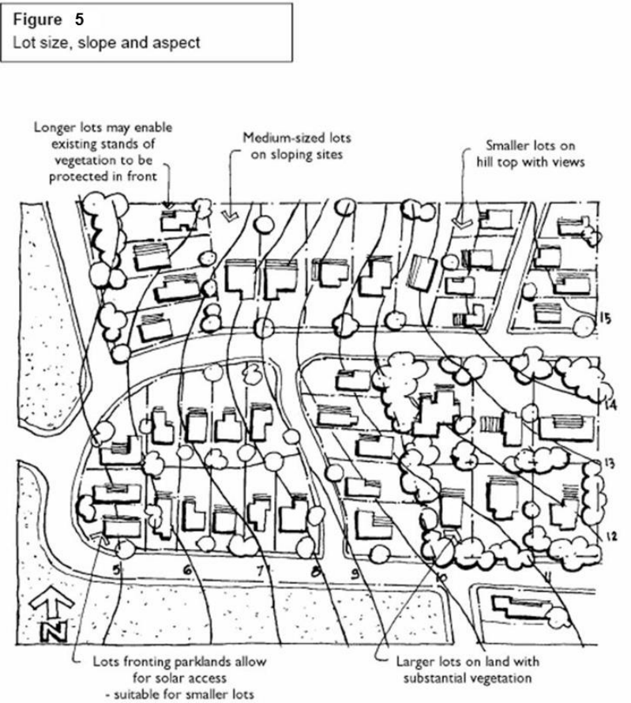
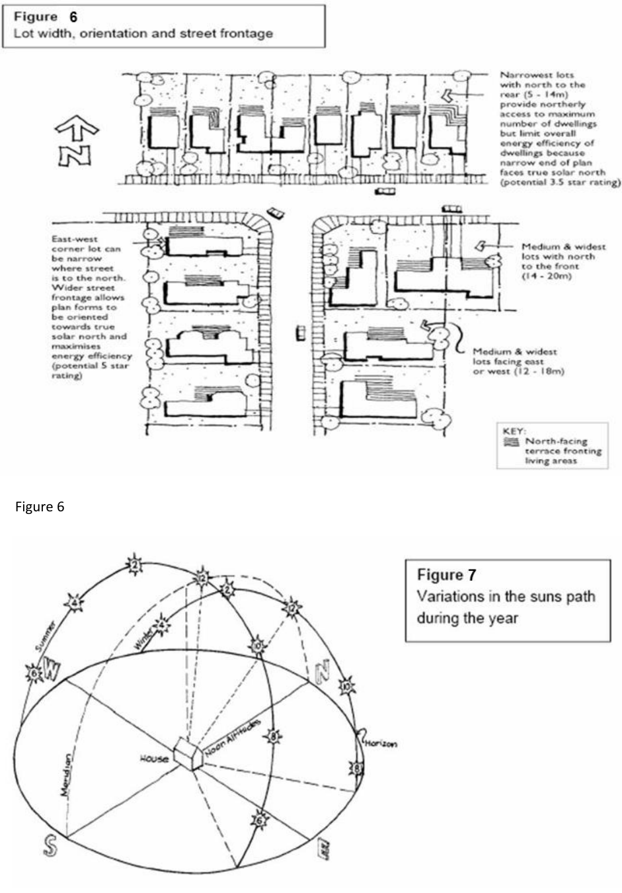
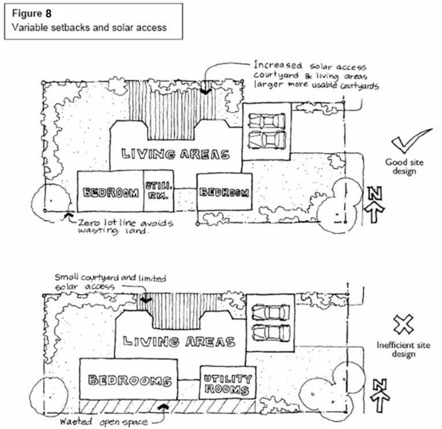

### 1.1 Subdivision Design

Background Principles

Subdivision design is about manipulating the key variables of aspect, shape and density in combination with site characteristics such as topography and slope to achieve an optimum mix of lot sizes and energy efficiencies. It shall also promote and facilitate pedestrian activity, bicycle use and access to public transport to minimise transport energy use (see Figure 1).

A solar-efficient subdivision will ensure that the overall development is significantly more energy efficient than conventional development because once the lots are correctly aligned and proportioned, individual houses in general will perform better with comparatively less effort.

A subdivision design shall maximise and protect solar access for each dwelling-house. This is achieved by defining the lot size, shape, orientation, the solar setback line and possibly a building height envelope, which together determine the ideal location of the northern wall of a dwelling-house and the true solar north-facing windows, for any given lot. Together, these factors ensure that dwelling-houses are located on lots such that reasonable solar access is achievable.

> [Picture on page 35: a picture, saved as a picture (images/part-d1-subdivision-guidelines-page-35-1.gif, 150 dpi).]

Figure 1

How to satisfy the submission requirements: Subdivision Design Intent

• To maximise the number of residential allotments which have good solar access and therefore which optimise the design performance of energy smart homes.

• To minimise reliance on private car use. Performance criteria: The intent can be achieved where:

• 80% of lots in a new subdivision have 5 star solar access, and the remainder either 4 or 3 star.

• Lot sizes reflect reasonable consideration of the impact of topography and aspect to maximise solar access.

• Lots are of a suitable shape to permit the location of a dwelling-house with suitable solar access and private open space (see Figure 2).

• Design and location of transport links and access facilitate pedestrian and cyclist activity, and the use of public transport.

> [Picture on page 36: a picture, saved as a picture (images/part-d1-subdivision-guidelines-page-36-1.gif, 150 dpi).]

Figure 2

Possible design solutions

This section suggests possible solutions to meet the performance criteria. Adoption of any one or range of suggestions will not necessarily achieve compliance but may contribute to orientation and topography suitability.

Lots should (ideally) be orientated so that one axis is within 300 east and 200 west of true solar north (see Figure 3).

North-facing slopes improve opportunities for solar access, with smaller lots best suited to north-facing slopes with gradients of less than 15% (less than 1:6). South-facing slopes impose a penalty on solar access and therefore larger lots / lowest densities are best suited to south-facing slopes (see Figure 4).

> [Picture on page 36: a picture, saved as a picture (images/part-d1-subdivision-guidelines-page-36-12.gif, 150 dpi).]

Figure 3

> [Picture on page 37: a picture, saved as a picture (images/part-d1-subdivision-guidelines-page-37-1.gif, 150 dpi).]

Figure 4

Lot size and shape

• Sloping sites are suitable for medium to large lots only (see Figure 5)

• Lots < 350m² are located on land with less than 10% (1:10) slope across the frontage.

• Lots > 450m² are capable of containing a building platform rectangle measuring 10 metres x 15 metres (see Figure 5).

• Lots 300m² to 450m² are capable of holding a building platform of 9.0 metres x 15 metres where the major axis of the block is between 300 east and 200 west of true solar north.

• Lots of <300m2 approximate square or rectangular shapes.

• Where lots do not comply with orientation, a building platform 9.0 metres x 15 metres is available with the orientation within 30° east and 20° west of true solar north.

> [Picture on page 38: a picture, saved as a picture (images/part-d1-subdivision-guidelines-page-38-1.gif, 150 dpi).]

Figure 5

Access

• Footpaths are designed to access public transport routes.

• Subdivision design includes: clearly marked bicycle network; marked kerbside bike lanes; dedicated cycleways; and links to regional cycleways.

• Pedestrian and cyclist routes shall be designed in accordance with Crime Prevention through Environmental Design (CPTED) guidelines.

Setbacks

• Variable setbacks and zero lot lines are a means of maximising solar opportunity, especially with small or narrow lots. Setbacks are manipulated to maximise solar access for all lots (see Figure 6,  Figure 7 & Figure 8).

> [Picture on page 39: a picture, saved as a picture (images/part-d1-subdivision-guidelines-page-39-1.gif, 150 dpi).]

Figure 6

Figure 7

> [Picture on page 40: a picture, saved as a picture (images/part-d1-subdivision-guidelines-page-40-1.gif, 150 dpi).]

Figure 8
