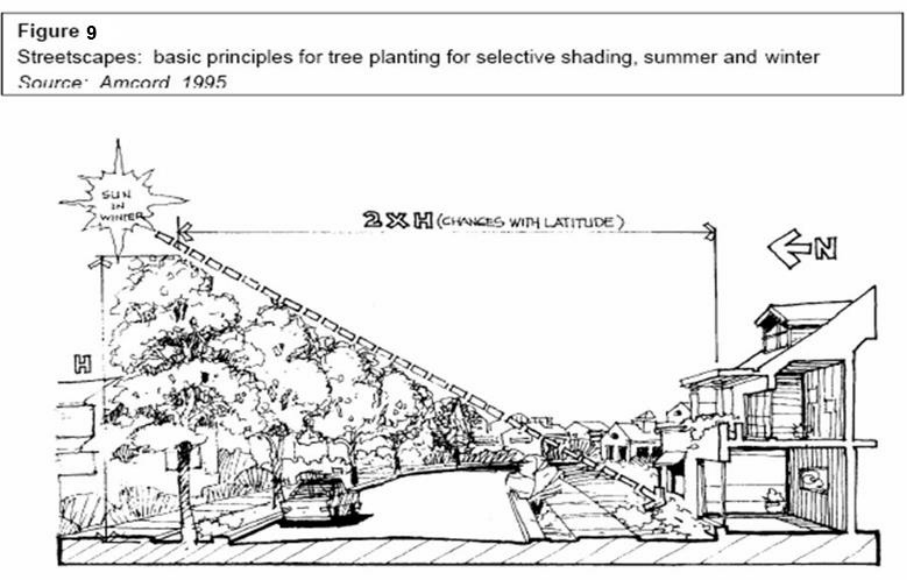

### 1.2 Urban Design and Landscaping

Background Principles

Streets and public spaces in a subdivision can be designed to contribute to solar efficiency, chiefly through the selection and location of trees.

In temperate climates such as most parts of New South Wales, deciduous trees can make the greatest shade in summer and allow sunlight to penetrate in winter.

Where evergreen indigenous trees would create unwanted shadows, deciduous trees will contribute towards pedestrian comfort, and avoid overshadowing. Trees can also be used as wind breaks, and many evergreen species are ideal for this purpose provided that the potential conflicts between evergreen species and solar access are properly managed.

Note: There are potential conflicts between the principles of Environmentally Sensitive Design (ESD), biodiversity and the use of non- indigenous deciduous trees which also require managing of leaf drop issues.

How to satisfy the submission requirements: Urban Design and landscaping Intent

• To ensure that streetscape components do not detrimentally affect solar access to individual dwelling-houses. Performance criteria: The intent can be achieved where:

• Street tree species are selected to provide summer shading while not impeding solar access to dwelling-houses in winter.

• Trees are planted or retained so as not to impede solar access to dwelling-houses (Figure 9).

• Streetscapes contribute as winter windbreaks.

> [Picture on page 41: a picture, saved as a picture (images/part-d1-subdivision-guidelines-page-41-9.gif, 150 dpi).]

Figure 9

Possible Design Solutions

This section suggests possible solutions to meet the performance criteria. Adoption of any one or range of suggestions will not necessarily achieve compliance, but may contribute.

• Select deciduous trees for solar efficiency where shadows may impact on housing.

• Plant taller tree species on the northern side of east-west aligned streets and shorter species on the southern side.

• Select plantings with low maintenance and low water consumption. (Consider leaf drop as a maintenance item from an ESD point-of-view).

• Retain existing vegetation in the master plan to minimise solar obstruction to dwelling-houses.

• Select evergreen species for windbreaks and plant them along the southern or western side of the area being protected against the wind.

• Ideally, select indigenous species that preserve the solar access of adjoining properties.

Schedule 3: Greta (Illalong), Mulbring (South) & Abermain (North)
