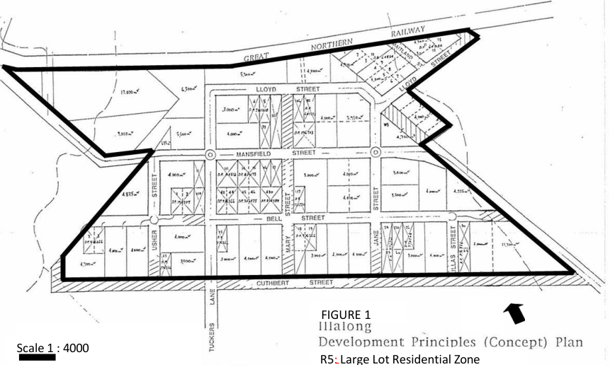
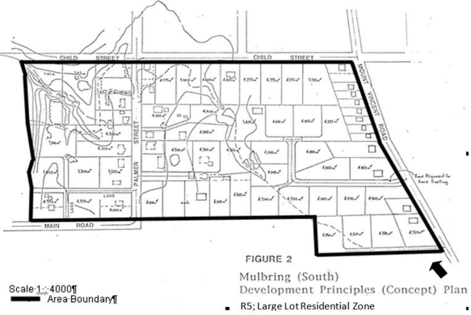
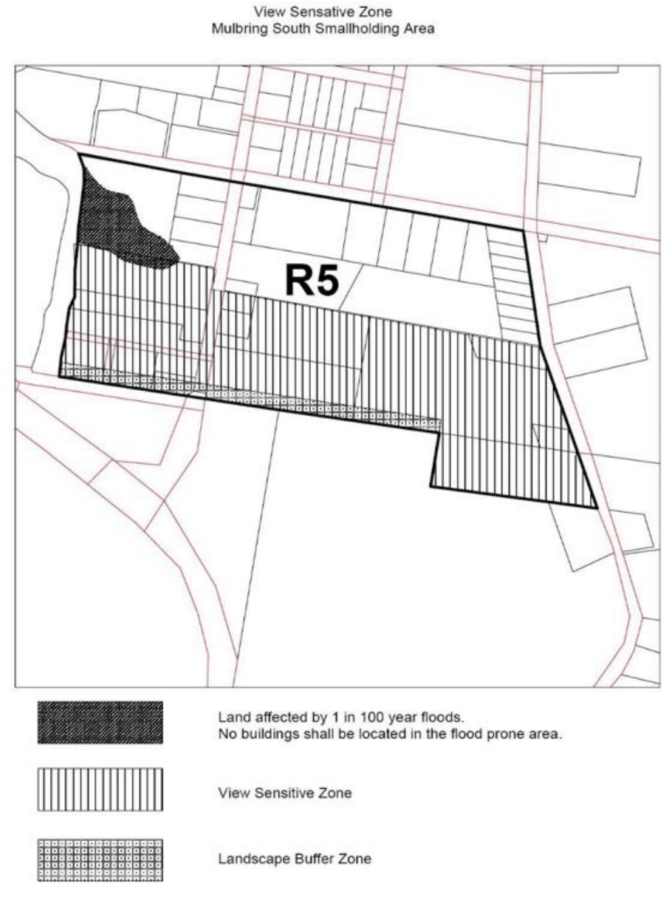
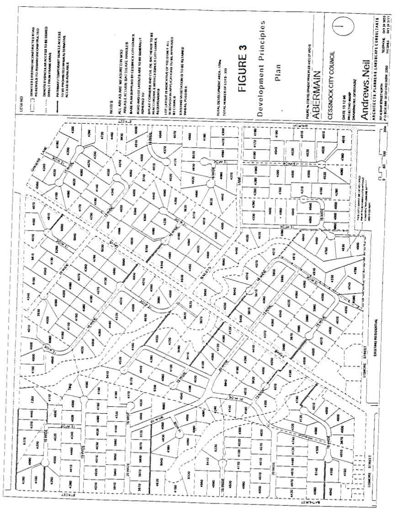

## 2. Siting of Buildings

#### Views

Planning Principles:

a) development shall retain distant, local and internal views; and

b) dwelling houses shall be screened from the noise and visual intrusion of main roads. General Standards:

Development shall be sited to enhance rural outlooks by:

a) siting buildings to maximise distant and local rural views from both indoor and outdoor living areas; and

b) siting buildings to limit views into adjoining lots or adjoining unattractive or restricted views.

> [Picture on page 44: a picture, saved as a picture (images/part-d1-subdivision-guidelines-page-44-12.gif, 150 dpi).]
> Words printed on the picture (title and legend, copied from the PDF):
> FIGURE 1
> Scale 1 : 4000
> Scale 1 : 4000
> Scale 1 : 4000
> R5: Large Lot Residential Zone

Area Area Boundary

Area Boundary

Figure 1

#### Slope

The land in Figure 1 is classified as having a 1%-5% slope in the Land Resources Study of the City of Greater Cessnock (Hunt, 1982). The major portion is categorised as footslope (B3) with a minor area of drainage plain (B5) in the south-east along the creek line. The land does not have a significant mass movement hazard. It has no significant limitations to residential development.

Schedule 3: Greta (Illalong), Mulbring (South) & Abermain (North)

#### Soil

The land in Figure 1 is classified as being composed of Greta Red Podzolic soil (RPga). This soil type is of low to moderate erosion hazard and has no significant limitations to residential development.

Most of the land is defined as having moderate sheet erosion of 10% to 20% of bare ground (Class 22). Along the creek line in the south-east portion of the subject land, there is minor gully erosion of less than 1.5 metres in depth (Class 51). Consequently, in some locations erosion and sediment control measures will be necessary.

> [Picture on page 45: a picture, saved as a picture (images/part-d1-subdivision-guidelines-page-45-9.gif, 150 dpi).]

Figure 2

#### Slope

The land in Figure 2 ranges in slope from 0% - 1% floodplain (A4) to 10% - 15% sideslope (D2). The major part of the land has a 1% - 5% sideslope (B1) in the Land Resources Study of the City of Greater Cessnock (Hunt, 1982). The land does not have a significant mass movement hazard.

#### Soil

The major part of the land in Figure 2 is classified as being composed of Fairhill yellow Podzolic soil (YPfl) which has a moderate to extreme erosion hazard. There is a small amount of Wallis Creek Yellow Podzolic Soil (YPwk) to the south of the subject area. This soil has a low erosion hazard.

Most of the land has minor gully erosion of less than 1.5 metres depth (Class 51) and moderate streambank erosion along Wallis Creek (Class 64). Thus, some locations will require sediment and erosion control measures.

Schedule 3: Greta (Illalong), Mulbring (South) & Abermain (North)

> [Picture on page 46: a picture, saved as a picture (images/part-d1-subdivision-guidelines-page-46-2.gif, 150 dpi).]

Schedule 3: Greta (Illalong), Mulbring (South) & Abermain (North)

#### Planning Principles: Views

Specific Controls:

a) Development envelopes shall be sited on proposed lots in the View Sensitive Zone (Figure 3) to enhance rural outlooks and to limit the visual intrusion of Main Road 220.

b) A landscape buffer shall be planted on lots closest to Main Road 220 in the location shown. This landscape buffer is to screen the house from the road and the road from the house. It is also intended to promote the rural atmosphere of the area by maintaining and enhancing rural outlooks from within these properties.

c) Selected trees shall be tall growth and long-lived (over 60 years). Those nearest the Main Road need to be tolerant of pollution and require little maintenance by being mechanically strong and insect and disease resistant.

d) The selected trees should preferably be native in origin to enhance the rural character of the area.

Schedule 3: Greta (Illalong), Mulbring (South) & Abermain (North)

> [Picture on page 48: a picture, saved as a picture (images/part-d1-subdivision-guidelines-page-48-2.gif, 150 dpi).]

Figure 3

#### Slope

The land in Figure 3 (ABERMAIN (NORTH)) is classified as having a 1%-5% slope in the Land Resources Study of the City of Greater Cessnock (Hunt, 1982). The majority of the land is in the category of sideslope (B2) as defined by Emery 1981. A very limited area along Deep Creek is classified as floodplain (B4) or drainage (B5). The land does not have a significant mass movement hazard.

Schedule 3: Greta (Illalong), Mulbring (South) & Abermain (North)

#### Soil

The land in Figure 3 is classified as being composed of Kutlung Yellow Podzolic soil (Ypkg). This soil can have a low to extreme erosion hazard. Soils are generally shallow and stony and can have poor drainage properties.

The land to the west of Deep Creek is categorised as having minor gully erosion of less than 1.5 metres deep (Class 51). The land to the east of Deep Creek is categorised as having minor sheet erosion of 1% to 10% of bare ground (Class 21). The creek itself has minor streambank erosion (Class 54) or minor rill erosion (Class 41). Consequently, residential development on the land in Figure 3 may cause some erosion problems. Therefore, soil erosion or sedimentation measures will be necessary.

Schedule 4 - Sawyers Gully, Rothbury & North Rothbury and

### Mulbring (North)

This schedule applies to land zoned R5: Large Lot Residential under the Cessnock Local Environmental Plan at Sawyers Gully (Figure 1), Rothbury & North Rothbury (Figure 2) and Mulbring (North) (Figure 3).
