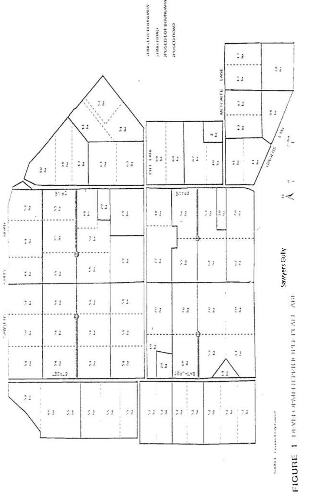
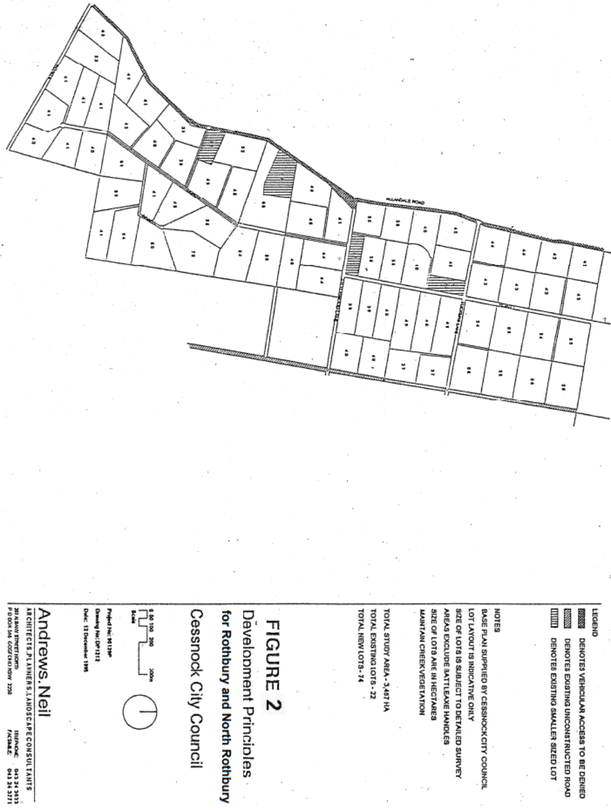
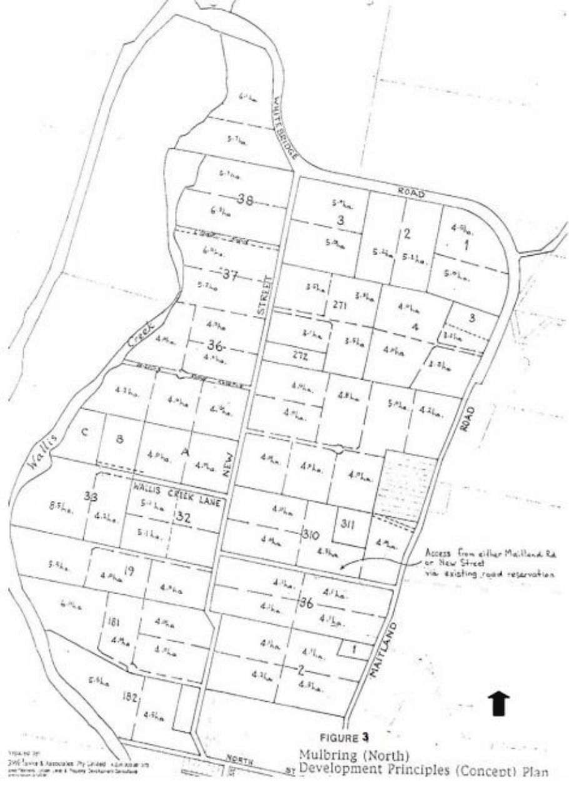

## 3. Flooding (Mulbring North)

The Wallis Creek catchment is excessive and begins in the Sugarloaf Range to the south, Heaton State Forest to the east and Brokenback Range to the west. The size and nature of this catchment has resulted in substantial flooding along Wallis Creek and its tributaries in the past.

Specific controls

Applicants proposing the subdivision of land likely to be affected by flooding of Wallis Creek are required to undertake investigations to determine the extent of flood affectation. Investigations shall be carried out by a suitably qualified professional. The study shall identify the 1 in 100 year flood line below which building construction will be prohibited.

All development / building envelopes and dwelling house sites are to be outside of the flood affected areas. Identified 1 in 100 flood lines are to be placed on the plan of subdivision and a Section 88B restriction ‘as to user’ created to prohibit buildings within the flood affected area.

> [Picture on page 53: a picture, saved as a picture (images/part-d1-subdivision-guidelines-page-53-4.gif, 150 dpi).]
> Words printed on the picture (title and legend, copied from the PDF):
> Sawyers Gully

Figure 1

Sawyers Gully 1(C2) area (land within Figure 1) is generally undulating to flat with slope varying between 1-10%.

#### Slope

Substantial watercourses drain the majority of the area. The northern most part of the area drains north-west to an unnamed creek. The north-eastern and eastern sections of the land drains to Black Waterholes Creek. While the southern section drains to Deep Creek. The site is within the Swamp Creek Catchment and flows from this area will directly influence water quality within this Creek system. Significant sections of watercourses contain established stands of vegetation along banks which provide habitat for fauna, provide corridors for fauna movement and play an important role in soil (creek bank) stabilization.

#### Soils

At a broad scale the area is composed of land having two soil types. The northern three quarters of the site contains brown Podzolic soils and the southernmost on quarter Yellow Podzolics. The following table shows the typical soil characteristics and limitations of the two dominant soil types.

| Mapping Soil Unit | Erosion Hazard | Mass Movement Hazard | Limitations to Urban Development | Limitations to Rural Development | Other Features |
|---|---|---|---|---|---|
| Kuttung Yellow Podzolic Soils (Ypkg) | Low to extreme Mostly high to very high. | Areas of mass movement occur within this unit associated with slopes > 20% | Mass movement shallow soils, some poorly drained areas, erodibility. | Low inherent fertility, shallow stony soils, erodibility. | Acid poorly structured topsoil, often shallow and stony, variable permeability |
| Bishops Bridge Brown Podzolic Soils (BPbe). | High at surface and low in subsoil | Not significant | Erodibility. | Low fertility, erodible surface soils | Low permeability, low fertility, acid, poorly structured topsoil. |

> [Picture on page 55: a picture, saved as a picture (images/part-d1-subdivision-guidelines-page-55-1.gif, 150 dpi).]

#### Slope

The North Rothbury South area is generally undulating to flat with slope varying between 1- 10%. Mid-slope areas contain grades between 1-15% with some central east parts and north east parts of the site having slopes between 20o and 30o.

The whole site drains via several water courses into Black creek and flows from this area directly influence water quality within this Creek system which has known water quality problems. Significant sections of watercourses contain established stands of vegetation along banks which provide habitat for fauna, provide corridors for fauna movement and play an important role in soil (creek bank) stabilisation.

#### Soils

Rothbury & North Rothbury

At a broad scale the area is composed to land having two soil types. The area contains predominantly Rosebrook Brown Podzolic soils with a small area in the north eastern corner of the zone consisting of Rothbury Brown Podzolics. The following table shows the typical soil characteristics and limitations of the two dominant soil types.

| Mapping Soil Unit | Erosion Hazard | Mass Movement Hazard | Limitations to Urban Development | Limitations to Rural Development | Other Features |
|---|---|---|---|---|---|
| Rosebrook Brown Podzolic Soils (Bprk) | Erodibility very high at surface, low in subsoil. Hazard generally moderate to high depending on terrain | May be significant on slopes >30% | Strong textural contrast between soil horizons causes lateral flow of infiltrated water, erodibility | Low inherent fertility, erodible surface soils | Permeability low to moderate |
| Rothbury Brown Podzolic Soils (BprY) | Erodibility very high at surface, low in subsoil. Hazard generally moderate to high depending on terrain | May be significant on slopes >30% | Strong textural contrast between soil horizons causes lateral flow of infiltrated water, erodibility | Low inherent fertility, erodible surface soils | Permeability low |

> [Picture on page 57: a picture, saved as a picture (images/part-d1-subdivision-guidelines-page-57-1.gif, 150 dpi).]

Figure 3

#### Slope

The Mulbring (North) area (see Figure 3) is generally undulating to flat with slope varying between 1

– 10%. The south-western corner of the site (in particular), contain slopes in excess of 10%.

Substantial watercourses drain the majority of the area. The north-eastern corner of the area drains in a north-easterly direction to John Brown Lagoon. The remainder of the land drains into Wallis Creek. The site is within the Wallis Creek Catchment, and flows from this area directly influence water quality within this Creek system. Significant sections of watercourses contain established stands of vegetation along banks which provide habitat for fauna, provide corridors for fauna movement and play an important role in soil (creek bank) stabilisation.

#### Soils

Minor sheet and gully erosion exists across much of the area with moderate gully erosion evident along watercourses.

At a broad scale the area is composed of land having four soil types. The majority of the site east of New Street consists of Brunkerville Yellow Podzolic soils. On the western side of New Street much of the northern sector contains Kuttung Yellow Podzolic soils with the remaining southern area consisting of Fairhill Yellow Podzolics. Congewai Alluvial soils occur in a narrow band along Wallis Creek. The following table shows the typical soil characteristics and limitations of the four dominant soil types.

| Mapping Soil Unit | Erosion Hazard | Mass Movement Hazard | Limitations to Urban Development | Limitations to Rural Development | Other Features |
|---|---|---|---|---|---|
| Kuttung Yellow Podzolic Soils (Ypkg) | Low to extreme. Mostly high to very high | Areas of mass movement occur within the unity associated with slopes >20% | Mass movement shallow soils, some poorly drained areas erodibility | Low inherent fertility, shallow stony soils, erodibility | Acid poorly structured topsoil, often shallow and stony, variable permeability |
| Brunkerville Yellow Podzolic soils (Ypbe) | Low to moderate very high at surface, low in subsoil | Not significant | Poor drainage, erodibility | Low inherent fertility, erodibility of surface soil | Nil |
| Fairhill Yellow Podzolic soils (Ypfl) | Moderate to extreme, very high at surface | Areas of mass movement occur within this unit | Erodibility, mass movement | Low inherent fertility, erodibility of surface soil | Stony B horizon |
