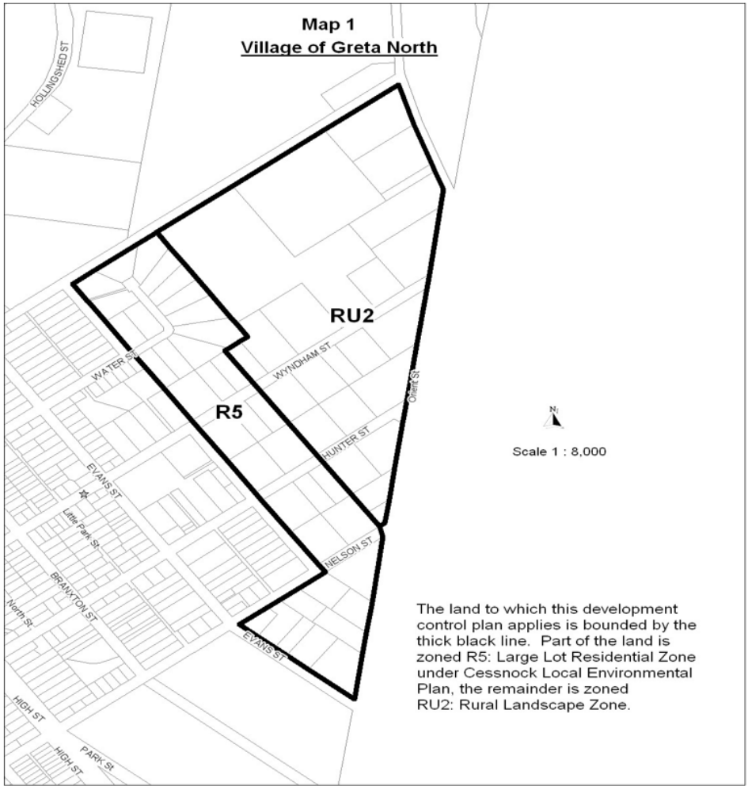

## 1. Subdivision Design

#### Lot Configuration

Planning Principles

The carrying out of development shall not create or increase ribbon development or adversely affect road safety. Development, particularly subdivision design, shall provide a mix of lot sizes where possible in order to avoid monotonous layouts and to provide a range of housing opportunities.

General Standards

(a) Varied sizes and dimensions of lots shall be designed, particularly in subdivisions creating more than 2 lots.

(b) New lots and vehicular access points shall be designed to ensure that the siting of dwelling houses (or other traffic generating development) does not create:

• multiple access points to a through road;

• the visual appearance of multiple buildings fronting a through road; and

• a hazard to traffic or pedestrian safety.

#### Access

Planning Principles

Road and accessways within the development site shall be sited and designed to be efficient and practical with regard to expected traffic volumes while maintaining the rural character and minimising any environmental impact.

Road Hierarchy

Greta (North) has no through roads. The road system is basically an extension of the grid pattern that forms the existing built-up area of Greta. Wyndham Street should be considered the primary distributor road as it is the central street of the area and the most trafficked.

General Standards

For subdivisions involving the construction of new roads or accessways, a concept plan shall be developed to illustrate a circulation system which:

(a) relates to the number of lots and expected number of dwelling houses to be serviced;

(b) minimises impact on the rural landscape and environment through clearing, civil engineering works, or disturbance to natural features;

(c) demonstrates that the role of any accessways are unambiguous in terms of the road hierarchy;

(d) employs construction specifications that are sympathetic to the natural site features;

(e) permits flood-free access to each lot; and

(f) permits pedestrian, equestrian and cycle access with minimal conflict with vehicles.

#### Connection to the Sewer System

The Hunter Water Corporation (HWC) requires developments in the vicinity of Orient Street to connect to a Corporation sewermain. Consult with the HWC in this regard.

> [Picture on page 60: a picture, saved as a picture (images/part-d1-subdivision-guidelines-page-60-4.gif, 150 dpi).]

Map 1

#### Slope

The land subject of this plan is undefined in the Land Resources Study of the City of Greater Cessnock (Hunt, 1982). Mass movement hazards are not significant.

#### Soils

Erosion and sediment control

The land the subject of this plan is classified as being composed of Greta Red Poszolic soil (RPga). This soil type is of low to moderate erosion hazard and has no significant limitations to residential development.

As with slopes, most of the subject land is undefined in terms of erosion hazard in the Land Resources Study of the City of Greater Cessnock (Hunt, 1982). However, a small pocket of minor sheet erosion, Class 21 (1% to 10%) of bare ground), is identified in the extreme north west of the area subject of this plan.

Consequently, individual assessment should be made as to the erosion hazards of specific properties.
