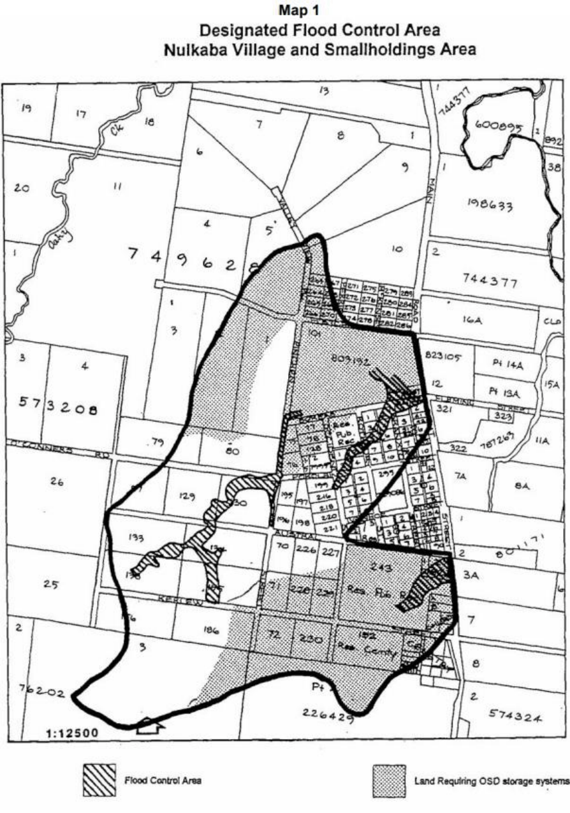
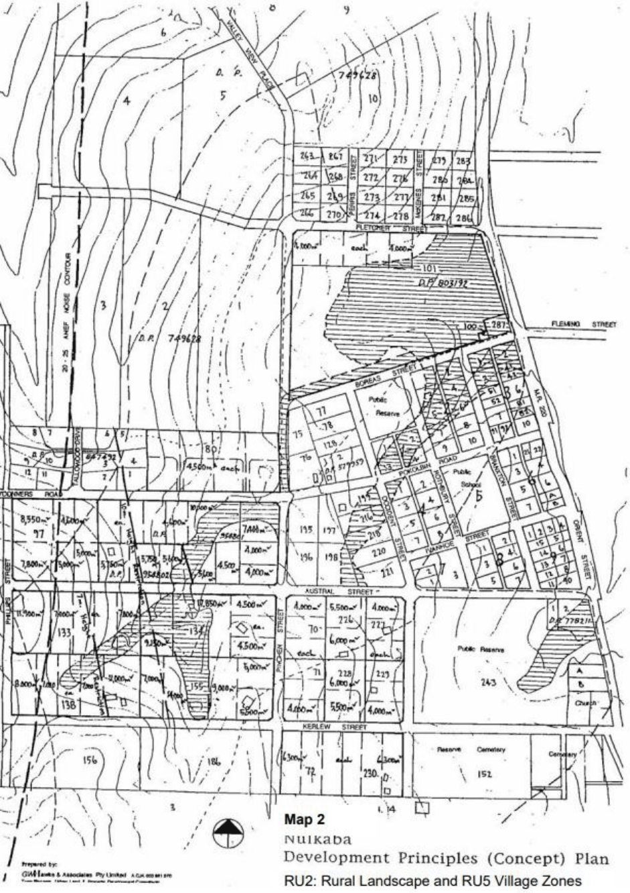
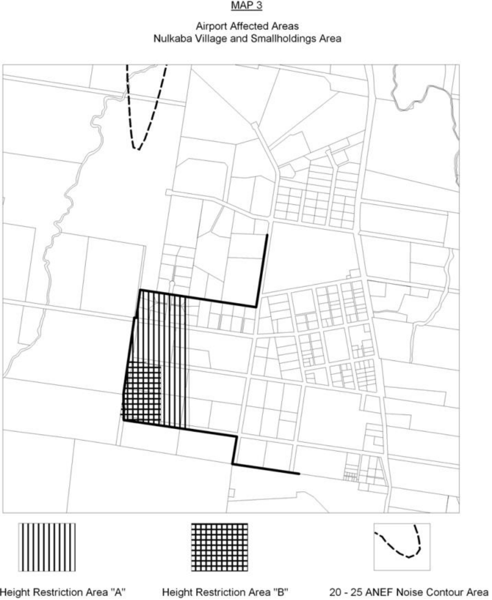

## 2. Special Considerations

#### Drainage and Flooding Issues

The Nulkaba Flood Study (Willing and Partners 1993) has indicated that, in the event of a 1 in 100 year flood, flood levels could be increased by 20mm to 50mm with the new development in the western and northern area of Nulkaba (see Map 1).

Planning Principles

Development should be carried out so as to make provision for the drainage corridors identified in the above study and minimise damage resulting from flood events.

General Standards

In the area designated on Map 1, on-site detention (OSD) storage systems shall be constructed to serve all new lots before any dwelling houses or impervious surface is constructed. OSD storage systems shall be designed so that existing flow rates are not exceeded. The applicant should consult Council's Works Department in regard to the design of the OSD storage system.

Affected Area

Map 1 shows the area subject to a 1 in 100 year flood and the specific controls outlined in this clause apply to the Nulkaba Village & Surrounding Area.

Specific Controls:

(a) in the Flood Control Area shown on Map 1 (hatched), no buildings or structures shall be permitted;

(b) the minimum floor level of habitable buildings (outside the hatched area) shall be at least 0.5 m above the relevant 1 in 100 year flood level contour;

(c) all subdivision applications shall show development / building envelopes. These shall be sited outside the flood prone area shown (hatched) on Map 1; and

(d) development applications shall be accompanied by a survey from a Registered Surveyor to determine the contours of the land at an interval of 0.5 metres and a vertical datum of Australian Height Datum.

#### Cessnock Airport - Height Limitations

The western portion of the land the subject of this plan is within the flight path for Cessnock Airport. Therefore, Clause 7.4 of the Cessnock Local Environmental Plan applies. This Clause relates to obtaining Council consent to construct buildings above the obstacle height limitation surface for the airport.

Planning Principles

No buildings or other structures shall be constructed that would constitute a hazard to aircraft.

Specific Controls:

(a) in the area marked ’A’ on Map 3, no building or structures over 10 metres high shall be permitted;

(b) in the area marked ‘B’ on Map 3, no building or structures over 7.0 metres high shall be permitted; and

(c) tall growth trees shall not be planted in flight path affected areas 'A’ or ’B’ shown on Map 3.

#### Cessnock Airport - Noise Constraints

Planning Principles

The extreme western portion of the area of this plan is on the border of the 20 ANEF (Australian Noise Exposure Forecast) noise contour (see Map 3). Locations over 25 ANEF are generally considered unsuitable for residential development. Locations between 20 and 25 ANEF are regarded as ‘conditionally acceptable’ in terms of residential development, depending on the level of interior noise. This is shown specifically in Map 3.

The rest of the area is below 20 ANEF. It may be concluded that residential development in the area not shaded is not adversely affected by aircraft noise.

General Standards

Interior noise levels in residential development shall conform to the Australian Standard Acoustics

- Aircraft Noise Intrusion - Building Siting and Construction, AS 2021 – 2015.

Specific Controls:

a) wherever possible, buildings should be sited away from the 20-25 ANEF affected area

b) Clause 7.4 of Cessnock Local Environmental Plan applies to all land within the 20-25 ANEF affected area. No building for the purposes of human habitation may be erected in the affected area unless interior noise levels comply with AS 2021.

c) for residential building and development in the 20-25 ANEF affected area, development applications (for subdivision or dwelling-houses, where lots are existing) shall be accompanied by a report from a qualified acoustical engineer. This report shall state the anticipated level of interior noise in normal domestic areas and in relaxing / sleeping areas of the dwelling-house.

Advice Section 3 of AS 2021 relates to building construction against aircraft noise intrusions. This section, together with the associated sound transmission data for building components, should be consulted when preparing a development application for land within the 20-25 ANEF contours.

> [Picture on page 66: a picture, saved as a picture (images/part-d1-subdivision-guidelines-page-66-1.gif, 150 dpi).]

Note: The land to which this schedule applies is bounded by the thick black.

Map 1

> [Picture on page 67: a picture, saved as a picture (images/part-d1-subdivision-guidelines-page-67-1.gif, 150 dpi).]

Map 2

#### Slope

The land the subject of this plan is classified as having a 1% - 5% slope and being in the category of sideslope (B2) as classified in the Land Resources Study of the City of Greater Cessnock (Hunt 1982). The land does no have a significant mass movement hazard. It has no significant limitations to residential development.

#### Soil: Erosion and Sediment Control Soils

The land the subject of this plan is classified as being composed of Cessnock Lateritic Podzolic soil (LPck). This soil type is of low erosion hazard. The undeveloped land the subject of this plan is classified as being susceptible to minor sheet erosion (Class 21). Consequently, the land has no significant limitations to residential development in terms of erosion or sedimentation issues.

> [Picture on page 69: a picture, saved as a picture (images/part-d1-subdivision-guidelines-page-69-1.gif, 150 dpi).]

Map 3
