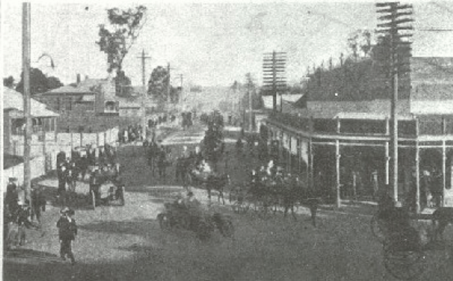
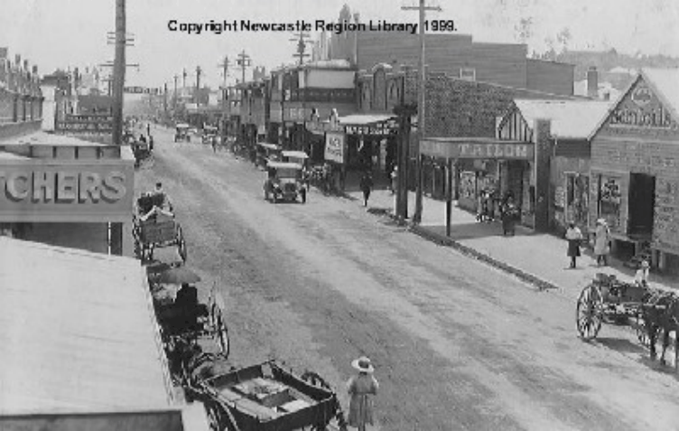
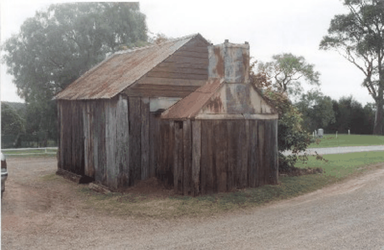
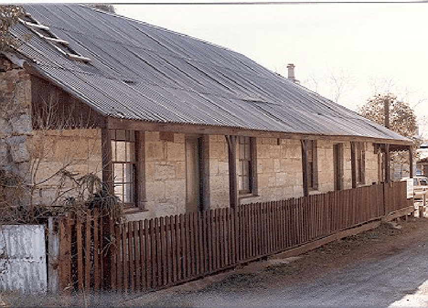
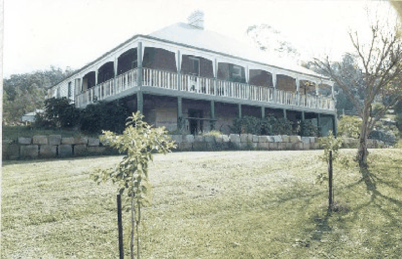
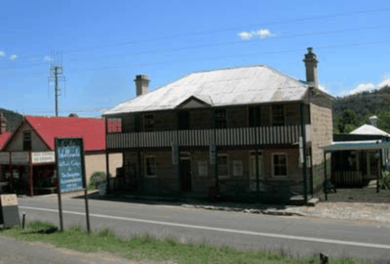
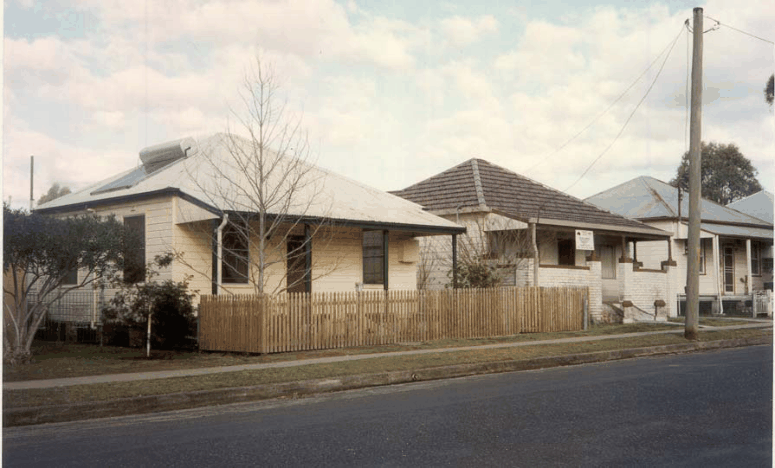
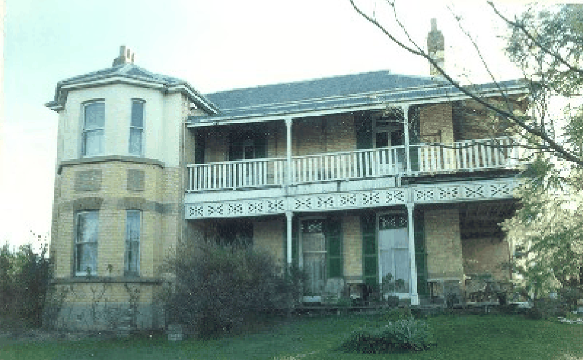
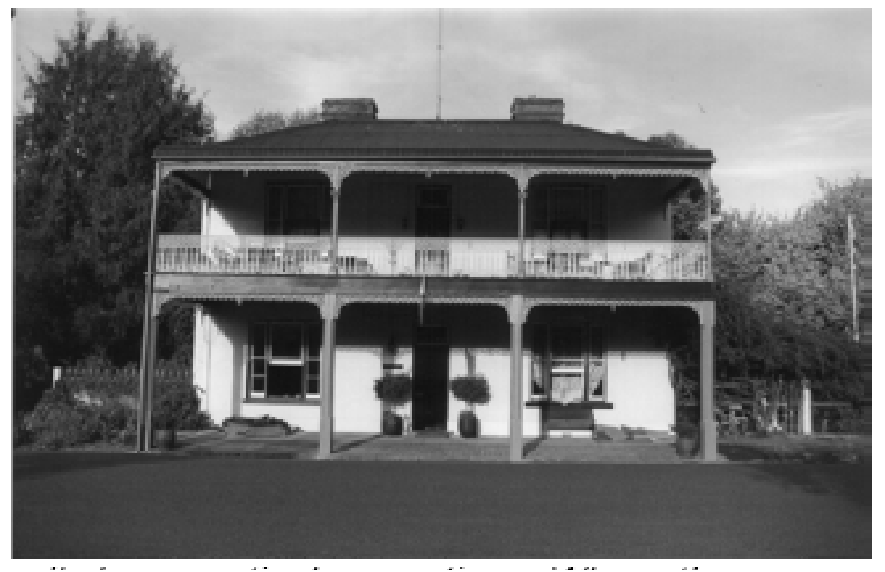
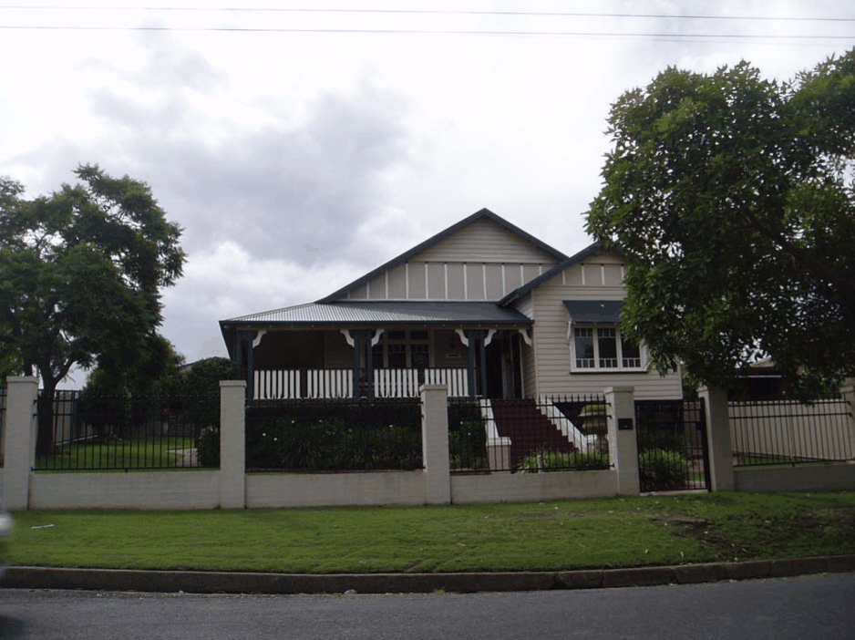

### 12.2 BACKGROUND

#### 12.2.1 European Settlement in Cessnock

The built environment of Cessnock, renowned for its historical character and value, began to grow in the early 1800’s.

> [Picture on page 2: a picture, saved as a picture (images/part-d12-heritage-conservation-and-design-guidelines-page-2-5.gif, 150 dpi).]

> [Picture on page 2: a picture, saved as a picture (images/part-d12-heritage-conservation-and-design-guidelines-page-2-6.gif, 150 dpi).]

#### 12.2.2 Heritage Items and Conservation Areas

Retaining heritage items enables the community to experience in perpetuity the pleasures and interest they offer. Once lost, they are gone forever.  No record or photograph can ever substitute for an actual place.

Before deciding how to care for a heritage building, group of buildings or area, it is important to understand what makes it special.

The conservation areas of Wollombi and the Great North Road have their own unique characteristics. The collective existence of buildings, individual heritage items, trees, open spaces, views and landmarks, and smaller details such as sandstone kerb and gutters all contribute to our appreciation of the area’s historic value.

The loss or damage of any one attribute will erode the special character of the Conservation Area as a whole. On-going care and maintenance of all elements in these conservation areas is considered to be an essential part of achieving their conservation.

The whole community has a role to play to ensure that individual buildings, gardens, and public areas are maintained, and not left to decay.

The large range of building types and styles spanning Cessnock’s history provide an excellent source of studying building techniques and history

The following information describes some of the building types found throughout Cessnock dating from the 1820’s through to the 20th century.

New buildings should not try to mimic or replicate these buildings styles, as this can detract from the authentic value of original buildings which create the areas of interest we enjoy today, and tends to confuse the old with the new.

#### Slab Houses 1820’s – 1850’s

Slab houses are now very rare throughout NSW making those which remain in the Cessnock LGA of great value and worthy of retention. Often, the slab buildings are only recognisable on careful inspection.

The typical slab house was constructed from vertical boards set in a base plate with rough hewn logs for rafters and roofed in shingles. These buildings ranged from two roomed cottages to larger dwellings of four rooms and buildings of two or three cottages joined

> [Picture on page 3: a picture, saved as a picture (images/part-d12-heritage-conservation-and-design-guidelines-page-3-25.gif, 150 dpi).]

together.

Slab building at Ashman’s Winery & Vineyard, Broke Road, Pokolbin, c.1858.

To weatherproof the building, narrow tin strips were placed over the joints and later horizontal weatherboards were added. On the inside, slabs were often lined with successive layers of calico, plaster and then wallpaper.

Some of the slab houses might have originally had simple shutters over window openings. Most houses would have originally had ledge and brace doors but these have mostly been replaced by four or six panelled doors.

#### Small Brick and Stucco or Timber Cottages 1830’s – 1850’s

These cottages are recognisable by their low ceilings, simple fenestration and proximity to the street.

They are characterised by a hip or gable roof, central six panel door and twelve pane windows on either side of the doorway. Many of the cottages were built without verandahs, although many now have them.

Despite modernisation such as additions to incorporate kitchens and bathrooms within the house, many of these early cottages retain their shape and form. In many instances, the cottage had a second part similar in size and shape at the rear.

Originally some of the cottages would have been whitewashed, or plain brick, but extra weatherproofing was added particularly due to flooding, so that most masonry cottages now have a cement render finish.

> [Picture on page 4: a picture, saved as a picture (images/part-d12-heritage-conservation-and-design-guidelines-page-4-19.gif, 150 dpi).]

The construction method used for the cottage is of scientific interest as it is an example of a cheap house erected during the early development of a rural New South Wales town during the 1830’s. It is known as Caroline Chisholm Cottage, No.3 Mill Street, East Maitland.

#### Early Georgian Two-Storey Buildings 1830’s – 1850’s

A number of substantial fine two-storey buildings dating from this period can be found in the Cessnock LGA.

They are characterised by a symmetrical elevation including a central door, and 12 pane windows either side and to the upper floor.

Where verandahs were used they were narrow cantilevered type to the upper floor, or narrow two storey type on simple turned timber columns.

> [Picture on page 5: a picture, saved as a picture (images/part-d12-heritage-conservation-and-design-guidelines-page-5-8.gif, 150 dpi).]

Victorian Georgian house built in 1841 by convict labour, with the verandah added in 1927.

#### Two-Storey Brick Houses 1850’s – 1860’s

Two-storey brick houses were usually built by local merchants and business people. They had hipped roofs with shingles, flat iron or occasionally slates, six panel doors, twelve pane windows and / or french doors.

A two-storey verandah at the front of the house was generally supported by simple tapered timber columns, often with cast iron columns on the first floor verandah.

There was generally a servant’s wing at the rear, separate kitchen and outbuildings including stables.

The houses were generally built on large allotments and set well back from the road. Some houses have been stuccoed, or painted at a later date. Most of the front facades have fine tuck pointed brickwork in flemish bond.

> [Picture on page 6: a picture, saved as a picture (images/part-d12-heritage-conservation-and-design-guidelines-page-6-1.gif, 150 dpi).]

Victorian Georgian building built by the local licensee (John Kenny) and used for various purposes over the years, c.1850’s.

#### Single-Storey Victorian Houses Late 1870’s – 1880’s

This type of house is the most common surviving in Cessnock. It is single-storey with hipped roof, central four panel door with sidelights and one or two pane windows on either side which frequently had wooden shutters.

The front verandah is supported by cast iron columns with capitals, cast iron brackets and cast iron trim. The cast iron detail is the most notable characteristic of this building type, with three patterns predominating in Maitland, one of which was designed by local architect J.W.

> [Picture on page 6: a picture, saved as a picture (images/part-d12-heritage-conservation-and-design-guidelines-page-6-11.gif, 150 dpi).]

Pender.

Single-storey Victorian House

These houses were built of either brick or timber and set on medium sized allotments. The brickwork was generally unpainted and unrendered, and sometimes had tuck pointing.

Steps leading to the front door were rendered and moulded, most houses being elevated half a metre from the ground level.

#### Two-Storey Victorian Houses 1880’s – 1905

The details of two-storey houses from this period were similar to those of the single-storey, and were built in either brick or weatherboard.

The two-storey house generally had a projecting bay at one side of the front. Later versions had a verandah continuing around the corner, and the projecting bay was balanced by a similar projecting bay around the side.

#### High Victorian non-residential buildings to the 1890’s

This period is principally marked by the Victorian love of decoration and is best shown in the development of the parapet and the verandah.

The verandah over the footpath became universally adopted with shops on the ground floor and residences over. The parapet was the most important design element becoming a major streetscape feature.

> [Picture on page 7: a picture, saved as a picture (images/part-d12-heritage-conservation-and-design-guidelines-page-7-17.gif, 150 dpi).]

‘Dunoon’ two-storey Victorian House, Buchanan Road, Buchanan, built in 1883.

#### Two-Storey Single Fronted House 1880’s – 1900’s

The two-storey single fronted house with full height verandah / balcony built in brick or timber is a special feature of Cessnock.

It is distinct from other areas in NSW in that it occurs in greater numbers and in groups. The popularity of this house type in the late 19th century was probably due to the occurrence of flooding and availability of timber.

It can be seen with a variety of different styles of detailing from the Victorian to Federation periods.

> [Picture on page 8: a picture, saved as a picture (images/part-d12-heritage-conservation-and-design-guidelines-page-8-9.gif, 150 dpi).]

#### Federation Style House Late 1890’s – 1900

Federation style houses in the Cessnock area are generally single-storey bungalow forms.

They are characterised by an asymmetrical form with fairly complicated roofs including dormer and gable elements. Terracotta tiles or corrugated iron painted tile red was a common roof treatment. The use of red brown tuck pointed brick was common for external walls. Most houses had a verandah, often on two sides. Walls were rarely square with bay windows common, leadlight windows were also popular.

Timber detailing tended to replace the cast iron decoration of previous styles. Full length turned timber verandah posts with timber balustrades, brackets or valance were popular.

Common landscape features included timber picket fences, tiled or brick pathways and brick edged gardens.

#### Modern Brick Bungalow 1930’s – 1940’s

Buildings of this period often replaced houses of an earlier date. They were usually triple fronted, with Marseille tiled roof. Gable ends were often a combination of timber shingles, white painted asbestos cement and wide timber battens.

Verandah columns often sat paired on squat masonry columns with brick balustrading and rendered capping and base moulding.  Diamond patterned leadlights were sometimes used on front windows.

> [Picture on page 9: a picture, saved as a picture (images/part-d12-heritage-conservation-and-design-guidelines-page-9-8.gif, 150 dpi).]
