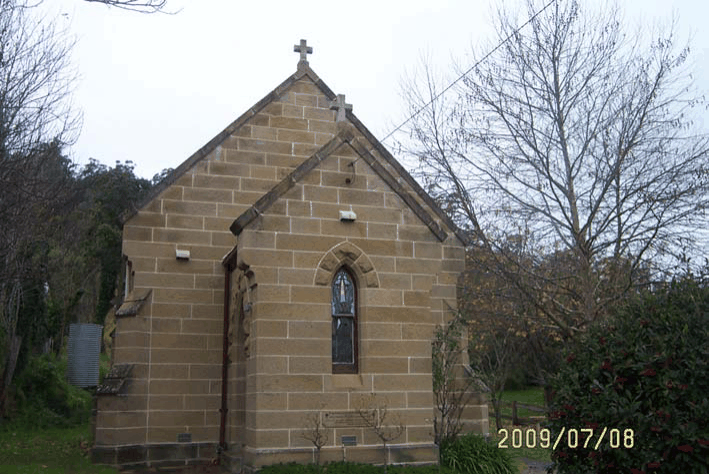

### 12.3 GENERAL CONSERVATION GUIDELINES

The following guidelines apply to projects which involve work to conserve an existing heritage item.

#### 12.3.1 Research

A key principle in heritage conservation is the need to understand the heritage importance or significance of an item before making decisions about how to manage it. A major part of understanding what makes an item special is to understand its history: why it was built; how it was used; and how it has changed.

Documentary research can reveal useful information including old photographs and early records such as title deeds to indicate successive owners.

Other types of documentary research might involve searching collections of libraries, sourcing maps and plans, photographic and picture collections or books and articles.

This information can be found at the Land Titles Office (Department of Lands), libraries – including Cessnock Library and the Mitchell Library in Sydney, Local Council records, local museums and possibly galleries. Former owners of the building may also be of assistance.

Establishing the construction date of early buildings is difficult, as there is often little documentary evidence. It is usually necessary, therefore, to rely on observation of the building style, and research of land titles in the Land Titles Office which provide a sequence of owner names and dealings.

#### 12.3.2 Getting to know the Building

A close examination of the fabric will usually be very important. The ‘fabric’ of a building or place refers to the physical material of which it is comprised.

Careful inspection can reveal evidence of original detailing. Painting might reveal the shape of a former iron roof over a verandah, nail holes on verandah posts might show the former location of brackets.

Systematic inspection of the fabric, informed by a knowledge of the history of the place, will help to understand its significance. A conservation specialist may be required to evaluate whether the building is significant and to identify the most significant elements.

Looking at other similar buildings in the locality can also indicate how missing parts of a building may have appeared, or how things were done.

When you have determined what is significant about a place, this information should help to guide maintenance, repair and conservation work. Wherever possible, original features, materials and finishes should be retained.

#### 12.3.3 Sound Advice

It is advisable, and often necessary to obtain professional advice from experienced people such as heritage architects when working on a major project.

Where there is considerable expenditure involved, it is important not to rely on guesswork which may lead to problems later on.

The Heritage Branch (in NSW Planning) maintains a list of Consultants who specialise in heritage work which can be obtained from Council.

#### 12.3.4 Keeping Records

When working on conserving or altering a place, it is important to make careful records of the state of the place before it is changed.

This will provide an accurate reference to how the repaired or new material should be constructed and / or appear. It will also provide good reference material for people who will look after the place in the future.

#### 12.3.5 Conservation Processes

Work on a heritage item or conservation area, can involve a variety of conservation processes as defined by the Burra Charter.

The Burra Charter establishes the nationally accepted standard for the conservation of places of cultural significance. The Charter advocates a cautionary approach to changing an item or area, doing as much work as necessary to repair, secure and to make it function, but as little as possible – so the history of the place can continue to be recognised in its physical presence.

The following are Burra Charter definitions of common conservation processes:

Restoration means returning the existing fabric of an item or area to a known earlier state by removing, adding on or re-assembling existing components without the introduction of new material.

Reconstruction involves introducing material to replace missing elements returning an item or area as nearly as possible to a known earlier state. Complete rebuilding on the same or another site is unacceptable except as an absolute last resort.

Adaptation means modifying an item or area to suit the existing use or proposed compatible

uses. A compatible use means a use which involves no change to the culturally significant fabric, or changes which require minimal impact.

Adaptation is acceptable where the conservation of the item or area cannot otherwise be achieved, and where the adaptation does not substantially detract from its cultural significance.

Preservation means maintaining the fabric of an item or area in its existing state and preventing deterioration.

Maintenance means the continuous protective care of the fabric and the setting of an item or area, and is to be distinguished from repair. Repair involves restoration or reconstruction.

#### Relocation

An item or work should remain in its historical location.  Moving a part or all of a building is unacceptable unless this is the sole means of ensuring its survival.

> [Picture on page 12: a picture, saved as a picture (images/part-d12-heritage-conservation-and-design-guidelines-page-12-1.gif, 150 dpi).]

Changes which remove building fabric or introduce new fabric should as far as possible be reversible in order that the earlier appearance may be recovered at a later date.
