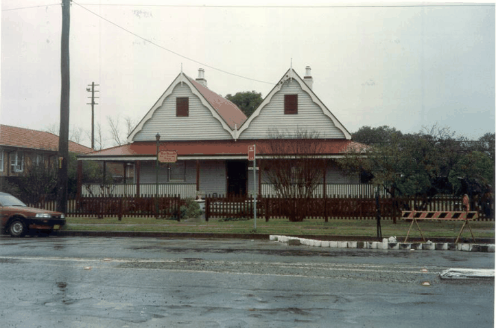
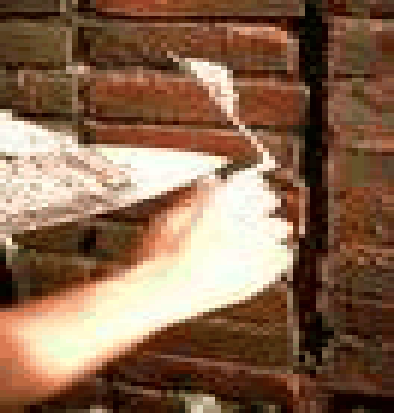
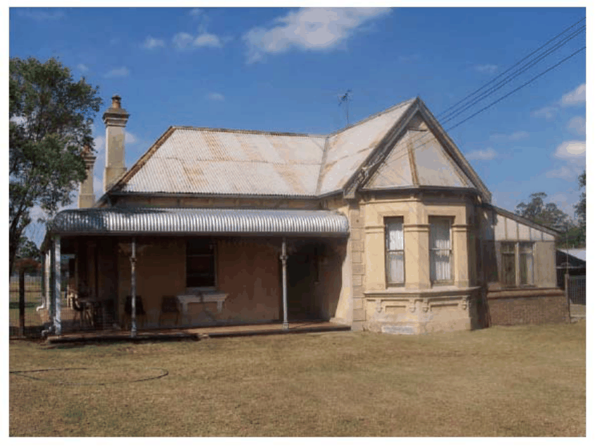
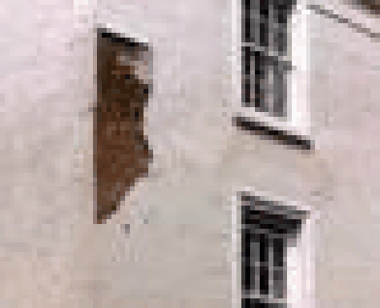
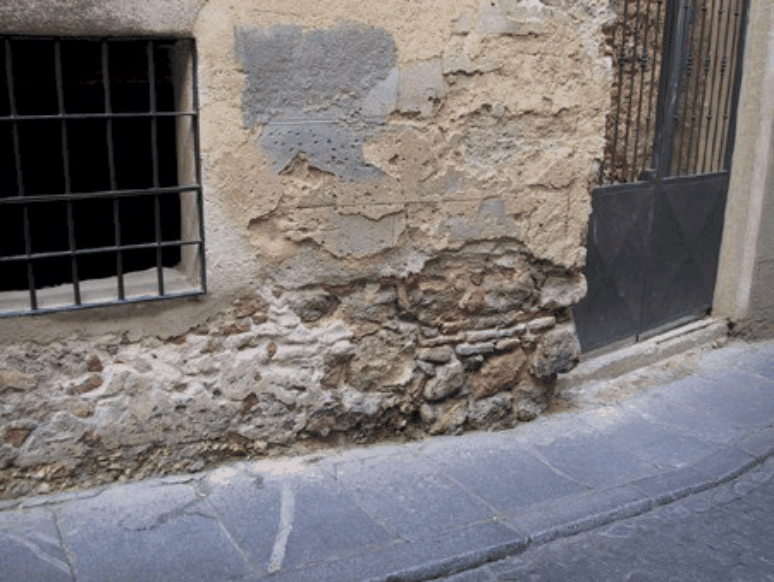

### 12.4 MAINTAINING OLD BUILDINGS

Old buildings benefit from routine maintenance. It should be remembered, however that old buildings have unique characteristics, and it is generally undesirable and sometimes very damaging to try and reverse the effects of age on materials.

While some maintenance can be undertaken by property owners, some types of work such as addressing damp problems or the repointing of masonry requires the expertise of trades people experienced in conservation work.

> [Picture on page 12: a picture, saved as a picture (images/part-d12-heritage-conservation-and-design-guidelines-page-12-11.gif, 150 dpi).]

> [Picture on page 13: a picture, saved as a picture (images/part-d12-heritage-conservation-and-design-guidelines-page-13-1.gif, 150 dpi).]

Regular maintenance is one of the most important parts of conservation work.

#### 12.4.1 Maintenance

Maintenance is one of the most important parts of conservation work. Regular maintenance shall be a regular part of any property management. This means that problems such as water penetration, termite infestation or vandalism do not get out of hand requiring substantial costs to repair.

#### 12.4.2 Repairing and Maintaining Roofs

• Roofs may contain a number of different elements including: sheeting or covering chimneys; cappings; roof vents; eaves; pediments; guttering; barge boards; and fascia boards.

• Original roof material shall be repaired rather than replaced wherever possible. However, if it is necessary to replace it, materials shall generally match in size, shape, colour and texture.

• Original chimneys, original cornices, eaves details, brackets and pediments shall be preserved as an important part of the composition of older buildings.

• When repairing or replacing corrugated iron roofing, small details shall be retained or matched to the original. Such details include, cutting of ridge and hip cappings to match the iron flutes which also make the roof more weatherproof.

• Traditional stepped flashings, roof vents, gutter moulds, and rainwater heads shall be preserved and restored wherever possible during re-roofing.

• Appropriate profiles for new guttering are important, such as ogee, half-round or quad styles.

• Round downpipes common until the early 20th century shall be used as appropriate.

• The retention of existing slate roofs will generally be required as this roof type is now rare in the area and complete replacement is likely to be very expensive. The repair of slate roofs will often require skilled tradespeople.

> [Picture on page 14: a picture, saved as a picture (images/part-d12-heritage-conservation-and-design-guidelines-page-14-1.gif, 150 dpi).]

An example of a Victorian brick cottage with galvanised iron roof and bull-nosed verandah roof.

#### 12.4.3 Repairing and Maintaining Rendered Walls

Render or stucco was often applied to external walls to protect them from the elements. This type of surface should not be removed, as softer porous bricks underneath the render will quickly deteriorate without their protective barrier.

External render was usually lime based, and was therefore absorbent.  Modern strong cement renders, however can cause dramatic decay. Once in the wall, moisture becomes trapped and underlying soft brick and stone can severely breakdown.

> [Picture on page 14: a picture, saved as a picture (images/part-d12-heritage-conservation-and-design-guidelines-page-14-10.gif, 150 dpi).]

Cement render and its attempted removal can cause major damage to brickwork. Cracked or damaged traditional render shall be repaired with a similar compatible render, not cemented and painted over.

#### 12.4.4 Repairing and Maintaining Face Brick or Stonework

Face brick or stone shall not be painted over. Buildings with this treatment were designed specifically, often using brick patterns, or tuck-pointing.

Paint systems also tend to prevent the evaporation of moisture from the surface.  Unless moisture can evaporate from the inside of the wall surface, the moisture content of the wall will increase.

In hot weather moisture behind the paint film will increase, and cause blistering. As the surface layer of paint begins to break down, further water penetration can lead to increased dampness.

#### 12.4.5 External Cleaning and Paint Removal

Cleaning paint from stone or brick shall not be undertaken without expert advice. Sandblasting or abrasive cleaning of masonry may remove the outer masonry surface and increase deterioration of the exposed surface.

This can ruin the appearance and de-value the building. Other less severe methods of cleaning are required.

#### 12.4.6 Waterproof Stone and Brick Coatings

The application of waterproof coatings or varnishes shall be avoided as they can accelerate the deterioration of the masonry by trapping moisture.  Damage can occur when water cannot escape and layers of salt build up below the surface.

Often the best solution for water penetration is repointing.

#### 12.4.7 Mortar and Repointing

Repointing of masonry is often a key part of conservation work.  It is very important to ensure that repointing is carried out properly using appropriate materials and techniques.

Mortar was originally intended to encourage the evaporation of moisture from the joints rather than the masonry units. A soft lime mortar with a rough texture and lower strength than the surrounding masonry shall be used for pointing work.

Grey cement shall not be used in buildings where lime mortars are present.  This is particularly important in old buildings where no damp proof course exists

Grey Portland cement is invariably stronger and of a different absorbency level from the brick or stonework.  This causes evaporation to occur in the stone or brick more easily than the replaced mortar joint.  Deterioration and cracking of masonry may therefore occur quickly after repointing in hard cement.

#### 12.4.8 Rising and Falling Damp

Some masonry buildings suffer from rising and / or falling damp.  It can cause crumbling of exterior masonry, staining of internal finishes, and cause musty smells in poorly ventilated rooms.

> [Picture on page 16: a picture, saved as a picture (images/part-d12-heritage-conservation-and-design-guidelines-page-16-1.gif, 150 dpi).]

Rising damp and salt attack can lead to serious deterioration of masonry

Rising damp can have a number of simple or complex causes.  Gutters and drains or sprinklers may be soaking and pooling on ground near a wall, concrete floors might be forcing water up a wall.

Before deciding how to fix the problem a number of alternatives may be suitable including improved subfloor ventilation, eliminating the water source and improving site drainage, or as a last resort inserting a damp proof course for severe cases.

Specialist advice is recommended to avoid large financial outlays which may not fix the problem.
