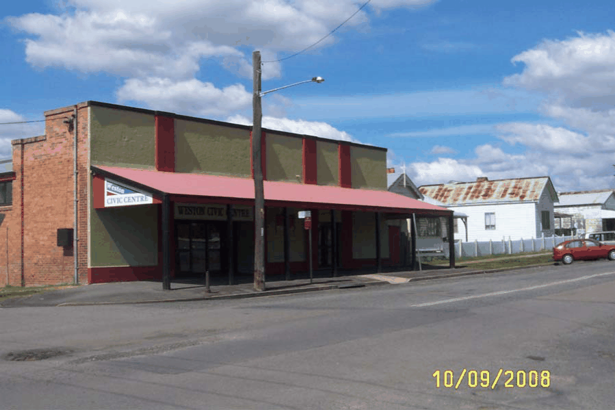
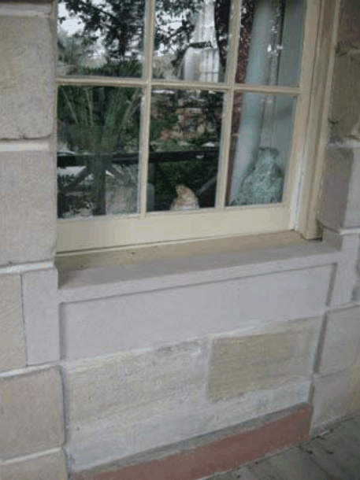
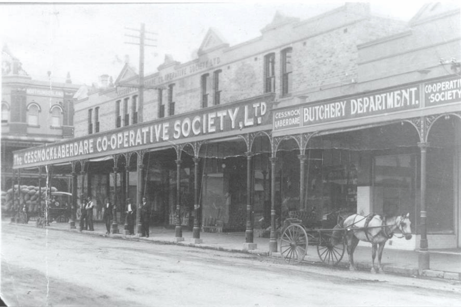
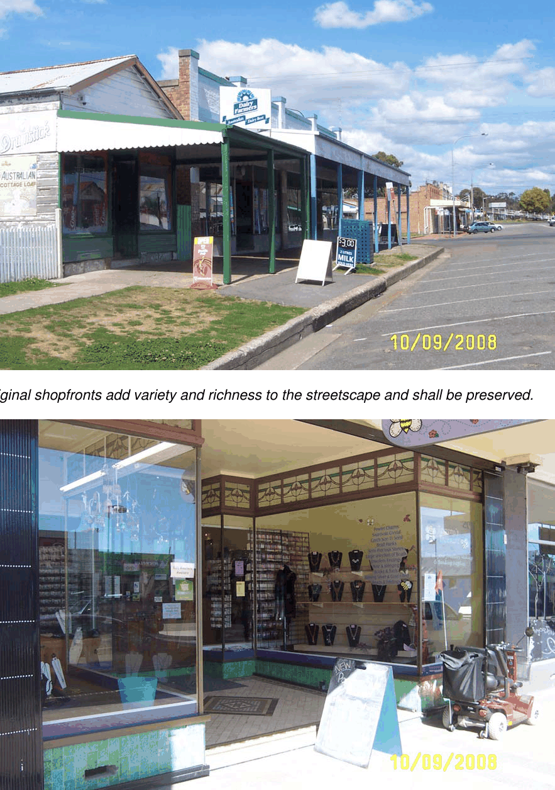
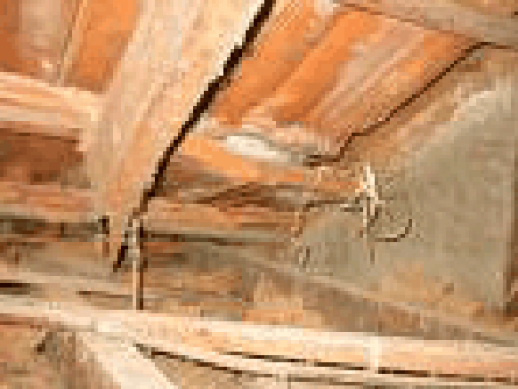
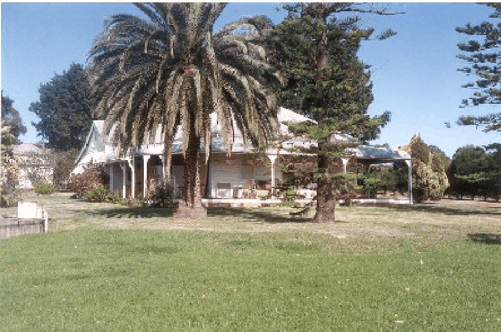
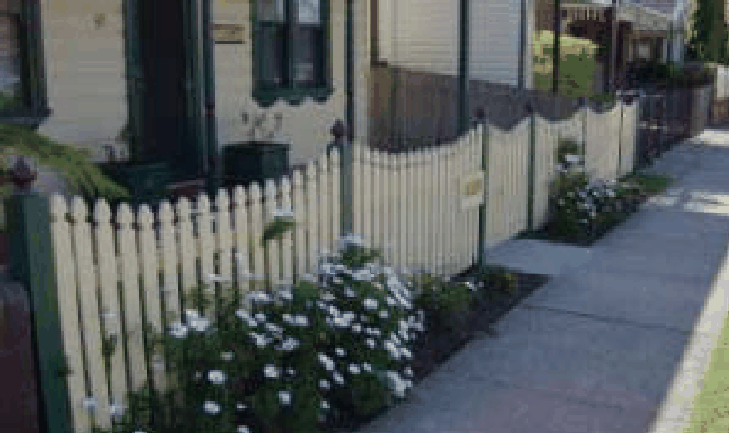
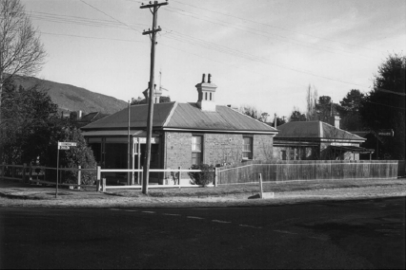
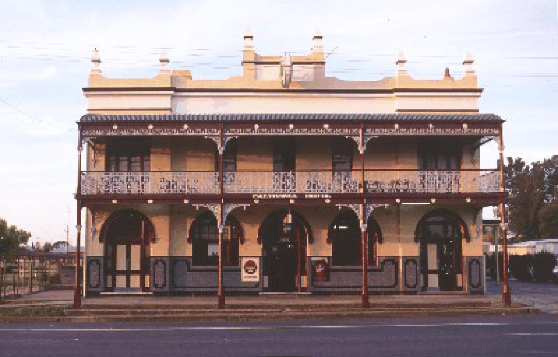

### 12.5 CONSERVING BUILDING ELEMENTS

When a building is designed, there is generally a consistent approach to details such as window frames, sills, skirting boards, verandah posts and brackets. These existing original features shall be retained and maintained.

New work, or repair of the existing details shall be in keeping with the original design. The imitation of something from another place, such as introducing aluminium lace or shutters is not appropriate as it can detract from the appearance and authenticity of the property.

Missing components such as verandah brackets, fences and chimneys shall be copied carefully and reinstated in their original style.

Internal details such as door and window handles were often special decorative features of a house, and shall be retained. Reproduction details can be expensive, so it is preferable to use originals where possible.

> [Picture on page 17: a picture, saved as a picture (images/part-d12-heritage-conservation-and-design-guidelines-page-17-13.gif, 150 dpi).]

The retention and repair of original building elements and details such as verandah posts, fencing, windows and doors is an important part of maintaining the significance of the building and character of an area or street.

#### 12.5.1 Doors and Windows

Original external building features such as timber windows and doors shall be retained in their original configuration and dimensions.

Timber was generally painted externally, not varnished. Priming undercoat and top coat provides the optimum protection against weathering.

> [Picture on page 18: a picture, saved as a picture (images/part-d12-heritage-conservation-and-design-guidelines-page-18-1.gif, 150 dpi).]

Original window details shall be retained.

#### 12.5.2 Shopfronts

Early photos of Cessnock’s buildings show a wealth of variety and richness in its early shopfront details. They are characterised by deep timber mouldings and colour.

> [Picture on page 18: a picture, saved as a picture (images/part-d12-heritage-conservation-and-design-guidelines-page-18-6.gif, 150 dpi).]

Original examples which remain today have value and shall be preserved. Later shopfronts while not original to the building, may also contribute positively to the streetscape and shall also be preserved.

> [Picture on page 19: a picture, saved as a picture (images/part-d12-heritage-conservation-and-design-guidelines-page-19-4.gif, 150 dpi).]

Original shopfronts add variety and richness to the streetscape and shall be preserved.

Early shopfronts are characterised by recessed entries, display areas and the use of tiles, stained glass and colour.

#### 12.5.3 Internal Alterations

The removal of internal walls is generally not recommended as this can impact on the structural stability of the building in addition to its integrity and character.

The majority of walls in older buildings are load bearing. The structural stability of the outer shell is dependent on the internal existence of walls, stairways and chimneys. It is therefore important to avoid:

• radical intervention in the interiors of older buildings;

• subdivision of rooms.

Original details such as panelling, ceilings, skirtings, architraves or remaining door and window furniture, shall be retained.

Where fire safety upgrading of buildings is required this shall be achieved in as sensitive a way as possible. The Heritage Branch has published a manual titled ‘Heritage on Fire’ which provides practical solutions to fire safety issues.

#### 12.5.4 Lath and Plaster

Where lath and plaster remains in listed heritage items, the comprehensive replacement of walls and ceilings shall be avoided. It is possible to re-adhere lath and plaster finishes where plaster is cracked or drummy.

Specialists in this field are available to provide advice and expertise.

#### 12.5.5 Timber

Keeping timber dry is very important to reduce the risk of wood deterioration as a result of fungal rot, attack by borers and termites, and swelling and shrinkage cracking.

It is essential, therefore, that roof drainage, guttering and stormwater drains are operating properly, and that surface water is drained away from walls.

Coatings such as paints, varnishes, waxes and oils are the principle means of controlling swelling as well as protecting and enhancing timbers.

Wooden items need regular maintenance and shall be inspected every six months. Subfloor spaces shall be inspected for signs of rot and termites, and roof spaces for evidence of leaks which may lead to fungal growth.

#### 12.5.6 Timber Repair

Sometimes wood is so badly deteriorated that it needs to be replaced. It is good conservation practice to replace the minimum necessary, and to use the skills of a carpenter or joiner.

The aim shall be to reconstruct the original form of the damaged section so that the repair does not detract from the appearance of the original work.

> [Picture on page 21: a picture, saved as a picture (images/part-d12-heritage-conservation-and-design-guidelines-page-21-1.gif, 150 dpi).]

Wooden items need regular maintenance and should be inspected every six months.

#### 12.5.7 Landscaping and Fences

Early plantings are important elements of an item or area. They can often be landmarks and contribute to the setting of a building. The maintenance or restoration of gardens can add to the authentic conservation of a building.

Original fences also contribute to the significance of an item or area and shall be retained and maintained. These may be very modest in scale, but everyday fences play an important role in establishing and maintaining the heritage significance of an area.

> [Picture on page 21: a picture, saved as a picture (images/part-d12-heritage-conservation-and-design-guidelines-page-21-10.gif, 150 dpi).]

Federation gardens typically used curved beds and paths with a mix of introduced and native plants.

Gardens have changed in fashion, like buildings over time. Gardens in Victorian times were influenced by English designs which used introduced plantings in symmetrical patterns. Later Federation gardens in the 1900’s used curved beds and paths combined with a mix of introduced and native plants.

The planting of certain tree species near the footings of load bearing buildings shall be avoided as they can lead to the drying out of subsoils and may result in the structural failure of the building. When gardens are placed too close to buildings, problems may also occur due to changed moisture or ventilation conditions.

> [Picture on page 22: a picture, saved as a picture (images/part-d12-heritage-conservation-and-design-guidelines-page-22-9.gif, 150 dpi).]

Decorative timber picket fencing contributes to the buildings character and surrounding area.

> [Picture on page 22: a picture, saved as a picture (images/part-d12-heritage-conservation-and-design-guidelines-page-22-11.gif, 150 dpi).]

Some fences may be very modest, but everyday fences contribute significantly to the character of the building and the area.

#### 12.5.8 Colour Schemes

Repainting of buildings shall occur as part of general maintenance. Colour schemes which are in keeping with the period of the building will enhance its character and the surrounding area.

Painting in a colour scheme suited to the age of a building can be well researched using a number of resources. They include:

• paint scrapes in areas which have not been overly exposed to reveal previous colours used;

• old black and white photographs which show shades on different elements of the building;

• an understanding of traditional colour schemes, which can be obtained by referring to books written about the subject.

It is not usually necessary to repeat the use of original colours, but research is often helpful to understand how different areas were treated.

Paint manufacturers have developed heritage colour ranges which are useful when deciding on suitable period colours.

> [Picture on page 23: a picture, saved as a picture (images/part-d12-heritage-conservation-and-design-guidelines-page-23-17.gif, 150 dpi).]

The Caledonia Hotel, Aberdare. Colour schemes which compliment the style of the building will enhance the character of the surrounding area.

The dominant use of bright corporate colours on building facades is generally inconsistent with maintaining the heritage character and significance of an item  and / or area. Well placed and proportioned signage can provide the clear information needed for effective street presence of a business.
