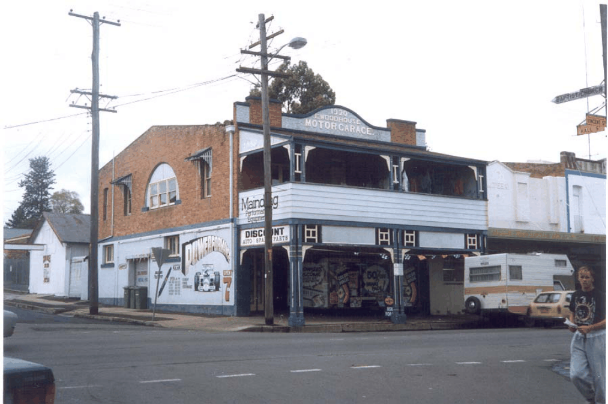

### 12.6 CHANGES OF USE

Each new use will inevitably bring change to the fabric of the place. When considering new uses it is important to try and ascertain what the likely impact of a proposed use will be.

Will the changes affect the significance of the place? Will they be minor or reversible?

If the original use of a place becomes redundant, finding another similar use may help in retaining the place’s significance.

Sometimes a continuing historical use is the reason why a place is considered important, and continuing that use is essential.

There is a danger that gradual cumulative changes will reduce the ability to interpret significant aspects of the building.

Very different uses (such as commercial uses in a former dwelling) may require significant changes to the building fabric, because of the need for amenities, or perhaps fire-rating of walls and ceilings. It is important to alter as few original features and / or materials as possible when changing the use of a building.

> [Picture on page 24: a picture, saved as a picture (images/part-d12-heritage-conservation-and-design-guidelines-page-24-15.gif, 150 dpi).]
