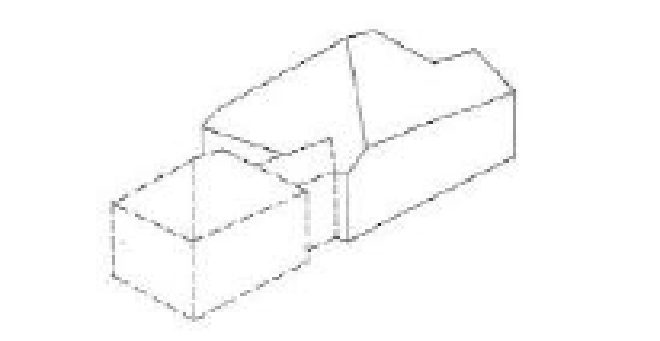
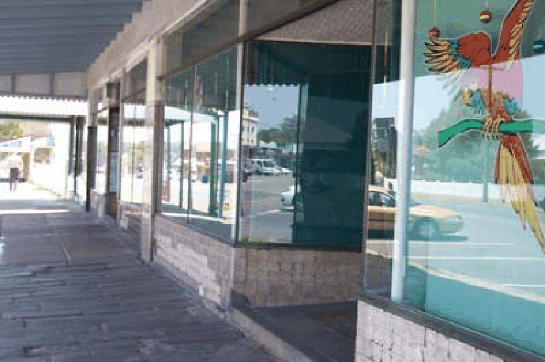
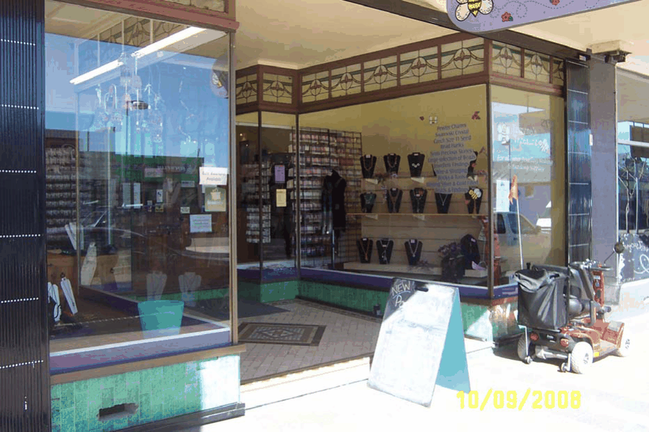
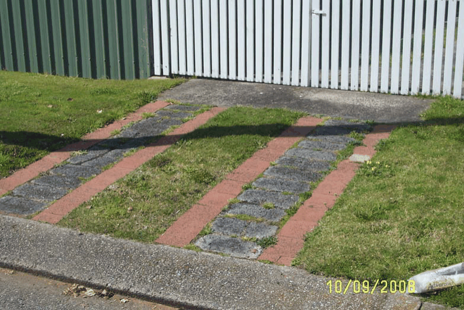
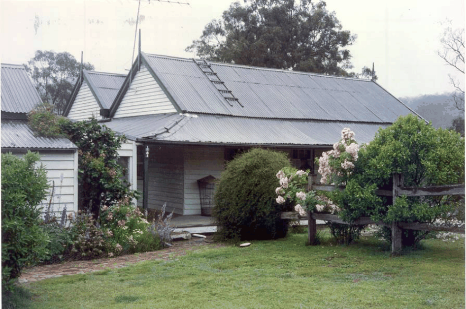
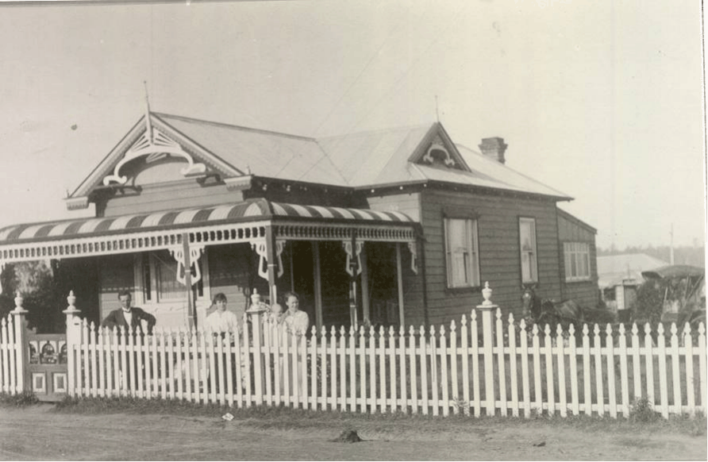
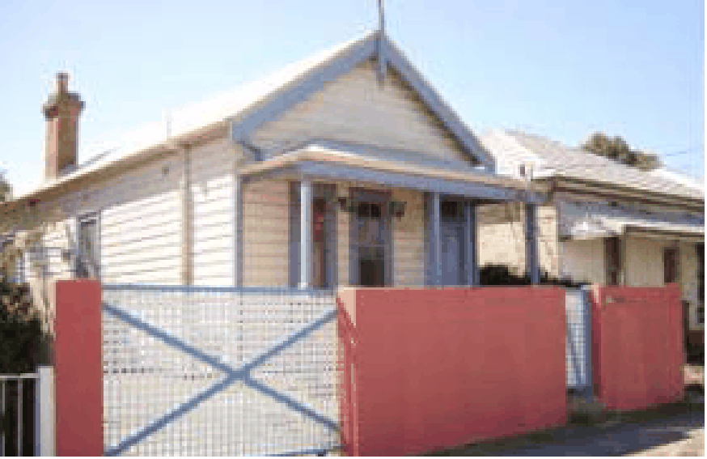
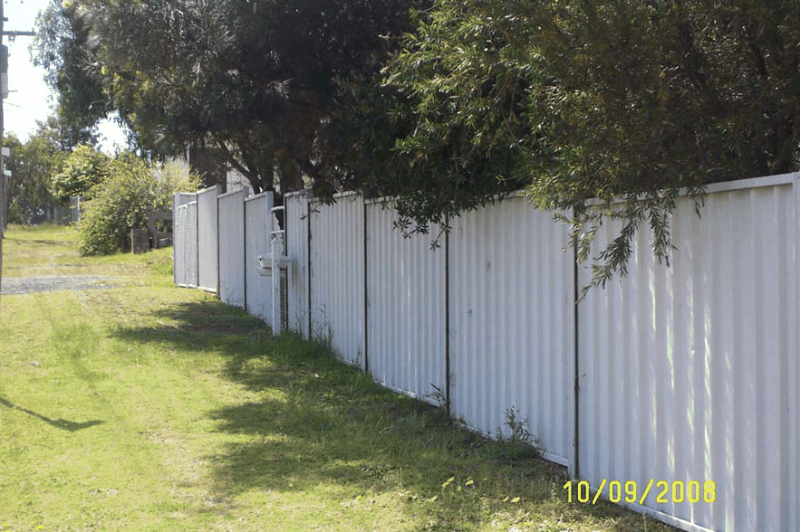

### 12.7 GENERAL REQUIREMENTS for ALTERATIONS and ADDITIONS

The objective of the following guidelines is to ensure that new development involving heritage items and buildings in a Conservation Area will respect and enhance the heritage character of the building and their surrounding area. The following requirements will generally apply to all development covered by this Plan.

#### 12.7.1 Sympathetic Design Aims

To ensure that new alterations and additions respect the architectural character and style of the building and area concerned.

To maintain and enhance the existing character of the street and the surrounding locality.

To enhance the public appreciation of the area.

#### Requirements

o An alteration or addition shall consider the characteristics of the existing building, and buildings in the surrounding area, and sit comfortably in this context.

• New work shall generally not precisely mimic the design and materials of the building, but be recognisable as new work on close inspection.

• Mock historical details shall not be applied as they will not be of any heritage value themselves, and can confuse our understanding between the ‘new’ and the ‘old’.

• Alterations and additions shall blend and harmonise with the existing building in terms of scale, proportion and materials.

• Alterations and additions shall not require the destruction of important elements such as chimneys, windows and gables.

#### 12.7.2 Siting, Setback and Orientation Aims

To maintain and enhance the existing character of the street and the surrounding area.

To ensure that new alterations or additions respect established patterns of settlement (ie. pattern of subdivision and allotment layout, landscaped settings, car parking and fencing.)

To provide an appropriate visual setting for heritage items and heritage conservation areas.

To ensure that the relationship between buildings and their sites which contribute to the character of the area are not disturbed or devalued.

> [Picture on page 26: a picture, saved as a picture (images/part-d12-heritage-conservation-and-design-guidelines-page-26-1.gif, 150 dpi).]

Rear extension which minimises impact on the original building. Side extension should not limit the ability for driveway access to the rear of the property.

#### Requirements

• Generally, alterations or additions shall occur at the rear of the existing building to minimise visual impact on the street frontage of the building, particularly where the additions and alterations involve a listed heritage item, or a building which contributes to the heritage character of the Conservation Area.

• Side additions shall not comprise the ability for driveway access to the rear of the block

• No new structures shall be built forward of an established building line.

• An adequate curtilage including landscaping, fencing, and any significant trees shall be retained.

• Larger additions can be successful when treated as a separate entity to retain the character of the original building in its own right.

• Front and side setbacks shall be typical of the spacing between buildings located in the vicinity of the new development.

• The orientation pattern of buildings existing in the area shall be maintained.

• Rear additions are generally best stepped back from side building lines.

• Extensions to the side elevation will not be appropriate if they alter established patterns of building and garden.

• Additions to the side of a building shall not remove or sever car access to the rear, where it is not sympathetically provided elsewhere.

• Archaeological evidence shall not be disturbed without Council approval.

• Where there has been known building sections which have been removed, and the building fabric has been substantially altered such that only its position on the site maintains its original context, further alterations which remove footprint evidence may not be appropriate.

#### 12.7.3 Size and Scale Aim

To ensure that new alterations and additions respect the character of the building and surrounding area.

#### Requirements

• An alteration or addition shall not be of a size or scale which overwhelms or dominates the existing building, substantially changes or destroys its identity or changes its contribution and importance in its surrounds.

• New uses shall be chosen which suit the size of the building, not requiring overwhelming changes.

• Unless it can be demonstrated that greater scale would be appropriate in the individual circumstances, additions shall be of the same scale as surrounding development.

#### 12.7.4 Roof form and shapes Aim

To retain characteristic scale and massing of roof forms within conservation areas and on heritage items when designing alterations and additions.

#### Requirements

• Roofs of extensions shall be carefully designed so that they relate to the existing roof in pitch, eaves and ridge height.

• Additional rooms can be added to heritage buildings, where roof forms have been carefully integrated into the existing building.

• If it is important that the roof form remains unaltered, additional rooms can be added in a detached pavilion form placed at the rear or possibly the side. Roof pitch, ridge height, height of parapet and eaves on additions shall relate to the original building.

• Providing the roof space is large enough, attic rooms shall be contained in roof forms for non–habitable uses such as a study or a library. The volume required for habitable uses such as bedrooms may mean unacceptable alteration to roof form.

• New roof elements such as dormer windows and skylights shall not be located where they are visually prominent.

• Chimneys shall be retained.

• Service utilities such as water heaters, air conditioning units, antennae and satellite dishes, shall not be located on the principle elevations of buildings.

• Use of roof materials shall be the same as materials on the existing heritage building and those typically used in the conservation area.

#### 12.7.5 Shopfronts

The quality and style of shopfronts is of great importance as they reflect the quality and style of significant architectural buildings, and enhance the character and interest of footways for pedestrians.

Early shopfronts not only provide a great sense of quality to the shop through their distinctiveness, they also enhance display areas for merchandise.

Retaining original shopfronts is particularly important as they are usually complimentary to the other architectural features of the building where ones appreciation of the street is primarily at eye level.

> [Picture on page 28: a picture, saved as a picture (images/part-d12-heritage-conservation-and-design-guidelines-page-28-12.gif, 150 dpi).]

New shopfronts were reinstated based on historical photographs.

The reinstatement of shopfronts in keeping with the original building design is encouraged.

Modern shopfronts of large glazing set in an aluminium frame are considered to contribute little to the architectural character of the street front.

The modern tendency to build along the front wall finish without recessed entries also produces a uniform and uninteresting footpath space and does not highlight the entrance to the shop.

> [Picture on page 29: a picture, saved as a picture (images/part-d12-heritage-conservation-and-design-guidelines-page-29-1.gif, 150 dpi).]

Original shopfronts add interest to the pedestrian footway

#### Aims

To retain shopfronts which contribute to the heritage significance of the building and surrounding area.

To ensure that new shopfronts complement the significance and character of the existing building and surrounding area.

#### Requirements

• Original shopfronts shall be retained.

• Where the original shopfront has been removed and replaced by an unsympathetic alteration, the reinstatement of earlier styles of shopfront in harmony with the overall building character is desirable.

#### 12.7.6 Accessibility

Providing access for people with disabilities is required under the Disability Discrimination Act. Heritage buildings are no exception, however, there is also a need to conserve these places and not alter them in a way which will impact on their heritage significance.

Historic buildings will generally require solutions specific to that site, however, there are a number of principles which can assist in developing effective solutions.

“Improving Access to Heritage Buildings, A Practical Guide to Meeting the Needs of People with Disabilities” is a useful and practical booklet, regarding accessibility issues, published by the Australian Heritage Commission and the NSW National Trust.

Access principles and solutions for effective accessibility follow.

A thorough approach to improving access to heritage buildings includes the following steps:

1\. Identify the heritage value or significance of the place, specifically those parts which have the greatest significance. This can be determined through developing a Conservation Plan, obtaining details on the property from Council, the Heritage Branch or National Trust of NSW, or seeking advice from a conservation professional.

2\. Undertake an access audit to determine existing and required levels of accessibility.

Modifications should generally incorporate the following:

• making the main or principle public entrance and public spaces accessible including a path to the entrance;

• providing accessible toilets;

• providing access to goods, services and programmes; and

• creating access to other amenities and secondary spaces.

Solutions shall:

• be sympathetic and, where possible, reversible;

• new work shall be evident on close inspection;

• in considering what is sympathetic, matters such as general form, materials, finish, compatibility with architectural details of the original design are guiding principles; and

• comply with Australian Standards – particularly AS 1428.1.

Some suggested approaches to accessibility / heritage issues are outlined below.

#### Access to the Principle Entry

The principle entry needs to be defined, it may not always be the ‘front door’, but the entry which most people will use.

It can be acceptable to develop a second entry which may be more convenient for some people while maintaining the building’s significance.

Entries shall be located to minimise loss of original elements such as railing, steps and windows.

The parking area or public drop off point shall be conveniently located to the principle entry. Access paths shall have a firm surface. Concrete is best, but well compacted gravel, cement stabilised or consolidated gravel or dirt are also suitable.

#### Ramps

There is often a level difference between the path and the main floor level. The solutions to these differences are many and might include:

• temporary or permanent ramps;

• levels of footpath can be raised in some circumstances (requiring council approval);

• shifting steps out from the face of the building and incorporating a ramp behind them;

• locating a ramp in a location of low heritage significance;

• lifting devices.

#### Doors

Entry doors shall have handles at less than 1100mm high.

A clear width of at least 800mm is necessary. If doors are not wide enough, it might be possible to increase effective opening size by joining two leaves together or using offset hinges.

#### 12.7.7 Materials and Colours Aim

To ensure that materials and colours used in alterations and additions respect the significance and character of the existing building and surrounding area.

#### Requirements General

• Traditional combinations of materials used in heritage buildings shall be considered when designing additions.

• It may not be appropriate or necessary to replicate the original combination of materials used in the original work. The use of a complementary material might make the increase in scale less noticeable and also enhance later understanding of the changes.

For instance, timber weatherboard extensions to brick houses was a common practice which is still appropriate today, as was the use of corrugated iron roofs at the rear of houses behind main roofs constructed with tile or slate.

• The use of highly reflective materials shall be avoided.

#### Doors and Windows

• Timber windows shall be retained in existing buildings. New doors and windows shall be of materials characteristic to the existing building, locality or an approved alternative.

#### Roofing

• Original roof material shall be matched in any addition in material and colour. If, however original roofing is expensive such as slate, corrugated iron is a suitable alternative to the rear.

• Traditional stepped flashings, roof vents, gutter moulds, and rainwater heads shall be used.

#### Brickwork

• New face brickwork shall match the existing brick in colour and texture, and type of jointing and mortar colour.

• Existing facebrick or stone on heritage items or heritage buildings in a conservation area shall remain unpainted and unrendered.

#### Imitation Cladding

• Timber board imitations are not acceptable for additions to heritage items or work visible from the street in Conservation Areas.

#### Colour Schemes

• Additions shall employ colour schemes which do not detract from traditional colour schemes in the area.

• Colour schemes suitable to the period of the building shall be used.

• Unpainted brick or stone shall remain unpainted.

#### Paving and Driveways

• Preferred materials for driveways include wheelstrips and gravel. Plain or stamped concrete shall be avoided.

• Paired wheelstrips over public footway areas are preferable to solid driveways.

> [Picture on page 32: a picture, saved as a picture (images/part-d12-heritage-conservation-and-design-guidelines-page-32-15.gif, 150 dpi).]

Solid driveways over grass public footways detract from the character of a streets informal edges and the setting of houses

#### 12.7.8 Design of new detail and openings Aim

To ensure that the character and pattern of new door and window openings in alterations or additions is compatible with the appearance of the original building and the area as a whole.

#### Requirements

• Alterations shall avoid arbitrary changes to openings or other features which do not fit in with the symmetry or character of the original design.

• If the street front of the original building is symmetrical, the addition shall avoid simply extending the original design across the addition.

• New detail and openings shall be simple in character using colour and materials which complement the original fabric.

#### 12.7.9 Evidence for Authentic Reconstruction Aims

To ensure that reconstruction reveals the known significance of the place (ie. from physical and / or documentary evidence.)

The building itself may offer clues as to items previously removed such as: evidence of handrails in posts; or marks in the footpath where verandah posts were removed.

As stated in the Burra Charter, ‘reconstruction is limited to the completion of a depleted entity and should not constitute the majority of the fabric of the place’.

#### Requirements

• The reinstatement of a lost feature shall faithfully replicate or copy the original in design, materials, arrangement and position.

• Reconstruction shall be identifiable as new work without at the same time making it intrusive.

#### 12.7.10 Removal of Unsympathetic Alterations and Additions Aim

To ensure that contributions of all periods to a place are respected.

To ensure that removal of any fabric only occurs when it is of slight significance, and the fabric which is to be revealed is of much greater significance.

#### Requirements

• Additions which are obviously out of character with the original design may be removed, whereas it may be preferable to retain well integrated additions or substantial alterations to the existing building.

#### 12.7.11 Services and New Technologies Aim

To minimise any obtrusive effect of new building services and technical equipment in conservation areas and on heritage items.

#### Requirements

• Exhaust vents, skylights, air conditioning ducts and units, solar panels, TV antennae and satellite dishes shall not be visible on the main elevation of the building or attached to chimneys where they will be obvious.

• In heritage areas they shall be hidden from view as much as possible.

• Essential changes to cater for electrical wiring, plumbing or other services shall be limited to what is essential to permit the new use to proceed.

#### 12.7.12 Landscaping Aims

To maintain the rhythm of gardens, open spaces and tree planting in a heritage streetscape

To ensure that planting does not compromise important views into or out of conservation areas

To maintain the landscape character of the locality in any new development.

> [Picture on page 34: a picture, saved as a picture (images/part-d12-heritage-conservation-and-design-guidelines-page-34-14.gif, 150 dpi).]

The hedge in front of this Victorian cottages complements its period style.

#### Requirements

• When designing new gardens, reference shall be made to surviving plants which indicate the basic garden structure, and can be worked into new designs.

• When selecting suitable trees, the following shall be considered:

- the varieties that already exist in the area;

- the size of the tree when mature; and

- the potential of the chosen species to interfere with services, retaining walls and other structures.

• Hard surfaces shall be kept to a minimum.

• Screening of hard surfaced areas is encouraged.

• Garden structures shall be appropriate to main buildings in terms of scale, style and materials.

• Original surfaces such as close jointed brick paving or stone flagging common to Victorian and Federation sites, and pebble aggregate, quarry tile or mosaic tile aprons common to later Californian Bungalow styles shall be retained.

#### 12.7.13 Fences

Fences form an integral, yet fragile part of heritage areas. The majority of historic fences have disappeared, so it is very important that those authentic fences which remain are preserved.

When repairing an original fence, determine:

• what is significant about the fence?;

• is it unusual or typical of its time?;

• its style; and

• its physical condition.

> [Picture on page 35: a picture, saved as a picture (images/part-d12-heritage-conservation-and-design-guidelines-page-35-25.gif, 150 dpi).]

Timber picket fence.

It is important to retain as much of the old material as possible.

When constructing a new fence and there is insufficient evidence to reproduce the original, it is important to build the fence so that it is in harmony with the existing fences and houses of the street. Ensure that the height matches that of (sympathetic) neighbouring fences, and that the colour scheme is compatible with the house.

> [Picture on page 36: a picture, saved as a picture (images/part-d12-heritage-conservation-and-design-guidelines-page-36-6.gif, 150 dpi).]

Solid high front fences detract from the value and streetscape character

#### Aim

To retain original existing fencing and provide for new fencing that is consistent with established patterns

#### Requirements

• Original fences shall be retained.

• Fences shall be located on building line

• Fences shall be simple with a level of detail comparable with the house.

• Fencing shall generally be open or transparent, or backed with a hedge, not solid.

• Fences shall be of a scale comparable with the street.

• Front fences shall be made of materials characteristic to the surrounding area, particular to the street and suitable to the era of the house. Examples include: timber picket; low masonry; and hedges.

• Plain or colour treated metal fences are not considered to be appropriate for conservation areas or heritage items on any street frontage or side boundary.

> [Picture on page 37: a picture, saved as a picture (images/part-d12-heritage-conservation-and-design-guidelines-page-37-3.gif, 150 dpi).]

The colorbond fence used along the side boundary of this house detracts from the character of the building and street.

#### 12.7.14 Garages, carports and sheds Aim

To ensure that garages, carports and sheds do not detract from the character of the area and / or heritage item due to inappropriate location, design and materials.

#### Requirements

• Garages shall preferably be located at the rear or set well back at the side of a building behind the rear building line.

• Garages and carports shall make reference to any established historic patterns in the street.

• The use of landscaping such as screening or planting and front fences may be useful tools in integrating the structure with its site.

• Double garages shall be detached buildings set behind the rear main building line.

• Colours and materials shall blend into the surrounding landscape. Custom orb iron roof profile and timber board profile cladding wall are common materials used.

• Garages shall have simple hipped, gable or skillion roofs depending on the design of the existing main building.

• Gable or hipped roof with skillion roofed attachment is the most appropriate double garage roof form.

• Existing outbuildings shall be maintained and reused wherever possible.

• Simple open light construction carports are preferable to solid heavily detailed buildings.

• Tennis courts shall not be sited so as to intrude on the setting of the main building. They will almost always be best located to the rear of the main building.

• The pitch of a single garage roof shall, in most cases, be comparable or slightly lower

than that of the main building, generally 25 – 300.

• The pitch of a double garage roof shall be lower than that of the main building.
