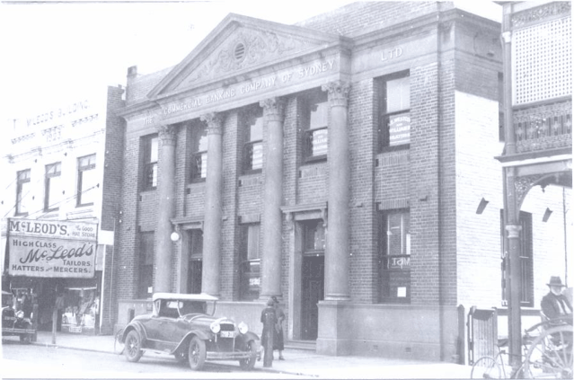
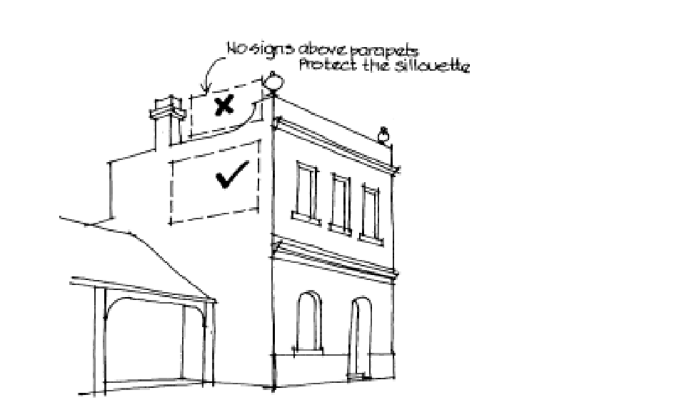

### 12.8 GENERAL REQUIREMENTS for NEW BUILDINGS in CONSERVATION AREAS

This section suggests ways in which new buildings can be designed and located in harmony with existing development in historic areas. It aims to encourage an appreciation of the special character, features and setting of an area, then to reflect this understanding in the design of the new building.

This section relates to wholly new development on the site of a heritage item, on vacant land in a conservation area, or land which is in the vicinity of heritage items or conservation areas.

#### 12.8.1 Introduction

It is essential that the scale and siting of new development does not detract from the scale, form, unity, and character of the surrounding area.

New development shall therefore respect the character of its surrounds. However, respect does not mean copying. While architectural replicas may appear visually compatible with their surroundings, they can confuse the original buildings in the area and give a false impression of historical development.

New development can be contemporary in design when it is well integrated with and related harmoniously to its older neighbours.

#### Character of an Area

It is important to understand the characteristics and features of an area before deciding on the form and style of a new building.

#### 12.8.2 Siting a New Building Aim

To ensure that siting of the new building respects the significance and character of the surrounding area.

#### Requirements

• New development shall have regard to the established patterns of the locality with regard to the typical location and orientation of buildings on an allotment.

• The siting of a new residential building allowing for a generously sized front garden will usually assist in its successful integration.

• New development shall be sited behind the building line of any adjoining heritage item.

#### 12.8.3 Scale Aim

To ensure that the scale of the new building respects the significance and character of the surrounding area, nor detrimentally impacts upon an established pattern of development in the vicinity.

This means that particular attention shall be given to approach views and internal views of existing landmarks which shall not be jeopardized.

Large unbroken roof spans may be obtrusive in flat areas of low scale buildings. Articulation of the floor plan can be a useful way to break up large spans.

To ascertain the appropriate scale of new buildings, the following design aspects are of particular importance:

• reference to the main ridge line heights of original surrounding buildings;

• natural ground or street levels;

• ensuring different parts of the building are in scale with the whole; and

• ensuring the scale of verandahs relate to the scale of those in adjacent buildings.

#### Requirements

• The scale of a new dwelling house shall be related to the size of the allotments laid out in the historical subdivision pattern of the area. This does not apply to consolidated lots. New buildings shall be in scale of surrounding dwelling houses. Large houses on small allotments will tend to look awkward and dominate the surrounding area.

• Large dwelling houses may be better located on large allotments in less sensitive areas.

• New dwelling houses shall generally be single-storey in areas where the majority of buildings are single-storey.

• Landmark buildings in conservation areas which may be heritage items, mansions or public buildings will generally be surrounded by single-storey buildings, or those of a lesser scale. These landmark buildings shall not be used as a precedent for increasing the scale of new buildings. New buildings shall rather relate to the scale of existing development around the landmark and respect its prominence.

#### 12.8.4 Proportions

The composition and proportion of building facades often form a pattern or rhythm which give the streetscape its distinctive character.

> [Picture on page 40: a picture, saved as a picture (images/part-d12-heritage-conservation-and-design-guidelines-page-40-29.gif, 150 dpi).]

Traditionally, older buildings up to the 1930’s used vertical proportions, reflecting the construction technology of the day. Modern technology allows for much greater spans and often leads to a horizontal emphasis.

The shape, proportion and placement of openings in walls are important elements in the appearance of a building.

#### Aim

To ensure that the proportions of the new building respects the significance and character of the surrounding area.

#### Requirements

• Openings in visible frontages shall retain a similar ratio of solid to void as to that established by the original older buildings.

• New buildings shall incorporate the typical proportions of surrounding development, even when using modern materials.

• New buildings shall establish a neighbourly connection with nearby buildings by way of reference to important design elements such as verandahs, chimneys or patterns of openings.

#### 12.8.5 Setback Aim

To ensure that the setback of the new building respects the significance and character of the surrounding area.

#### Requirements

• Where there is a uniform historically based setback, it is generally advisable to maintain this setback in a new building. Where the new building will be obtrusive it shall be set well back and heavily screened.

• If the setback varies, the new building shall not be set closer to the street than an adjoining historic building (even if it is not an identified heritage item).

• Setback from side boundaries shall be consistent with typical buildings in the immediate vicinity.

#### 12.8.6 Form and Massing

The form and massing of a building is its overall shape and the arrangement of its parts. Important elements of mass in buildings include: roofs; facades; and verandahs.

Residential plan and roof forms differ greatly depending on the era of the building.

Plan forms characteristic of typical 1800’s houses were simple, often with a straight frontage, or where there walls were at different lines, a verandah was placed to produce a plan form of a basic square or rectangular shape.

Most buildings constructed up to the 1900’s were characterised by small roof forms with a roof.

Hips and gables generally did not span greater than 6.5 metres. If a house was to be wider or longer, another hip or gable or skillion was added.

The basic plan and roof form were often extended at the rear or sides by a skillion roof with a

typical 250 pitch.

The roof is usually the most influential aspect of the design of new building in a conservation

area. The shape of a roof and pattern it makes against the sky is generally distinctive in a conservation area and shall be a primary consideration in the design of new development.

#### Aim

To ensure that the form and massing of the new building respects the significance and character of the surrounding area.

#### Requirements

• New buildings shall be designed in sympathy with the predominant form and massing characteristics of the area.

• Houses generally had ridges of the same height. It is therefore important in new buildings to ensure that the width of wings can maintain a consistent ridge and roof height.

#### 12.8.7 Landscaping Aim

To ensure that new landscaping respects the significant characteristics and elements of the surrounding area.

#### Requirements

• Generous green landscaped areas shall be provided in the front of new residential buildings where ever possible. This will almost always assist in maintaining the character of the streets and conservation areas.

• New landscaping shall not interfere with the appreciation of significant building aspects such as shopfronts or contributory building facades.

• Important contributory landscape characteristics such as canopy cover or boundary plantings shall be retained in new development.

#### 12.8.8 Detailing Aim

To ensure that detailing on new buildings respects, but does not imitate original detailing on older surrounding buildings.

#### Requirements

• Avoid fake or synthetic materials and detailing. These tend to give an impression of superficial historic detail.

• Avoid slavishly following past styles in new development. Simple, sympathetic but contemporary detailing is more appropriate. Original materials and details on older buildings need not be copied, but can be used as a reference point.

#### 12.8.9 Building Elements and Materials

Materials and their colours will influence how a new building will blend or intrude with the character of its surrounds.

#### Aim

To ensure that the use of materials and colours of the new building respect the significance and character of the surrounding area.

#### Requirements Doors and windows

• New doors and windows shall proportionally relate to typical openings in the locality.

• Simply detailed four panel doors or those with recessed panels are generally appropriate.

• Mock paneling, applied mouldings and bright varnished finishes shall be avoided.

• Older houses have windows which are of vertical orientation and this approach shall be used in new buildings.

• Standard windows often come in modules of 900mm wide. Their use shall be limited to single or double format only. The most suitable windows are generally double hung, casement, awning or fixed type.

• If a large area of glass is required, vertical mullions shall be used to suggest vertical orientation. A large window could also be set out from the wall to form a simple square bay window making it a contributory design element rather than a void.

• Coloured glazing, imitation glazing bars and arched tops are not encouraged.

#### Roofs

• Corrugated galvanized iron (or zincalume finish) is a most appropriate roofing material for new buildings in historic areas. It is also economical and durable. Pre-finished iron in grey or other shades in some circumstances may also be suitable.

• Tiles may be appropriate in areas with buildings dating to the 1900’s – 1930’s. Unglazed terracotta tiles are the most appropriate. The colour and glazing of many terra cotta tiles make them inappropriate.

• Other materials to avoid include modern profile steel deck.

• Ogee profile guttering is preferable to modern quad profile. Plastic downpipes shall be avoided in prominent positions.

#### Paving and Driveways

• Preferred materials for driveways include wheelstrips and gravel.

• It is important that the amount of hard driveway material does not dominate the front garden area.

#### Walls (imitation cladding)

• Cladding materials which set out to imitate materials such as: brick; stone; and weatherboard, shall be avoided as they tend to detract from the authentic character of the surrounding original buildings.

#### Walls (weatherboard)

• 150mm weatherboards are generally appropriate for historic areas. They shall be square-edged profile unless the surrounding buildings are post 1920’s.

#### Walls (brick)

• Plain, non-mottled bricks are preferable with naturally coloured mortar struck flush with the brickwork, not deeply raked.

• Bricks of mixed colours (mottled) shall be avoided, as shall textured ‘sandstock’ bricks.

#### 12.8.10 New Commercial Buildings in Conservation Areas

In addition to the above, new development in commercial precincts within conservation areas, or that adjacent to a heritage item shall take into account the following issues.

#### Requirements Building Heights and Setbacks

• The height of buildings shall reinforce the desired scale and character of the area.

#### Services

• Service structures, plant and equipment within a site are an integral part of the development and shall be suitably screened, buildings shall not be built out.

#### On–site loading and unloading

• Facilities for the loading and unloading of service vehicles shall be suitably screened from public view.

#### Design of Car Parking areas

Car parking areas shall be located and designed to:

• provide landscaping where practicable to shade parked vehicles and screen them from public view; and

• provide for access off minor streets, and for the screening from public view of such car parking areas from surrounding public spaces and areas.

Car park structures shall:

• incorporate a façade, designed to complement adjoining buildings in an urban context; and

• be setback from the street frontage and out of view where possible.

#### Roof Form, Parapet and Silhouettes

In Commercial areas, it is the consistency of parapets which make a significant contribution to the architectural character of an area.

• Where the prevailing pattern of roof forms assists in establishing the character of a townscape, new roof forms shall seek to be compatible with the shape, pitch, and materials of adjacent buildings.

• Parapet heights and articulation shall be compatible with earlier surrounding buildings.

• Lightweight materials such as ribbed coloured metals shall not be used on vertical wall or parapet surfaces.

• New verandahs shall be based on design principles of traditional verandahs with sloping roofs galvanised iron and regularly spaced columns.

#### 12.8.11 New Development in the vicinity of Heritage Items

In addition to the matters raised previously, the following principles shall be given particular attention when considering new development in the vicinity of heritage items.

#### Aim

To ensure that new buildings provide a setting for the adjoining heritage item, so that its historical context and heritage significance are maintained.

#### Requirements

• Development in the vicinity of listed heritage items shall respect and complement the built form character of those items in terms of scale, setback, siting, external materials, finishes and colour.

• New development shall have regard to the established siting patterns of the locality.

• New development shall generally be set back from the building line of the adjoining or adjacent heritage item.

• The sensitive selection of materials, colours and finishes is important in terms of achieving compatibility with the heritage items.

• Height and scale of new buildings shall not obscure or dominate an adjoining or adjacent heritage item.

• Development in the vicinity of a heritage item may be contemporary in design.

#### 12.8.12 Signage Aim

To ensure that signage respects and enhances the amenity of the area.

Architectural research can reveal old and original signage through historic photo collections and Cessnock Library.

#### Requirements

New Signage

• The scale, type, design, location, materials, colour, style and illumination of any sign shall be compatible with the design and character of the buildings and shall not intrude on the visual qualities of the townscape.

• The architectural characteristics of the building shall always dominate.

> [Picture on page 46: a picture, saved as a picture (images/part-d12-heritage-conservation-and-design-guidelines-page-46-17.gif, 150 dpi).]

Signage should be located within architectural elements of the building using appropriate lettering style, size and colouring.

Above Awning Signs

• Shall be simple in design and avoid a proliferation of advertising which can be confusing and detract from the building and conservation area.

• Shall be positioned flush with the wall surface.

• Shall not be fluorescent or internally illuminated.

• Signs adjacent to heritage items or older buildings in conservation areas shall be designed and located sympathetically.

Appropriate signs above verandah level include:

• signwriting in the parapet panel with a simple clear lettering style.

Appropriate signs on verandahs include:

• signwriting on the verandah fascia board;

• sign suspended below fascia (sympathetically sized, shaped and coloured).

Original Signs

• Early signage has cultural value and shall be retained.

#### Colour

• Colours shall be sympathetic to the surrounding area and be related to the colours of the building.

• The use of entire glazed shopfronts for temporary notices is not considered appropriate, nor is the use of temporary fluorescent signwriting.

• The use of bright corporate colours and sign designs which are not related to the architecture or character of the area and building are not considered appropriate.

#### Lettering styles

• Traditional styles of lettering can be interpreted for modern buildings such as the use of raised lettering or traditional styles such as: Clarendon; Ionic; Tuscan; Modern; and Fat.
