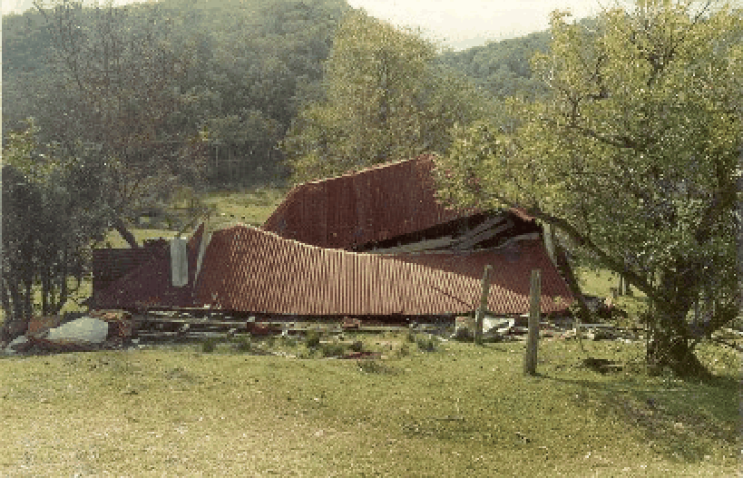

### 12.9 REQUIREMENTS for DEVELOPMENT APPLICATIONS

#### 12.9.1 When is a Development Application Required?

Council should be consulted before carrying out any changes to buildings or sites which:

(i) are listed as heritage items;

(ii) are in a conservation area; or

(iii) are in the vicinity of heritage items or conservation areas.

Development applications will generally be required for proposals which:

(i) potentially impact upon the heritage significance of a heritage item; or

(ii) involve development or use in a conservation area which has the potential, in the opinion of Council, to adversely affect the character of the conservation area.

Cessnock Local Environmental Plan (CLEP), Clause 5.10: Heritage conservation, specifies the circumstances in which a development application is required.

More detailed information regarding development applications is provided for the following categories of development:

• subdivision;

• minor additions and alterations;

• major additions and alterations;

• development in the vicinity of a heritage item, conservation area, archaeological site

• and places of Aboriginal heritage significance;

• change of use;

• development of a site containing archaeological relics or with known archaeological potential;

• demolition;

• new development in a conservation area; and

• new or replacement signage.

Applicants shall refer to the more detailed information provided for these development categories (set out below) to determine whether or not a particular proposal requires development consent or some other form of approval from Council.

Requirements are different for listed heritage items, and for components of a conservation area which are not listed heritage items.

The requirements for each development category refer to supporting information and documentation which may be required with a development application. One or more of these requirements may apply to your application, and it is therefore necessary that you discuss the requirements and reports relevant to your proposal with Council before they are prepared or commissioned.

The content and range of issues to be addressed in the various documents will depend on the heritage significance of the site and the impact the proposed development is likely to have.

Sections 12.9.2 to 12.9.10.2 contain details about the range of matters that the documents may contain. Pre-application consultation with Council staff will establish what is a reasonable level of supporting information for individual cases.

As a general rule, the greater the significance of the item or the potential impacts of the proposal, the more detail shall be provided.

NB: In some cases, Council may require additional information to that listed for the relevant category of development, depending on the circumstances of the case. Again, it is suggested that you consult with Council staff early in the process, so that relevant requirements can be determined.

Consultants

For simple development proposals documentation can be prepared by the building owner or manager. Assistance can be sought from Council staff, including Council’s Heritage Officer and / or the Heritage Branch (in NSW Planning) where necessary. Statements of Heritage Impact for heritage items and / or preparation of development applications for complex proposals, or those which are likely to have a major impact on the heritage significance of an item or a conservation area, will usually require the assistance of a suitably qualified consultant who has experience in heritage conservation matters.

The use of specialist consultants who are suitably qualified and experienced in heritage matters can significantly reduce the amount of time taken in both the preparation of the development application and its assessment by Council. These time savings can far outweigh the initial cost of their services.

Council and the Heritage Branch can provide a list of consultants practicing in heritage related fields.

#### 12.9.2 Subdivision

The appearance of a locality, and the nature of development that has traditionally occurred in it, is often linked to the subdivision pattern, to the size and shape of the lots, the width of streets and footpaths, and the building and landscaping opportunities that these patterns have allowed or encouraged.

The subdivision pattern itself can be a reflection of the history of the area, of what sort of people lived there, what kind of community it was, whether it was poor or affluent, rural or urban.

To retain these physical indicators of the history of a locality, therefore, subdivision proposals in conservation areas, or on land in the vicinity of or on which a heritage item is situated, require careful consideration. It should be noted that, the definition of subdivision includes amalgamation or consolidation of lots.

Development applications are required for the matters listed below, and applications shall be accompanied by the information specified.

Conservation Areas

A development application is required for any subdivision of land in a conservation area.

Development Application Requirements

Development applications for subdivision in a conservation area will generally require the following information to be submitted:

• adequate plans, showing the building envelopes, siting and setbacks of proposed buildings on the lots to be created, that demonstrate that:

• the proposal will not substantially alter the density of development such that the character and heritage significance of the conservation area is adversely affected;

• the allotment and building spacing (ie. frontage widths, side and front boundary setbacks), are typical of surrounding development such that:

- the rhythm of buildings in the conservation area is maintained;

- so that vistas and views to and of any heritage items in the vicinity, especially the principal elevations of buildings, are not interrupted or obscured;

- so that the landscape quality of the conservation area streetscape is retained;

• the scale and form of proposed new development will not detract from the significant and dominant heritage elements of the conservation area’s streetscape;

• the details of required works and services, such as design and materials for kerbing and guttering, access crossings and the like are consistent with original elements of the conservation area;

• the subdivision will not require demolition of existing building stock or re-arranged vehicular access or car parking (on or off the site of the proposal) that would adversely affect the streetscape of the conservation area;

• other specialist reports, where relevant (eg. archaeologist, historian).

Council staff can advise whether or not this information is required with particular applications.

#### 12.9.3 Heritage items and land in the vicinity of heritage items

Development Application Requirements

Development applications for subdivision in the vicinity of a heritage item, or on land on which a heritage item is situated will generally require the following information to be submitted:

• Heritage Impact Assessment (HIA) accompanied by adequate plans, showing the building envelopes, siting and setbacks of proposed buildings on the lots to be created, and demonstrating that:

- the significance of the item will not be compromised by the subdivision or future development that may occur as a result of the subdivision proceeding;

- the allotment and building spacing, (ie. frontage widths, side and front and rear boundary setbacks) will preserve vistas and views to and of the item, especially the principal elevations of the building/s;

- that the setting of the heritage item and a satisfactory curtilage, including important garden and landscape elements, is retained;

- the scale and form of proposed new construction or buildings on the lots to be created will be compatible with and will not detract from the significant and dominant heritage elements of the item;

- the subdivision will not require re-arranged vehicular access or car parking (on or off the site of the proposal) that would adversely affect the heritage significance of the time, particularly the principal elevations;

• character assessment: for minor proposals which, in the opinion of Council, will have only minimal or no impact on the heritage significance of an item or component of a conservation area, a full HIA may not be necessary. However, a Character Assessment, which may be prepared by the owner / applicant, addressing the questions set out in Section 12.9.12.2 will be required;

• an archival and photographic record of the setting of the item may be required if its context is substantially altered by the proposed subdivision and likely future development;

• a conservation management plan may be required for extensive and complex proposals;

• an archaeological assessment may be required if the site contains archaeological relics or has known archaeological potential;

• other specialist reports, where relevant (eg. archaeologist, historian).

Council staff can advise on whether or not this information is required with particular applications.

#### 12.9.4 Minor Additions and Alterations Not Requiring Consent

The following matters are usually considered to be of a minor nature and unlikely to adversely affect heritage significance. A development application will usually not be required.

Cessnock Local Environmental Plan (CLEP), Schedule 2: Exempt development, lists what type of development, known as ‘Exempt’ development, is considered to have minor environmental impact and will not require local planning approval.

Reference should also be made to SEPP (Exempt and Complying Development Codes) 2008.

CLEP, Clause 5.10: Heritage conservation reads as follows:

(3) When consent not required

However, consent under this clause is not required if:

(a) the applicant has notified the consent authority of the proposed development and the consent authority has advised the applicant in writing before any work is carried out that it is satisfied that the proposed development:

(i) is of a minor nature, or is for the maintenance of the heritage item, archaeological site, or a building, work, relic, tree or place within a heritage conservation area, and

(ii) would not adversely affect the significance of the heritage item, archaeological site or heritage conservation area, or

(b) the development is in a cemetery or burial ground and the proposed development:

(i) is the creation of a new grave or monument, or excavation or disturbance of land for the purpose of conserving or repairing monuments or grave markers, and

(ii) would not cause disturbance to human remains, relics, Aboriginal objects in the form of grave goods, or to a place of Aboriginal heritage significance, or

(c) the development is limited to the removal of a tree or other vegetation that the Council is satisfied is a risk to human life or property, or

(d) the development is exempt development.

‘Exempt’ Development listed in subclause (d) relates to minor works, such as: avaries; barbeques; clothes hoists; cubby houses; garden sheds, letter boxes; and shade structures, which subject to subclause (a) are deemed to have negligible environmental impact.

#### 12.9.4.1 Essential Maintenance

Council may waive the requirements for a development application where works can be demonstrated to be maintenance only. For the purposes of this Chapter:

• maintenance includes, works required to be undertaken because of structural inadequacy or concerns about public safety, but not extending to major or extensive change or to the total demolition of any structure;

• reconstruction approved as part of maintenance shall be limited to the form of the existing structure or to a known earlier form in accordance with the definition of ‘reconstruction’ contained in this Chapter.

#### 12.9.5 Major Additions and Alterations

Major additions and alterations are those proposals which have the potential to significantly affect the heritage significance of an item or the character of a conservation area. These changes therefore require the submission of a development application with sufficient supporting information to allow full and proper assessment of potential impacts.

#### 12.9.5.1 Conservation Areas

Major additions and alterations to a building or work in a conservation area which may require development consent include, but are not limited to:

• verandah enclosures visible from the street or other public vantage point;

• additional windows and doors and changes to existing windows and doors;

• re-instatement of verandahs and chimneys;

• extensions to buildings which are visible from the street or other public vantage point;

• raising of existing buildings to reduce the impact of flooding;

• erection of new carports and garages, including those with access from a side or rear lane;

• removal of features or decorative elements contributing to the significance of the building or work, or the conservation area;

• roof and wall re-cladding involving a change of materials;

• rendering of brickwork or painting of previously unpainted surfaces;

• skylights or other structures, such as solar panels, ventilators, satellite dishes and the like, attached to the exterior or roof and visible from the street or public vantage points adjoining the site;

• any non-structural external alterations (including painting, rendering, cladding, sand blasting and the like).

Development Application Requirements

Major additions or alterations to a component of a conservation area will generally require the following to be submitted with a development application.

• Statement of Heritage Impact:

- details the heritage significance of the component and its contribution to the conservation area;

- explains the extent and nature of the work and describing the context of the component (ie. what is around it, what and where are the neighbouring buildings or other features of the locality, and how the component to be altered relates to them). The statement shall describe the impact of the proposed alteration on the streetscape and neighbouring properties;

- details the measures taken to minimise impact on the heritage significance of the conservation area;

- provides the reasons for the proposed alterations or additions (ie. extensions for redevelopment of the site, or for restoration of the component to its former or original state);

- explains why the proposal cannot be located within an existing structure;

- details the proposed future use of the site if the use is changing.

• Character Assessment

- for minor proposals which, in the opinion of Council, will have only minimal or no impact on the heritage significance of an item or component of a conservation area, a full Statement of Heritage Impact as described above will not necessarily be required. However, a Character Assessment, which may be prepared by the owner / applicant, addressing the questions set out in Section

12.9.12.2 will be required.

• Site Plan

- drawn to scale and showing the location of the building or work to be altered and adjoining buildings.

• Plans, sections and elevations.

- drawn to scale, showing the extent of the proposed works by colouring or hatching. These drawings shall show how the alterations or additions will affect existing buildings, structures and features, and shall include a schedule of external finishes, materials and colours.

• Other specialist reports.

- where relevant (eg. archaeologist, historian).

Council staff can advise whether or not all of this information is required with particular applications.

#### 12.9.5.2 Heritage Items

Major additions and alterations to a heritage item which require development consent include, but are not limited to, all of the matters listed in ‘conservation areas’ above, and the following additional matters:

• all extensions, whether visible from the street or not;

• roof re-cladding;

• front fences;

• swimming pools and tennis courts;

• pergolas and garden structures requiring a construction certificate or activity application;

• demolition of any existing subsidiary structures such as garages, carports, original

• garden sheds and the like;

• replacement of existing garages and carports;

• all structural and non-structural alterations to the outside of the item (this includes painting, rendering, cladding, sand blasting and the like);

• major alterations to gardens which require removal of significant vegetation, introduction of new structures, changes of level, retaining walls and the like;

• internal alterations to an item of State or regional significance.

Development Application Requirements

Major alterations and additions to a heritage item will generally require the following to be submitted with a development application.

• Statement of Heritage Impact

- details the heritage significance of the item;

- explains the extent and nature of the work and describing how the impact of the additions or alterations on the heritage significance of the item is to be minimised;

- describes what measures have been taken to ensure that the additions or alterations are sympathetic to the item in terms of design;

- describes what measures have been taken to ensure that the additions or alterations will not visually dominate the item;

- provides the reasons for the proposed alterations or additions (eg. extensions for redevelopment of the site, or for restoration of the component to its former or original state);

- explains why the proposal / additional area cannot be located within an existing structure;

- details the proposed future use of the site if the use is changing.

• Engineering Assessment

- where it is asserted that the alterations and additions are required because part or all of the item is beyond repair or unstable.

• Schedule of Work

- lists the proposed work to the item and cross-referenced to appropriate drawings, including a schedule of external finishes, materials and colours. In the case of an item of State or regional significance, the Schedule of Works shall detail all internal alterations.

• Archival and Photographic Record

- may be required for the part or parts of the item to be altered.

• Early photographs or drawings

- where available, particularly where the intention of the alterations or additions is to return the item to its former or original state.

• Conservation Management Plan

- may be required for extensive and complex proposals.

• Archaeological Assessment

- may be required if the site contains archaeological relics or has known archaeological potential.

• specialist reports

- where relevant (eg. historian).

Council staff can advise whether or not all of this information is required with particular applications.

#### 12.9.6 Development in the Vicinity of a Heritage Item or Conservation Area

Cessnock Local Environmental Plan, Clause 5.10: Heritage conservation, requires that Council take into consideration the likely effect of proposed developments on the heritage significance of a heritage item or conservation area, when determining a development application on land in its vicinity.

Development Application Requirements

Applications for development in the vicinity of a heritage item or conservation area, will generally require submission of the following additional information to allow Council to properly assess potential impacts.

• Statement of Heritage Impact

- accompanied by adequate plans, specifications and drawings to demonstrate:

- that the application has been prepared having regard to the heritage significance of the item or conservation area;

- the likely impact on heritage significance of the item or conservation area and the measures taken to minimise impact on that significance;

- the necessity for the particular proposal to occur in the vicinity of the item or conservation area;

- the measures taken to protect the setting and context of the item or conservation area (eg. a natural or rural setting which defines the edge of a conservation area and / or contributes to its significance or helps describe its growth and development);

- the impact on views to and from the item or conservation area, and measures taken to minimise negative effects;

- the likely impact on historic subdivision patterns, density, rhythm or other detail important to the curtilage or setting of the item or conservation area.

• Character Assessment

- for minor proposals which, in the opinion of Council, will have only minimal or no impact on the heritage significance of an item or component of a conservation area, a full Statement of Heritage Impact as described above will not necessarily be required. However, a Character Assessment, which may be prepared by the owner / applicant, addressing the questions set out in Section

12.9.12.2 will be required.

• Specialist Reports

- where necessary (eg. archaeologist, historian).

Council staff can advise if this information is required with particular applications.

#### 12.9.7 Development of a Site Containing Archaeological Relics or with known

#### Archaeological Potential

Heritage Items and Conservation Areas

Any proposal which will disturb the surface of an archaeological site or ‘potential’ archaeological site will generally require submission of a development application. Disturbance of a site can include clearing of vegetation, resurfacing or paving, construction of pathways and the like if such work involves disturbance of surface and / or below ground deposits.

Council shall consult with the Heritage Branch when considering development applications for archaeological sites and the local Aboriginal communities for sites having Aboriginal heritage significance (see CLEP, Clause 5.10(7): Archaeological sites & (8): Places of Aboriginal heritage significance.

Consents and permits may be required from the Department of Environment, Climate Change and Water (DECC&W) and the Heritage Branch in addition to or in conjunction with any development consent granted by Council.

Development Application Requirements

Development applications for work affecting an archaeological site or ‘potential’ archaeological site will generally require the following information to be submitted.

• Archaeological Assessment

- evaluates the probable extent, nature and integrity of the archaeological resource at the site;

- determines the significance of the resource;

- describes appropriate management solutions for the resource having regard to statutory requirements, the significance of the resource, the particular development proposal and its likely impact on the resource;

- defines the necessity for other permits or approvals required under the Heritage Act 1977, National Parks and Wildlife Act, 1974, or other relevant legislation.

• Archival and Photographic Record

- may be required in some cases.

• Conservation Management Plan

- may be required for extensive and complex proposals.

• specialist reports

- where relevant (eg. historian).

N.B. Archaeological Assessments will differ significantly in terms of level of investigation, amount of information required and management solutions recommended, depending upon the circumstances and nature of particular sites. Council staff, DECC&W and the Heritage Branch (in NSW Planning) can provide assistance in this regard.

#### 12.9.8 Change of Use

Conservation Areas and Heritage Items

Any change of use of a building or place which is a heritage item or is in a conservation area requires submission of a development application.

Change of building use means change of one class of building to another as recognised by the Building Code of Australia.

The existing use of a building may contribute to its significance. This will be taken into account by Council when considering applications.

It is important, particularly where the building is a listed heritage item, that proposed uses / functions are sympathetic and appropriate having regard to the design of the building, its original use and purpose. The nature of any physical changes to the fabric required as a result of the change of use shall be taken into consideration.

Changes to the curtilage of the building, such as for required parking areas, loading areas, signs, security fences and the like, can also have an impact on the significance of a heritage item or a conservation area. Development Application Requirements

A development application for the change of use of a building will generally require submission of the following information.

• Statement of Heritage Impact

- describing the current use of the building and including a statement as to whether this use contributes to the to the significance of the item or conservation area;

- explaining the need for the change of use;

- describing any changes to the fabric of the item or component of a conservation area required as a result of the change of use;

- describing any changes to the site (ie. parking, access or the like) required as a result of the change of use.

• Character Assessment

- for minor proposals which, in the opinion of Council, will have only minimal or no impact on the heritage significance of an item or component of a conservation area, a full Statement of Heritage Impact as described above will not necessarily be required. However, a Character Assessment, which may be prepared by the owner / applicant, addressing the questions set out in Section

12.9.12.2 will be required.

Where a proposal involves changes to building fabric or the site, additional information listed in Major Additions and Alterations may also be required.

#### 12.9.9 Demolition

#### 12.9.9.1 Conservation Areas

Demolition of components of conservation areas can significantly affect the appearance of local streets and, over time, change those attributes which give each area its own special character. Components of a conservation area, while not individually listed items, can have a collective significance. Loss of any one of them can erode the significance of the conservation area as a whole.

A development application is generally required for partial or total demolition of any building or work in a conservation area.

However, the following matters are usually considered to be of a minor nature and are unlikely to adversely affect heritage significance. Development Applications may not be necessary for:

• Demolition of modern garden sheds and other modern ancillary structures.

Development Application Requirements

Partial or total demolition of a component of a conservation area may require the following to be submitted with a development application.

• Statement of Heritage Impact

- details the heritage significance of the component and its contribution to the conservation area;

- provides evidence that all options for retention and adaptive re-use have been explored;

- explains the extent and nature of the demolition and describing the context of the component (ie. what is around it, what and where are the neighbouring buildings or other features of the locality, and how the component to be demolished relates to them). The statement shall describe the impact of the proposed demolition on the streetscape and neighbouring properties;

- provides the reasons for the proposed demolition (ie. to allow for extensions, for redevelopment of the site or for restoration of the component to its former or original state);

- explains why the demolition is necessary to achieve the long term plans for the site;

- details the proposed future use of the site if the use is changing.

• Character Assessment

- for minor proposals which, in the opinion of Council, will have only minimal or no impact on the heritage significance of an item or component of a conservation area, a full Statement of Heritage Impact as described above will not necessarily be required. However, a Character Assessment, which may be prepared by the owner / applicant, addressing the questions set out in Section

12.9.12.2 will be required.

• Development Consent

- for the future use and development of the site, this may be required prior to approval of an application for total demolition of a component of conservation area.

• Archival and Photographic Record

- where total demolition is proposed, preparation of a full archival and photographic record of the existing building and grounds may be required.

• Site plan

- drawn to scale and showing the location of the building or work to be demolished, or the part to be demolished, and any adjoining buildings.

• Engineering Assessment

- prepared by a Structural Engineer specialising in heritage related work, where it is asserted that the structural condition of the building or work to be demolished, or the part to be demolished, is beyond repair or unstable.

• Plans, Sections and Elevations

- if partial demolition is proposed, the plans, sections and elevations, drawn to scale, showing the extent of demolition by colouring or hatching in accordance with standard architectural and technical drawing practice. These drawings shall show how the partial demolition will affect existing buildings, structures and features. A partial Archival and Photographic Record may also be required.

• Consultant’s Reports

- where necessary (eg. historian, archaeologist).

Council staff can advise if this information is required with particular applications.

#### 12.9.9.2 Heritage Items

A development application is required for demolition, in whole or in part, of any buildings, works or horticultural features of a heritage item.

Development Application Requirements

Proposals for demolition of listed heritage items require a detailed investigation based on a full understanding of the significance of the item and the impact that the partial or total demolition will have. More detailed information shall therefore accompany such development applications. Depending upon the nature of the item, the extent of the demolition and the reason for the demolition, the required information may include:

Statement of Heritage Impact

- details the heritage significance of the item;

- provides evidence that all options for retention and adaptive re-use have been explored;

- explains the extent and nature of the demolition and its impact on the heritage significance of the item;

- where partial demolition, explains why this is necessary for the heritage item to function;

- explains why all of the significant elements of the item cannot be kept and any new development located elsewhere on the site;

- describes the context of the item (ie. what is around it, what and where are the neighbouring buildings or other features of the locality, and how the item to be demolished relates to them);

- provides the reasons for the proposed demolition (ie. to allow for extensions, for redevelopment of the site or for restoration of the item to its former or original state);

- explains why the demolition is necessary to achieve the long term plans for the site. Can demolition be postponed in case future circumstances make retention and conservation more feasible?

- if it is proposed to change the use of the item, or if the item is to be totally demolished, a detailed description of the proposed future use / development of the site will be required.

Development Consent

For the future use and development of the site, this may be required prior to approval of an application for total demolition.

Engineering Assessment

-prepared by a Structural Engineer specialising in heritage related work, where it is asserted that the structural condition of the building or work to be demolished, or the part to be demolished, is beyond repair or unstable.

• Plans, Sections and Elevations

- if partial demolition is proposed, the plans, sections and elevations, drawn to scale, showing the extent of demolition by colouring or hatching in accordance with standard architectural and technical drawing practice. These drawings shall show how the partial demolition will affect existing buildings, structures and features.

• Archival and Photographic Record

- where demolition (including partial) is proposed, preparation of a full archival and photographic record of the existing item may be required.

• Early Photographs or Drawings

• - where available, particularly where it is asserted that the item has been significantly altered previously, such that its significance is diminished, or where total demolition is proposed.

• Conservation Management Plan

- may be required for extensive and complex proposals.

• Archaeological Assessment

- may be required if the site contains archaeological relics or has known archaeological potential.

All applications for demolition of heritage items of State or Regional significance shall be referred to the Heritage Branch and any comments received within 28 days of being notified, shall be taken into account in the determination of the application.

#### 12.9.10 New Development in a Conservation Area

A development application will generally be required for all new development in a conservation area.

Proposals shall be based on an understanding of the area involved and its heritage significance, and demonstrate how that significance is being respected, or impacts upon it are to be minimised.

This Chapter provide guidelines for conservation and issues to be considered in the conservation areas, these shall be taken into consideration in preparing proposals. Development Application Requirements

Development applications for new development in a conservation area will generally require the following information to be submitted.

Statement of Heritage Impact

- shall comprise adequate plans, specifications and drawings to demonstrate:

- the impact that the proposed development would have on the heritage significance of the conservation area;

- the measures proposed to conserve the significance of the conservation area and its setting;

- why the development needs to occur in the conservation area;

- the compatibility of the proposed development with nearby original buildings and the character of the conservation area, including consideration of the size, form, scale, orientation, setbacks, materials and detailing of the proposed development;

- a description of the impact of the new development on any heritage items in the vicinity, including impact on curtilage of an item, and views to or from an item;

- which design elements characteristic of the particular conservation area have been incorporated in the design, if any.

Site Plan

- drawn to scale and showing the location of the building or work to be altered and adjoining buildings.

Plans, Sections and Elevations

- drawn to scale, showing the relationship between the new development and surrounding developments in terms of the design guidelines (eg. size and scale, roof forms and shapes).  These drawings shall include a schedule of external finishes, materials and colours.

Archaeological Assessment

- may be required if the site contains archaeological relics or has known archaeological potential.

Specialist Reports

- where necessary (eg. archaeologist, historian).

Council staff can advise on whether this information is required with particular applications.

#### 12.9.11 New or Replacement Signage

#### 12.9.11.1 Conservation Areas

A development application will be required for all new and replacement signage in a conservation area, other than temporary signs such as those relating to the sale or lease of the place or premises to which they are affixed.  Signage in conservation areas shall not

detract from the character or heritage significance of the area.  Part 12.8.12 of this Chapter provides guidelines for appropriate signage.  Signage shall be considered as part of the buildings and streetscapes on which they are found.

Development Application Requirements

Applications for new or replacement signage in a conservation area will generally require submission of the following information.

Documentation

- adequate plans, specifications, drawings and supporting documentation to demonstrate that:

- the impact of the signage on the heritage significance of the conservation area and its streetscape has been considered and minimised;

- alternatives have been considered, and that the proposal is generally in accordance with the guidelines;

- the signage is necessary for the proper functioning of the particular premises and its approved uses;

- any unnecessary, redundant or inappropriate signage will be removed;

- the need for illumination has been carefully considered and justified, and where possible signs are to be remotely rather than internally illuminated.

#### 12.9.11.2 Heritage Items

All new or replacement signage on a heritage item or its curtilage, other than real estate signs relating to the sale or lease of the place or premises to which they are affixed, will require submission of a development application.

Original / existing signage shall not be removed, repainted or covered without a development approval or prior consultation and approval in writing from Council staff. This signage may themselves have a connection with an important use of the item and therefore be part of the significance of the item. Existing signage may have a heritage value of their own which should be retained.

Signage shall be considered as part of the buildings and streetscapes on which they are found.

Development Application Requirements

Statement of Heritage Impact

- accompanied by adequate plans, specifications and drawings to demonstrate that:

- the impact of the signage on the heritage significance of the item has been considered and minimised;

- the signage will not visually dominate the item;

- the proposal is generally in accordance with the guidelines for signage contained in Part 1 of this DCP;

- if the proposal is not in accordance with the guidelines;

- the signage is necessary for the proper functioning of the particular premises and its approved uses;

- any unnecessary, redundant or inappropriate signage will be removed;

- the need for illumination has been carefully considered and justified, and where possible signs are to be remotely rather than internally illuminated.

Conservation Management Plan

- signage may form part of a conservation management plan for large or complex proposals, such as multiple commercial use of an item.

Early photographs or drawings

- where available, particularly where it is proposed to replicate original signage.

Council staff can advise on whether or not this information is required with particular applications.

#### 12.9.12 Conservation Incentives

Cessnock Local Environmental Plan, Clause 5.10(10): Conservation incentives, provides incentives for use and development of a building that is a heritage item. Council recognises that sympathetic development and on-going maintenance of heritage properties can be expensive, and can sometimes impose an unreasonable cost burden on property owners. The incentive reads as follows:

The consent authority may grant consent to development for any purpose of a building that is a heritage item, or of the land on which such a building is erected, even though development for that purpose would otherwise not be allowed by this Plan if the consent authority is satisfied that:

(a) the conservation of the heritage item is facilitated by the granting of consent, and

(b) the proposed development is in accordance with a heritage conservation management plan that has been approved by the consent authority, and

(c) the consent to the proposed development would require that all necessary conservation work identified in the heritage conservation management plan is carried out, and

(d) the proposed development would not adversely affect the heritage significance of the heritage item, including its setting, and

(e) the proposed development would not have any significant adverse  effect on the amenity of the surrounding area.

When considering an application for consent to erect a building on land on which there is situated a building which is a heritage item, the Council may:

(a) for the purpose of determining the floor space ratio; and

(b) for the purpose of determining the number of parking spaces to be provided on the site;

exclude from its calculation of the floor space of the buildings erected on the land, the floor space of the item, but only if the Council is satisfied that the conservation of the building depends upon the Council making that exclusion.

#### 12.9.13 Willful neglect or other damage to a Heritage Item or building in a

#### Conservation Area

State Government Provisions

The Heritage Regulation 2005, Part 3:  Minimum standards of maintenance and repair, list the statutory requirement to maintain heritage significance.

The provisions relate only to a building, work or relic that is listed or within a precinct that is listed on the State Heritage Register and relate to:

- weather proofing;

- fire protection;

- security; and

- essential maintenance.

They do not require owners to undertake restoration works, but where works are needed, owners may apply for financial assistance through the Heritage 2001 funding program.

Where the maintenance and repair standards are not met and the heritage significance of the item is in jeopardy, the Heritage Council has the power to order repairs after consultation with the owner. These orders can be enforced if necessary, and owners prosecuted for failure to comply with an order.

> [Picture on page 65: a picture, saved as a picture (images/part-d12-heritage-conservation-and-design-guidelines-page-65-18.gif, 150 dpi).]

Local Provisions

As discussed in various sections of this Chapter, all components of a conservation area, including but not limited to listed heritage items, contribute to its character, regardless of whether they are individually significant. It is for this reason that the controls relating to demolition are quite stringent, and will be applied consistently.

Applications for demolition of buildings where there is evidence of intentional neglect or damage are unlikely to be considered favourably.

Where Council is of the opinion that a building, work or relic is unsafe or unhealthy, or poses some other risk to the public, the relevant provisions of the Local Government Act 1993 will be enforced to their fullest extent to ensure that adequate work is undertaken to remove such risk, and to avoid the necessity for demolition of the building, work or relic.

Where additional work is required in relation to:

- weather proofing;

- fire protection;

- security; and

- essential maintenance,

Council will request the owner of the building, work or relic to undertake such work to ensure the on-going stability and preservation of significant fabric of the item or component. If such work is not undertaken, and particularly where the building work or relic is a listed heritage item and its significance is deemed by Council to be deteriorating due to wilful neglect or damage, documentary and photographic evidence will be collected by Council, and used in future assessment of applications relating to the site.

Demolition of a listed heritage item or component of a conservation area is considered by Council to be a last resort action, and as stated above, will not be approved where wilful neglect or damage can be established.
