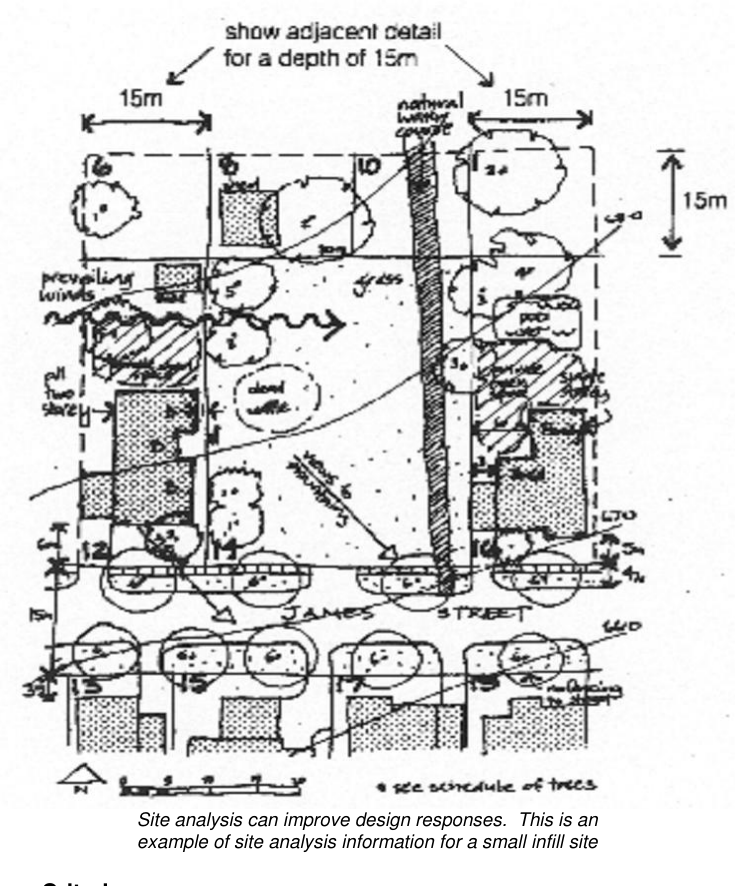
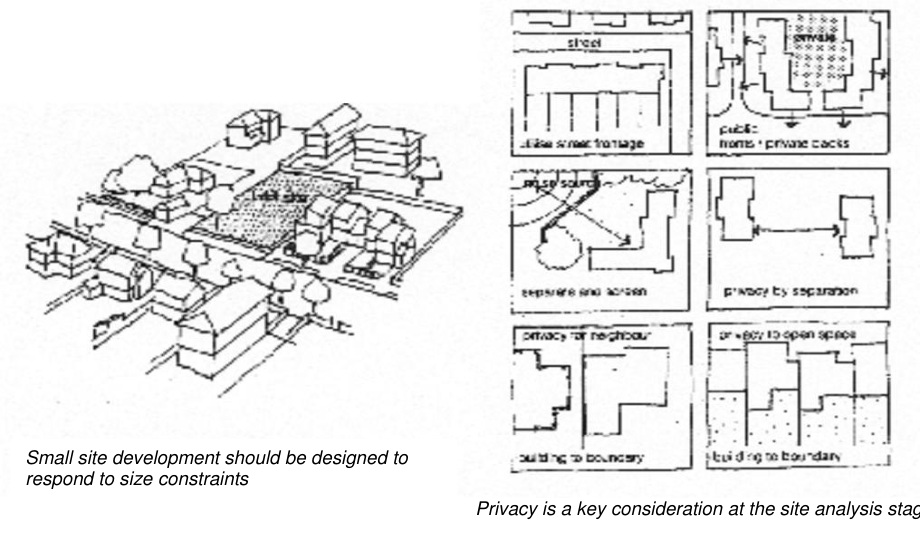
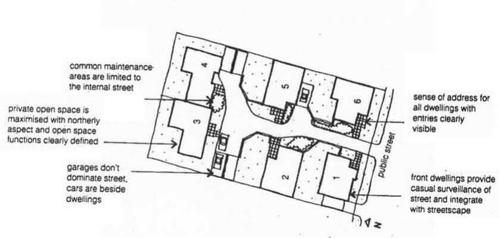
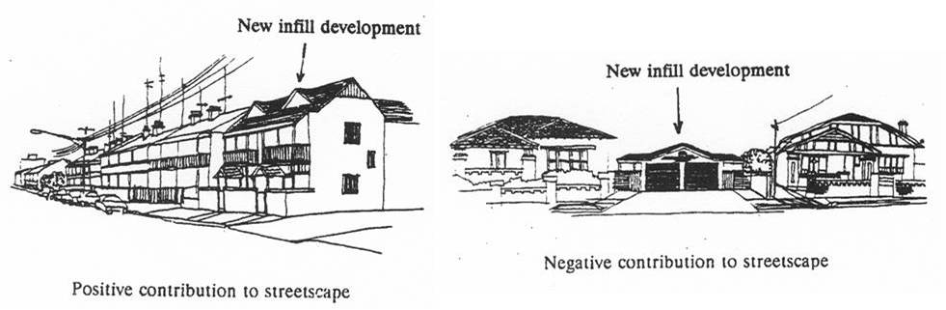
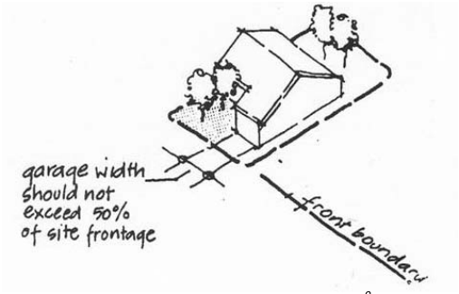
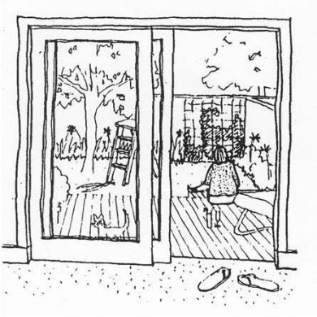

### 2.3 DESIGN ELEMENTS – SITE ANALYSIS, PLANNING & LAYOUT

#### 2.3.1 Where does the design process begin?

The initial step in the design process is site analysis.  This allows the designer to gain a full appreciation of the opportunities and constraints that relate to the site.  These include a consideration of the various natural and man-made environmental features on or around the

site.  Following the completion of this analysis, the next step is site planning and layout.  This incorporates the location of buildings, streets and open space and an indication of where buildings might be set back or where zero lot lines might be permitted.

#### 2.3.2 Site Analysis Objectives

1\. To encourage development that shows ’good manners‘ to surrounding development by considering the characteristics of adjacent sites at the outset of the design process.

2\. To ensure that site attributes and constraints are carefully considered.

> [Picture on page 3: a picture, saved as a picture (images/part-d2-urban-housing-page-3-7.gif, 150 dpi).]
> Words printed on the picture (title and legend, copied from the PDF):
> Site analysis can improve design responses.  This is an
> example of site analysis information for a small infill site

#### Performance Criteria

1 When assessing the suitability of overall site planning, Council will have regard to the extent that the attributes and constraints of the site have been considered, with particular regard to:

• the likely impact on surrounding development, particularly with regard to overshadowing, privacy and obstruction of views;

• topographical features such as slope, existing natural vegetation and opportunities for the creation of views and vistas;

• opportunities to maximise northerly aspect for buildings and private open spaces;

• the character of surrounding development, particularly setbacks and subdivision layout;

• opportunities to link into existing open space, pedestrian and cycle networks;

• the extent to which driveways and/or parking areas are likely to dominate the appearance of the development;

• the visibility, width and design speed of proposed roads and/or driveways; and

• pedestrian access which is visible and safe.

#### Provisions

There are no Provisions for this section.

> [Picture on page 4: a picture, saved as a picture (images/part-d2-urban-housing-page-4-8.gif, 150 dpi).]
> Words printed on the picture (title and legend, copied from the PDF):
> Small site development should be designed to
> respond to size constraints
> Privacy is a key consideration at the site analysis stage

#### 2.3.3 Site Planning and Layout Objectives

1\. To achieve a coherent site layout that provides a pleasant, attractive, manageable and resource efficient living environment.

2\. To ensure that streetscape, amenity and energy-efficiency are considered at the outset of the design process.

3\. To encourage the concurrent planning of subdivision layout with dwelling siting and design.

4\. To encourage site planning and building design that optimises solar access to land and buildings.

5\. To ensure that urban areas are not fragmented by minor multi dwelling housing development.

> [Picture on page 5: a picture, saved as a picture (images/part-d2-urban-housing-page-5-1.gif, 150 dpi).]

Consider image of development, amenity and ongoing management at the site layout stage.

#### Performance Criteria

Applicants are to demonstrate that the following site planning issues have been considered;

• appropriateness of built form and landscape in relation to the site context, topography and urban character;

• building arrangement and their relationship to streets and open spaces;

• accessways within and beyond the site;

• location, function and opportunities for casual surveillance of open space;

• ongoing site management considerations;

• personal privacy and security;

• parking arrangements and reducing the predominance of driveways;

• energy efficiency in building design and siting;

• heritage and conservation opportunities and constraints;

• opportunity for future subdivision into individual lots and communal spaces, including servicing arrangements.

All applicants are required to provide a site plan which annotates the manner in which site attributes and constraints have been considered.

#### Provisions

There are no Provisions for this section of the Chapter.

#### 2.3.4 Streetscape & Front Setbacks Objectives

1\. In developed areas, to ensure that new development enhances and makes a positive contribution to the character of existing streetscapes.

2\. In new areas, to ensure that new development establishes appropriate and attractive streetscapes which reinforces the function of the street and is sensitive to the landscape and environmental conditions of the locality.

> [Picture on page 6: a picture, saved as a picture (images/part-d2-urban-housing-page-6-1.gif, 150 dpi).]

#### Performance Criteria

1\. The scale and appearance of new development is compatible and sympathetic to existing development in the locality, particularly on the perimeter of the development site and where that locality or development site has some heritage significance or distinctive character.

2\. The streetscape reflects the functions and characteristics of the street type in the traffic movement network and is designed to encourage pedestrian access and to support or establish a sense of place and street identity.

> [Picture on page 6: a picture, saved as a picture (images/part-d2-urban-housing-page-6-10.gif, 150 dpi).]

Garage on allotment less than 600m2

3\. Front setbacks are generally consistent with those of adjoining development, though not necessarily identical.  Some variations to minimum setbacks can be considered particularly where such variations are used to create streetscape variety and interest.

4\. The setbacks of buildings is related to their height and to the width of the street, in such a way to ensure pedestrians do not feel buildings are overbearing.

5\. Setbacks provide space for residents to feel an adequate sense of visual and acoustic privacy when using rooms fronting the street.

6\. Parking and garages do not dominate the frontage of the development (refer to section 2.4.8 for greater detail).

#### Provisions:

1\. In new areas, setbacks from the boundary with the road reserve should be as specified in Table 1.

| Table 1: Street Setbacks in New Area |  |
|---|---|
| Street Type | Minimum Frontage Setback |
| Access Place & Access Street (carriageway width 3.5 - 5.0 metres) | 4.0 metres |
| Other Street (carriageway Width >5.0 metres) | 6.0 metres |

2\. The garage width on allotments of less than 600m2 should not exceed 50% of the site frontage, the remainder of which shall be landscaped.

#### 2.3.5 Private Open Space

Private open space does not include public open space.  The provision of public open space is dealt with in the relevant S.94 Contributions Plan.

To be included in private open space calculations, open space at ground level shall have a minimum dimension of 3.0 metres (and above ground level a minimum dimension of 2.0 metres).

Roof gardens, terraces, balconies and verandahs can count as usable open space provided they are not enclosed and if it can be demonstrated that the bulk of the building is satisfactory and no undue lack of privacy results.

#### Objectives

1\. To ensure that private open space provided for a dwelling-house is usable and meets user requirements for privacy, safety, access direct sunlight, outdoor activities and landscaping.

2\. To locate any private open space to take account of outlook, natural features of the site and neighbouring buildings or public open space.

> [Picture on page 7: a picture, saved as a picture (images/part-d2-urban-housing-page-7-19.gif, 150 dpi).]

Private Open Space

#### Performance Criteria

1\. Private open space is clearly defined to distinguish it from communal open space.

2\. Private open space areas are of dimensions to suit the projected requirements of the dwelling occupants, and to accommodate some outdoor recreational needs as well as providing space for service functions.

3\. Part of the private open space is capable of serving as an extension of the function of the dwelling for relaxation, dining, entertainment, recreation and children’s play, and of being accessed from a main living area of the dwelling.

4\. Orientation of the private open space enables solar access and helps to achieve comfortable year round use.

#### Provisions

1\. If the objectives and performance criteria of this section are achieved, private open space can be a minimum of 50m2 per 1 or 2 bedroom dwelling or 70m2 per 3+ bedroom dwellings provided:

• the ‘principal area’ of private open space, where the dwelling is located at or near ground level, is not less than 4.0 metres x 4.0 metres and is directly accessible from the living area;

• screening is provided to maintain privacy;

• where the dwelling is located above ground level, a balcony is provided having a

minimum area of 8m2, and a minimum dimension of 2.0 metres with direct access from the main living area of the dwelling.
