### 2.4 DESIGN ELEMENTS – BUILDING DESIGN & APPEARANCE

#### 2.4.1 General

This section addresses the various elements involved in building design.  Emphasis is placed on the appearance, height and scale of buildings, together with measures for energy conservation.  Good neighbour measures are also included, particularly for maintenance of views and privacy.  Other important elements include the provision of car parking and heritage considerations.

#### 2.4.2 External Appearance Objectives

1\. To encourage the creation of attractive, well designed residential development.

2\. To allow flexibility in design and use of materials while encouraging high architectural standards.

3\. The provision of good design which provides continuity of character between the local building forms and new development by using a selection and/or combination of characteristic elements and massing.

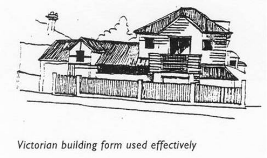

> [Picture on page 8: a picture, saved as a picture (images/part-d2-urban-housing-page-8-32.gif, 150 dpi).]

#### Performance Criteria

1\. The building design and the Statement of Environmental Effects that accompanies the proposal shall demonstrate that the following matters have been addressed:

• consideration of the existing scale, character and massing of development in the immediate area;

• finishes which are ‘textured’ rather than bland, through the use of light and shade, diversity in materials and finishes and appropriate decorative treatments;

• consideration of both typical and rare fenestration (door and window) patterns and the relationship between glazed and solid wall areas;

• traditional relationship of roof mass to wall ratio, roof pitch and design, length of unbroken ridgelines, parapets, eaves and roofwater guttering detailing.

2\. The provision of a variety of experiences for the users achieved in the design through attention to silhouette, pattern, texture and colour.  The amount and length of unbroken roof ridge lines, unpunctuated facades, fencing and repetitive form should be minimised.

3\. Design diversity within and between developments should be sought by maximising the advantages of orientation, landforms, views and natural vegetation.

4\. The following features of existing areas should be considered and integrated into new development proposals where possible:

• traditional street and lane patterns;

• street setbacks;

• groupings of buildings;

• corner feature sites;

• pedestrian walkways;

• promenades, squares and courtyards;

• characteristic kerb and gutter treatment;  and

• pavement design, materials and finishes.

#### Provisions

There are no provisions for this section.

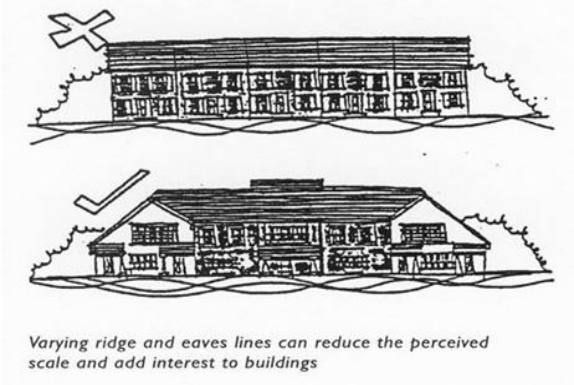

> [Picture on page 9: a picture, saved as a picture (images/part-d2-urban-housing-page-9-27.gif, 150 dpi).]

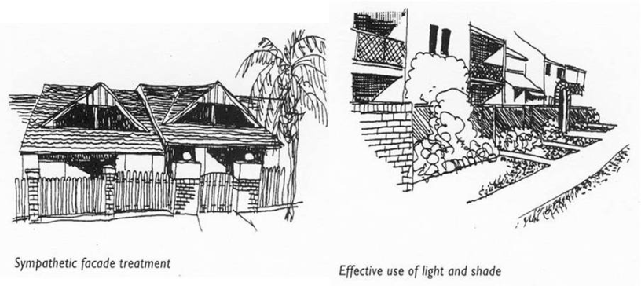

> [Picture on page 10: a picture, saved as a picture (images/part-d2-urban-housing-page-10-1.gif, 150 dpi).]

#### 2.4.3 Building Height and Scale Objectives

1\. To ensure that the height, scale and length of new development is not excessive and relates well to the local context.

2\. To encourage design which creates desirable living conditions and ensures that the amenity of surrounding properties is properly considered.

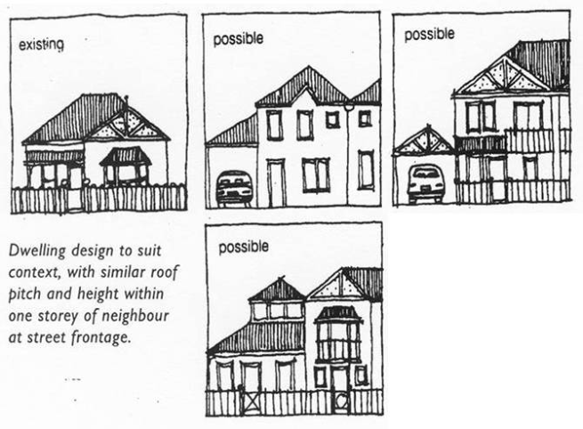

> [Picture on page 10: a picture, saved as a picture (images/part-d2-urban-housing-page-10-8.gif, 150 dpi).]

#### Performance Criteria

1\. Walls are sited and are of such length and height that there is no significant loss of amenity to adjacent dwellings and land.  This can be achieved through:

• setbacks that are progressively increased as wall heights increase to reduce bulk and overbearing;

• building siting and height that are related to land form, with minimal cut and fill;

• building forms that enable a sharing of views with neighbours;

• building bulk, that is generally distributed to reduce impact on neighbours and on the public street;

• building heights similar to those in the public streetscape;

• building to the boundary, which maximises privacy for neighbouring dwellings and their private open space;

• boundary walls, limited in length and height, to minimise the impact on neighbours; and

• adequate separation between facing dwellings for privacy.

#### Provisions

Interpretation

• Height is measured vertically from existing ground level prior to the commencement of any works to the underside of the ceiling in the uppermost habitable room:

• Loft spaces will not be included in the height measurement where they do not significantly alter the roof design or building bulk:

• Cathedral ceilings are permitted and will not be penalised:

• The maximum height for boarding houses, dual occupancies, dwelling-houses, group homes, multi dwelling housing and seniors housing is 7.2m (to the underside of the ceiling in the uppermost habitable room – excluding lofts).

Variation

Variation of this height limit may be permitted where it can be shown that:

1\. the height of the proposed building is equivalent or less than the height of a building on an adjacent site; or

2\. the variation is minor and would satisfy the objectives and performance criteria of this section; and

3\. other requirements of this chapter relating to streetscape, daylight, sunlight and privacy are satisfied.

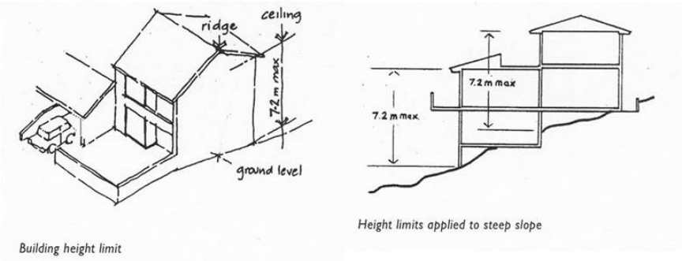

> [Picture on page 11: a picture, saved as a picture (images/part-d2-urban-housing-page-11-24.gif, 150 dpi).]

#### 2.4.4 Side and Rear Setbacks Objectives

1\. To allow flexibility in the siting of buildings and the provision of side and rear setbacks.

2\. To allow adequate natural light and ventilation between dwelling-houses.

#### Performance Criteria

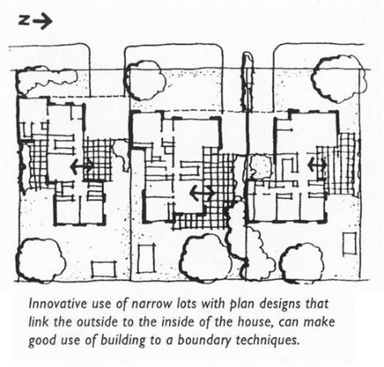

> [Picture on page 12: a picture, saved as a picture (images/part-d2-urban-housing-page-12-2.gif, 150 dpi).]

Walls are sited and are of such length and height that there is no significant loss of amenity to adjacent dwellings and land.  This can be achieved through:

• setbacks that are progressively increased as wall heights increase to reduce bulk and overbearing;

• building siting and height that are related to land form with minimal cut and fill;

• building forms that enable a sharing of views with neighbours;

• building bulk, that is generally distributed to reduce impact on neighbours and on the public street;

• building heights similar to those in the public streetscape;

• building to the boundary, which maximises privacy for neighbouring dwellings and their private open space;

• boundary walls, limited in length and height, to minimise the impact on neighbours; and

• adequate separation between facing dwellings for privacy.

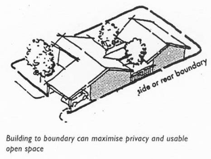

> [Picture on page 12: a picture, saved as a picture (images/part-d2-urban-housing-page-12-17.gif, 150 dpi).]

#### Provisions

1\. A minimum side or rear boundary setback of 1.0 metre shall be provided for walls up to 3.0 metres in height unless the wall is built to the boundary.

2\. For that part of the wall over 3.0 metres and less than 7.2 metres in height the minimum setback shall be 1.0 metres plus 300 mm for every metre of height over 3.0 metres.

3\. For that part of a wall over 7.2 metres in height the minimum setback shall be increased by 1.0 metre for every metre of height over 7.2 metre.

4\. Walls may be built to the side and rear boundaries where:

• they do not contain any openings unless such openings comply with the fire resistance levels of the Building Code of Australia and are infilled with translucent or opaque materials; and

• the wall height and length match an existing or similarly constructed wall on the adjoining site; or

• the maximum wall height is 3.0 metres and there will be minimal impact on privacy, use of private open space and solar access to adjoining properties.

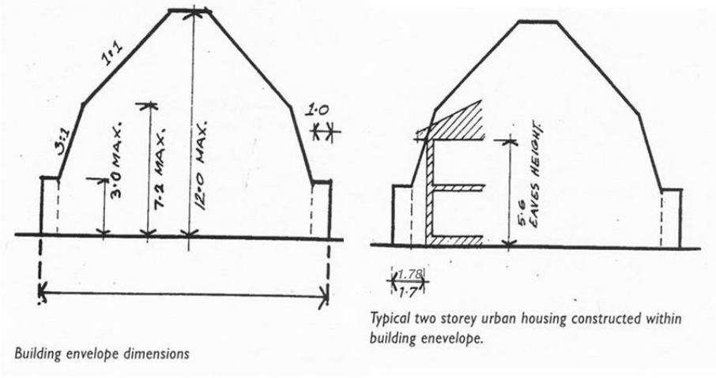

> [Picture on page 13: a picture, saved as a picture (images/part-d2-urban-housing-page-13-11.gif, 150 dpi).]
> Words printed on the picture (title and legend, copied from the PDF):
> 1.78

#### 2.4.5 Energy Conservation Objectives

1\. To provide dwellings with adequate daylight and natural ventilation to habitable rooms and adequate sunlight to private open spaces.

2\. To avoid the potential for significant overshadowing of habitable rooms and private open spaces.

3\. To reduce total energy use in residential buildings by reducing heat loss and energy consumption for heating and cooling.

4\. To encourage the use of building materials that are energy efficient, non harmful and environmentally sound.

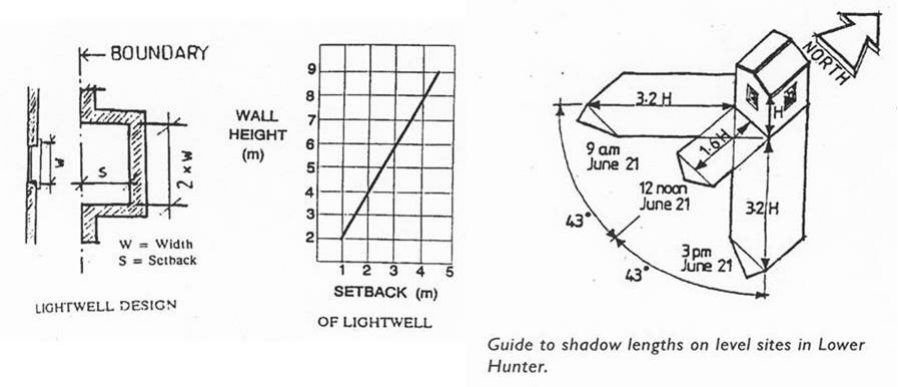

> [Picture on page 14: a picture, saved as a picture (images/part-d2-urban-housing-page-14-1.gif, 150 dpi).]

#### Performance Criteria:

1\. Buildings shall be orientated with the main indoor and outdoor living spaces and major window areas facing towards the north and east.

2\. To the fullest extent possible, buildings shall be insulated.

3\. When a wall is likely to obstruct light to the window of a habitable room, it may be necessary to construct a lightwell based upon the table above.

4\. Buildings shall include adequate thermal mass and windows located, sized and shaded to facilitate thermal performance.

5\. West facing walls shall be designed with windows fitted with appropriate shade structures, and/or landscape screens.

6\. The building materials that are selected shall have low energy inputs in their production and cause minimal damage to the environment.

7\. Buildings shall be designed, wherever possible to include a north facing roof upon which a solar hot water system or collector could be installed.  The building’s internal plumbing shall be designed to facilitate the installation of such a system.

8\. The design of the building shall maximise the cooling potential of natural ventilation by seasonal prevailing winds.

9\. Solar access to adjoining properties shall be protected.

#### Provisions

1\. Dwellings shall be sited to comply with the ventilation requirements of the Building Code of Australia by locating windows not less than a horizontal distance of 1.0 metre from any facing building.

2\. The windows of living areas facing north should receive not less than three hours of sunlight between 9:00am and 3:00pm on June 21.  Buildings shall not reduce the sunlight available to the windows of living areas that face north in existing adjacent dwellings to less than the above specification.

Sunlight to the principal area (4.0 metres x 4.0 metres) of ground-level private open space of adjacent properties shall not be reduced to less than 2 hours between 9:00am and 3:00pm on June 21.  Where existing overshadowing by buildings and fences is greater than this, sunlight shall not be reduced by more than 20%.

For designers proposing development where lot size, orientation, degree of slope, scale and / or setbacks of buildings create a potential for loss of solar access of adjacent properties, Council may require an applicant to prepare shadow diagrams.

The following measures may be required to reduce overshadowing:

• the building re-sited or setbacks increased;

• heights reduced; and/or

• the roof design amended.

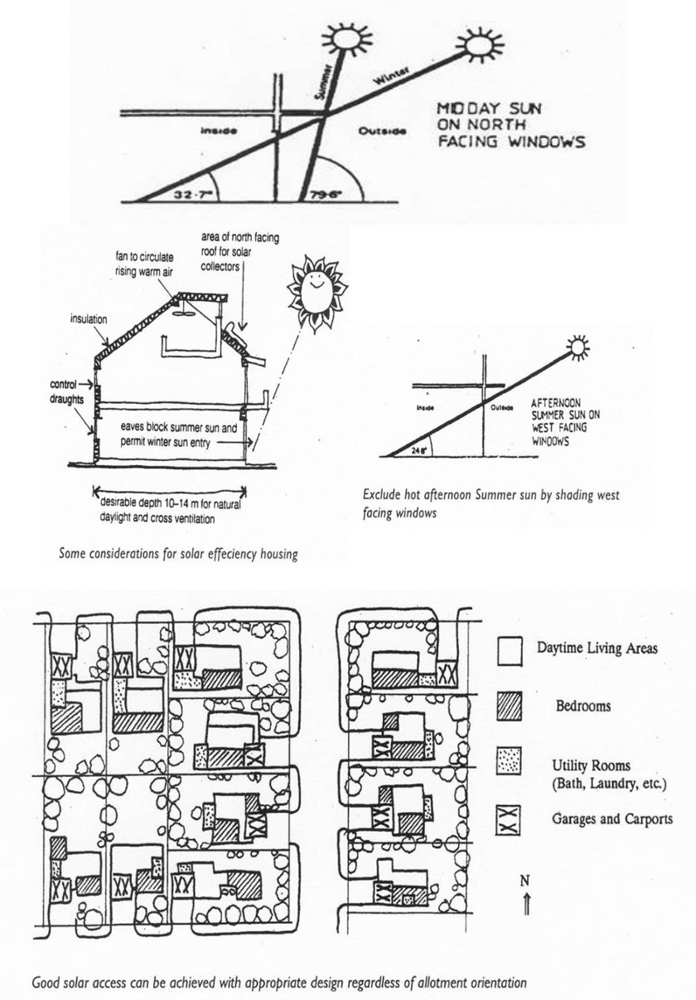

> [Picture on page 15: a picture, saved as a picture (images/part-d2-urban-housing-page-15-5.gif, 150 dpi).]

#### 2.4.6 Views and Privacy Objectives

1\. To encourage the sharing of views whilst not restricting the reasonable development potential of a site.

2\. To site and design buildings to meet projected user requirements for visual and acoustic privacy.

3\. To protect the visual and acoustic privacy of nearby buildings and private open space.

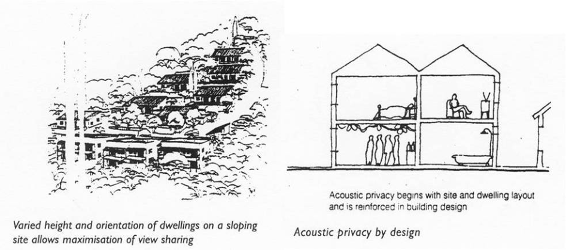

> [Picture on page 16: a picture, saved as a picture (images/part-d2-urban-housing-page-16-8.gif, 150 dpi).]

#### Performance Criteria

View Sharing

1\. All property owners are able to develop their property within the established planning guidelines, however, existing views should not be substantially affected where it is possible to design for the sharing of views.

2\. Grand vistas and views which are recognised and valued by the community should not be obscured by new development.

3\. Heritage or familiar dominant landmarks should be retained and not obscured.

Privacy

4\. Development is designed so that the privacy of individual dwelling-houses and adjacent dwelling-houses is protected, with particular regard to private open spaces and the windows of habitable rooms.

Measures utilised to ensure that this standard is satisfied may include:

• proper consideration of privacy outcomes at the site planning stage;

• screening, including lattice or mature planting;

• offset windows;

• innovative balcony design; or

• separation by distance.

#### Provisions

Visual Privacy

1\. A minimum 9.0 metre separation shall be provided between the windows of habitable rooms of facing dwellings that abut a public or communal street.

This distance shall be increased to 12.0 metres for windows above first floor level.

2\. Direct views between living area windows of adjacent dwellings shall be screened or obscured where:

• ground and first floor windows are within an area described by taking a 9.0 metre radius from any part of the window of the adjacent dwelling.  An area so defined is described as a ‘privacy sensitive zone’;

• other floor windows are within a ‘privacy sensitive zone’ described by a 12.0 metre radius.

3\. Direct views from living rooms of dwellings into the ‘principal area’ of private open space of other dwellings shall be screened or obscured within a ‘privacy sensitive zone’ described by a 12.0 metre radius.

4\. Direct views described in 2 and 3 may be obscured by one of the following measures:

• 1.8 metre high solid fences or walls between ground-floor level windows or between a dwelling and open space where the slope is below 10%;

• screening that has a maximum area of 25% openings, is permanently fixed and is made of durable materials; or

• landscape screening either by existing dense vegetation or new planting that can achieve a 75% screening effectiveness within three years.

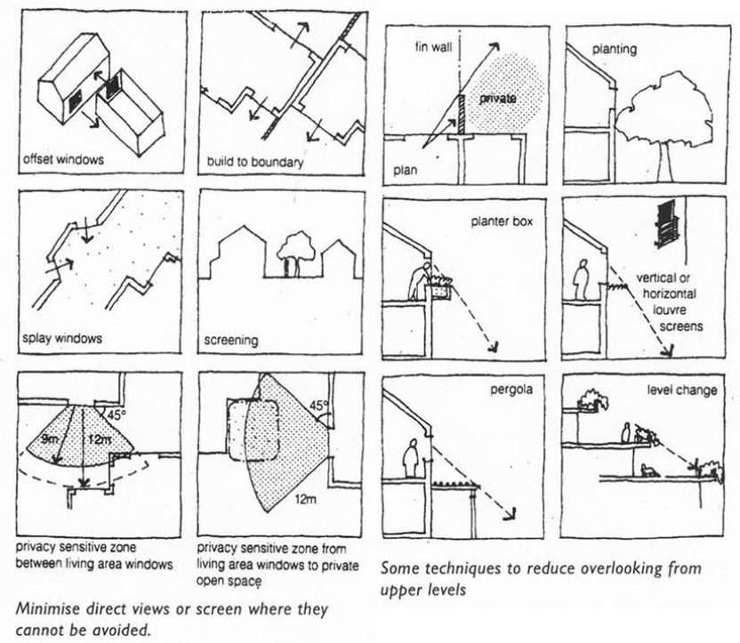

> [Picture on page 17: a picture, saved as a picture (images/part-d2-urban-housing-page-17-23.gif, 150 dpi).]

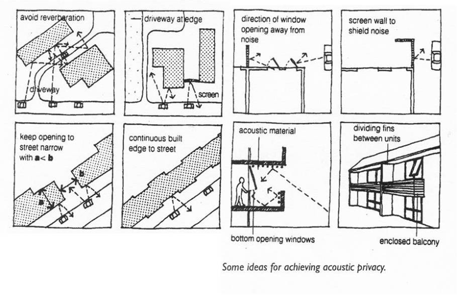

> [Picture on page 18: a picture, saved as a picture (images/part-d2-urban-housing-page-18-1.gif, 150 dpi).]

Acoustic Privacy

5 Site layouts shall ensure parking areas, streets and shared driveways have a line of sight separation of at least 3.0 metres from bedroom windows.

6 Openings of adjacent dwellings shall be separated by a distance of at least 3.0 metres.

7 Shared walls and floors between dwellings shall be constructed to limit noise transmission.

8 Dwellings adjacent to high levels of uncontrollable external noise shall be designed to minimise the entry of that noise.

9 Site layout shall separate active recreational areas, parking areas, vehicle accessways, and service equipment areas from bedroom areas of dwellings.

10 Mechanical plant or equipment shall be designed and located to minimise noise nuisance.

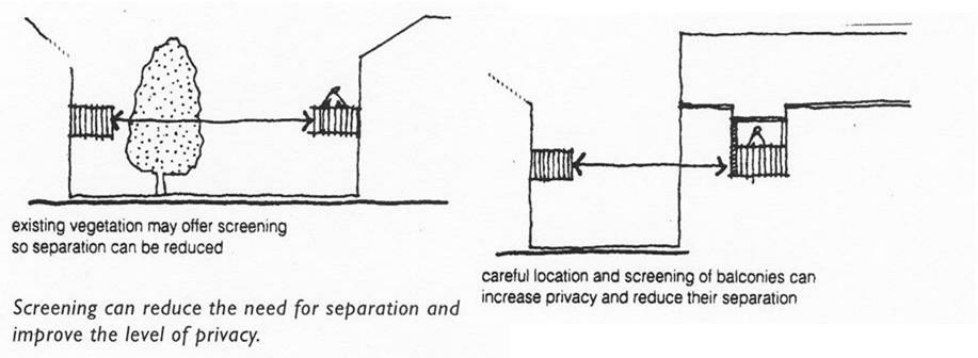

> [Picture on page 18: a picture, saved as a picture (images/part-d2-urban-housing-page-18-15.gif, 150 dpi).]

#### 2.4.7 Fencing and Walls Objective

1\. To ensure that front and side fences and walls provide privacy, security and noise attenuation without having a detrimental impact upon the streetscape and adjacent buildings.

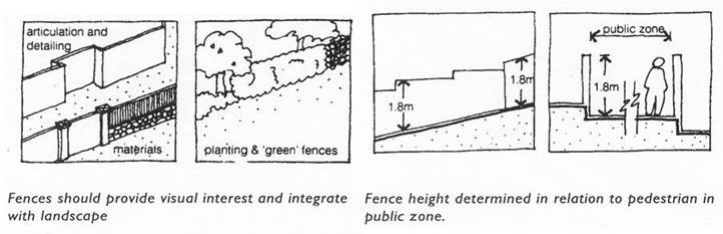

> [Picture on page 19: a picture, saved as a picture (images/part-d2-urban-housing-page-19-6.gif, 150 dpi).]

#### Performance Criteria

1\. The design sets out the role of proposed front fences and walls where they are a component of the streetscape of a public street.

2\. Front fences and walls:

• enable some outlook from buildings to the street for safety and surveillance;

• assist (if used) in highlighting entrances and in creating a sense of communal identity within the streetscape;

• are designed and detailed to provide visual interest to the streetscape;

• are constructed of materials compatible with proposed housing, and with attractive visible examples of fences and walls in the streetscape to offer a sense of continuity; and

• are compatible with facilities in the street frontage area, such as mail boxes and garbage collection areas.

3\. The use and/or design of fences and walls in streetscapes of significance is appropriate to the heritage or environmental context of the site.

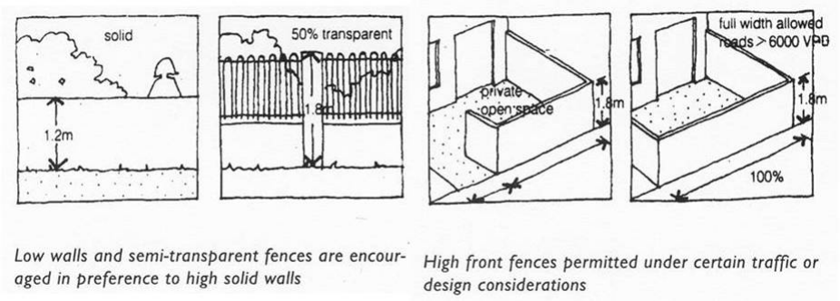

> [Picture on page 19: a picture, saved as a picture (images/part-d2-urban-housing-page-19-22.gif, 150 dpi).]

#### Provisions

1\. Front fences and walls should be no more than 1.2 metres if solid.  This height may be increase to 1.8 metres if:

• the main private open space is in the front of the dwelling-house (not encouraged); and

• the fence has openings which make it not less than 50% transparent; or

• traffic volumes and/or noise exceed 6000 vehicles per day and/or 60 dB(A) and

• the development site is not located in a heritage conservation area.

2\. Front fences and walls shall be designed to use similar or compatible materials to that used in attractive buildings in the locality.

3\. The use of sheet-metal fencing shall be avoided adjacent to public places, unless the visual impact is to be softened by landscaping.

#### 2.4.8 Car Parking Objectives

1\. To provide convenient, accessible and safe parking to meet the needs of residents and visitors.

2\. To encourage the design of access and parking as part of the overall landscape design.

3\. To allow service vehicles access where necessary.

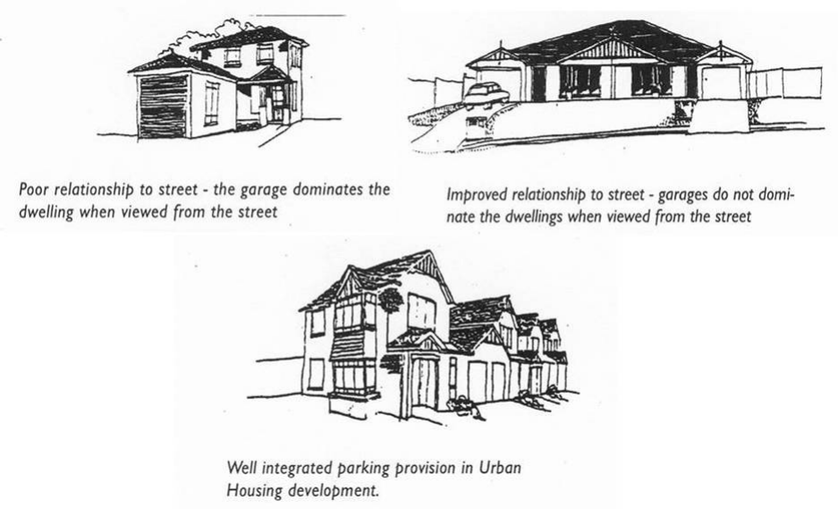

> [Picture on page 20: a picture, saved as a picture (images/part-d2-urban-housing-page-20-15.gif, 150 dpi).]

#### Performance Criteria

1\. Parking requirements for any development shall have regard to:

• proximity and frequency of public transport; and

• street width, traffic volume and on-street parking capacity.

2\. The design of driveways and parking areas shall have regard to the safety of pedestrians, cyclists and vehicles.

3\. Vehicles shall be able to enter and exit the site in a forward direction except where it can be demonstrated that the scale of development and the local conditions make this unnecessary.

4\. The visual dominance of driveways and garages/carports shall be minimised by:

• the use of irregular driveway alignment;

• minimising the width of driveways;

• the selection of paving materials e.g. decorative paving and brick banding;

• breaking up the appearance of driveways with landscaping;

• the use of screen planting; and/or

• car parking structure designs that add interest to the development.

5\. The area of driveways shall be minimised to reduce the volume of runoff and increase the area available for landscaping.

6\. All car parking spaces shall be adequately drained, marked and designated on the site.

7\. Encourage the environmentally friendly disposal of car wash waste water.

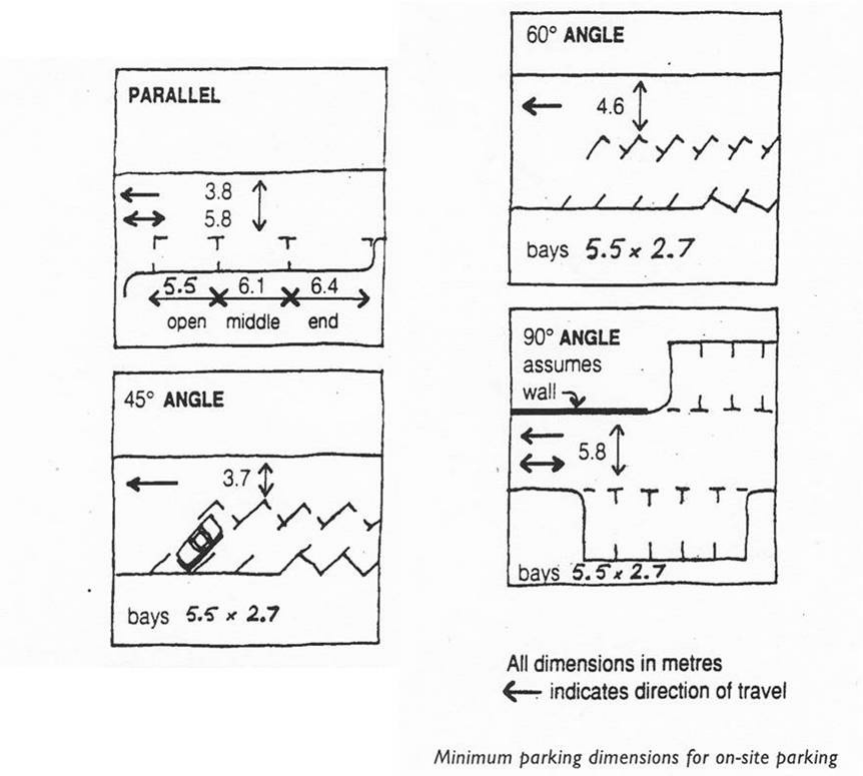

> [Picture on page 21: a picture, saved as a picture (images/part-d2-urban-housing-page-21-9.gif, 150 dpi).]

#### Provisions

1\. Parking shall be provided as per Part C: General Guidelines, Chapter 1: Parking and Access, and the minimum number of off-street car spaces will be as follows:

• one space for each one or two bedroom dwelling; or

• two spaces for each dwelling containing more than two bedrooms; and

• one visitor space for the first three dwellings and one space for every five thereafter or part thereof for multi dwelling housing; or

• 0.5 visitor spaces for each unit in residential flat buildings and shop top housing developments.

2\. The minimum dimension of a car parking space is 5.5 metres by 2.5 metres (parallel parking) or 2.7 metres (angle parking).

3\. The minimum dimension of an entrance-way is 3.0 metres with the driveway itself not being less than 2.5 metres wide with adequate turning areas provided.

4\. The preferred dimensions of parking bays and driveways for common parking layouts are shown above.

5\. Where parking is provided in separate garages the turning area shall be increased to

6.5 metres with a minimum garage entrance width of 2.4 metres.

6\. The provision of stacked parking will be considered on merit.

7\. The grade of a driveway shall not exceed 1 in 5, except where it can be demonstrated that steeper driveways provide safe access on particular sites.

#### 2.4.9 Heritage Considerations Objectives

1\. To ensure preservation of the distinctive character of an area which is identified for heritage significance or is valued by the community.

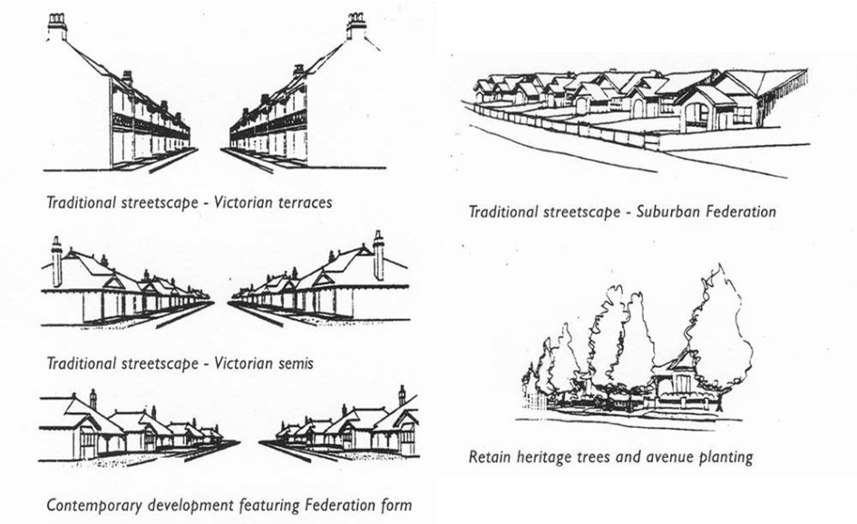

> [Picture on page 22: a picture, saved as a picture (images/part-d2-urban-housing-page-22-12.gif, 150 dpi).]

#### Performance Criteria

1\. The retention, preservation and recycling of existing buildings which make a positive contribution to the heritage character of the locality.

2\. Good contextual design which reinforces the aesthetic qualities of the heritage streetscape.  The dominant design features which contribute to the historic character of a streetscape shall be reflected in the proposed development.

3\. Existing remnants of heritage tree or avenue planting shall be retained and strengthened by additional planting.

#### Provisions

There are no Provisions for this Section.
