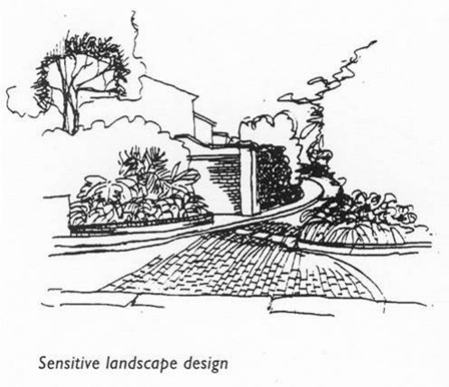
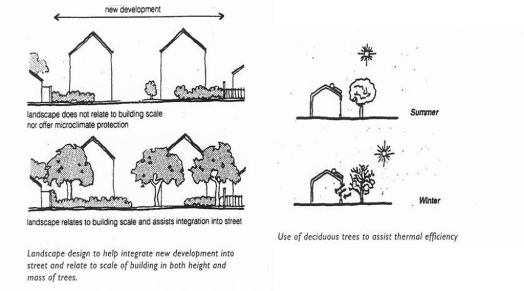
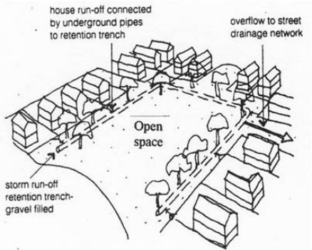
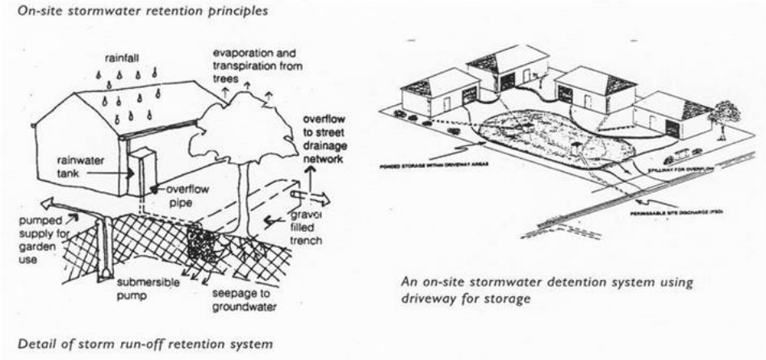
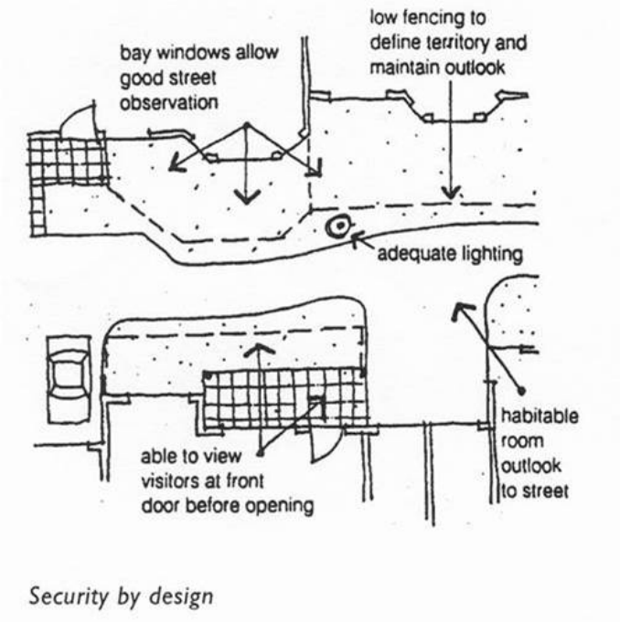
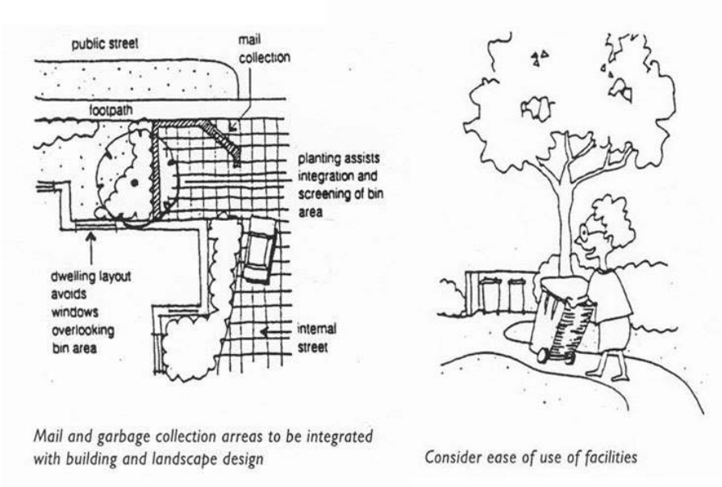

### 2.5 DESIGN ELEMENTS – LANDSCAPE, DESIGN, SECURITY, SERVICES & SITE FACILITIES

#### 2.5.1 General

This section addresses a number of important elements that are frequently forgotten in the design process.  They include: landscape design; site facilities; security; and servicing. Although not contained in section 2.4 ’Building Design and Appearance‘, they form an integral part of the process.

#### 2.5.2 Landscape Design Objectives

1\. To enhance the appearance, amenity and energy – efficiency of new development for the users and for the community in general.

2\. To encourage the integration of building and landscape elements.

3\. To enhance developments for acoustic and visual privacy and shade.

4\. To blend new development into an established streetscape and neighbourhood.

5\. To encourage the use of water efficient landscape systems.

> [Picture on page 23: a picture, saved as a picture (images/part-d2-urban-housing-page-23-16.gif, 150 dpi).]

#### Performance Criteria

1\. Site design minimises site disturbance and preserves existing landscape elements such as rock formations, trees, significant vegetation and water courses where possible.

2\. In established areas, landscaping relates to the scale of other elements of the streetscape and the landscape of adjoining development.

3\. Landscaping shall be geared towards user requirements, taking into account maintenance, exercise opportunities, shade provision and aesthetic quality.

4\. To the fullest extent possible, appropriate vegetation shall be used to provide shade to the northerly and westerly elevations of buildings in summer, while allowing sunlight in winter.

5\. The provision of landscaping to the street frontage of new development shall be substantial and shall attempt to enhance the appearance of the development and assist with streetscape integration.

6\. The design of the landscape shall, as appropriate:

• define a theme for new streets, or complement existing streetscapes;

• complement the functions of the street and reinforce desired traffic speed and behaviour;

• be of an appropriate scale relative to both the street reserve width and the building bulk;

• improve privacy and minimise overlooking between dwellings;

• appropriately account for streetscapes and landscapes of heritage significance;

• provide adequate lighting for pedestrian and vehicular safety;

• be tolerant of the site conditions and adequately mulched.

#### Provision

There are no Provisions for this section.

> [Picture on page 24: a picture, saved as a picture (images/part-d2-urban-housing-page-24-11.gif, 150 dpi).]

#### 2.5.3 Stormwater Management Objectives

1\. To provide an effective stormwater management system which is sustainable and requires minimal maintenance.

2\. To maintain existing site discharge rates.

3\. To maintain existing or control flowpaths in excess of design requirements (i.e.

> [Picture on page 24: a picture, saved as a picture (images/part-d2-urban-housing-page-24-18.gif, 150 dpi).]

spillways).

#### Performance Criteria

1\. The following criteria shall be considered in the design of on-site stormwater management systems:

• the downstream capacity and need for on-site stormwater detention and re-use;

• the scope for on-site infiltration of water;

• the minimisation of detrimental impacts on existing water table and quality;

• the sustainability and maintenance needs of the stormwater system;

• the safety of pedestrians and vehicles;

• emergency spillways and/or overland flowpaths; and

• potential impact on adjacent properties.

#### Provisions

There are no Provisions for this Section.

> [Picture on page 25: a picture, saved as a picture (images/part-d2-urban-housing-page-25-13.gif, 150 dpi).]

#### 2.5.4 Security, Site Facilities and Services Objectives

1\. To provide adequate personal and property security for residents.

2\. To ensure site facilities, such as garbage and recycling bin enclosures, recycling bins, mail boxes, clothes drying areas, external storage facilities, exterior lighting and signage are designed to be conveniently reached and require minimal maintenance.

3\. To ensure facilities are visually attractive and blend in with the streetscape.

4\. To ensure residential areas are adequately serviced with essential services in a timely, cost effective and efficient manner.

> [Picture on page 26: a picture, saved as a picture (images/part-d2-urban-housing-page-26-1.gif, 150 dpi).]

#### Performance Criteria

1\. Buildings adjacent to streets or public space are designed to allow casual surveillance and shall have at least one habitable room’s window facing that area.

2\. Adequate light is provided to all pedestrian paths, shared areas, parking areas and building entries.

3\. Open air clothes drying facilities that are provided for communal use, are easily accessible to all residents and are visually screened from the street.

4\. Garbage or recycling bin areas, mail boxes and external storage facilities are sited and designed for attractive visual appearance and for efficient and convenient use.

5\. Dwellings are provided with adequate storage areas and clothes drying facilities.

6\. Adequate numbering system and signage is provided.

7\. The design and provision of public utilities, including: sewerage; water; electricity; street lighting; telephone and gas services to conform to the cost-effective performance measures of the relevant servicing authority.

8\. Compatible public utility services to be co-ordinated in common trenching in order to minimise construction costs for underground services.

9\. Development to be within locations where reticulated water supply services, complying with the requirements for domestic and fire fighting purposes, is available.

10\. Each dwelling to be provided with direct and convenient pedestrian access to a public road.

> [Picture on page 27: a picture, saved as a picture (images/part-d2-urban-housing-page-27-1.gif, 150 dpi).]

#### Provisions

1\. Shared entries shall serve a maximum of twelve dwellings.

2\. If a bin storage area is provided within the site area, it shall be roofed and designed so as to conceal its contents from view of an adjacent public place and/or other properties.  It shall be provided with a water-tap for wash down purposes and drained to connect to the sewer.  The storage area shall be as close as practicable to the pick-up location.

3\. Individual mail boxes shall be located close to each ground floor dwelling entry, or a mail box structure located close to the major pedestrian entry to the site and complying with the requirements of Australia Post.
