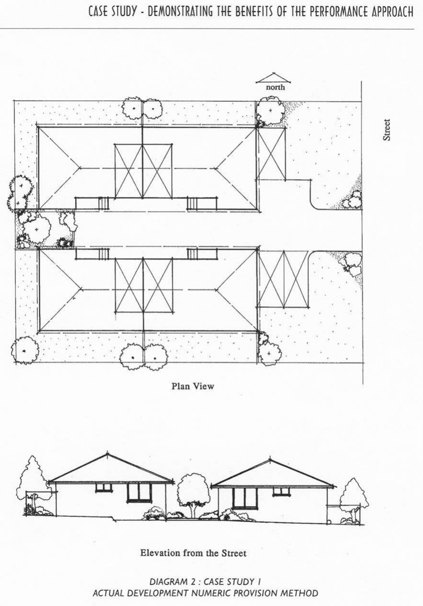

### 2.6 ESTIMATING DEVELOPMENT POTENTIAL

#### 2.6.1 Yield Table

The provisions set out in Table 2 are intended to be used to estimate the number of dwellings a site could accommodate.  These standards are relatively conservative and particular sites may be able to accommodate more dwellings when consideration is given to the various performance based design elements contained in Sections 2.3, 2.4 and 2.5.

#### Table 2: Yield Table

| Development Standard | Urban Housing Type |  |  |
|---|---|---|---|
|  | Dual Occupancy | Urban Housing Up to two storeys | Urban Housing with more than 2 storeys |
| Floor Space Ratio (FSR) | 0.5:1 | 0.4:1 | 0.6:1 |
| Minimum Site Area | 450m2 | NA | NA |
| Height | 7.2 metres | 7.2 metres | 12 metres |
| Street Setbacks | 6.0 metres to main frontage – if corner allotment 3.0 metres to secondary frontage | 6.0 metres to main frontage – if corner allotment 3.0 metres to secondary frontage | 9.0 metres |
| Side/Rear Setbacks Car Parking | 1.0 metres 1 bedroom: 1 space 2 bedroom: 1 space 3 bedroom+: 2 spaces | 3.0 metres 1 bedroom: 1 space 2 bedroom: 1 space 3 bedroom+: 2 spaces + 1 visitor space for first 3 dwellings and 1 space for every 5 thereafter or part thereof | 6.0 metres 1 bedroom: 1 space 2 bedroom: 1 space 3 bedroom: 2 spaces + 1 visitor space for first 3 dwellings & 1 space for every 5 thereafter or part thereof |
| Private Open Space | 1 bedroom: 50m2 2 bedroom: 50m2 3 bedroom +: 70m2 | 1 bedroom: 50m2 2 bedroom: 50m2 3 bedroom+: 70m2 | 1 bedroom: 50m2 2 bedroom: 70m2 3 bedroom: 100m2 |
| Minimum separation between habitable room windows of facing dwellings | Ground and 1st floor level – 9.0 metres Above 1st floor level 12.0 metres | Ground and 1st floor level – 9.0 metres Above 1st floor level – 12 metres | Ground and 1st floor level – 9.0 metres Above 1st floor level – 12 metres |
| 2.7 CASE STUDY – DEMONSTRATING THE BENEFITS OF THE PERFORMANCE APPROACH 2.7.1 General |  |  |  |

To illustrate the opportunities that are available to developers to design by pursuing the ‘Performance Approach’ an actual development has been taken and compared to the alternative that would have been possible under the ‘Performance Approach’ of this document.

Under the ‘Performance Approach’, significantly more thought and effort needs to be put into the design process and each development site needs to be analysed independently, as opposed to the traditional approach which encouraged ’off the shelf‘ designs.  However, as the case study illustrates, the rewards to all parties are substantial and include:

• greater dwelling yield and/or larger dwellings;

• an improved living environment for occupiers;

• more energy efficient development;

• greater acceptance by the community of medium-density development;

• more attractive living environments and streetscapes.

Table 3 compares the two development proposals and Diagrams 2-3 show the site plans and street elevations.

#### 2.7.2 Proposal One - Actual Development Not Complying with the Lower Hunter

#### Urban Housing DCP

This is an actual development of 4 x 2 bedroom townhouses which was taken from one of the Lower Hunter local government areas.

The design was determined by the setbacks required (11m, 3m, and 2m respectively for front, side and rear) with a central driveway and the dwellings occupying the leftover spaces.

All private open space is located in side and rear setbacks, having a maximum dimension of 3m and little regard to site orientation.  Communal open space is located with visitor parking in the front setback.

The appearance of the development is dominated by the central driveway and bland front elevations which make little attempt to relate to surrounding development or create any architectural interest.  Each townhouse is identical in appearance.

#### 2.7.3 Proposal Two - Alternative Development Complying with the DCP

This represents the type of development that would be possible if the Performance Approach was followed.  A central feature of this approach is that dwelling yield is not pre-determined, but rather, is a function of site opportunities and constraints and the quality of design.

The yield achieved in this instance is 2 x 2br and 3 x 3br dwellings.  In fact, three standard floorplans have been utilised, in each case having two bedrooms as loft accommodation. Dwellings 1 and 2 are two bedrooms and would have a floorspace of 80m2, dwellings 3 and 5 are each three bedrooms with a floorspace of 90m2 each, while dwelling 4 is also three bedrooms, but has more generous living areas and a floorspace of 100m2.  These floorspace figures do not include the generous verandah areas that have been provided.

The front setback is 3.0 metres and in this instance, the setback forms part of the usable open space for dwellings 1 and 2.  Both of these dwellings are oriented towards the street and would appear as typical freestanding cottages.  Their design integrates with the streetscape via articulated facades, front verandahs and picket fencing.

Side setbacks vary and in the case of dwellings 2 and 3 form part of the usable open space. Dwellings 4 and 5 enjoy particularly generous garden areas as illustrated on the accompanying plan.  Dwelling 4, in particular, has a large courtyard and garden areas on its northern side.  In all cases, the open space had been located near living areas.

Although each of the dwellings is single storey plus loft, the overall height is only 1.0 metre greater than the typical design and there would be little additional shadow cast.  The privacy of adjoining sites would be maintained by the careful location of dormer windows.

Each dwelling would have a single garage with a stacked second parking space.  The central driveway would be paved and interrupted by landscape features, providing space for on-site turning whilst ensuring the vehicular speed is minimised and pedestrians have priority.

#### Table 3: Case Study Comparison

| CONSIDERATIONS | - PROPOSAL ONE - ACTUAL DEVELOPMENT | - PROPOSAL TWO - ALTERNATIVE DEVELOPMENT |
|---|---|---|
| Dwelling Yield | 4 x 2br townhouses | 2 x 2br 3 x 3br townhouses |
| Total Floorspace | 274m2 | 440m2 |
| Floorspace Ratio | 0.31:1 | 0.49:1 |
| Total Private Open Space | 178m2 | 240m2 |
| Total Communal Open Space | 192m2 | 117m2 |
| Parking Spaces | 7 | 8 |
| Setbacks: Front Side Rear | 11 metres 2.0 metres 1.0 metres (in part) | 3.0 metres 2.0 metres Nil (in part) |
| Overall Height | 4.5 metres | 5.5 metres |

> [Picture on page 31: a picture, saved as a picture (images/part-d2-urban-housing-page-31-1.gif, 150 dpi).]
