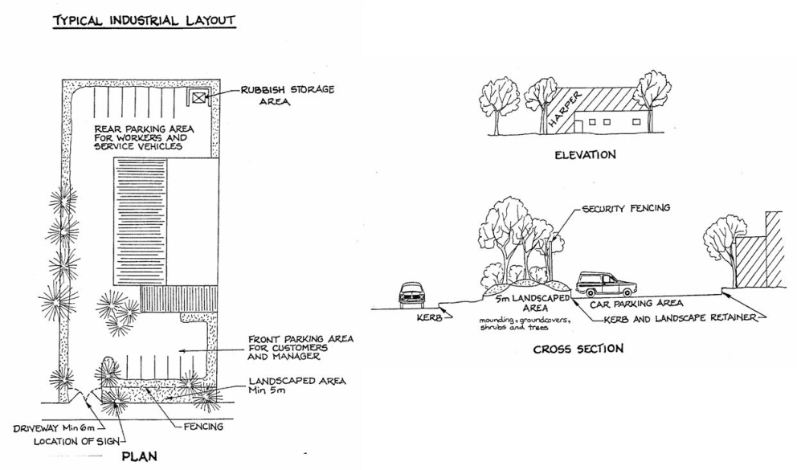

### 3.2 GUIDELINES FOR DEVELOPMENT

#### 3.2.1 Landscaping

Principle

To improve the visual quality and amenity of industrial development through implementing effective low maintenance landscaping of industrial sites.

Controls

Those areas of the site to be landscaped include:

a) the front setback area to a minimum depth of 6.0 metres;

b) the side and rear setbacks if visible from a public place;

c) large vehicular parking areas may be required to be landscaped to provide shade and to soften the visual impact of parking facilities.

#### 3.2.2 Vehicular Parking

Principle

To provide adequate on-site vehicular parking for employees and customers which is located in close proximity to building entrances.

Controls

a) Compliance with Part C: General Guidelines, Chapter 1: Parking and Access.

b) All car parking facilities shall be located behind the front 6.0 metre landscaped area.

CESSNOCK DEVELOPMENT CONTROL PLAN (2010)

D.3-1

Part D: Specific Development Chapter 3: Industrial Development

c) Where it is proposed to locate parking facilities behind an industrial building or to the rear of an industrial site, separate provision for visitor parking shall be made in front of the building, but behind the front 6.0 metre landscaped area.

d) Vehicular parking areas shall generally have a minimum construction standard of a two coat bitumen seal and be clearly delineated.

#### 3.2.3 Vehicular Movements and Access

Principles

1\) To prevent delay or obstruction to traffic by vehicles waiting to gain access to the site.

2\) To accommodate the movement of employee and visitor traffic to and from the site in a forward direction.

Controls

a) Access drives to be designed to have a width which reflects the nature and needs of the particular land use.

b) Access drives shall not be located in close proximity to an intersection.

c) Loading and unloading facilities appropriate to the particular development are to be provided on-site, such that service vehicles are located wholly within the site and generally do not impede traffic movements.

Note: Should developers require more detailed technical information regarding vehicular movements to, from and within the site, their attention is drawn to the various publications available from the Roads & Traffic Authority (www.rta.nsw.gov.au).

#### 3.2.4 Building Design

Principle

To provide industrial buildings which are both functional and attractive in the context of their local environment.

Controls

a) The external walls of industrial buildings shall be of profiled colour treated cladding or masonry materials, or a combination of both.

b) Consideration shall be given to the design and use of the above materials in the street elevation of industrial buildings, particularly where such buildings are in close proximity to residential or commercial neighbourhoods or front main roads.

#### 3.2.5 Building Setbacks

1\. Front building setbacks shall be determined on the following criteria:

a) provision of landscaped area to a minimum depth of 6.0 metres (refer to 3.2.1);

b) provision of car parking facilities (refer to 3.2.2);

c) building height, bulk and layout;

d) the nature and needs of the industrial activity; and

e) the general streetscape.

2\. Side and rear setbacks as specified by the Building Code of Australia.

CESSNOCK DEVELOPMENT CONTROL PLAN (2010)

D.3-2

Part D: Specific Development Chapter 3: Industrial Development

#### 3.2.6 Outside Storage and Work Areas

External storage and work areas are to be located behind the building and screened from public view by means of fencing.

#### 3.2.7 Security Fencing

Security fencing shall be located behind the front landscaped area.

#### 3.2.8 Drainage

Principles

1\. To ensure adequate drainage facilities are provided within the site to collect and carry stormwater to external drainage systems.

2\. To prevent the hazard of flooding and diversion or concentration of water onto adjoining properties or public areas.

3\. To ensure that the public drainage systems can adequately accept additional runoff generated by developments.

Controls

a) Stormwater run-off from roofs and paved areas is to be collected on-site and disposed of to the street drainage system, drainage easement, natural drainage course or infiltration trench or other means as determined by Council.

> [Picture on page 3: a picture, saved as a picture (images/part-d3-industrial-development-page-3-20.gif, 150 dpi).]

CESSNOCK DEVELOPMENT CONTROL PLAN (2010)

D.3-3
