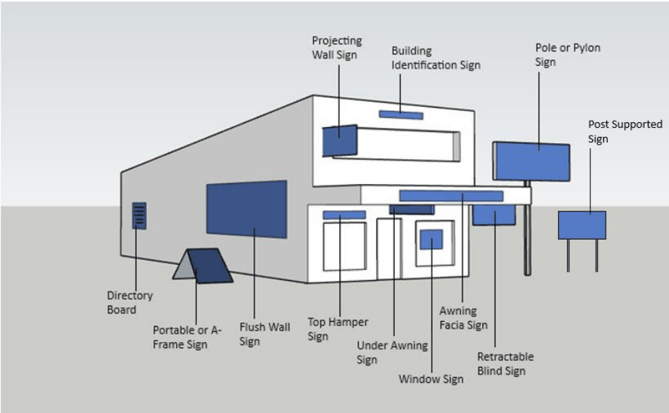

# Cessnock Development Control Plan 2010 - Part D5 Signage and Outdoor Advertising

Source PDF: [D5 - Signage and Outdoor Advertising.pdf](https://planfortomorrow.sharepoint.com/sites/Planfortomorrow/Shared%20Documents/00%20NSW-Planning-Resources/dcp/cessnock-development-control-plan-2010/part-d5-signage-and-outdoor-advertising/D5%20-%20Signage%20and%20Outdoor%20Advertising.pdf)

Table of Contents

### Contents

DEVELOPMENT BASED PROVISIONS ..................................................................................... 2 Signage and Advertising ...................................................................................................... 2 Preamble ............................................................................................................................. 2 Application .......................................................................................................................... 2 Supporting information ........................................................................................................ 2 Definitions ........................................................................................................................... 3 Types of Signage .................................................................................................................. 3 Development Provisions ....................................................................................................... 5

#### DEVELOPMENT BASED PROVISIONS Signage and Advertising

The Cessnock Development Control Plan (CDCP) is comprised of 4 parts. Development applications must address all relevant sections of Part 2, Part 3 and Part 4 and supporting guidelines, such as Council’s Engineering Guidelines for Design and Construction.

Development based provisions apply to specific types of development and may include provisions that are different from those in Parts 2 and 4 of the CDCP. Where there is a difference between any development provision/s in Parts 2 or 4 and Part 3, the provision/s in Part 4 prevail.

#### Preamble

Signage is an integral part of the streetscape in urban and rural environments, providing information to people on business locations, products and services. Well-designed and located signs can be useful and can complement the character of an area. Poorly designed and inappropriate signs can detract from the overall quality of an area and reduce the value of information contained within signage.

Standards for signage are required to maintain the desirable characteristics of buildings, streetscape and the overall quality of a particular area. Without reasonable and fairly applied criteria, signs may distract and dominate the setting by way of height, shape, size, number, lighting and movement. In addition, signage standards will ensure that businesses are protected against signage clutter, which occurs when there are too many signs competing for the user’s attention to the point where none of the signs can be readily comprehended.

#### Application

The provisions of this chapter apply to all signage and advertising development in Cessnock Local Government Area, where not otherwise authorised by State Environmental Planning Policy (Exempt and Complying Development Codes SEPP) 2008.

#### Supporting information

All development applications for signage or outdoor advertising for which Council consent is required, must be assessed against the criteria contained within Chapter 3 of State Environmental Planning Policy (Industry and Employment) 2021.

Definitions All terms used in this Local Character Statement and DCP chapter have the same meaning as defined in the Cessnock Local Environmental Plan 2011, with the exception of the following:

Advertising signage Means signage to which Part 3.3 of State Environmental Planning

Policy (Industry and Employment) 2021 applies and includes any advertising structure for the advertisement.

Directional signage Means signage that helps people orientate themselves within a

property, provides instructions, or guidance.

External signage Advertisements or signs located outside an area enclosed by a

building.

#### Internal signage

Advertisements or signs located within an area enclosed by a building.

Types of Signage

> [Picture on page 3: a picture, saved as a picture (images/part-d5-signage-and-outdoor-advertising-page-3-15.gif, 150 dpi).]

Figure 1: Types of signage Exempt Signage Certain signage is exempt development if it meets the requirements of the State Environmental Planning Policy (Exempt and Complying Development Codes) 2008. Applicants are encouraged to consult this Policy for current signage provisions. Signage that Requires Development Consent Unless otherwise stated in this DCP chapter, the relevant exempt and complying signage standards in State Environmental Planning Policy (Exempt and Complying Development Codes) 2008 prevail for the purpose of assessing signage requiring development consent. For advertising signage, the development standards in State Environmental Planning Policy (Industry and Employment) 2021 prevail for the purpose of assessing signage requiring development consent.

Permissibility of Signage that Requires Development Consent

The following forms of signage are not specifically addressed in State Environmental Planning Policy (Exempt and Complying Development Codes) 2008. These specific forms of signage are subject to the requirements set out in this DCP.

Table 1: Permissible signage zones

| Signage Type | Zone |  |  |  |  |  |  |  |  |  |  |  |
|---|---|---|---|---|---|---|---|---|---|---|---|---|
|  |  |  |  |  | Residential | Employment |  |  |  |  |  |  |
|  | RU2 | RU3 | RU4 | RU5 | Zones R1, R2, R3, R5 | Zones E1, E2, E3, E4, E5 | MU1 | SP2 | SP3 | RE1 | RE2 | Conservati on Zones C1, C2, C3, C4 |
| Business directory sign | ✓ | × | ✓ | × | × | ✓ | ✓ | ✓ | ✓ | ✓ | ✓ | × |
| Directional sign | ✓ | × | ✓ | ✓ | ✓ | ✓ | ✓ | ✓ | ✓ | ✓ | ✓ | ✓ |
| Entrance sign | ✓ | × | ✓ | × | × | ✓ | × | × | × | ✓ | ✓ | × (Except C3) |
| Portable sign (e.g., A-frame) | ✓ | × | ✓ | ✓ | ✓ | ✓ | ✓ | × | ✓ | ✓ | ✓ | × |
| Post supported sign | ✓ | ✓ | ✓ | ✓ | × | ✓ | ✓ | ✓ | ✓ | ✓ | ✓ | × |
| Pole or pylon sign* | × | × | × | × | × | ✓ | ✓ | ✓ | ✓ | × | × | × |
| Projecting wall sign | ✓ | × | ✓ | ✓ | × | ✓ | ✓ | × | ✓ | ✓ | ✓ | × |
| Retractable blind sign | × | × | × | × | × | ✓ | ✓ | × | ✓ | ✓ | ✓ | × |

✓ Permissible signage × Prohibited signage

\*Pole or Pylon signs are permissible when proposed as part of a service station development.

#### Development Provisions

General Signage Controls

| Objectives | Development Controls |
|---|---|
| To enable Council to assess the potential impacts of the proposed signage. | Applications proposing signage must contain a sufficient description of the signage, including: • an illustration of the design of the proposed signage; • dimensions of the proposed signage; and • the proposed location of the signage. |
| To ensure the scale, proportion and form of the signage is appropriate in consideration of the streetscape, setting or landscape. | The following signs are not permitted in any zone: • above awning signs; • animated, neon, flashing, pulsing or moving signs; • inflatable signs; • anchored airborne signs; • roof or sky sign; • trailer/vehicle sign; and • signs attached to trees, electricity or telephone poles, or the like. |

| Objectives | Development Controls Signage proposals must be consistent with the types and locations in Table 1. All fixed signage must remain within the property boundary, except in the case of a sign attached to an awning over the footpath. Signage in residential zones (R1, R2, R3, R5, RU5) must: • not be advertising signage; • not exceed one sign per property; • not be a prominent feature within the streetscape; and • be in keeping with the established residential character and amenity of the area, or the future desired character of the area. Where permitted, signage in rural and environmental zones (C1, C2, C3, C4, RU2, RU4) must: • not obstruct a driver’s line of sight along rural roads; • not result in the removal of trees; • be in keeping with the established rural or environmental character of the area, or the desired future character of the area; and • should be integrated with onsite landscaping |
|---|---|
| To ensure signage is compatible with the scale, proportion and other characteristics of the building and does not adversely impact the streetscape. | Signage must not dominate the building on which it is located, or protrude above any parapet or eaves. Signs must not obscure any significant architectural feature of a building. All signage visible from a public place must be complementary to the scale, shape and style of the development and the established or desired character of the surrounding area or precinct. |
| To ensure signage is of a high- quality, sympathetic to the architectural style of the building and surrounding built form. | Advertising structures are to form an integrated part of the façade of buildings and must reinforce architectural elements and design. All required signage elements and fittings must be carefully disguised within the overall design of the signage. Materials used must be durable, fade and corrosion proof and of a high aesthetic quality. |
| To encourage the reduction of signage clutter by rationalising and simplifying existing signage and avoiding signage proliferation. | Proposals must detail a coordinated approach for all signage within the property in instances where: • multiple signs are proposed within the property; or where a building or site contains multiple tenancies or uses. Signage must not impede the visibility of other lawful signage. |
| To ensure illuminated signage does not negatively impact the amenity | Internally or externally illuminated signage is not permitted within residential zones (R1, R2, R3, RU5). |

| Objectives | Development Controls |
|---|---|
| of any residence, or other habitable development. | Internally illuminated signage is only permitted in employment zones (E1, E2, E3, E4, E5). External surface illumination must be discreet or concealed and focused solely on the sign. Internally and externally illuminated signage must comply with AS/NZS 4282:2019 Control of the obtrusive effects of outdoor lighting. |
| To ensure signage does not adversely affect the safety of motorists, pedestrians or cyclists | Signage must not interfere with the operation of road traffic signs and signals, or obscure sightlines within public spaces. Signage must be securely fixed, structurally sound and not constitute a potential danger to any person or vehicles. |
| To ensure signage erected or displayed on heritage items or within heritage conservation areas respects the significance of the heritage item or heritage conservation area and does not obscure or detract from the architectural character or heritage significance of such buildings or areas. | The proposal must demonstrate that the signage will complement the historic character of the building or conservation area with the use of traditional colour, materials, proportion, positioning, construction, graphics and fonts. Signage must be appropriately located, so as to allow the character of the building or conservation area to remain prominent and not obscure or conceal important architectural features, such as windows, doors, roof features or other architectural embellishments. Fixings for new signage must be designed to allow for installation and removal that causes minimal damage to building fabric and be reversible. Corporate and franchise signage must be in harmony with the character of the heritage item or conservation area. Original and or other significant building identification signs, wayfinding or advertising signs are to be retained and conserved in place, wherever practical. The number of signs must not exceed one per elevation that is visible from a public place. The total number of signs permitted on any building will be considered on merit, but must be limited to prevent saturation. Signage must respect important views to and from a heritage item or within a heritage conservation area, including any significant visual relationships. |
| To ensure signage does not obscure or compromise important views or the skyline. | Signage must not extend above the prevailing height of buildings, tree canopies or ridgelines. |

Specific Signage Controls

In addition to the General Signage Controls above, the following controls apply to the signage types below.

| Objectives To ensure the scale, proportion and form of certain specific signage is appropriate in consideration of the streetscape, setting or landscape. | Development Controls Business Directory signs are subject to the following standards: • may only be erected where an approved business operates; • must only be used where they are more practical than other types of signs, e.g. in place of a number of business identification signs; • a maximum of 1 business directory sign is permitted per approved building or site and may identify as many individual businesses within the building or site as required; • must not exceed a maximum advertising area of 0.5m² per individual business; • must only contain the name and address of each individual business and a logo or symbol identifying each business; • must be no higher than 2 metres above natural ground level; • must be securely fixed to a fence, building or post- supports where it does not constitute a danger to any person or vehicles; • must be wholly contained within the site or premises; • must not advertise a specific product, trade or brand names. Directional signs are subject to the following standards: • must be positioned to ensure the safety of pedestrians and drivers is not compromised; • must not cover mechanical ventilation inlet or outlet vents; and • must not be externally illuminated or use flashing lights or similar devices for illumination. Entrance signs are subject to the following standards: • a maximum of two signs are permitted, with one sign located on either side of the property entrance or both signs are to be erected in a central landscaped position; • if the property has two entrance points accessed at different locations at least 30 metres apart or from different road frontages, two signs will be permitted per property entrance; • maximum signage area is 2.0m² and maximum height is 2 metres above natural ground level; • must be securely attached flush to the gateway structure, • multiple signs must have the same setback and be of |
|---|---|

| Objectives | Development Controls uniform design and spacing; • where placed on a gateway structure (either side of the property entrance), signs must be an integrated and recessive feature of the gateway structure. Note: Commercial vineyards may incorporate 2 wine barrels into the property entrance, positioned so as not to obstruct vehicular or pedestrian sight lines or access. Portable signs are subject to the following standards: • Maximum of 1 sign per business; • Must be associated with a lawfully established business; • Must be positioned on the footpath adjacent to that business, with a minimum unobstructed clearance of 2 metres between the sign and any building frontage. • Must not be used in relation to a business that is used as a restricted premises; • Must not be illuminated, produce sound or involve moving components or transparent materials; • Must be suitably weighted so as to be free from any movement and prevent injury to people or damage to property; • Must not be displayed during hazardous weather events; • Must not obstruct or pose a risk to pedestrians or vehicular traffic; • Must not be located on a footpath adjacent to a bus zone, taxi stand, or drop-off/pick- up zone; • Must not be within- o 600mm of a kerb, or o 3m of another A-frame sign or outdoor poster stand, or o 5m of a pedestrian crossing, pedestrian kerb ramp or intersection. • Must not display offensive, violent, obscene or discriminatory material; • Must be no more than 1.2m high and 600m wide; • Must be removed at the close of trade of each business day; and • A minimum unobstructed footpath clearance of 2 metres must be maintained between the sign and any building frontage. |
|---|---|

| Objectives | Development Controls Post supported signs are subject to the following standards: • a maximum of one sign is permitted per 30 metres of property frontage; • maximum signage area is 2.0m² and maximum height is 2 metres above natural ground level in RU zones; • signs shall be either a square or rectangular configuration. • Properties with multiple businesses on-site may increase the maximum signage area to 3.0m². Projecting wall signs are subject to the following standards: • only one sign is permitted per property; • must not project beyond the boundary of the property; • must be compatible with the architectural style of the building on which the sign is located; • projecting wall signs shall have a maximum signage area of 2.0m²; • the maximum projection must not exceed 2500mm from the edge of the building; • must be located at least 2600mm above natural ground level; • must be at least 600mm from the vertical projection of any kerb alignment; • must not be located above the awning of a building; • must not project above the top of the wall to which it is attached; • must be spaced at least 3.0 metres apart to provide adequate visibility for other signs; and must be securely fixed and • maintained in a structurally adequate and safe manner. Retractable blind signs are subject to the following standards: • must be used for business identification purposes only; • be erected with the lower edge at least 2.6m above ground level (existing); and • must not project beyond the boundary of the property. Large scale developments, including wineries, tourist and accommodation precincts and multi-tenancy shopping developments shall prepare a signage strategy supported by a visual impact assessment that co-ordinates signage across the site. This will be assessed on merit against: • the General Signage objectives and controls within this chapter; • the impact of the signage on the established character, or future desired character of the area; and integration of the signage with buildings and other landscape elements. |
|---|---|

| Objectives | Development Controls Other signage, not addressed in this DCP or a State Environmental Planning Policy, will be assessed on merit. Matters that must be taken into consideration include, but are not limited to: • the General Signage objectives and controls in this chapter; • the impact of the signage on the established character, or future desired character of the area; and • integration of the signage with buildings and other landscape elements. The applicable exempt signage standards in State Environmental Planning Policy (Exempt and Complying Development Codes) 2008 prevail for signage that requires development consent, with the following allowances: Window signs: • may be internally illuminated in employment zones (E1, E2, E3, E4, E5, MU1). |
|---|---|
