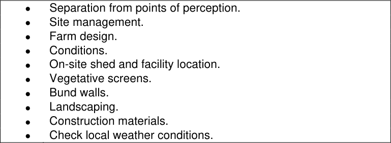
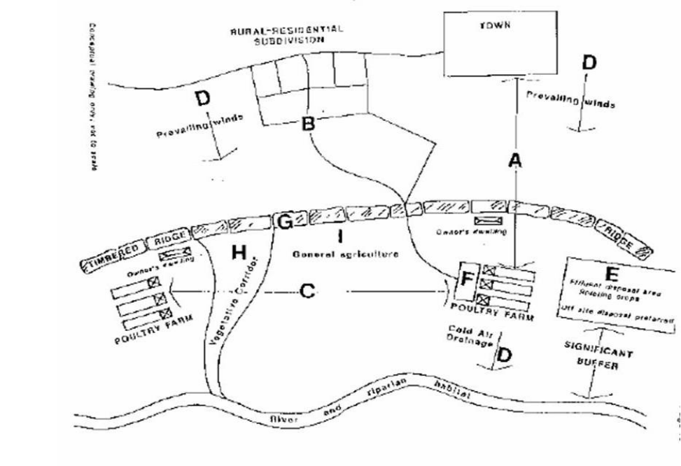

### 6.5 POTENTIAL IMPACTS ON SURROUNDING LAND USES, MINIMISATION OF IMPACTS – PLANNING ISSUES

#### 6.5.1 Potential impacts on surrounding land uses

Intensive poultry industries can result in conflict with nearby land uses, particularly residential activities, as a result of: odour; noise; dust; lights; and declining visual amenity.

The development application process addresses the potential conflicts apparent at the time of application lodgement. Development approval does not guarantee a right to continue to operate, even if the most advanced technology and management practices are employed. Relevant pollution control legislation such as the Protection of the Environment Operations Act shall be complied with at all times.

For these reasons it is recommended that poultry operations locate in isolated areas and that operators be aware of proposed developments in proximity to their boundaries.

#### 6.5.2 Impact Minimisation

Poultry sheds and facilities require isolation from other land uses to reduce potential adverse impacts on community amenity and to ensure poultry health.

#### Community Amenity

In order to prevent conflict between the poultry farm and surrounding land uses, separation distances shall be carefully considered.

The separation distance between the source of the impact (odour, dust, noise or lights), and each receptor will be a function of:

• the source and strength of the impacts;

• the number of receptors;

• receptor proximity to the development

• the prevailing local meteorological conditions; and

• the nature of the intervening terrain and vegetation.

Therefore, proposals for poultry farms require evaluation on individual merits due to the complexity of the determination of a separation distance. A merit based system will need to identify the sources of potential conflict, methods of impact amelioration and make an assessment of the suitability of these methods. Table 1, below, identifies the types of impacts and the sources of these impacts, while Table 2 identifies the general amelioration principles by which these proposals shall be assessed. It should be noted that this list is not exhaustive and depending on the location and type of farm proposed the relevance of these factors will change.

#### Recommended separation distances for proposed adjoining land uses and poultry

developments are provided in Part C: General Guidelines, Chapter 4: Land Use Conflict & Buffer Zones. These figures are a guideline only, and effective distances will depend on the nature of the site and surrounding land uses and the methods proposed to reduce impact.

Table 1: Impacts & their sources: Assessment of Poultry Development Proposals.

| Impacts | Sources |
|---|---|
| Lights | Laying sheds; vehicles and machinery. |
| Noise | Vehicles; plant and machinery; stock; feed mills. |
| Odour | Wet manure, birds and feed; burning of waste; bird odour; dead birds; chemicals and feed; manure/litter stockpiles; waste utilisation areas. |
| Dust | Feed deliveries; vehicles; manure stockpiles; site operations; feed mills. |
| Visual | Untidy site; obtrusive structures, such as plain metal feed hoppers. |

Source: NSW Agriculture, 1993.

Table 2: General principles for the amelioration of adverse impacts.

> [Picture on page 11: a picture, saved as a picture (images/part-d6-poultry-farms-neighbouring-land-uses-page-11-25.gif, 150 dpi).]
> Words printed on the picture (title and legend, copied from the PDF):
> • Separation from points of perception.
> • Site management.
> • Farm design.
> • Conditions.
> • On-site shed and facility location.
> • Vegetative screens.
> • Bund walls.
> • Landscaping.
> • Construction materials.
> • Check local weather conditions.

Source: NSW Agriculture, 1993.

Figure 1 (below) demonstrates the practical application of many of these principles.

While the selection of a site with one or more unfavourable environmental parameters is not encouraged, some site disadvantages can be overcome or reduced by appropriate engineering works or superior management practices. Where such a site is chosen, design features will need to clearly demonstrate how the site disadvantages will be overcome. Performance of these sites will require close monitoring.

#### Figure 1: General Principles for the amelioration of adverse impacts

> [Picture on page 12: a picture, saved as a picture (images/part-d6-poultry-farms-neighbouring-land-uses-page-12-8.gif, 150 dpi).]

Explanatory Notes

A Large separation distance to established residential areas is required. B Urban development, increasing allotment size close to poultry development and maintenance of suitable setback is required.

C Suitable separation distance between poultry houses. D Prevailing winds away from established residential areas. Cold air drainage away from established residential areas.

E On-site effluent disposal areas (if adopted), to:

• be located on suitable land;

• have adequate area for rotations;

• have adequate nutrient harvesting;

• be separated from sensitive sites (eg. waterways); and

• be monitored.

F Vehicle parking, turning and loading area screened to avoid headlights disturbing poultry and neighbours and to reduce noise nuisance.

G Visual screening by trees and topography. H Native vegetation to be linked to allow for movement of fauna. I General agricultural activity is compatible with poultry development and is a suitable surrounding land use.

#### Poultry Health

Poultry health can be affected by surrounding land uses and the size of the farm tends to determine the required separation distance from roads, property boundaries and other poultry farms. Farm sizes are defined in Table 3 while recommended separation distances are given in Table 4. The issues facing large farms are more complex and therefore, suitable separation distances should be assessed on individual merits.

Managers of established farms should be aware of proposed poultry developments in proximity to their operation and should raise any concerns over the encroachment of other farms during the development application process.

Table 3: Sizes of Poultry Farms.

|  | Small | Typical | Large |
|---|---|---|---|
| Broilers |  |  |  |
| Sheds | 1 - 2 | 3 - 5 | > 5 |
| Birds | < 45,000 | 45,000 – 75,000 | > 75,000 |
| Floor area (m²) | < 4,000 | 4,000 – 6,500 | > 6,500 |
| Layers |  |  |  |
| Birds | < 10,000 | 10,000 – 30,000 | > 30,000 |
| Floor area (m²) | < 600 | 600 – 1,800 | > 1,800 |
| Breeding farms |  |  |  |
| Birds | < 15,000 | 15,000 – 25,000 | > 25,000 |
| Floor area (m²) | < 4,000 | 4,000 – 7,000 | > 7,000 |

Source: Draft NSW Poultry Farming Guidelines, NSW Agriculture, 1993.

Table 4:  Recommended external separation distances for small and typical poultry farms for the purposes only of poultry health.

| Situation | Small Farm | Typical Farm |
|---|---|---|
| Property boundary | 50 metres | 50 metres |
| Well trafficked public road | 100 metres | 100 metres |
| Other poultry farms | 500 metres | 1000 metres |

As with all separation distances, the physical environment, design and management features will affect the suitability of the distance, therefore, the distances provided in Table 4 are given as a guide only.

Source: Draft NSW Poultry Farming Guidelines, NSW Agriculture, 1993.
