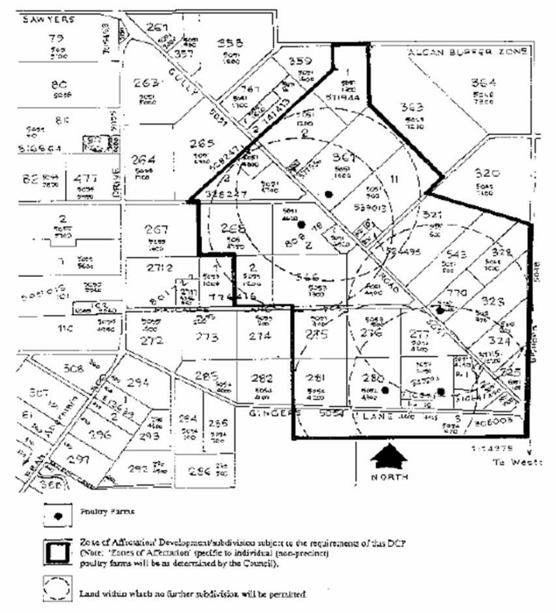
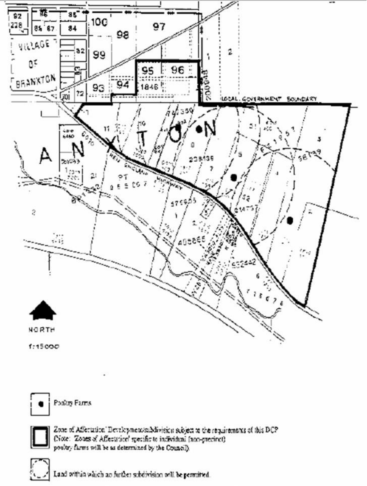

### 6.9 CONFLICT MINIMISATION

The development of land around existing poultry farms requires careful consideration to reduce the potential for conflict between land uses.

Table 5 demonstrates practical applications which are to be used to ensure that development on land in proximity to existing poultry operations is acceptable and which at the same time promotes a desirable environment for the new development.

Minimum recommended separation distances for developments not listed in Part C: General Guidelines, Chapter 4: Land Use Conflict & Buffer Zones, will be merit based and dependent upon the nature of the development and site.

Figure 3 - Precinct 1 - Sawyers Gully

> [Picture on page 15: a picture, saved as a picture (images/part-d6-poultry-farms-neighbouring-land-uses-page-15-11.gif, 150 dpi).]

Figure 4 - Precinct 2 - Branxton - Greta.

> [Picture on page 16: a picture, saved as a picture (images/part-d6-poultry-farms-neighbouring-land-uses-page-16-2.gif, 150 dpi).]

Table 5: Potential Impacts - Conflict Reduction

| Potential Impact | Adjoining land uses can reduce conflict with existing poultry operations and promote a desirable environment for themselves. |
|---|---|
| Visual | * Where possible, site development out of the line of visual impact (eg. where topography / distance can prevent visual impact from occurring). * Provide vegetative screening between the sight line of the development and poultry operation. Existing vegetation can be utilised where suitable. * Design the building so that windows of frequently used areas (eg. dining, living and kitchen areas) do not face the poultry operation. |
| Noise | * Site the development at a reasonable distance from the poultry operation. * Use vegetative screening as an acoustic buffer to divert and filter direct noises. * Design the building so that any bedrooms, studies etc. do not face direct noise sources. * Locate site operations to reduce potential noise generation (eg. noisy machinery may need to be housed). |
| Lights | * Site the development at a reasonable distance from the poultry operation. * Use vegetative screening to soften the impact of lights. * Design the building so that any bedrooms do not directly face obtrusive lights, including on-coming vehicle lights. * Design site lighting to ensure lights do not affect existing farms (ie. by frightening poultry). |
| Odour | * Pay particular attention to lands in relation to the topography and microclimate of the area and ensure that the development is not sited in areas where concentrated odours can occur, such as: (1) downhill of a poultry farm where cold air drainage promotes channelling of strong odours; or (2) areas directly down wind of the poultry farm, particularly in summer. * Use vegetation to divert and diffuse pungent odours. |
| Dust | * Site the development at a reasonable distance from the poultry operation. * Pay particular attention to the relationship between lands in respect of the topography and microclimate (especially wind strength and direction) of the area and ensure that the development is not sited in areas where dust problems will occur. * Use vegetation to divert and diffuse any dust. |

When locating a new development in proximity to an existing poultry farm, consideration shall also be given to the potential impacts on the farmer. Greater personal stress, reduced quality of life and requirements for greater capital expenditure may all result from encroaching unsympathetic development. These impacts may contribute significantly to operation closure or relocation.

Chapter 6: Schedule 1

#### SCHEDULE 1

| Typical NPK levels (dry weight basis) of some wholly organic materials. |  |  |  |
|---|---|---|---|
|  | Nitrogen (N) % | Phosphorus (P) | Potassium (K) % |
| Poultry manure (litter) | 2.6 | 1.8 | 1.0 |
| Poultry manure (cage) | 3.1 | 2.5 | 1.6 |
| Cow Manure | 1.5 | 0.5 | 1.2 |
| Sheep Manure | 1.7 | 0.5 | 1.2 |
| Blood and Bone | 5.3 | 5.2 | - |
| Seaweed (kelp) | 0.2 | 0.1 | 0.5 |
| Fish Meal | 10.4 | 2.5 | - |
| Rat Guano | 13.0 | 2.3 | - |
| Sewage Sludge | 2.0 | 1.0 | - |
| Dried blood | 14.0 | - | - |
| Hoof and horn meal | 13.0 | - | - |

Source: Agfact AC.20 Organic Fertilisers - An Introduction, 1992.
