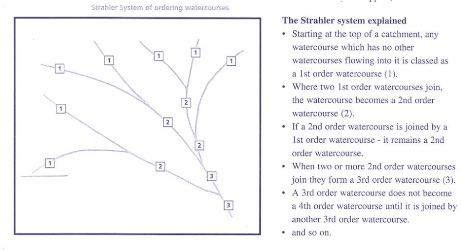

### 7.2 HOW TO USE THIS SECTION

#### 7.2.1 Consent authorities

Council's development approval is required before the construction of most types of dams, noting CLEP, Schedule 2: Exempt Development, for exemptions.

You will need to apply to Council for development consent for a dam where the dam (or an extension to an existing dam) is:

1\. one of the types of dams listed below that require a Department of Environment, Climate Change and Water (DECC&W) approval; or

2\. to be located on a 1st or 2nd order watercourse (this includes off-stream structures within the catchment of 1st or 2nd order watercourses) over 0.5 megalitres (500m3); or

3\. an off-stream structure licenced under the Water Management Act 2000, to hold water extracted from a river or groundwater; or

4\. an off-stream structure in the Pokolbin Private Irrigation District; or

5\. any structure licensed under the Protection of the Environment Operations Act, 1997.

Examples:

1\. A roughly circular dam approximately 2 metres deep, 25 metres wide and 30 metres long is just below 1200 litres in size.

2\. A square dam approximately 2 metres deep, 25 metres wide and long is 1250 litres in size.

If the dam falls into one of these categories, you shall use this section to prepare your development application to submit to Council. You may also apply to Council for a Construction Certificate for the dam at the same time as making the development application.

Additionally, an approval from DECC&W may be required.

You will need to apply to DECC&W for an approval (under the Water Management Act 2000) where the dam (or an extension to an existing dam):

1\. exceeds the total Maximum Harvestable Right Dam Capacity (MHRDC) for your

property*1; or

2\. is located on 3rd order watercourse, 4th order watercourse or greater order watercourse*2; or

3\. is located on 1st or 2nd order watercourse*2 that has a permanent flow; or

4\. is an off-stream structure that is neither a harvestable rights dam nor a special exempt dam under the DECC&W Farm Dams Policy *3; or

5\. intercepts groundwater; or

6\. is fed from a spring with a permanent flow.

\*1: See 7.3 to calculate your MHRDC. *2: See 7.2.4 for information on watercourse / stream order definitions or see maps at Council. *3: See DECC&W Farm Dams Policy for full list of exemptions.

If your dam falls into one of the categories above, you will need to apply for an ‘integrated development application’, where the application you submit to Council will also be referred to DECC&W for their assessment.

Note:  If the dam is within 40 metres of a 3rd order watercourse or greater (even if it is to be

constructed on a 1st or 2nd order watercourse) then an approval may also be required under the water Management Act 2000.

Note:  Documents from DECC&W will be required to complete your application for this approval. This Chapter does not outline the considerations that DECC&W uses in assessing approval applications.

#### 7.2.2 Circumstances where a dam cannot be constructed

A dam shall not be constructed in the following areas:

a. areas of mass movement, as defined in Cessnock Land Resources Study;

b. areas of acid sulfate or potential acid sulfate soils;

c. endangered ecological communities;

d. areas of high salinity hazard; and / or

e. immediately below a sewer / septic outlet that cannot be moved or relocated.

#### 7.2.3 Stream Order

The following diagram and text describes the definitions of ‘stream orders’.  Note that the stream orders in the Cessnock City Council area can be viewed at Council.

> [Picture on page 4: a picture, saved as a picture (images/part-d7-construction-of-dams-page-4-4.gif, 150 dpi).]

(Source: Department of Land and Water Conservation ‘Farm Dams Assessment Guide’)

#### 7.2.5 Other legislation or policy which may apply to your application

The following table outlines other legislation or policy that may affect your application. Matters should be discussed with Council if you consider that any of these may affect your application. Please note that this list was current at the time of writing of this Chapter and that you should check if there are any extra requirements.

| Issue | Legislation / policy that may apply | What action do I need to take? |
|---|---|---|
| Dam is on Crown Land. | Crown Lands Act 1989 | Dept of Water & Energy consent, as owner is required to lodge the development application. |
| Dam will impact on threatened species, endangered populations or endangered ecological communities. | Threatened Species Conservation Act 1995 and / or Environmental Planning and Assessment Act 1979 | See Council regarding Threatened Species requirements / considerations. |
| Dam will involve clearing of riparian vegetation. Dam will impact on threatened species listed under the Fisheries Management Act. | Fisheries Management Act 1994, Native Vegetation Act 2003, & Environmental Planning and Assessment Act 1979 | See Catchment Management Authority (CMA) regarding clearing. See Council regarding Fisheries requirements. |
| Dam may have significant effect on matters of national environmental significance (eg. listed threatened species, migration species and World Heritage Areas such as Yengo National Park). | Commonwealth Environmental Protection and Biodiversity Conservation Act 1999 | Commonwealth legislation – see Council if consultation with Environment Australia is needed. Approval under EPBC Act may be required. |
| Dam will involve clearing of native vegetation. | Native Vegetation Act 2003 | Contact DECC&W and CMA - may need separate consent under Native Vegetation Act. |
| Dam will involve disturbance to koala habitat. | State Environment Planning Policy 44: Koala Habitat Protection. | Contact Council regarding requirements. |

| Issue | Legislation / policy that may apply | What action do I need to take? |
|---|---|---|
| Dam is for pollution control purposes | Protection of the Environment Operations Act 1997 | Contact Council & contact with the Environment Protection Agency may be required. |
| If dam is an ‘artificial waterbody’ as defined by Schedule 3 of the Environmental Planning and Assessment Regulation 2000 | Environmental Planning and Assessment Act 1979 and Regulation 2000 | Development may be ‘designated development’ – if so, an Environmental Impact Statement shall be prepared. See Council for details. |
| If dam involves fill being imported into the site and is therefore a ’waste management facility’ as defined by Schedule 3 of the Environmental Planning and Assessment Regulation 2000 | Environmental Planning and Assessment Act 1979 and Regulation 2000 | Development may be ‘designated development’ – if so, an Environmental Impact Statement shall be prepared. See Council for details. |
| If dam is an ‘extractive industry’ as defined as defined by Schedule 3 of the Environmental Planning and Assessment Regulation 2000 | Environmental Planning and Assessment Act 1979 and Regulation 2000 | Development may be ‘designated development’ – if so, an Environmental Impact Statement shall be prepared. See Council for details. |
| If dam has potential to disturb Aboriginal archaeology | National Parks and Wildlife Act 1974 | Licence required to disturb relics. |
| If unauthorised development and works have been undertaken. | Environmental Planning and Assessment Act, 1979 | Action may be initiated in situations where individuals or corporations have breached the Act. |
