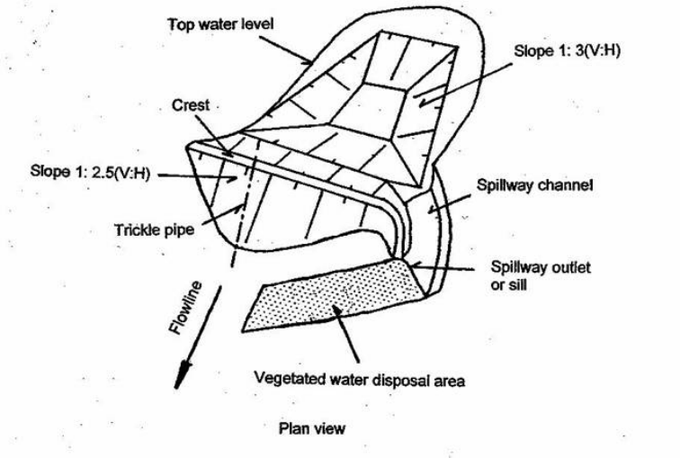

### 7.4 CALCULATE THE MAXIMUM HARVESTABLE RIGHT DAM CAPACITY (MHRDC)

Determining your MHRDC is just a matter of multiplying your property area by the factor shown for the locality of your property on the maps included with the Farm Dams Assessment Guide (the Cessnock area is reproduced at Map 1). The result of this calculation is the MHRDC for your property.

For example, a 200-hectare property at Wollombi will have a MHRDC of 17 megalitres. This is found by referring to the map, reading off (approximating) the multiplier (.085 megalitres per hectare) and multiplying this by the property area (200 ha). The property assessment guide in the ‘Farm Dams Assessment Guide’ brochure describes this calculation in more detail.

Note: The MHRDC applies to the total number of dams on a property – for example, one dam alone may not exceed the MHRDC, but the total number of dams on a property may together exceed the MHRDC.

#### Figure 1: Illustrative view of a dam

Note that although this plan is not required with a development application, it illustrates the typical components of a dam.

> [Picture on page 6: a picture, saved as a picture (images/part-d7-construction-of-dams-page-6-4.gif, 150 dpi).]

Source: Department of Land and Water Conservation, 2002
