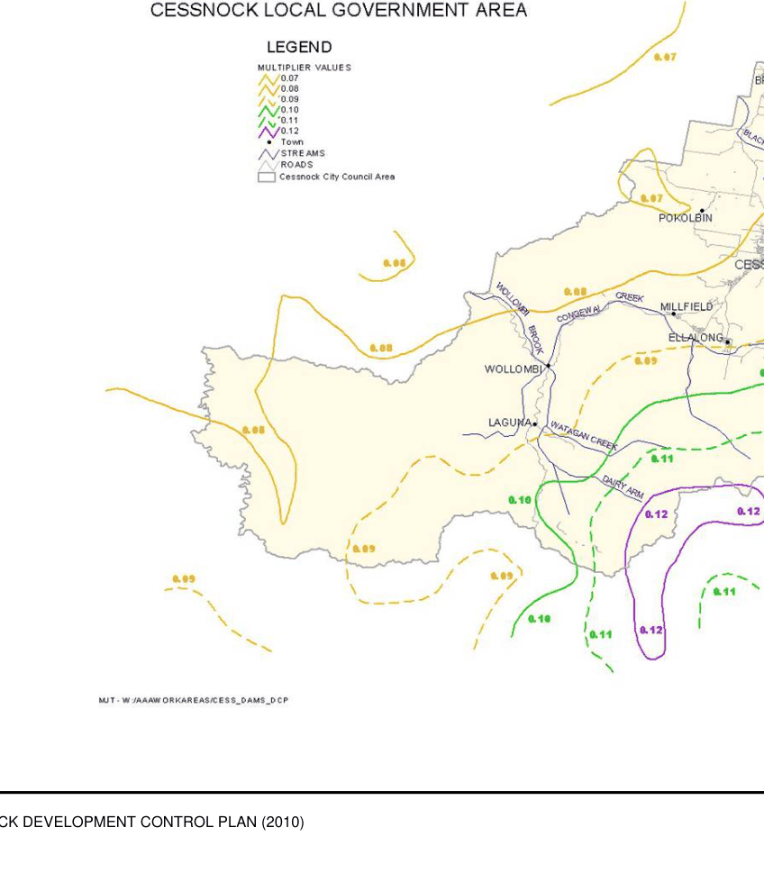

### 7.5 PERFORMANCE STANDARDS

#### 7.5.1 Location Requirements

The dam shall:

a. ideally be built in a depression, as this is generally the most favoured location due to its better storage to excavation ratio; and

b. not be constructed on slopes greater than 15% slope, because there is not usually enough suitable soil material to build a satisfactory wall.

(see 7.2.2 for locations where dams shall not be constructed)

#### 7.5.2 Construction Requirements

Dam construction should generally follow the construction principles outlined in the Earthmovers Training Course - Unit 10 Construction of Farm Dams.

(a) Crest

The width of the dam crest is to be a minimum of 3.0 metres for a 3.0 metre high dam wall. The crest should increase in width 0.5m for every metre above a 3.0 metre high dam.

(b) Freeboard

A minimum of 1.0 metre is to be established for freeboard. This should increase by 10% for every metre over a 3.0 metre high wall.

D.7-7

> [Picture on page 7: a picture, saved as a picture (images/part-d7-construction-of-dams-page-7-2.gif, 150 dpi).]

(c) Embankments

The material used to construct an embankment shall be sufficiently impervious to keep seepage low and to be stable. A soil with 25% clay content is in most cases suitable to form an impervious barrier.

a. The following soil types shall not be used for dam construction: sand; gravels; organic soils; peat; or highly erodible soils.

b. For dams over 5 megalitres in size, sufficient suitable soil material shall be available for wall construction. Sampling and evaluation of the subsoil at the proposed dam site, or of imported fill material, shall be undertaken to determine the quality and quantity of soil material.

c. Topsoil shall be stripped and stockpiled from the excavation and wall areas before the dam wall is constructed, with the stockpile located clear of any natural watercourse. All soil excavated above high water mark and the embankment is to be covered with a minimum of 100mm of top soil. During construction, a sediment fence shall be installed immediately below the area of soil disturbance and around stockpile of soil.

d. If the embankment is to be trafficked, it shall be certified by a geotechnical engineer. The embankment shall have suitable width, guideposts and barriers.

e. The embankment shall be completed with at least 100mm of topsoil. It shall be planted with a good holding grass such as couch. Trees or shrubs are not to be planted on or within 10 metres of the embankment as roots may provide seepage paths for water.

f. The slope of the upstream embankment batters shall be no steeper than the ratio of

2.5 horizontal to 1.0 vertical, while the downstream batter shall be no steeper than 3.0 horizontal to 1.0 vertical. However, if the dam is within 100 metres of a dwelling-house and is not fenced, then the upstream batter shall be no steeper that 6.0 horizontal to 1.0 vertical.

g. The dam wall is to be adequately compacted at optimum soil moisture content by a sheep’s foot roller or similar in layers no greater than 150mm.

(d) Spillway

a. A spillway is required on all dams in order to pass surplus runoff around the dam which would otherwise pass over the embankment. The spillway shall be a minimum of 3.0 metres in width increasing in size dependent on the size of the dam and catchment. Generally, spillways are to be designed so as not to overflow more than half the depth of the freeboard.

b. The width of the outlet is not to be less than the inlet width to the dam. The spillway also is not to direct flows onto the downstream toe of the embankment.

c. The spillway area shall be turfed, stable and able to accept runoff flow. Other treatments may also be acceptable, for example concrete lining. The spillway cut batter should have a maximum steepness of 2.5 horizontal :1.0 vertical.

d. A small diameter (100mm) pipe is required to be installed through the embankment where spring flows or small flows of long duration occur to ensure that the spillway does not erode. Design details shall be provided if this is the case.

e. When surplus water flows through the dam spillway, there shall be a suitable place to return it to its normal flow line without causing erosion. If it is near a property boundary, flows shall leave the property in the same place that they did before the dam was built.

(e) Cut-off Trench

All dams are required to have a cut-off trench. The cut-off trench is to be constructed along the entire length of the base of the embankment at a minimum width of 2.0  metres or 1.5 times the height of the dam, whichever is the largest. The trench shall be excavated at least

1.0 metre into impervious soil and backfilled and compacted with impervious material.

(f) Vegetation Filters, Tree Planting and Aquatic Plants

a. Water running into the dam shall be passed through a fenced and well-grassed filter

zone. The vegetation in this area will filter out much of the unwanted material like silt, fertiliser, manure, dead vegetation and litter and rubbish. Farm dams, where cultivating exists, shall include a silt trap.

These simple vegetation filters operate all year round and are especially effective when storm runoff would otherwise carry debris into the dam.

b. A gate shall be provided in the fence so that the filter area can be renovated by light grazing during rapid growth seasons. Prolonged grazing in dam catchments has potential to cause algal and weed growth in the dam due to the introduction of nutrients from manure.

c. Where silting of the dam is a problem, vegetation filters of stiff long-stemmed grasses can be used with silt traps to reduce water velocity and cause more silt to be trapped before it enters the dam. A typical silt trap is about one-tenth the size of the dam.

d. A fence around the dam wall and spillway can improve water quality downstream of the dam.

e. Trees around the dam can help reduce evaporation and reduce the growth of undesirable water weeds and algae. However, they shall be at least 10 metres from the embankment.

f. Dams located in flow lines or 1st order watercourses can result in movement of nutrients to downstream waterways. Dams in these locations shall incorporate a constructed wetland to reduce nutrient loads to receiving waterways.

(g) Hydrological Aspects

a. To minimise the threat of contamination to groundwater, the dam shall be clay lined and dam construction shall be above the watertable.

One of the main hydrological concerns with dam construction is the potential for the excavation to intercept the groundwater causing direct hydraulic interaction with surface waters. Potential concerns include impacts on the groundwater resource through evaporation losses and contamination.

Contaminants can enter the groundwater with little or no attenuation via the dam. As runoff would be directed towards the dam any animal wastes, fertilisers, or other agricultural chemicals could contaminate the groundwater.

b. All excavations which intercept the groundwater are required to be licensed by DWE under the Water Management Act, 2000.

#### 7.5.3 Erosion and Sediment Control

a. The development’s construction shall comply with:

• Council’s ‘Engineering Requirements for Developments’;

• Conservation and Land Management’s ‘Urban Erosion and Sediment Control’;

• Landcom’s ‘Soil and Water Management for Urban Development; and ‘Managing Urban Stormwater, Soils and Construction’.

b. Care shall be exercised during the construction of dams involving excavations and leading to exposed areas which may be sources of sediment and associated nutrient mobilisation by strong winds or heavy rain. These areas need to be stabilised and planted down with a vegetative cover or regularly wetted to prevent erosion. Spillway areas also need to be carefully constructed and vegetated, preferably to spread water spilling from the dam rather than having a focused single point release that any lead to erosion below the spillway.

c. Erosion and sediment control devices are to be installed prior to construction and maintained to ensure that there is no increase in downstream levels of nutrients, litter, vegetation debris or other water borne pollutants.

#### 7.5.4 Vegetation Impacts

See Part C: General Guidelines, Chapter 2:  Flora and Fauna Survey Guidelines.

#### 7.5.5 Salinity Impacts

a. Identified discharge sites are not to be cleared of existing remnant vegetation.

b. Unsealed dams shall not be constructed in designated recharge areas. Information about sealing of dams shall be obtained from DECC&W.

c. In areas showing signs of saline water logging and / or areas with shallow saline groundwater (depth to groundwater less than 2.0 metres), salt tolerance limits shall be investigated in relation to the proposed use before the dam is constructed.

#### 7.5.6 Dam safety

Proximity to dwelling houses

Where dams are to be within 100 metres of a dwelling-house, the dam shall have a maximum upstream batter slope of 6.0 horizontal to 1.0 vertical.

Dam Safety Committee

The requirements of the NSW Dams Safety Committee shall be met.

The Committee’s main objective is ’to ensure that all prescribed dams in NSW are in such a condition as to not pose an unacceptable danger to downstream residents and property, nor to adversely affect the public welfare and environment.’ The Committee advises that “… the ultimate responsibility for the safety of a dam lies with the dam owner”.

Source: Dams Safety Committee Information Sheet No.5 ‘Advice on Legal Matters for Dam Owners’

Further information on the NSW Dams Safety Committee can be found at www.damsafety.nsw.gov.au.

#### 7.5.7 Visual Impacts

A consideration of the visual impacts of the dam shall be made. The visual impacts on and from the following shall be considered:

• neighbouring and adjoining properties;

• items of the environmental heritage and other buildings or places with heritage significance; and

• visual impact from roads and other public spaces.

#### 7.5.8 Pokolbin (Hunter Wine Country) Private Irrigation District

Dams within the Pokolbin (Hunter Wine Country) Private Irrigation District (PID) shall comply with the Property Management Plan prepared as part of the District’s Strategic Irrigation Management Plan.

#### 7.5.9 Compliance with other legislation and policies

The application shall comply with all requirements of other relevant legislation and policies. A list of other legislation and policies that may affect your dam construction (see 7.2.4).

#### 7.5.10 Impacts on neighbouring properties

The potential impacts of the dam on neighbouring properties during construction and post construction shall be considered.  These impacts are:

1\. Visual impacts (see section 7.5.7 above);

2\. Runoff – the potential for runoff from the spillway onto neighbouring properties shall be satisfactorily addressed. Release of polluted waters (eg. salt, sediment or pollutants) shall be avoided;

3\. Stability – the impacts on neighbouring properties and nearby buildings if the dam should fail shall be considered;

4\. Fences – the construction and siting of the dam shall not interfere with the siting of boundary fences and their reasonable access for maintenance.

5\. Flows  - shall leave the property in the same place that they did before the dam was built. Also, flow shall not be concentrated onto adjoining properties unless it occurred prior to the construction of the dam. Dams shall not be located so that any impounded water backs up across property boundaries.

#### 7.5.11 Areas affected by underground mine workings

Applications for dams proposed to be constructed in areas affected by underground mine workings will be referred to the Mine Subsidence Board for their comment.

#### 7.5.12 Reinstatement / rehabilitation of dams and dam sites

Any threat proposed by the previous dam shall be removed. Details of the decommissioning of the dam and the rehabilitation of the site shall be submitted to Council.

#### 7.5.13 Cumulative Impacts

The cumulative impacts of dam construction on catchments shall be considered. These include:

• the cumulative impact of a decreasing flow to the Hunter River and other sub-catchments to maintain a suitable environmental flow;

• cumulative visual impacts; and

• the cumulative impact of loss of riparian vegetation.

#### 7.5.14 Additional information regarding dam maintenance

While these are not performance standards that will be assessed by Council, the following information will assist in managing your dam:

1\. maintain grass on all areas of the dam, especially the inlet and outlet;

2\. check trickle pipe for blockages;

3\. avoid driving through or damaging spillway;

4\. spillways shall be kept well-grassed and free from debris. A build-up of debris in the spillway could reduce its capacity and cause the dam to be overtopped;

5\. do not allow trees or shrubs to grow on or near the wall. When trees growing on the wall die, the decomposing roots can form tunnels which lead to seepage and leaks and possibly to a piping failure of the structure. Shrubs also provide cover for rabbits which can damage the wall by burrowing.
