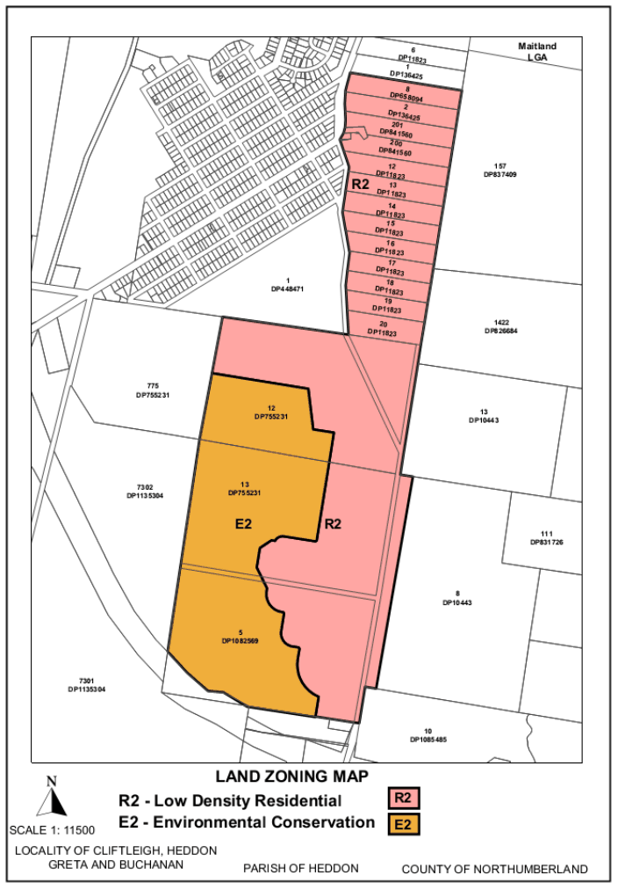

#### 13.1.1 Application

This Plan is called Averys Village and forms part of the Cessnock Development Control Plan

2010\. The Plan consists of the written statement and plans referred to in the document.

Figure 1 details the land to which the Plan applies (shown edged heavy black and zoned R2 Low Density Residential and E2 Environment Conservation).

The land is proposed to be subdivided to permit the development of dwellings. This Plan (chapter) was adopted by Council on 20 March 2013 and will come into force on the date of the New South Wales Government notification of the making of the Local Environmental Plan that applies to the land.

#### Figure 1: Site and Zoning Plan

> [Picture on page 4: a picture, saved as a picture (images/part-e14-averys-village-page-4-11.gif, 150 dpi).]
