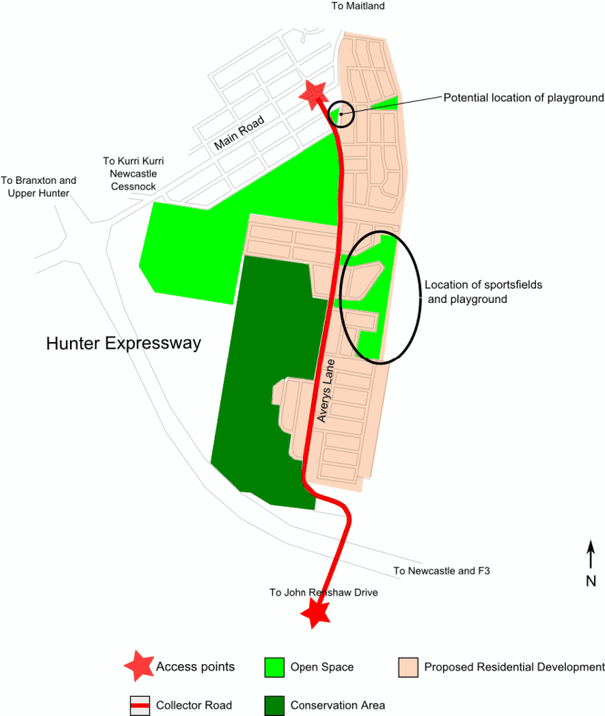

#### 13.1.4 Structure Plan

The Structure Plan at Figure 2 shows the basic development principles of the site.

It shows the development concept that applies to Averys Village. It provides guidance for individual developments to enable them to contribute to an overall development plan.

All development should demonstrate consistency with, and consideration of, the following development principles.

#### Objectives

(a) The development of Averys Village is well co-ordinated and efficient across a number of land parcels and owners.

(b) Averys Village is a seamless extension of the existing urban area.

(c) Walkable neighbourhoods provide convenient access to neighbourhood parks, community facilities and other services, with less dependence on cars for travel.

(d) Neighbourhood structure fosters a sense of community.

(e) Access is generally provided by way of an interconnected network of streets and paths which facilitate safe, efficient and pleasant walking, cycling and driving.

(f) New development supports the efficiency of public transport systems, and provides safe, direct access to the systems for residents.

(g) A variety of lot sizes and housing types cater for the diverse housing needs of the community at a density that can ultimately support the provision of local services.

(h) Key environmental areas such as waterways, vegetation, land resources, and areas of cultural significance and scenic value are maintained and enhanced.

(i) An integrated and sustainable approach is expressed in the design and provision of open space and urban water management.

(j) Cost-effective and resource efficient development promotes housing affordability.

#### Requirements:

(i) Consent will not be granted for development which is not generally consistent with the Structure Plan at Figure 2.

(ii) Subdivision lay out must not prejudice the ability of neighbouring sites to deliver the outcomes sought by this Plan, including infrastructure efficiencies, housing yield, environmental enhancement and connectivity.

(iii) Suitable legal access is to be provided to all land.

(iv) All road and drainage works within the site are to be designed and constructed to a standard appropriate for the proposed development and in accordance with Council’s Engineering Requirements for Development.

> [Picture on page 6: a picture, saved as a picture (images/part-e14-averys-village-page-6-16.gif, 150 dpi).]

#### Figure 2: Structure Plan
