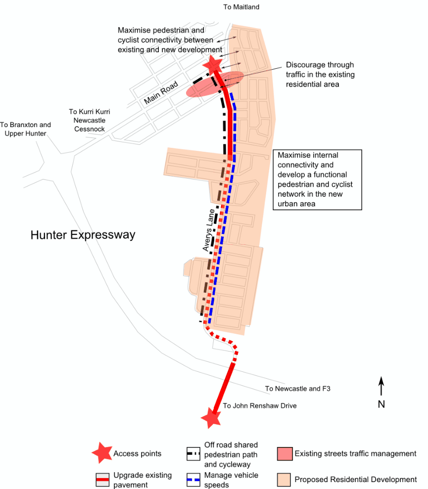
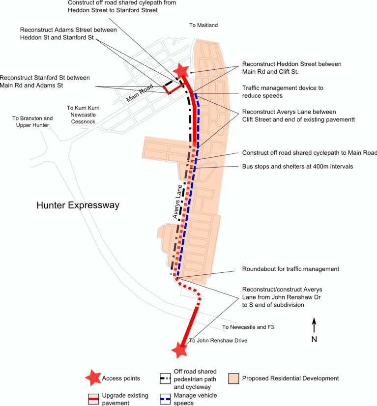

#### 13.1.5 Traffic, Road Design, Pedestrian/Cycleway Networks

The main road vehicle access routes to the site will be via Averys Lane: North to Heddon Street to access the Hunter Expressway, Kurri Kurri, Maitland and Cessnock, and South to John Renshaw Drive to access Kurri Kurri, the Hunter Expressway and Newcastle.

Averys Lane runs north-south and will provide the collector route through the release area with local roads forming a grid pattern to the east and west of Averys Lane.

Figure 3 shows the Transport Concept Plan for Averys Village.

#### Figure 3: Transport Concept Plan

> [Picture on page 7: a picture, saved as a picture (images/part-e14-averys-village-page-7-11.gif, 150 dpi).]

#### Objectives

(a) Residents have safe convenient vehicular, pedestrian and bicycle networks.

(b) Vehicular, cyclist and pedestrian connectivity is maximised within the Release Area and to other parts of Heddon Greta.

(c) Low vehicle speeds are encouraged throughout the Release Area.

(d) Public transport can be provided to the area.

(e) The impact of development on transport infrastructure outside of the Release Area is considered.

(f) Transport works arising from the development are supported by conditions of development consent, arrangements with Roads and Marine Services (RMS) and a Section 94 Plan.

(g) Legal and convenient access is maintained to adjacent rural properties.

#### Requirements

(i) Consent will not be granted for the subdivision of land unless a Transport Management Plan has been lodged to the satisfaction of the consent authority.  The Transport Management Plan should address such matters as traffic volumes, triggers for the provision of infrastructure and upgrades, an assessment of the impact of the development on the road system internal and external to the site and urban release area, pedestrian and cyclist networks, identification of road upgrades, intersection upgrades and the cumulative impact of development on the road network, at a minimum.

(ii) The road, cycle and pedestrian movement network is to be generally consistent with the concept plan shown in Figure 4.

(iii) The positioning and design of movement networks must give priority to: a facilitating efficient walking, cycling and public transport networks, and b retaining and complementing natural topography, such as views and drainage.

(iv) Pedestrian and cycle links are to be constructed to link to the existing urban area of Heddon Greta at the same time as the initial development of the land.

(v) An off road shared pedestrian path/cycleway is be to constructed as shown in Figure 4 as a stage towards the ultimate objective of connecting to the existing shared off road pedestrian paths/cycleways to the town centre and Kurri Kurri

(vi) Averys Lane is to be traffic calmed to reduce vehicle speeds.

(vii) Averys Lane is to be designed to allow its use as a public bus route and/or by school buses, including provision for buses to turn around if a “through route” is not likely.

(viii) Legal and convenient access to existing lots within or adjacent to the urban release area is to be maintained, unless the relevant landowner consents otherwise.

(ix) Subdivision road networks should have no dead ends unless unavoidable.  The use of low speed “share ways” to connect cul de sac heads and the like is acceptable.

(x) A number of offsite road, intersection, cycleway and pedestrian networks upgrades will be required in conjunction with the development of the land, such as those shown in Figure 4.

(xi) The following (but not limited to) should be provided in response to the anticipated demand generated by development on the site: a Progressive upgrading of the “access point” intersection of Main Road with Heddon Street that ultimately results in traffic control signals (RMS), including:

i. Right turn lanes on Main Road Heddon Greta (RMS), and

ii. Right turn lanes on Heddon Street at its intersection with Main Road (RMS);

b Upgrade of Heddon Street from Main Road to Clift Street to provide a 13m carriageway and associated drainage; c Upgrade of the “urban component” of Averys Lane to Clift Street provide a 13m carriageway and associated drainage; d Upgrade of Adams Street from Heddon Street to Stanford Street to a 9 m carriageway with associated drainage; e Upgrade of Stanford Street from Main Road to Clift Street to provide a 9 m carriageway and associated drainage; f Upgrade of Averys Lane south of the release area to John Renshaw Drive to provide an 11 m carriageway to rural standards; g Upgrade of the “access point” at the intersection of Averys Lane with John Renshaw Drive to incorporate a right turn lane for traffic entering Averys Lane (RMS); h Provide  traffic management works at the north connection to the subdivision (traffic calming); i Provide a single lane roundabout at the south connection to the subdivision (traffic calming/ intersection); j An off shared pedestrian path/cycleway along the full length of the ”urban” component of Averys Lane and Heddon Street to Main Road, and k An off road shared pedestrian path/cycleway along Main Road Heddon Greta from Heddon Street to Stanford Street.

Note:

1\. Also see Clause 13.1.11 Drive In Interface Requirements for additional road design/management requirements, particularly (vi).

2\. Also see Clause 13.1.1.14 Staging Requirements for additional transport related requirements, particularly requirements (iii), (iv) and (v).

#### Figure 4: Transport works

> [Picture on page 10: a picture, saved as a picture (images/part-e14-averys-village-page-10-2.gif, 150 dpi).]
