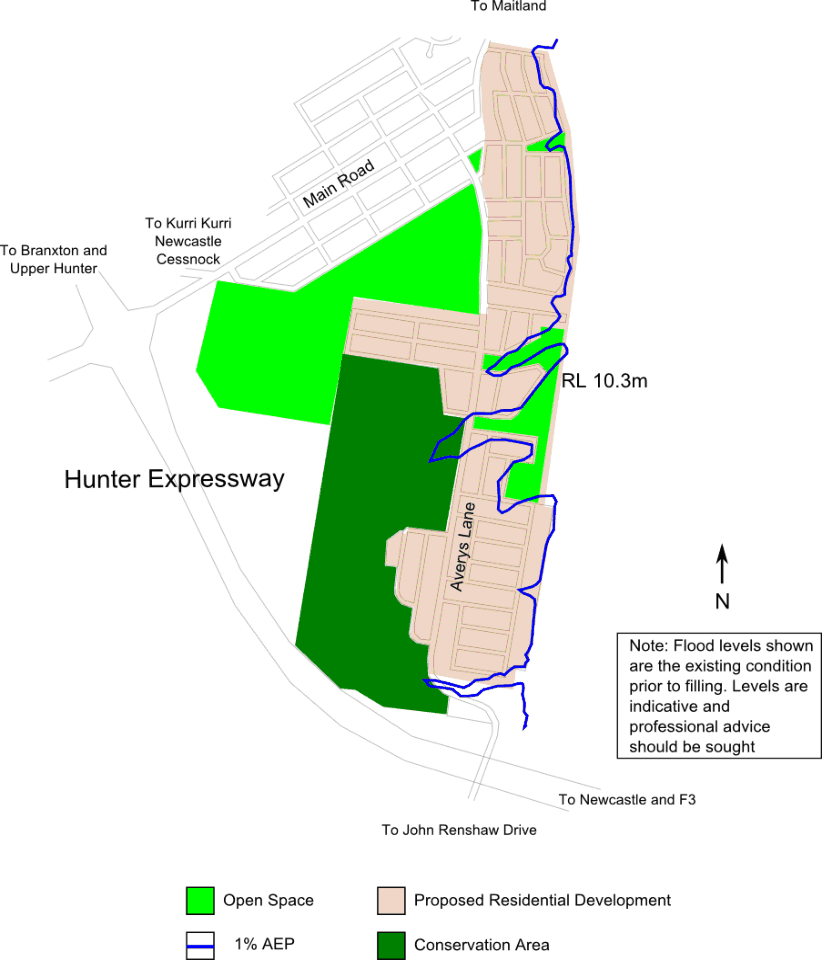
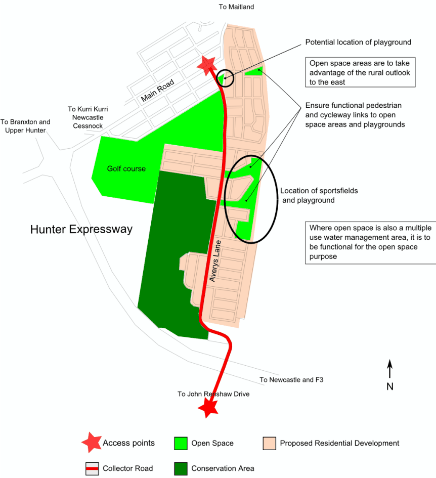

#### 13.1.6 Water Management Objectives

(a) The water balance of Averys Village is to be as close as practical to natural conditions.

(b) Water management should seek to provide an effective treatment train in the context of minimising Council’s long term maintenance requirements.  The treatment train should consider source controls, water quality, water volume, on and off site detention, instream treatment measures and the implications for receiving areas.

(c) Runoff flow rates from low intensity, common rainfall is equivalent to the runoff flow rates from a natural catchment.

(d) Runoff generated by more intense rainfall causes no downstream property damage or risk to public safety and to mimic the existing flow regime as near as possible.

(e) Development should not result in more run off than what existed prior to development for the 10 year ARI to 100 year ARI.

(f) Easements will be required to be negotiated between adjoining landowners if required.

#### Requirements

(i) Consent will not be granted for the subdivision of land unless a Water Management (Stormwater) Strategy has been lodged to the satisfaction of the consent authority, addressing the management of water quality and quantity (having regard to all contributing catchments and downstream water bodies), the 1% AEP Wallis Creek Flood Level, and the 1% AEP storm event.

(ii) The Water Management Strategy is to include, but is not limited to, water quality treatment measures to protect the quality of downstream receiving waters.  These measures may be provided at a subdivision level, allotment level, or a combination. The Strategy is to clearly outline the requirements for any allotment controls that will be required in any development application, including individual buildings.

(iii) The overall Strategy and its design detail is to consider the context of the site along with upstream and downstream impacts.

(iv) Water management strategies should aim to achieve a:

a. Reduction of erosion;

b. Reduction of flow velocity;

c. Reduction of runoff volume through at source controls and water quality treatment, and

d. Maximum infiltration (note: the nature of the soils at Averys Village may limit infiltration).

(v) Drainage easements may need to be provided.

(vi) Development is to comply with the provisions of Section 25 (Stormwater Management) of the Cessnock Development Control Plan 2010.

(vii) Development of land inconsistent with the Water Management Strategy can occur if the proposed measures are justified by a supporting study, to the satisfaction of the consent authority.  The supporting study must be lodged prior to or with the relevant development application.

(viii) The supporting study is to include (but is not limited to):

a. Hydrological and flood analysis of the proposed strategy;

b. Impact on the overall Water Management Strategy;

c. Impact on other future urban development within Heddon Greta;

d. Cost impact on Council (recurrent) and other future urban development (capital);

e. Impact on upstream and downstream land and buildings; and

f. Environmental impact.

(ix) The quantity of runoff flow rates of each stage of development is to be equivalent to the pre development state.  Council will assist in determining what is defined as a stage for the purposes of this clause.

(x) The quality of runoff should be in accordance with ARQ guidelines and Council Engineering Standards.

(xi) The water management strategy for the major watercourses is to be designed to appear as a natural stable stream in a riparian corridor. Existing major natural drainage lines and watercourses are to be retained wherever possible, and preferably rehabilitated through comprehensive re-planting with indigenous plant species, rather than being piped and filled.

(xii) Easements may need to be created in circumstances where water management infrastructure, such as detention basins, is located on land not included in that development. Easements are to be negotiated between adjoining landowners as required prior to the approval of the construction certificate of the development.

(xiii) Minimum floor level of any habitable space in a residential dwelling must be above RL 10.8 m to comply with Council’s Flood Standard for the locality. (RL 10.3 + 500mm freeboard)

(xiv) Development Applications for subdivision must demonstrate that suitable flood free access is available to all allotments

(xv) The design of stormwater management systems is to be undertaken in accordance with Cessnock City Council’s engineering requirements for development, unless otherwise varied by the content of this DCP.

(xvi) Design storms and flow rates shall be determined using the procedure in the current version of Australian Rainfall and Runoff.

(xvii) An underground piped drainage system is to be constructed within the road alignments to provide sufficient depth for lots to drain and shall be designed to convey the flow rate from the design 10 year Average Recurrence Interval (ARI) event.

(xviii) Additional piped drainage features (e.g. inter-allotment drainage lines) are permissible for areas other than roads within the development, where required and appropriate.

(xix) The combination of the pipe drainage network and water within the road reserve is to convey the 100 year ARI event.  The depth velocity product of surface water for the

100 year ARI event within the road reserve is to be less than 0.4m2/s unless special safety features are provided.

(xx) Cross drainage (culverts and bridges) shall be designed to convey the design critical

100 year ARI storm event.  The design of subdivision earthworks levels shall consider the potential increase in flood water as a result of the cross drainage structures, including an appropriate allowance for blockage.  Concessions may be granted for larger culvert diameters, open span bridges or where additional features (i.e. trash racks) are installed to reduce the likelihood and magnitude of blockage.

(xxi) Any drainage easements and reserves within the site shall be constructed and dedicated to Council (at no cost) at the subdivision stage or prior to occupation.

(xxii) Alternative methods and criteria for design of stormwater systems (for example, continuous simulation using rainfall data) may be proposed and considered on merit.

#### Figure 5: 1% AEP flood level

> [Picture on page 13: a picture, saved as a picture (images/part-e14-averys-village-page-13-11.gif, 150 dpi).]

#### Landscaping, Streetscape and Open Space Areas Objectives

(a) Open Space caters for a variety of recreational, aesthetic and environmental purposes.

(b) Open space can be easily maintained and managed.

(c) Open space should provide informal and formal settings.

(d) Landscaping responds to the natural topography and rural setting of the land.

#### Requirements

(i) Open space is to be provided generally in accordance with the Open Space Structure Plan at Figure 6.

(i) Consent shall not be granted for the subdivision of land unless a landscape plan has been lodged to the satisfaction of the consent authority.  The landscape plan is to be acceptable to the consent authority, and can be in the form of a concept plan at the development application stage and a detailed Plan at the construction certificate stage (this should be confirmed with the consent authority prior to lodgement of a development application for subdivision).

(ii) Such landscape plans should include:

a. details of the proposed landscaping of the public domain, including streets and open space;

b. A schedule of the species and the planting locations;

c. Technical details of the planting and initial maintenance regime;

d. An assessment of ongoing maintenance requirements;

e. Landscape treatments, including paving and street furniture, and

f. A guide to landscaping and plant species to be provided to prospective land purchasers.

(iii) Landscaping should showcase and/or frame the rural vistas to the east, and the wooded conservation area to the west, where possible.

(iv) The natural character of all ridgelines, knolls and hillsides are to be protected by retaining any vegetation or introducing new landscaping to minimise the visual impact of development within and adjacent to the visually sensitive areas.

(v) Natural watercourses are to be protected and revegetated where appropriate to enhance the visual amenity, prevent soil erosion, and to protect the quality of receiving waters and to improved connectivity of biodiversity corridors.  Riparian vegetation along watercourses is to be re-established using locally occurring native species from locally sourced seed stock.

(vi) Existing trees are to be retained wherever possible.

(vii) Street trees are to be planted to:

a. Soften the streetscape;

b. Act as traffic calming measures through perceived narrowing the road;

c. Provide shade to footpaths and roads, and

d. Enhance views.

(viii) Open space areas are to be linked by pedestrian and cycle paths to provide an accessible network of open space.

(ix) Two local parks each with an area of not less than 0.5ha with various facilities, including a playground should be provided, preferably at the general locations shown in the Open Space Structure Plan

(x) A sportsfield with an area of not less than 2 ha with various facilities including playfield and amenities block should be provided, preferably at the general location shown in the Open Space Structure Plan (Note: a site assessment should be undertaken prior to finalising the sportsfield location and design).

(xi) Multiple use open space should remain usable for its intended purpose, and not compromised for extended periods by such matters as wet soils.

(xii) Where possible, roads or laneways/shareways are to border open space areas in order to provide passive surveillance and access.

#### Figure 6: Open Space structure plan

> [Picture on page 15: a picture, saved as a picture (images/part-e14-averys-village-page-15-15.gif, 150 dpi).]
