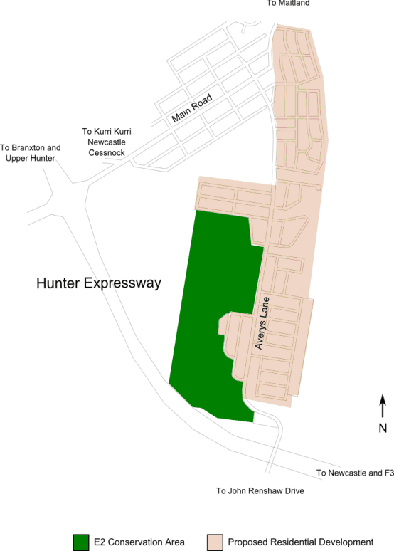

#### 13.1.8 Environmental Conservation Area Objective

The proposed E2 Environmental Conservation zoned area shown in Figure 7 is managed appropriately and protected in perpetuity.

#### Requirements

(i) Consent for the subdivision of the land should not occur until a Vegetation Management Plan (VMP) for the E2 Environmental Conservation Zone has been lodged, or an alternative mechanism is implemented to maintain the conservation values of the land in perpetuity (note: a Voluntary Planning Agreement is proposed for this land and may provide such a mechanism), to the satisfaction of Council.

(ii) The Vegetation Management Plan is to specify:

a. All proposed areas of Kurri Sand Swamp Woodland (KSSW) to be retained and connections to proximate areas of similar habitat to be reasonably

maintained on site;

b. Controls to protect the KSSW, creekline and any other areas conserved are implemented, including fencing, sediment control devices and appropriate signage;

c. Existing trees are to be retained where possible; consideration should be given to locating open space where it results in the retention of groups of existing trees;

d. Existing mature and hollow habitat trees should be identified on a plan and should be retained wherever possible;

e. Where a habitat tree needs to be removed, a clearing protocol for their removal is to be prepared and included in the Vegetation Management Plan;

f. Details of revegetation, restoration and weed control effort including the riparian corridors.  Areas affected by degradation, erosion and/or rubbish dumping should be rehabilitated subject to any conditions imposed by the consent authority;

g. All asset protection zones and stormwater retention basins are to be located outside the E2 Environmental Conservation zoned area, and

h. Fencing shall be installed surrounding the conservation area to control public access, and prevent rubbish dumping and use by recreational vehicles.

#### Figure 7: Land zoned E2 Environmental Conservation

> [Picture on page 17: a picture, saved as a picture (images/part-e14-averys-village-page-17-21.gif, 150 dpi).]
