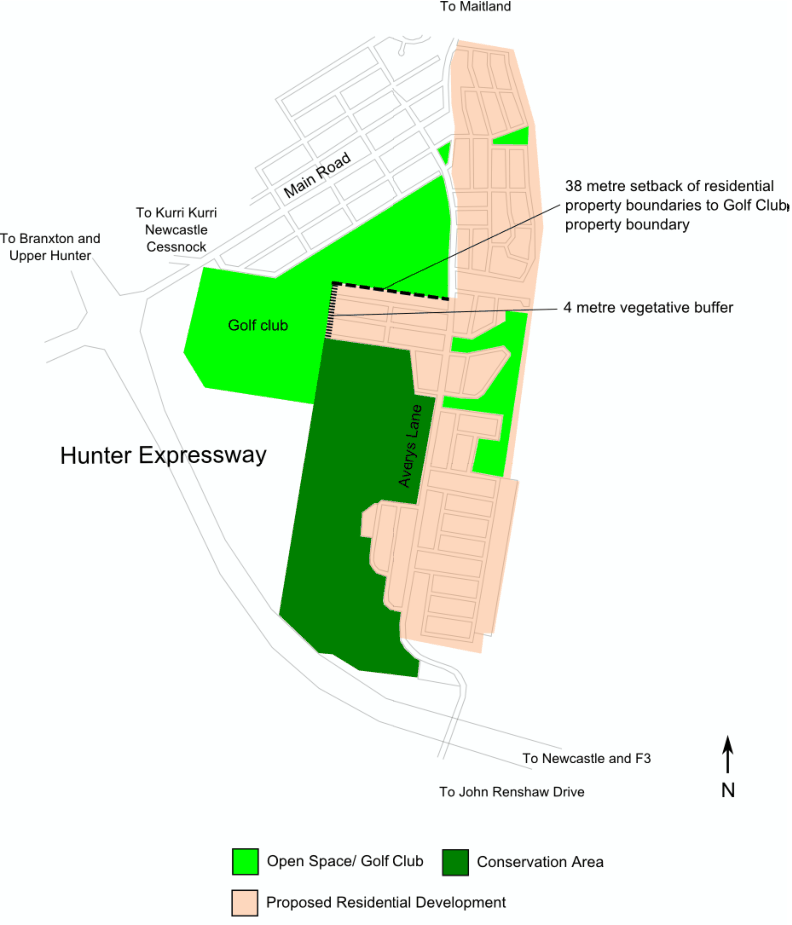

#### 13.1.11 Golf Course Interface Objectives:

(a) Future subdivision, allotments, residences and public spaces are to be located and designed to reduce hazards and negative amenity impacts arising from the operation of the Kurri Kurri Golf Course.

(b) Residential development has a minimal impact on the operation of the Kurri Kurri Golf Course.

(c) Risks are minimised to people and property from the operation of the Kurri Kurri Golf Course.

#### REQUIREMENTS

(i) Consent will not be granted for the development of land adjacent to the Kurri Kurri Golf Course unless a risk and amenity impact assessment has been undertaken by the proponent and appropriate design and management measures are proposed as part of the development, to the satisfaction of the consent authority.

(ii) A setback of not less than 38 metres will apply from the boundary of the Kurri Kurri Golf Course to the boundary of any residential lot as shown in Figure 8.

(iii) A vegetative buffer of not less than 4 metres will be provided within the residential zoned land along the boundary of the Kurri Kurri Golf Course as shown in Figure 8.

(iv) The requirements specified in clauses (ii) and (iii) above may be varied if the risk and amenity impact assessment, referred to in clause (i) above, provides justification of an alternative measure to the satisfaction of the consent authority.

#### Figure 8 Golf course interface

> [Picture on page 19: a picture, saved as a picture (images/part-e14-averys-village-page-19-16.gif, 150 dpi).]
