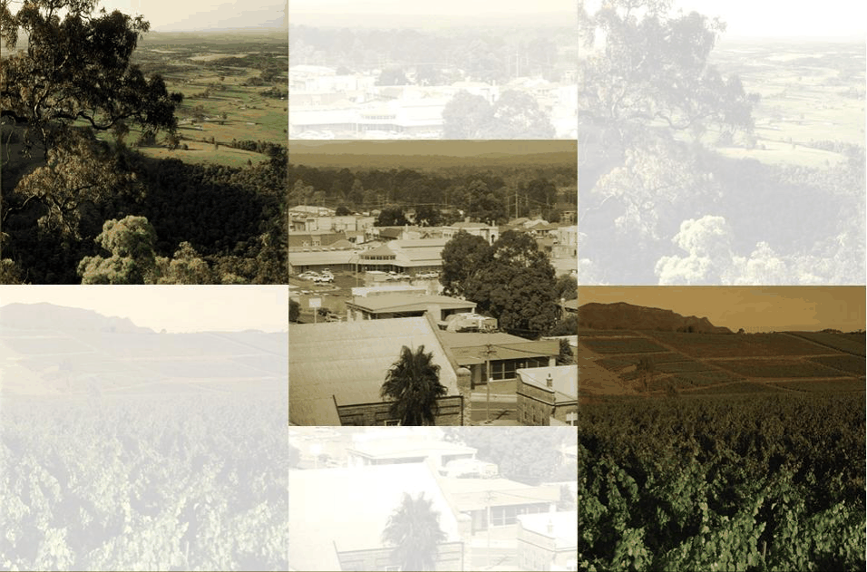

# Cessnock Development Control Plan 2010 - Part E14 Averys Village

> This chapter is split into 16 section file(s), one per numbered heading, in the order they appear in the PDF.

Source PDF: [E14 - Averys Village.pdf](https://planfortomorrow.sharepoint.com/sites/Planfortomorrow/Shared%20Documents/00%20NSW-Planning-Resources/dcp/cessnock-development-control-plan-2010/part-e14-averys-village/E14%20-%20Averys%20Village.pdf)

### CESSNOCK

### DEVELOPMENT CONTROL PLAN 2010

### PART E

### SPECIFIC AREAS

> [Picture on page 1: a picture, saved as a picture (images/part-e14-averys-village-page-1-5.gif, 150 dpi).]

### E.14: AVERYS VILLAGE, HEDDON GRETA

#### CONTENTS

#### E.1 AVERYS VILLAGE

#### Objectives:

#### 3

#### 13.1.1

#### 4

#### Application

#### 13.1.2

#### 5

#### Purpose of the Plan

#### 13.1.3

#### 5

#### Relationship with other Plans

#### 13.1.4

#### 5

#### Structure Plan

#### 13.1.5

#### 7

#### Traffic, Road Design, Pedestrian/Cycleway Networks

#### 13.1.6

#### 11

#### Water Management

#### Landscaping, Streetscape and Open Space Areas

#### 14

#### 13.1.7

#### 16

#### Biodiversity and Vegetation Clearing

#### 13.1.8

#### 16

#### Environmental Conservation Area

#### 13.1.9

#### 18

#### Bushfire Protection

#### 13.1.10

#### 18

#### Highway Noise & Vibration

#### 13.1.11

#### 18

#### Golf Course Interface

#### 13.1.12

#### 20

#### Drive In Theatre Interface

#### 13.1.13

#### 20

#### Heritage

#### 13.1.14

#### 20

#### Services

#### 13.1.15

#### 21

#### Staging

Figure 1: Site and Zoning Plan ............................................................................................ 4

Figure 2: Structure Plan ....................................................................................................... 6

Figure 3: Transport Concept Plan ....................................................................................... 7

Figure 4: Transport works.................................................................................................. 10

Figure 5: 1% AEP flood level ............................................................................................. 13

Figure 6: Open Space structure plan ................................................................................ 15

Figure 7: Land zoned E2 Environmental Conservation................................................... 17

Figure 8 Golf course interface........................................................................................... 19

<!-- sections -->
## Sections

1. [1.1 INTRODUCTION](01-1-1-introduction.md)
2. [13.1.1 Application](02-13-1-1-application.md)
3. [13.1.2 Purpose of the Plan](03-13-1-2-purpose-of-the-plan.md)
4. [13.1.3 Relationship with other Plans](04-13-1-3-relationship-with-other-plans.md)
5. [13.1.4 Structure Plan](05-13-1-4-structure-plan.md)
6. [13.1.5 Traffic, Road Design, Pedestrian/Cycleway Networks](06-13-1-5-traffic-road-design-pedestrian-cycleway.md)
7. [13.1.6 Water Management Objectives](07-13-1-6-water-management-objectives.md)
8. [13.1.7 Biodiversity and Vegetation Clearing Objective](08-13-1-7-biodiversity-and-vegetation-clearing.md)
9. [13.1.8 Environmental Conservation Area Objective](09-13-1-8-environmental-conservation-area.md)
10. [13.1.9 Bushfire Protection Objective](10-13-1-9-bushfire-protection-objective.md)
11. [13.1.10 Highway Noise & Vibration Objective:](11-13-1-10-highway-noise-and-vibration-objective.md)
12. [13.1.11 Golf Course Interface Objectives:](12-13-1-11-golf-course-interface-objectives.md)
13. [13.1.12 Drive In Theatre Interface Objective](13-13-1-12-drive-in-theatre-interface-objective.md)
14. [13.1.13 Heritage Requirement](14-13-1-13-heritage-requirement.md)
15. [13.1.14 Services Requirement](15-13-1-14-services-requirement.md)
16. [13.1.15 Staging](16-13-1-15-staging.md)
