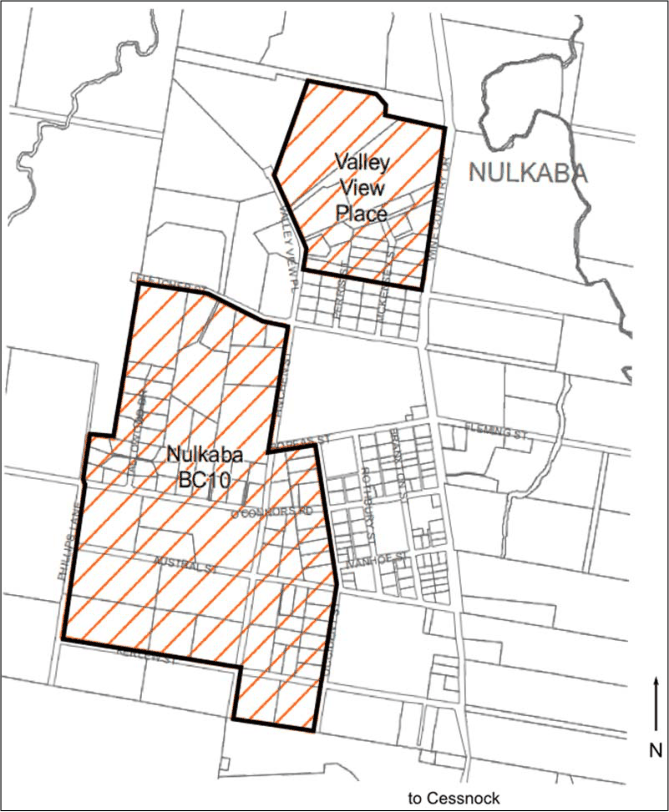

#### 13.1.4 Relationship to other Plans and Chapters of the Development Control

#### Plan

This Section supplements the provisions of the CLEP, and the other chapters of the CDCP.

This Chapter should be read in conjunction with all relevant Chapters of the CDCP and any other relevant Council policies.  A number of other Chapters are applicable to the site (e.g. residential subdivision guidelines) and in some instances the provisions of those Chapters are supplemented by additional guidelines in this locality specific chapter. Where there is an inconsistency between this Chapter and other Chapters of the CDCP, the provisions of this Chapter prevail. Where there is any inconsistency between this Plan and any environmental planning instrument, the provisions of the environmental planning instrument prevail.  An environmental planning instrument includes a State Environmental Planning Policy (SEPP), a Regional Environmental Plan (REP) and a Local Environmental Plan (LEP).

#### Figure 1: Boundary of BC10 and Valley View Urban Release Areas

> [Picture on page 5: a picture, saved as a picture (images/part-e15-nulkaba-urban-release-areas-bc10-page-5-13.gif, 150 dpi).]

Source: Cessnock LEP 2011
