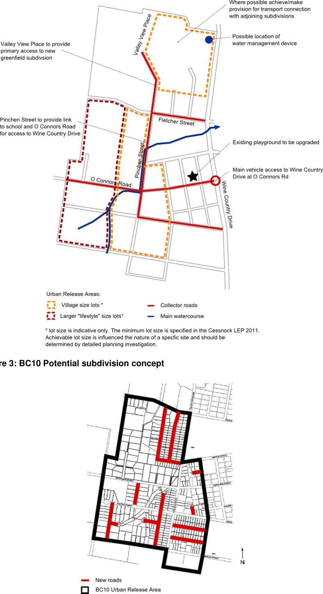

#### 13.1.5 Structure Plan

The Structure Plan at Figure 2 shows the basic development principles to apply to the land. It shows the development concept that applies to the Urban Release Areas and the surrounding suburb.

The Structure Plan provides guidance for individual developments to enable them to contribute to an overall development plan. All development should demonstrate consistency with, and consideration of, the following development objectives. Even though the RU5 zoning of part of the land permits a wide variety of land uses, it is considered that new development will consist almost entirely of residential uses. It should be noted that Wine Country Drive is a main road and that Road and Maritime Services (RMS) will limit access from individual properties to the road.

Objectives:

(a) The development of the Valley View Place and BC10 Urban Release Areas is well co-ordinated and efficient across a number of land parcels and owners, including in the context of the overall development of the suburb of Nulkaba;

(b) As much as practicable, the development of the Urban Release Areas provides a seamless extension of the existing village area of Nulkaba;

(c) Walkable neighbourhoods provide convenient access to a neighbourhood park and school, with less dependence on cars for travel;

(d) Neighbourhood structure fosters a sense of community;

(e) Access is generally provided by way of an interconnected network of streets and paths that facilitate safe, efficient and pleasant walking, cycling and driving;

(f) Development is compatible with the rural village ambience of the area, and

(g) Important environmental features such as waterways and vegetation are protected.

Requirements:

(i) Development is to be generally consistent the Structure Plan at

Figure 2.

(ii) Subject to detailed site investigation, applicants for subdivision in the BC10 Urban Release Area are encouraged to be guided by the subdivision concept at Figure 3 in order to optimise the sharing and efficiency of transport and other infrastructure

(iii) Infrastructure provision should be optimised at a catchment level in order to maximise sharing and the ease of expansion of infrastructure and utilities.

(iv) Subdivision layout must not prejudice the ability of neighbouring sites to deliver the outcomes sought by this Plan.

(h) Suitable legal access is to be retained where it already exists and provided to all new lots.

#### Figure 2: Nulkaba Structure Plan

> [Picture on page 8: a picture, saved as a picture (images/part-e15-nulkaba-urban-release-areas-bc10-page-8-2.gif, 150 dpi).]

#### Figure 3: BC10 Potential subdivision concept
